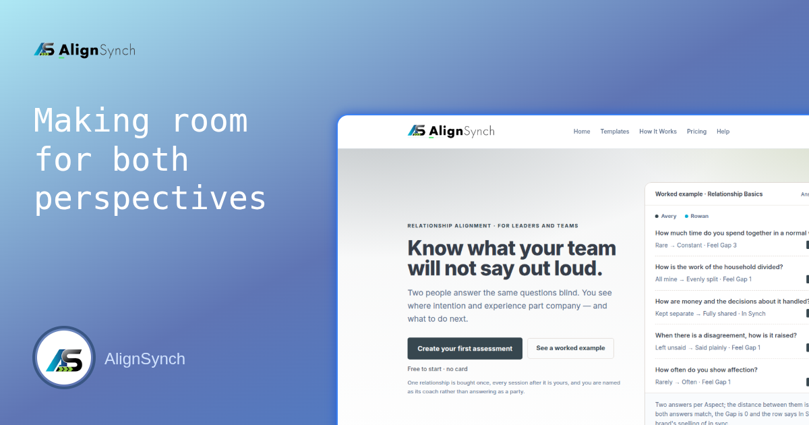
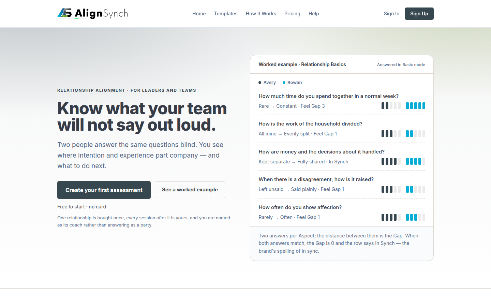
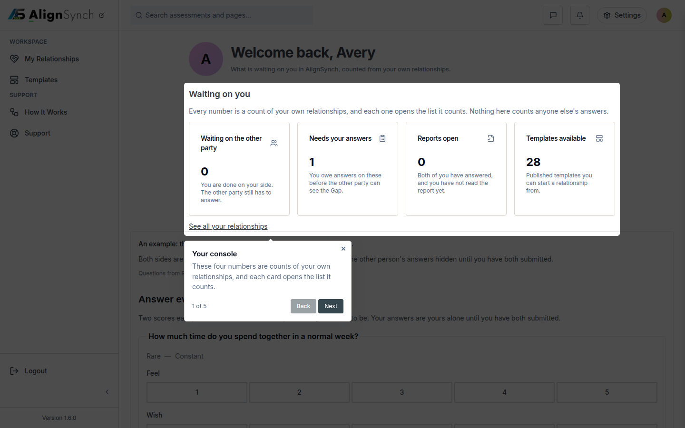
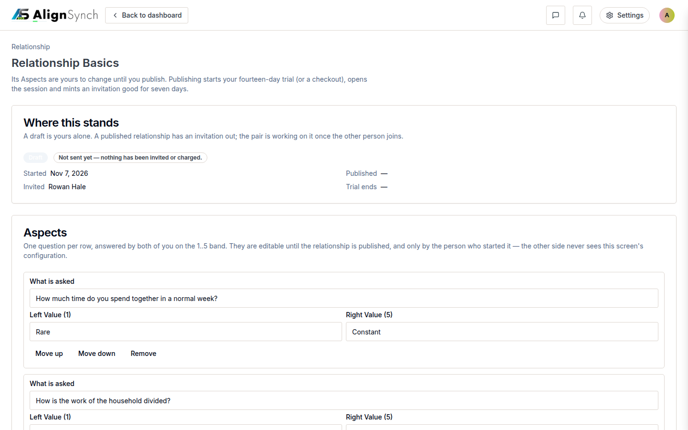
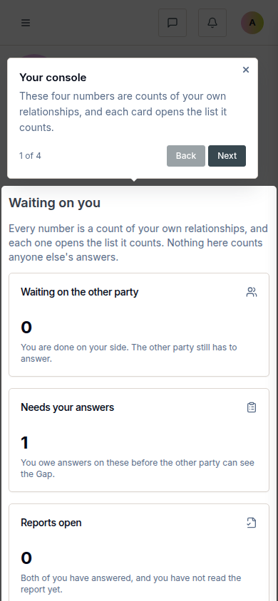
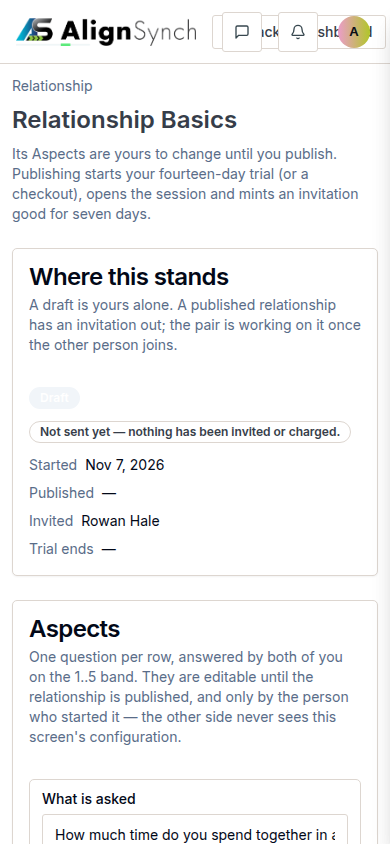
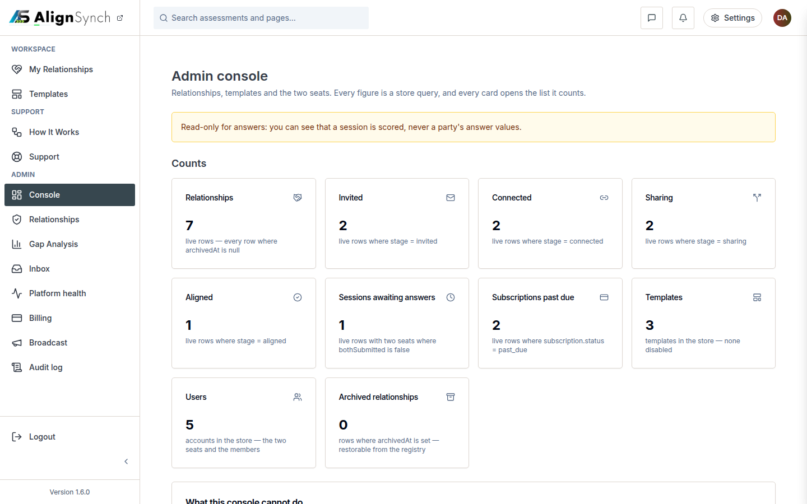
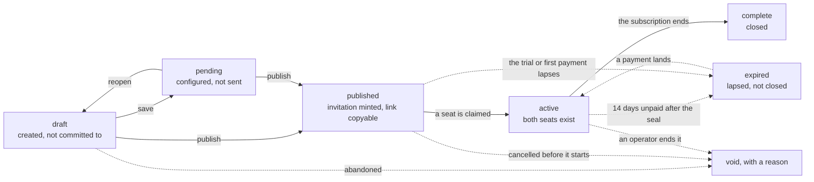
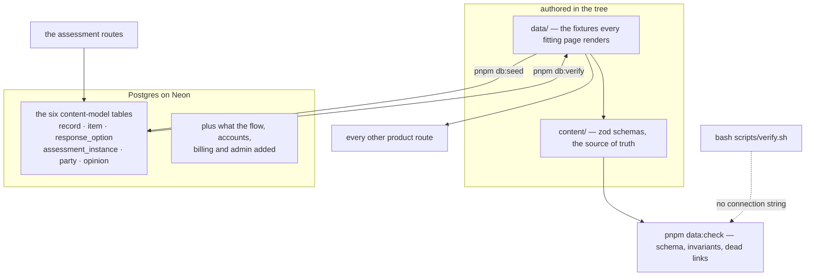

<p align="center">
  
</p>

<p align="center">
  <a href="#quickstart"><strong>Quickstart</strong></a> &middot;
  <a href="#where-the-docs-are"><strong>Docs</strong></a> &middot;
  <a href="https://demo.alignsynch.com/"><strong>Live demo</strong></a> &middot;
  <a href="AGENTS.md"><strong>Agent guide</strong></a> &middot;
  <a href="CHANGELOG.md"><strong>Releases</strong></a>
</p>

<p align="center">
  
  
  
  
  
  
  
  
  
</p>

# Two answers. One Gap.

AlignSynch asks two people the same questions about how they feel and how they wish things to be. Each
of them answers alone, and neither can read the other's sheet. Where the answers part is the **Gap** — a
difference of two opinions, computed on the page and stored in no column.

It is a relationship-alignment product for the person accountable for a relationship — a lead, a
manager, a partner, a coach — and it is built to be **used with someone**, not administered to them: one
starts it, the other accepts an invitation, and the report that compares them opens only when both sides
are sealed.

**Most tools ask you what you think of them. AlignSynch asks both of you, then shows the distance.**

This repository is the **template** that product is built from, not a single site: one Next.js core, one
route table, and a brand selected at build time — `BRAND=alignsynch` builds the product this page
describes. The doctrine behind that shape, and the three questions a new screen has to answer, is
[docs/guides/template-doctrine.md](docs/guides/template-doctrine.md).



Every screenshot on this page is a committed file under
[docs/assets/screens/](docs/assets/screens/README.md), captured at `1440×900` and `390×844` from the code
the registry's commit column names. The registry beside them carries the route, the viewport, the brand,
the date and the commit for each row, and `tests/docs-screens-registry.test.ts` fails when a row names a
file that is not on disk or a file has no row. Nothing here is a mockup.

## Start here

**What it is.** AlignSynch is a two-party relationship alignment platform: two people answer the same
questions in private, and where the answers part is the Gap the report draws. The tree is one Next.js
core that a brand record configures — `data/brand.ts` resolves the record, `BRAND` names which one a
build renders, and no screen checks the variable itself. Neon Postgres carries the database-backed
routes (six content-model tables, no ORM) and Neon Managed Auth owns identity; every other product
surface reads the content-first fixtures in `data/`. The architecture is in
[docs/README.md](docs/README.md); the agent-facing contract is [AGENTS.md](AGENTS.md).

**Status.** `1.20.1` on `main` (tag `v1.20.1`), [MIT](LICENSE). Every change is gated by
`bash scripts/verify.sh` — the same script CI runs, with the depth of the steps following the diff.

**Run it.** Node 24, or it does not start: `.nvmrc` pins `24` and `engines` pins `24.x`. `/usr/bin/node`
is 18.19.1 on the machines this tree was built on and shadows a newer runtime on `PATH`, so a Node 24
`bin` directory goes first.

```bash
export PATH="$HOME/.nvm/versions/node/v24.22.0/bin:$PATH"   # node 24.22.0 + pnpm 12.16.1
pnpm install --frozen-lockfile                              # the install CI runs
BRAND=alignsynch pnpm dev                                   # this build, on http://localhost:3000
bash scripts/verify.sh                                      # the gate; run it before you push
```

`BRAND=alignsynch` is not decoration on a local run: it is the flag that selects the AlignSynch record,
and a build that names no brand gets `data/brand.ts`'s own default record instead of this one.

`pnpm dev` and `pnpm build` must never run at once — both write `.next/`. The longer form, with the
database and `localhost`-origin notes, is <a href="#quickstart">Quickstart</a> below.

**Where to go next.**

| File                               | What it is for                                                  |
| ---------------------------------- | --------------------------------------------------------------- |
| [CONTRIBUTING.md](CONTRIBUTING.md) | running the gate, the lanes it prints, and how a PR is opened   |
| [SECURITY.md](SECURITY.md)         | reporting a vulnerability privately — never a public issue      |
| [LICENSE](LICENSE)                 | MIT: what you may do with this code                             |
| [docs/README.md](docs/README.md)   | the hub: every document, grouped by the question it answers     |
| [AGENTS.md](AGENTS.md)             | the command table, conventions and pitfalls an agent works from |

## How it works

|        | Step             | What happens                                                                                                                           |
| ------ | ---------------- | -------------------------------------------------------------------------------------------------------------------------------------- |
| **01** | **Start it**     | Pick a template, name both people. The relationship is a draft until the initiator publishes it — publishing mints the invitation.     |
| **02** | **Answer blind** | Each side fills in Feel and Wish for every Aspect. The sheet is private to its author; neither screen can read the other's.            |
| **03** | **Seal it**      | Answers freeze when both have answered _and_ accepted. The seal is a refusal (`409`) on a write, not a hidden button.                  |
| **04** | **Read the Gap** | The report opens for both: `Where you stand`, both parties' opinions, and the Gap on every Aspect against the Setting it was set with. |

The create flow itself is five stages — **Details · Settings · Aspects · Account · Invite** — and a
relationship is written as a `draft` at the end of it. The stage table, the fields and the tests that
hold both are [docs/specs/flow-stages.md](docs/specs/flow-stages.md).

## AlignSynch is right for you if

- ✅ You need to know what **two** people actually think of working together — not what one of them reports.
- ✅ You want the answer to be **arithmetic**, not a score somebody assigned: `gapOf(2, 5) === 3`, and `gapOf(4, 4) === 0` is In Synch.
- ✅ You run this with clients, a team or a partner, and it matters that **each side answered without seeing the other**.
- ✅ You want a **reusable template** per relationship type, and a catalogue of them behind one list.
- ✅ You want the operator side as well: an admin console whose every figure is a predicate over the rows it links to.

## The product, screen by screen

### The overview, and the numbers behind it

Sign-in lands on `/dashboard`: four counts — `Waiting on the other party`, `Needs your answers`,
`Reports open`, `Templates available` — each one a count over rows the linked list shows, so no total
exists without the list behind it. The rail carries the member's own shelves (`My Relationships`, `My
Assessments`, `My Templates`, `Library`, `Templates`) and the support group.



### One relationship, from draft to a live invitation

The relationship screen names the template, the two people, the state and the Aspects, and keeps the one
action that moves it in reach. Every field is editable by the initiator and by staff, and the edit panel
**prices an invalidation before it saves one** — changing a template on a relationship that already has
answers is not a silent edit.



### On a phone

The rail becomes a drawer below 768px and the card stacks. The same two surfaces at 390 wide:





### Both sides answer, and the sheets seal

The counterparty arrives on `/invite/<token>`, gets three steps that say who invited them, what happens
next and what each of them will see, and only then the account gate and the claim. Opening the link
claims nothing — the claim is a `POST` on the last step, so a token spent by a mail client's link
preview would not be a token wasted. The invitation expires in seven days, and re-inviting is
revoke-and-replace: a new token, and the old link answers `unknown` rather than `expired`. The whole
flow, route by route, is [docs/specs/two-party-flow.md](docs/specs/two-party-flow.md).

### The Gap is the report

`Where you stand`, `Both parties' opinions`, `The Gap between the two` — Aspect by Aspect, against the
Setting the relationship was created with. Both parties read the same report; there is no per-seat copy,
no export and no third opinion. A coach or operator can act on a relationship, and when they do the
report says so and the write lands in the audit log — but no operator opinion is ever a party's answer.

**The method opens it, the money waits.** The sheets seal first; the initiator puts a payment method on
file, and the report opens for both the moment that method exists — nothing is captured then. The charge
falls due seven days later and a decline is retried at day 1, 3 and 5; sealed-and-unpaid expires the
relationship on day 14, after reminders at day 3 and day 10. Every one of those windows is arithmetic over
a stored instant in `relationship_payment` ([lib/flow/payment.ts](lib/flow/payment.ts),
[docs/diagrams/payment.md](docs/diagrams/payment.md)). No card is charged in this deployment: the hosted
adapter runs **test keys** and the page says so.

### The admin console

The operator's overview: every figure is a predicate over the same relationship registry the list pages
draw, the card links to that exact filter in the URL, and the page ends with a panel saying what the
console cannot do rather than leaving it to be discovered.



The operator group of the rail sits beside it — `/admin/console`, `/admin/instances`, `/admin/gaps`,
`/admin/inbox`, `/admin/health`, `/admin/billing`, `/admin/broadcast`, `/admin/audit` and `/admin/docs`
— gated on the `product.admin` capability (`lib/brand-boundary.ts`). The growth model is deliberately
not a rail row: `/admin/growth` charts a _modelled_ business rather than this instance's, so it is
URL-only. The audit log records every audited write: who, at which rung, what it touched, and why.

## The flow, as a diagram

One relationship, seven statuses, and every transition attributable to a person. The status is the one
stored fact in this schema — `draft` and `pending` differ by nothing but intent, so no row could imply
them (the argument is at the top of
[0030_relationship_lifecycle.sql](db/migrations/0030_relationship_lifecycle.sql)). Everything else is
derived at read time: the invitation's expiry, the session's answering and sealed states, the Gap.



The full set — this lifecycle, the money ladder, the brand boundary, the data model and the gate's lanes
— lives in [docs/diagrams/](docs/diagrams), where one home keeps the pictures from drifting apart. The
transition table with its actors is [lib/relationship/status.ts](lib/relationship/status.ts).

## Where the data lives

Two sources, and the gate can see only one of them. The fixtures in `data/` are the authored source, held
to the zod schemas in `content/` by `pnpm data:check`; Postgres mirrors them, `pnpm db:seed` writes
`data/assessments.ts` into the tables, and `pnpm db:verify` proves the rows still say what the fixture
says. `bash scripts/verify.sh` **never opens a connection**, which is why CI can run it with no
`DATABASE_URL` at all.



The six tables are #145's, mirror `content/record.ts` and `content/assessment.ts` field for field, and
`lib/db/rows.ts` `safeParse`s every row back through the same schemas, so the model stays the single
source of truth. There is no ORM. The Gap has no column, no view and no generated column, and
`db:migrate` fails on the name.

## What AlignSynch is not

|                                    |                                                                                                                                       |
| ---------------------------------- | ------------------------------------------------------------------------------------------------------------------------------------- |
| **Not a psychometric instrument.** | A Gap is the difference of two self-reported scores. There is no norming, no validity claim, and no verdict the numbers cannot carry. |
| **Not an anonymous survey.**       | Both people are accounts, and the second seat is claimed by a single-use invitation — the invitation is the consent record.           |
| **Not a third opinion.**           | A coach or operator can act on a relationship, and the write is audited and drawn on the report. They never answer as a party.        |
| **Not multi-tenant.**              | A brand is a build, not a tenant. There is no i18n layer and no course schema.                                                        |
| **Not charging cards.**            | The checkout is real code against the billing port; the hosted adapter runs test keys, and the page says so on one line.              |

## Quickstart

**Node 24, or it does not start.** `.nvmrc` pins 24, `engines` pins `24.x` and CI reads `.nvmrc` — one
runtime stated in the places that decide it (issue #682). `/usr/bin/node` is 18.19.1 on the machines
this tree was built on — it shadows a newer runtime on `PATH` and every Next command dies under it.

```bash
nvm use                          # .nvmrc pins 24 — this is not a formality
node -v                          # must print v24.x
pnpm install --frozen-lockfile   # the install CI runs
BRAND=alignsynch pnpm dev        # next dev --turbo, http://localhost:3000
BRAND=alignsynch pnpm build      # next build; needs no connection string and no env file
BRAND=alignsynch pnpm start      # serve the build on port 3000
```

In a script or an agent shell there is no interactive `nvm use`; put a Node 24 `bin` directory first on
`PATH` instead (`$HOME/.nvm/versions/node/v24.22.0/bin`, for example). The package manager is pinned the
same way — pnpm 12.16.1, from `packageManager` — and `scripts/verify.sh` refuses another major before it
runs a single step.

**`pnpm build` succeeds with no database.** Only database-backed routes need a connection, and only at
request time: the pool is created on the first query and the auth server on first use, not at import.
That distinction is why the gate runs with no connection string attached — a build that needed a database
would leave every pull request unable to test itself.

**`127.0.0.1` is not `localhost`.** Neon Auth checks the request's `Origin` against the branch's trusted
list and pre-approves `localhost` on any port, so `http://localhost:3000` signs in with no configuration
while `http://127.0.0.1:3000` answers `403 INVALID_ORIGIN` unless the origin was added to that branch. A
`GET` is not origin-checked, so an untrusted origin can still _look_ signed in.

**Before you push, the gate.** The same script is the pre-push hook, so a Node 18 shell cannot push
either.

```bash
bash scripts/verify.sh          # THE gate. green = shippable
bash scripts/install-hooks.sh   # once per clone: pre-push runs the same script
```

It runs `deps → glossary → ui-registry → columns → release:check → changelog:check → docs:check →
md:check → email:bodies → qa:atlas:check → demo:flow:verify → nav:menu → env:check → bash -n →
whitespace → typecheck → lint → format:check → data:check → growth:check → demo:verify → test → parity →
build`, stops at the first failure and names it. The depth follows the diff —
`lane=docs|content|config|code`, highest wins, printed on every run — and `GATE_LANE=full bash
scripts/verify.sh` forces all of it after a dependency bump. CI runs this script, once per brand as a
matrix, and the required context `typecheck / lint / build` is reported by a `gate` job that only collects
the two legs; a check that lives only in the workflow YAML is a guaranteed red push.

## Where the docs are

| Start here                                                           | What it answers                                                            |
| -------------------------------------------------------------------- | -------------------------------------------------------------------------- |
| [docs/wiki/README.md](docs/wiki/README.md)                           | the code wiki: key concepts, module map, how a request becomes a page      |
| [docs/diagrams/](docs/diagrams)                                      | the five flow charts — lifecycle, payment, brand boundary, data, gate      |
| [docs/getting-started/demo.md](docs/getting-started/demo.md)         | the demo branch: how it is built, reset and bundled                        |
| [AGENTS.md](AGENTS.md)                                               | command table with verified results, conventions, pitfalls                 |
| [CHANGELOG.md](CHANGELOG.md)                                         | every release, generated from the commits and published as the notes       |
| [docs/assets/screens/README.md](docs/assets/screens/README.md)       | the current screenshot set — one row per surface — and how to recapture it |
| [docs/operations/gate.md](docs/operations/gate.md)                   | gate baseline, first-pass yield, the required-check ruleset                |
| [docs/glossary.md](docs/glossary.md)                                 | the domain's words, generated from the schema comments                     |
| [docs/ui-registry.md](docs/ui-registry.md)                           | every surface, its status, and which template claims it                    |
| [docs/reference/data-model.md](docs/reference/data-model.md)         | the content model: entities, invariants, strictness                        |
| [docs/specs/two-party-flow.md](docs/specs/two-party-flow.md)         | the assessment flow: create, invite, answer, unlock the Gap                |
| [docs/specs/flow-stages.md](docs/specs/flow-stages.md)               | the five stages of the create flow, field by field                         |
| [docs/guides/template-doctrine.md](docs/guides/template-doctrine.md) | one core, many expressions: the three questions a new surface answers      |
| [docs/guides/bundles.md](docs/guides/bundles.md)                     | a template or the demo dataset as one importable file                      |
| [docs/reference/billing.md](docs/reference/billing.md)               | the billing port, its adapters, and why test mode says so on the page      |
| [docs/operations/releasing.md](docs/operations/releasing.md)         | cutting a version: changelog entry, tag, GitHub Release, the deploy        |
| [docs/reference/env-spec.md](docs/reference/env-spec.md)             | environment, team, integrations, feature flags, the P1–P4 stage gates      |
| [docs/operations/repo-layers.md](docs/operations/repo-layers.md)     | lane table, classifier rules, build semaphore                              |

`AGENTS.md` is the agent-facing companion to this file. The two must agree on commands, the package
manager and the Node version; a command change belongs in both.

**The share card** at the top of this page is [docs/assets/og-image.png](docs/assets/og-image.png),
1200×630, committed byte for byte. The route crawlers are served from `app/opengraph-image.png`,
which `tests/brand-og.test.ts` pins.

## FAQ

**Do I need a database to build it?**

No. `pnpm build` passes with `DATABASE_URL` and `NEON_AUTH_BASE_URL` unset and no `.env.local`; the gate
never opens a connection. The database is needed by the routes that read it, at request time.

**What happens if one side never answers?**

The invitation expires after seven days, and a re-invite is revoke-and-replace — the old link stops naming
an invitation rather than claiming one exists. A relationship whose sheets sealed and whose fee never
landed expires fourteen days after the seal, after reminders at day 3 and day 10.

**Why a template rather than a single site?**

Because the core is the product ([docs/guides/template-doctrine.md](docs/guides/template-doctrine.md)): a
brand selects a record, not a page, so a second expression of the same core is a build rather than a fork
of the tree. `data/brand.ts` holds the records, and `BRAND` names which one a build renders.

**Is anything charged?**

No. The billing port, the adapters, the webhook and the entitlement read are all real; the hosted adapter
runs test keys and no card is charged.

**How much of this is mocked?**

`docs/ui-registry.md` counts **16** surfaces as `mock` — a surface whose numbers are literals rather than
a row under `data/` or a read through `lib/db/`. Each is named with its `status` in that page, and
`data/flags.ts` carries ten declared surface flags, each with a note saying what would have to exist
before it is on.

## Under the hood

| Layer         | What it is                                                                                                                      | Where         |
| ------------- | ------------------------------------------------------------------------------------------------------------------------------- | ------------- |
| Runtime       | Next.js 16.4.1, App Router, Turbopack                                                                                           | `app/`        |
| UI            | React 19, TypeScript 5 in `strict` mode, Tailwind CSS 3.4 and shadcn/ui over Radix                                              | `components/` |
| Content model | zod 4 schemas as the single source of truth; every type is `z.infer`red from them                                               | `content/`    |
| Fixtures      | the validated records pages render; `pnpm data:check` fails a build when one drifts from the schema                             | `data/`       |
| Data          | Neon Postgres over `pg`, forward-only SQL in `db/migrations/`                                                                   | `lib/db/`     |
| Auth          | Neon Managed Auth (hosted Better Auth), proxied at `app/api/auth/[...path]`; the app owns no users or sessions table of its own | `lib/auth/`   |
| Deploy        | Vercel — `main` deploys; the AlignSynch build is at <https://demo.alignsynch.com/>                                              | —             |

`content/` imports nothing from React or Next. That is what lets the same model be rendered by the app,
validated by a plain `node` script, and checked against the database with no browser in the loop.

The model in five lines: a **Record** is a post (`id`, `slug`, `type`, `status`, `date`); `type` is the
record's kind, and an assessment is one of them; a **Template** is a record that holds items and has no
parties, because `strict()` rejects one; a **Session** is a template copied and given two parties, and a
**Relationship** is the subscription that owns one or more of them; the **Gap** is a function of two
opinions, never a field. [docs/glossary.md](docs/glossary.md) is generated from the schema comments and
[docs/reference/data-model.md](docs/reference/data-model.md) is the field-level inventory.

```bash
pnpm db:migrate   # apply db/migrations/*.sql in order; wants the unpooled URL
pnpm db:seed      # mirror data/assessments.ts into the tables; idempotent, prints counts
pnpm db:verify    # the DB port of the drift check plus the party rules; exit 1 per violation
pnpm demo:verify  # seed the demo dataset, drive the app, diff rows and answers
```

The `db:*` scripts are not gate steps, and the database-backed routes are `force-dynamic` with no
`generateStaticParams()`, so nothing is read at build time. `DATABASE_URL` and friends live in a
gitignored `.env.local`, never in `next.config.mjs`'s `env` block — that block is inlined into the client
bundle.

| Variable                  | Read by                            | Needed for                                                                  |
| ------------------------- | ---------------------------------- | --------------------------------------------------------------------------- |
| `DATABASE_URL`            | `lib/db/client.ts`                 | every database-backed route, at request time                                |
| `DATABASE_URL_UNPOOLED`   | `scripts/load-env.mjs`             | `db:migrate`, `db:seed`, `db:verify`; falls back to `DATABASE_URL`          |
| `NEON_AUTH_BASE_URL`      | `lib/auth/server.ts`               | signing in and out, sessions, `/api/auth/*`                                 |
| `NEON_AUTH_COOKIE_SECRET` | `lib/auth/server.ts`               | the same; application config, supplied per environment                      |
| `ADMIN_EMAILS`            | `lib/auth/admin-allowlist.ts`      | the operator allowlist: a verified address on the list is upserted as admin |
| `BRAND`                   | `data/brand.ts`, `next.config.mjs` | which brand record the build renders; unset renders the module's default    |
| `BILLING_PROVIDER`        | `lib/billing/index.ts`             | `mock` (default, keyless) or `stripe`; test keys only                       |
| `RESEND_API_KEY`          | `lib/flow/email.ts`                | sending the invitation mail; without it the link is shown in the UI instead |
| `FLAG_<NAME>`             | `lib/flags.ts`                     | `1` on, `0` off, for the ten declared surfaces — read per request           |

[.env.example](.env.example) is the whole environment surface by name, and `pnpm env:check` holds the
manifest beside it (`scripts/env-manifest.ts`) to the code in both directions — a read with no row and a
row nothing reads both fail the gate. A surface that is still a mock must not be on by default, so every
flag in `data/flags.ts` defaults to `false`, and the resolver is server-only on purpose: a flag the
browser decides can neither `404` a route nor stop a query.

### What is built

The numbers are measured, not remembered: `docs/ui-registry.md` is generated from the tree and from the
judgement entries in `data/ui-registry.ts`, and the gate fails when the committed page and the tree
disagree.

```bash
pnpm ui:registry:check   # what the gate runs: regenerate in memory, compare, exit 1 on drift
pnpm ui:registry         # rewrite docs/ui-registry.md after a legitimate change
```

- **97 routes** — 61 static, 36 dynamic, from `app/**/page.tsx`
- **43 component domains** — 357 files under `components/`, 350 of them `.tsx`
- **31 route handlers** — `app/**/route.ts`, listed in the registry and not counted as UI
- **status split** — 16 mock, 75 fixture, 40 db, 8 live, 1 prototype

The statuses are wiring claims, not opinions: `db` reaches `lib/db/`, `live` reaches an `/api` write,
`fixture` reaches a record module under `data/`, and `mock` reaches neither — so a surface whose numbers
are literals is a stand-in however finished it looks.

### Adopting the template for a new brand

1. **Add the record.** Write `data/brands/<id>.ts` exporting a `Brand`, and register it in the `brands`
   table in `data/brand.ts`. Its `logo` is a path already registered in `data/media.ts` — the registry is
   a bijection with `public/`, and `pnpm data:check` fails when it is not.
2. **Pick the front page.** `app/(marketing)/page.tsx` switches over `BrandId`, so a new brand is a
   compile error until its home composition is chosen deliberately: one copy module under `data/pages/`
   and one `case` arm. That is the only application code an adoption touches.
3. **Build and gate it.** `BRAND=<id> pnpm build`, then `bash scripts/verify.sh`.
4. **Retarget the nouns.** The record swaps a name, a palette and a mailbox — not copy. There is no
   vocabulary layer yet, so a third brand inherits the words wherever its own copy has not been written.
5. **Retire, do not delete.** A surface a new brand does not want is a flag and a capability, not a fork.

## Status

**Beta.** `package.json` is `1.20.1` (tag `v1.20.1`), the AlignSynch build is deployed at
<https://demo.alignsynch.com/>, and the gate is green on `main`.

What works end to end: registration, sign-in and sessions through Neon Managed Auth; account settings and
public profiles persisted in Postgres; the two-party flow — pick a template, start a relationship, invite
the other party, both answer, the sheets seal, the Gap unlocks; the paid completion path with its
reminders and its lapse; and the operator console with its instance and Gap lists, inbox, health, billing,
broadcast and audit surfaces.

No metric, testimonial, customer count or uptime figure appears on this page, and no count above was
copied from an issue: each one comes from the command that produces it.

---

<p align="center">
  <sub>Two answers. One Gap. Built as a template, one core many expressions.</sub>
</p>
