# AlignSynch

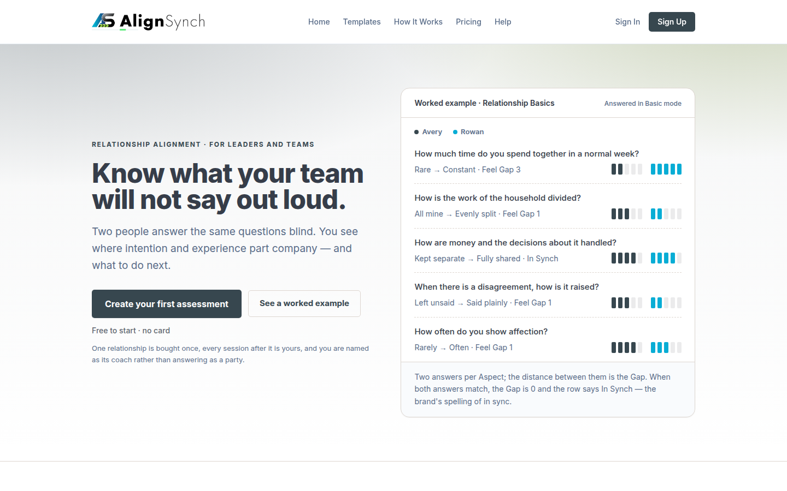

Two people answer the same questions about how they feel and how they wish things to be. Each answers
alone. Where their answers part is the **Gap** — the difference of two opinions, computed on the page
and stored in no column. One person starts a relationship, the other follows an invitation, both fill in
a sheet they cannot see the other's answers in, and the report that compares them opens only when both
sides are sealed.

This repository is the **template** that product is built from, not a single site: one Next.js codebase,
one route table, several brands, and a build picks the brand. It is cut from the QuizHub starting UI
template ([docs/TEMPLATE-DOCTRINE.md](docs/TEMPLATE-DOCTRINE.md), #318).

<p align="center">
  
  
  
  
  
  
  
  
</p>

> [!NOTE]
> **Live demo:** <https://alignsynch-amber.vercel.app/> — `main` deploys on every merge.

Every screenshot below is a committed file under [docs/assets/screens/](docs/assets/screens/README.md),
captured from a production build of the brand it is filed under, on the demo branch, at `1440×900` and
`390×844`. The registry beside them carries the route, the viewport, the date and the commit for each
row, and a test fails when the page and the files disagree. Nothing on this page is a mockup.

- [A relationship, start to finish](#a-relationship-start-to-finish)
- [The flow, as a diagram](#the-flow-as-a-diagram)
- [The admin console](#the-admin-console)
- [The other product in the same tree](#the-other-product-in-the-same-tree-quizhub)
- [Where the data lives](#where-the-data-lives)
- [Two brands, one tree](#two-brands-one-tree)
- [Run it](#run-it)
- [Where the docs are](#where-the-docs-are)
- [Engineering reference](#engineering-reference)

## A relationship, start to finish

**You sign in, and the rail is two rows of real work.** `My Relationships` is every relationship and its
session in one list; `Templates` is one destination with two tabs — the catalogue and the templates this
account owns. Support is the second group, and an operator sees a third.

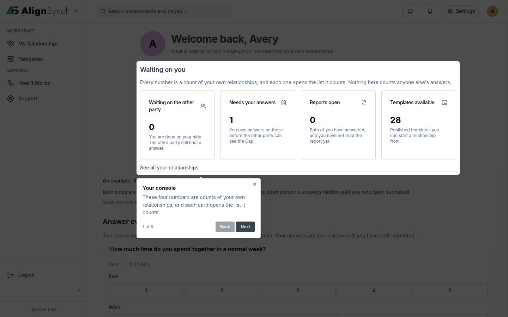

**You start one, and the card is where it lives.** The relationship screen names the template, the two
people, the state and the Aspects, and puts the one action that moves it in reach: publish it, and the
invitation link is minted for the other person. Every field is editable by the initiator and by staff,
and the edit panel prices an invalidation before it saves one.

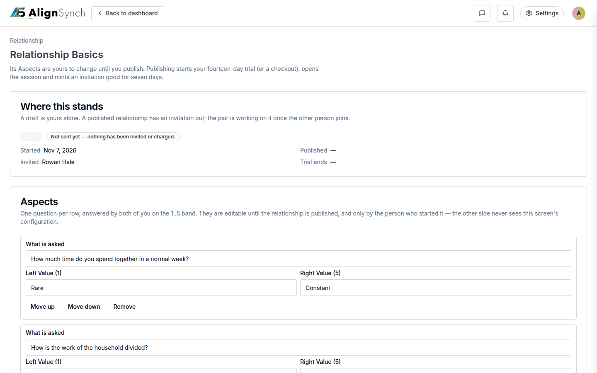

On a phone the rail becomes a drawer below 768px and the card stacks. The same two surfaces at 390 wide:

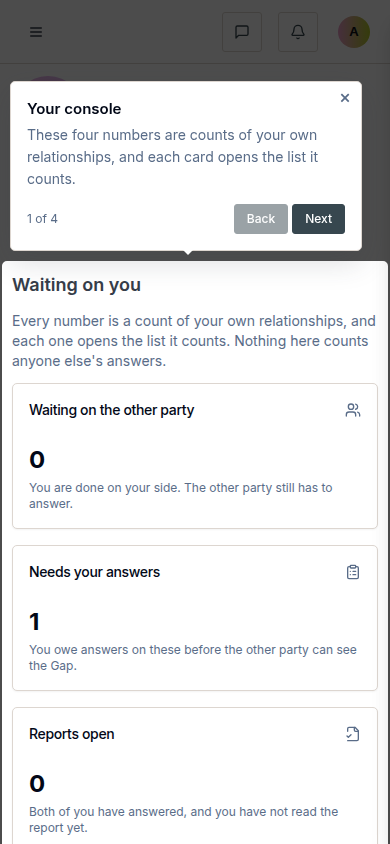

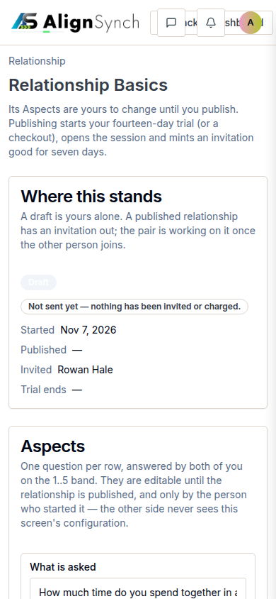

**Both sides answer, and neither side can read the other.** The counterparty arrives on `/invite/<token>`,
gets three steps that say who invited them, what happens next and what each of them will see, and only
then the account gate and the claim. `/invite/<token>` claims nothing on a `GET` — a token consumed by a
mail client's link preview would be a token wasted — and the whole of that wizard is in
[docs/TWO-PARTY-FLOW.md](docs/TWO-PARTY-FLOW.md).

**The sheets seal, and the Gap is the report.** Answers stay editable until both parties have answered
_and_ accepted; the second acceptance is the seal, and a sealed sheet is a refusal (`409`) rather than a
hidden button. The report then draws `Where you stand`, `Both parties' opinions` and `The Gap between the
two`, Aspect by Aspect, against the Setting the relationship was created with — arithmetic over two
scores, `gapOf(2, 5) === 3`, never a stored verdict. Both parties read the same report; the invitation
link is how the other side got there. There is no per-seat copy and no export, and this page does not
claim one.

**Paid, or quiet.** #619 moved the fee to the end: the sheets seal first, the initiator settles the plan
from there, and the report opens on payment. Fourteen days of a sealed, unpaid relationship expire it,
with a reminder on day 3 and day 10 — the obligations and their windows are in
[lib/flow/payment.ts](lib/flow/payment.ts). No card is charged in this deployment: the hosted adapter
runs **test keys** and the page says so.

## The flow, as a diagram

One relationship, seven statuses, and every transition attributable to a person. The status is the one
stored fact in this schema — `draft` and `pending` differ by nothing but intent, so no row could imply
them (the argument is at the top of
[0030_relationship_lifecycle.sql](db/migrations/0030_relationship_lifecycle.sql)). Everything else on the
line is derived at read time: the invitation's expiry, the session's status, the Gap.

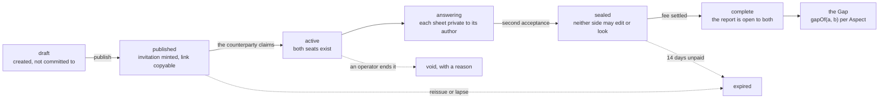

## The admin console

`/admin/console` is the operator's overview: every figure is a predicate over the same relationship
registry the list pages draw, and the card links to that exact filter in the URL, so no total exists
without the rows behind it. The template and user cards count their own collections, and the page ends
with a panel saying what the console cannot do rather than leaving it to be discovered.

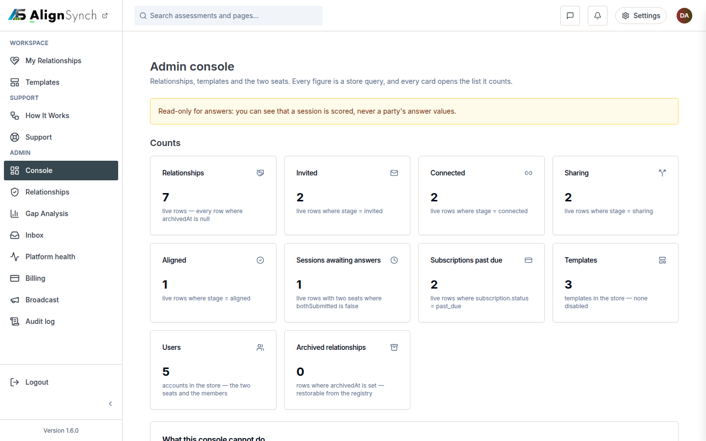

The seven destinations beside it (`/admin/instances`, `/admin/gaps`, `/admin/inbox`, `/admin/health`,
`/admin/billing`, `/admin/broadcast` and the audit log at `/admin/audit`) are rows in the operator group
of the rail. They are gated on the `product.admin` capability, which is on for both brands today and
closes the subtree on a build that does not claim it (`lib/brand-boundary.ts`).

## The other product in the same tree (QuizHub)

The template ships two products. QuizHub is the quiz platform the core came from and stays first class:
shelves on `/explore`, a quiz with its community tabs, a play surface that scores as you go.

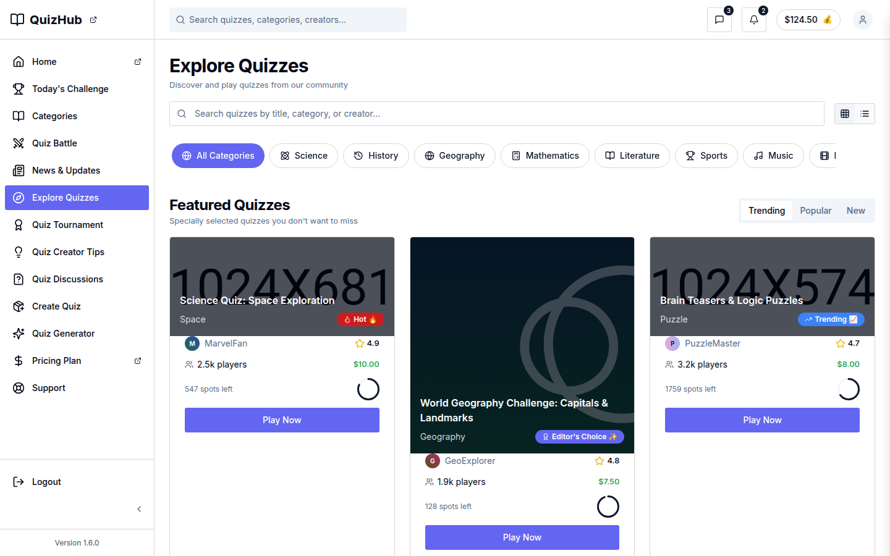

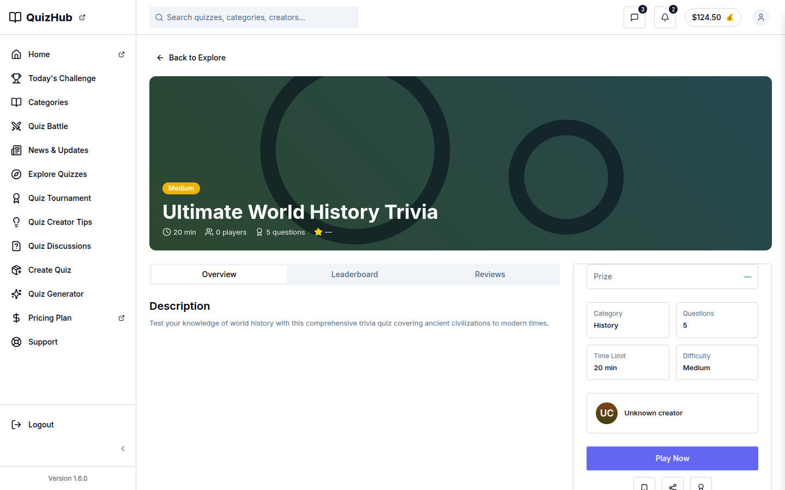

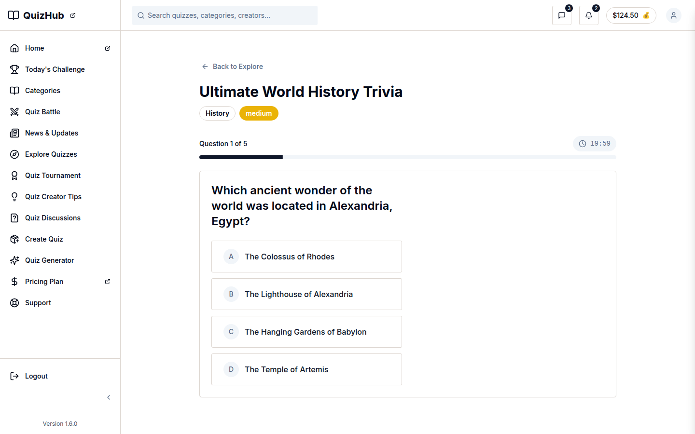

Every QuizHub surface answers **`404` on an AlignSynch build** and vice versa, deliberately
(`lib/brand-boundary.ts`, `tests/parity/boundary.ts`): two products from one route table would otherwise
ship each other's screens, and a boundary that is a test is a boundary that holds.

## Where the data lives

Two sources, and the gate can see only one of them. The fixtures in `data/` are the authored source, held
to the zod schemas in `content/` by `pnpm data:check`; Postgres mirrors them, and `pnpm db:seed` writes
`data/assessments.ts` into the tables while `pnpm db:verify` proves the rows still say what the fixture
says. `bash scripts/verify.sh` **never opens a connection**, which is why CI can run it with no
`DATABASE_URL` at all.

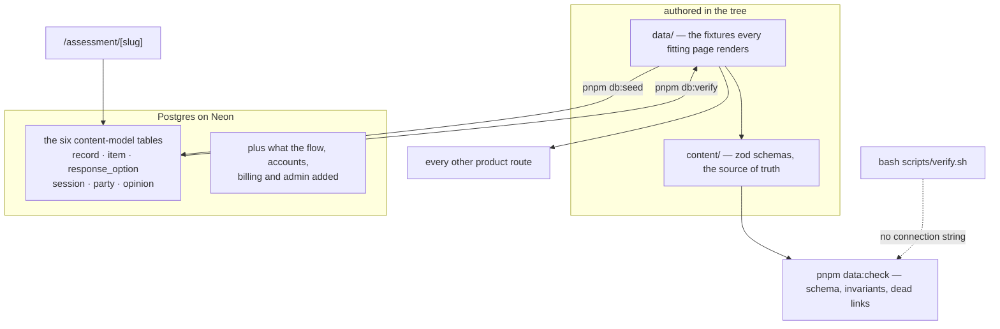

The six tables are #145's, and they mirror `content/record.ts` and `content/assessment.ts` field for
field: `session` was `assessment_instance` until #340 split the subscription (`relationship`) from one
assessment cycle of it, and `lib/db/rows.ts` `safeParse`s every row back through the same schemas, so the
model stays the single source of truth. There is no ORM. The Gap has no column, no view and no generated
column, and `db:migrate` fails on the name.

## Two brands, one tree

`data/brand.ts` holds the records; `next.config.mjs` inlines one flag that selects between them. Both
front doors are real builds of this commit, and neither is a skin over the other's page.

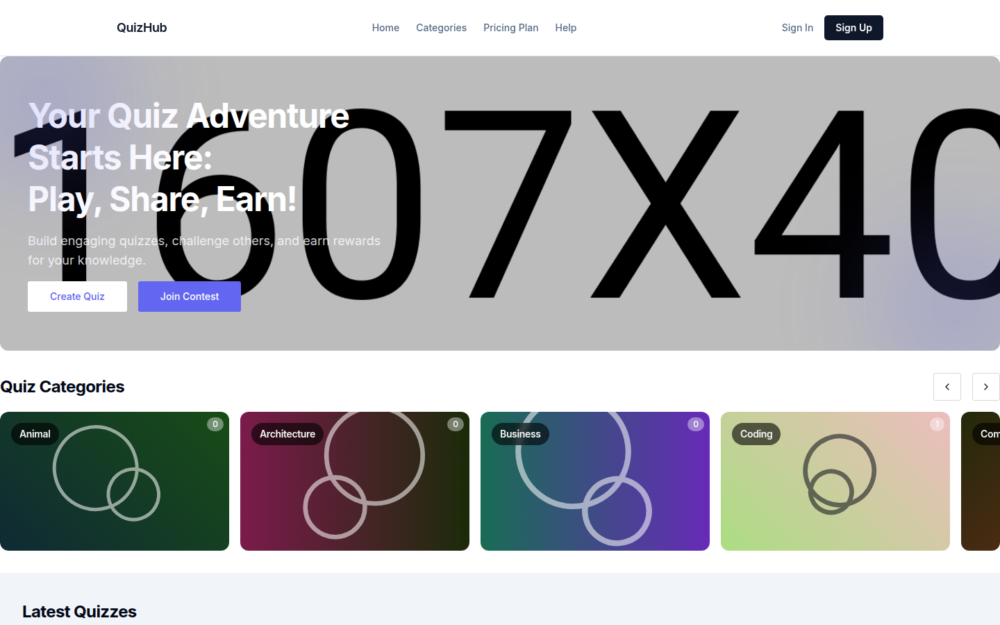

The AlignSynch front door is [the image at the top of this page](#alignsynch).

|                    | `BRAND=quizhub` (the default)                    | `BRAND=alignsynch`                                                |
| ------------------ | ------------------------------------------------ | ----------------------------------------------------------------- |
| Front door         | categories, shelves, top players, live winners   | the practice, the two-sided answer, the four assessment templates |
| Palette and copy   | `data/brand.ts` (the file's own record)          | `data/brands/alignsynch.ts`                                       |
| Quiz surfaces      | on                                               | `404` — `product.quiz-surfaces` is off                            |
| Alignment surfaces | on (the core is shared)                          | on                                                                |
| Admin console      | on — `product.admin` is on for both brands today | on                                                                |
| Build              | `pnpm build`                                     | `BRAND=alignsynch pnpm build`                                     |

The flag swaps a **record**, not a page: no screen checks `process.env` and no module imports a brand by
name, so "this demo is AlignSynch now" is one build rather than a find-and-replace. It is inlined by the
bundler because client components read the record too — a `process.env` the bundler did not replace would
render one brand on the server and another at hydration. A `BRAND` that names no record in `data/brand.ts`
throws at build time instead of rendering a half-swapped product. CI builds both brands as a matrix, and
`pnpm parity` hashes seven routes under each into `tests/parity/manifest.txt`.

What the flag does not do is retarget the nouns: the fixtures still speak the product they were written
for wherever a brand's own copy has not been written. [Adopting the template](#adopting-the-template-for-a-new-brand)
is the five steps an adoption takes.

## Run it

**Node 24, or it does not start.** `.nvmrc` pins 24, `engines` says `>=20.9`, and `/usr/bin/node` is
18.19.1 on the machines this tree was built on — it shadows a newer runtime on `PATH` and every Next
command dies under it.

```bash
nvm use                          # .nvmrc pins 24 — this is not a formality
node -v                          # must print v24.x
pnpm install --frozen-lockfile   # the install CI runs
pnpm dev                         # next dev --turbo, http://localhost:3000
pnpm build                       # next build; needs no connection string and no env file
pnpm start                       # serve the build on port 3000
```

In a script or an agent shell there is no interactive `nvm use`; put a Node 24 `bin` directory first on
`PATH` instead (`$HOME/.nvm/versions/node/v24.22.0/bin`, for example). The package manager is pinned the
same way — pnpm 12.16.1, from `packageManager` — and `scripts/verify.sh` refuses another major before it
runs a single step.

**`pnpm build` succeeds with no database.** Only database-backed routes need a connection, and only at
request time: the pool is created on the first query and the auth server on first use, not at import.
That distinction is why the gate runs with no connection string attached — a build that needed a database
would leave every pull request unable to test itself.

**`127.0.0.1` is not `localhost`.** Neon Auth checks the request's `Origin` against the branch's trusted
list and pre-approves `localhost` on any port, so `http://localhost:3000` signs in with no configuration
while `http://127.0.0.1:3000` answers `403 INVALID_ORIGIN` unless the origin was added to that branch. A
`GET` is not origin-checked, so an untrusted origin can still _look_ signed in.

**Before you push, the gate.** The same script is the pre-push hook, so a Node 18 shell cannot push
either.

```bash
bash scripts/verify.sh          # THE gate. green = shippable
bash scripts/install-hooks.sh   # once per clone: pre-push runs the same script
```

It runs `deps → glossary → release:check → typecheck → lint → format:check → data:check → test → parity →
build`, stops at the first failure and names it. The depth follows the diff — `lane=docs|content|config|code`,
highest wins, printed on every run — and `GATE_LANE=full bash scripts/verify.sh` forces all of it after a
dependency bump. CI runs this script and nothing else, under the job name `typecheck / lint / build`; a
check that lives only in the YAML is a guaranteed red push.

## Where the docs are

| Start here                                                     | What it answers                                                               |
| -------------------------------------------------------------- | ----------------------------------------------------------------------------- |
| [docs/wiki/README.md](docs/wiki/README.md)                     | the code wiki: key concepts, module map, and what turns a request into a page |
| [AGENTS.md](AGENTS.md)                                         | command table with verified results, conventions, pitfalls                    |
| [CHANGELOG.md](CHANGELOG.md)                                   | every release, generated from the commits and published as the notes          |
| [docs/assets/screens/README.md](docs/assets/screens/README.md) | the current screenshot set, one row per surface, and how to recapture it      |
| [docs/GATE.md](docs/GATE.md)                                   | gate baseline, first-pass yield, the required-check ruleset                   |
| [docs/glossary.md](docs/glossary.md)                           | the domain's words, generated from the schema comments                        |
| [docs/ui-registry.md](docs/ui-registry.md)                     | every surface, its status, and which template claims it                       |
| [docs/DATA-MODEL.md](docs/DATA-MODEL.md)                       | the content model: entities, invariants, strictness                           |
| [docs/TWO-PARTY-FLOW.md](docs/TWO-PARTY-FLOW.md)               | the assessment flow: create, invite, answer, unlock the Gap                   |
| [docs/TEMPLATE-DOCTRINE.md](docs/TEMPLATE-DOCTRINE.md)         | one core, many expressions: the three questions a new surface answers         |
| [docs/BUNDLES.md](docs/BUNDLES.md)                             | a template or the demo dataset as one importable file                         |
| [docs/billing.md](docs/billing.md)                             | the billing port, its adapters, and why test mode says so on the page         |
| [docs/RELEASING.md](docs/RELEASING.md)                         | cutting a version: changelog entry, tag, GitHub Release, the deploy           |
| [docs/ENV-SPEC.md](docs/ENV-SPEC.md)                           | environment, team, integrations, feature flags, the P1–P4 stage gates         |
| [docs/REPO-LAYERS.md](docs/REPO-LAYERS.md)                     | lane table, classifier rules, build semaphore                                 |

`AGENTS.md` is the agent-facing companion to this file. The two must agree on commands, the package
manager and the Node version; a command change belongs in both.

**The share card** is [docs/assets/og-image.png](docs/assets/og-image.png), 1200×630, and it is not
drawn by hand: it is a render of `app/opengraph-image.tsx` around `lib/brand-og.tsx`, with every colour
read from `data/brand.ts`, so the committed file and the route crawlers are served cannot drift into two
designs.

## Engineering reference

### What actually runs

| Layer         | What it is                                                                                                                      | Where         |
| ------------- | ------------------------------------------------------------------------------------------------------------------------------- | ------------- |
| Runtime       | Next.js 16.1.6, App Router, Turbopack                                                                                           | `app/`        |
| UI            | React 19, TypeScript 5 in `strict` mode, Tailwind CSS 3.4 and shadcn/ui over Radix                                              | `components/` |
| Content model | zod 3 schemas as the single source of truth; every type is `z.infer`red from them                                               | `content/`    |
| Fixtures      | the validated records pages render; `pnpm data:check` fails a build when one drifts from the schema                             | `data/`       |
| Data          | Neon Postgres over `pg`, forward-only SQL in `db/migrations/`                                                                   | `lib/db/`     |
| Auth          | Neon Managed Auth (hosted Better Auth), proxied at `app/api/auth/[...path]`; the app owns no users or sessions table of its own | `lib/auth/`   |
| Deploy        | Vercel — `main` deploys; the AlignSynch build is at <https://alignsynch-amber.vercel.app/>                                      | —             |

`content/` imports nothing from React or Next. That is what lets the same model be rendered by the app,
validated by a plain `node` script, and checked against the database with no browser in the loop.

### The domain model in five lines

1. A **Record** is a post: `id`, `slug`, `type`, `status`, `date`.
2. `type` is `post_type` — `quiz` or `assessment`. Both are records, and neither imports the other.
3. A **Template** is a record that holds items and has no parties. There is no `parties` key to omit:
   `strict()` rejects one.
4. A **Session** is a template copied and given two parties; a **Relationship** is the subscription that
   owns one or more of them.
5. The **Gap** is a difference of two opinions: `gapOf(2, 5) === 3`, and `gapOf(4, 4) === 0` is In Synch.

[docs/glossary.md](docs/glossary.md) is generated from the schema comments — every term where its type is
defined — and [docs/DATA-MODEL.md](docs/DATA-MODEL.md) is the field-level inventory.

### The database is a mirror, and the gate does not read it

```bash
pnpm db:migrate   # apply db/migrations/*.sql in order; wants the unpooled URL
pnpm db:seed      # mirror data/assessments.ts into the tables; idempotent, prints counts
pnpm db:verify    # the DB port of the drift check plus the party rules; exit 1 per violation
pnpm demo:verify  # seed the demo dataset, drive the app, diff rows and answers
```

The `db:*` scripts are not gate steps, and `/assessment/[slug]` is `force-dynamic` with no
`generateStaticParams()`, so nothing is read at build time. `DATABASE_URL` and friends live in a
gitignored `.env.local` written by `neon env pull`, never in `next.config.mjs`'s `env` block — that block
is inlined into the client bundle. The variables a deployment needs, and the one that must not be public:

| Variable                  | Read by                            | Needed for                                                                                   |
| ------------------------- | ---------------------------------- | -------------------------------------------------------------------------------------------- |
| `DATABASE_URL`            | `lib/db/client.ts`                 | every database-backed route, at request time                                                 |
| `DATABASE_URL_UNPOOLED`   | `scripts/load-env.mjs`             | `db:migrate`, `db:seed`, `db:verify`; falls back to `DATABASE_URL`                           |
| `NEON_AUTH_BASE_URL`      | `lib/auth/server.ts`               | signing in and out, sessions, `/api/auth/*`                                                  |
| `NEON_AUTH_COOKIE_SECRET` | `lib/auth/server.ts`               | the same; application config, supplied per environment                                       |
| `BRAND`                   | `data/brand.ts`, `next.config.mjs` | `quizhub` or `alignsynch`; unset builds the default brand                                    |
| `RESEND_API_KEY`          | `lib/flow/email.ts`                | sending the invitation mail; without it the link is shown in the UI instead                  |
| `FLAG_<NAME>`             | `lib/flags.ts`                     | `1` on, `0` off, for the ten declared surfaces — read per request, so a flip needs a restart |

A surface that is still a mock must not be on by default, so every flag in `data/flags.ts` defaults to
`false` and the resolver is server-only on purpose: a flag the browser decides can neither `404` a route
nor stop a query.

### What is built

The numbers are measured, not remembered: `docs/ui-registry.md` is generated from the tree and from the
judgement entries in `data/ui-registry.ts`, and the gate fails when the committed page and the tree
disagree.

```bash
pnpm ui:registry:check   # what the gate runs: regenerate in memory, compare, exit 1 on drift
pnpm ui:registry         # rewrite docs/ui-registry.md after a legitimate change
```

- **83 routes** — 54 static, 29 dynamic, from `app/**/page.tsx`
- **42 component domains** — 301 files under `components/`, 295 of them `.tsx`
- **24 route handlers** — `app/**/route.ts`, listed in the registry and not counted as UI
- **status split** — 15 mock, 67 fixture, 34 db, 8 live, 1 prototype

The statuses are wiring claims, not opinions: `db` reaches `lib/db/`, `live` reaches an `/api` write,
`fixture` reaches a record module under `data/`, and `mock` reaches neither — so a surface whose numbers
are literals is a stand-in however finished it looks.

### Adopting the template for a new brand

1. **Add the record.** Write `data/brands/<id>.ts` exporting a `Brand`, and register it in the `brands`
   table in `data/brand.ts`. Its `logo` is a path already registered in `data/media.ts` — the registry is
   a bijection with `public/`, and `pnpm data:check` fails when it is not.
2. **Pick the front page.** `app/(marketing)/page.tsx` switches over `BrandId`, so a new brand is a
   compile error until its home composition is chosen deliberately: one copy module under `data/pages/`
   and one `case` arm. That is the only application code an adoption touches.
3. **Build and gate it.** `BRAND=<id> pnpm build`, then `bash scripts/verify.sh`.
4. **Retarget the nouns.** The record swaps a name, a palette and a mailbox — not copy. There is no
   vocabulary layer yet, so a third brand inherits the words wherever its own copy has not been written.
5. **Retire, do not delete.** A surface a new brand does not want is a flag and a capability, not a fork.

### Status and limits

**Beta.** `package.json` is `1.6.0` (tag `v1.6.0`), the AlignSynch build is deployed, and the gate is green
on `main`.

What works end to end: registration, sign-in and sessions through Neon Managed Auth; account settings and
public profiles persisted in Postgres; the two-party flow — pick a template, start a relationship, invite
the other party, both answer, the sheets seal, the Gap unlocks; the paid completion path with its
reminders and its lapse; and the operator console, its instance and Gap lists, the inbox, health, billing,
broadcast and audit surfaces.

What does not:

- **No payment is taken.** The checkout is implemented against the billing port, but the hosted adapter
  runs **test keys** and the page says so on one line. See [docs/billing.md](docs/billing.md).
- **Fifteen surfaces are mocks** — the quiz editor's save, the generator, the leaderboard, tournaments,
  battle and chat among them. Each is named in [docs/ui-registry.md](docs/ui-registry.md), and
  `data/flags.ts` carries a note per surface saying what would have to exist before it is on.
- **One template has a server behind it.** The quiz product's create, play and community surfaces are
  fixtures; the relationship flow, accounts, support, billing and the console touch the database.
- **No multi-tenancy, no i18n, no course schema.** A brand is a build, not a tenant.
- **Image optimization is off on purpose** (`images.unoptimized` in `next.config.mjs`), and a `<Image>`
  that passes `fill` still has to bring its own `sizes`.

No metric, testimonial, customer count or uptime figure appears on this page, and no count above was
copied from an issue: each one comes from the command that produces it.
