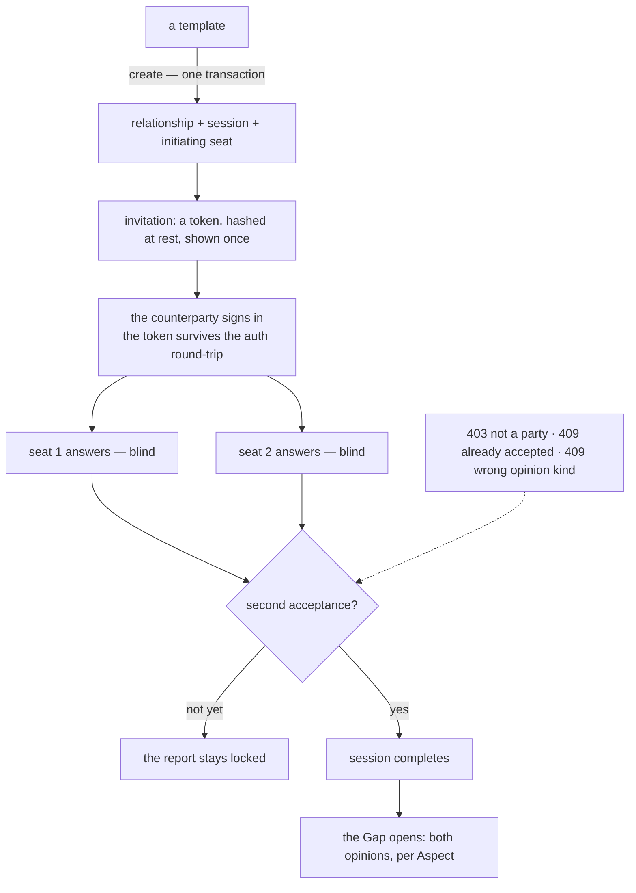
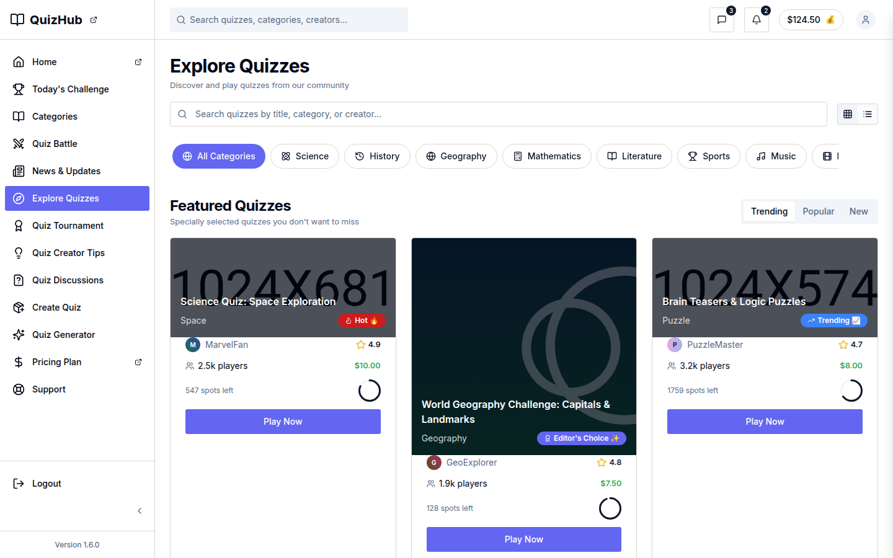

# v1.1.0-rc1 — the template becomes a product

<!-- docs-nav:begin -->

[Docs hub](../README.md) › **Release notes** › v1.1.0-rc1 · prev [v1.0.0](v1-0-0.md) · next [v1.2.0](v1-2-0.md)

<!-- docs-nav:end -->

The first release candidate for the alignment product. It put a database under one route and a
second party under every assessment, and it kept the tree able to prove that the quiz product's pages
never leak into the alignment product's build.

## What was painful before

- **`/assessment/[slug]` was a read of a seeded fixture**, prerendered at build time. The four
  instances in `data/` had a screen each and no way to be started, invited, answered or finished.
- **There was one party.** A two-party assessment with one party is a form, and the product's whole
  claim — the Gap between two opinions — was a picture in a fixture.
- **One brand's product was still the other's build.** The quiz product's routes rendered under the
  alignment brand, which meant a page selling quizzes to a customer who came for an alignment
  report.
- **Nothing pinned the render.** A component edit could change both brands' HTML and no check would
  notice, because no check compared a render to anything.

## What it does now

- **Six content tables and one route that reads them.** `db/migrations/0001_content_model.sql`
  mirrors `content/record.ts` and `content/assessment.ts`; `lib/db/rows.ts` parses rows back through
  those schemas, so the model stays the single source of truth and the app owns no users or sessions
  table — Neon's Managed Auth lives in its own schema.
- **The two-party flow exists end to end**: create a relationship from a template, invite with a
  hashed token, answer blind, unlock the Gap on the second answer.
- **A brand is a record.** `data/brand.ts` plus `BRAND` selects which of the two products the one
  tree builds, and `fix(brand)` (#300) gates the quiz product's routes off the alignment build — they
  answer `404` there by capability rather than by convention, and the list is enumerated in
  `tests/parity/boundary.ts`.
- **Parity is a check.** Seven routes render under both brands and hash into
  `tests/parity/manifest.txt`; a mismatch writes the render to an artifact rather than committing
  1.4 MB of HTML.
- **The platform grew the parts a product needs and a prototype does not**: real sessions behind
  login, a PIN-gated demo panel that signs in without a password, feature flags per template, a
  bundle that exports a template or the demo dataset as one versioned file, and a media resolver
  with three tiers.

## The two-party flow

The dotted arrow is the half a diagram usually leaves out. Every refusal was proved against the
**demo** database in this candidate, and the entry says plainly that no run in the repository has
driven the flow against production's rows — `pnpm demo:verify` refuses production by design.

## Screens

`/explore` is one of the routes this release gated off the alignment build: it renders under
QuizHub and answers `404` under AlignSynch, where `lib/brand-boundary.ts::requireQuizProduct()`
owns the decision. It is here because the boundary is the release's quietest change and the most
load-bearing one — the frame is current (2026-11-07), not a picture of the candidate.

## The entry, as published

<!-- changelog-view:begin entry -->
<!-- generated from CHANGELOG.md by scripts/changelog-view.mjs — edit the entry, not this block -->

- **Released** 2026-10-31
- **Tag** [`v1.1.0-rc1`](https://github.com/riolabs-ai/alignsynch/releases/tag/v1.1.0-rc1)
- **Pull requests named** 107
- **The entry** [`CHANGELOG.md`](../../CHANGELOG.md)

### Added

- `feat(nav)` — the console's destinations reach the sidebar, the operator's stay behind the role ([#327](https://github.com/riolabs-ai/alignsynch/pull/327))
- `feat(console)` — /assessment/templates — built-in versus authored, per account ([#326](https://github.com/riolabs-ai/alignsynch/pull/326))
- `feat(console)` — /dashboard counts the viewer's own rows and links each number to its list ([#325](https://github.com/riolabs-ai/alignsynch/pull/325))
- `feat(console)` — the operator's relationship registry, behind the first requireAdmin surface ([#324](https://github.com/riolabs-ai/alignsynch/pull/324))
- `feat(console)` — the Gap across completed relationships, nameless and complete-only ([#323](https://github.com/riolabs-ai/alignsynch/pull/323))
- `feat(db)` — the three columns the console needs, all nullable and unfilled ([#322](https://github.com/riolabs-ai/alignsynch/pull/322))
- `feat(billing)` — the plan cards start a real checkout (#289) ([#315](https://github.com/riolabs-ai/alignsynch/pull/315))
- `feat(billing)` — the test-mode hosted adapter, its webhook, and .env.example (#289) ([#310](https://github.com/riolabs-ai/alignsynch/pull/310))
- `feat(invite)` — re-invite revokes and replaces the token, behind a 24h cooldown and a cap (#275) ([#303](https://github.com/riolabs-ai/alignsynch/pull/303))
- `feat(billing)` — a provider-free port, an offline adapter, and the plan gate ([#289](https://github.com/riolabs-ai/alignsynch/pull/289))
- `feat(legal)` — /terms and /privacy, version 1 draft, wired on both brands (#270) ([#296](https://github.com/riolabs-ai/alignsynch/pull/296))
- `feat(assessment)` — the report's three gap groups, a verdict band, and one stage sentence (#274) ([#301](https://github.com/riolabs-ai/alignsynch/pull/301))
- `feat(assessment)` — the answer input is a five-segment radio group (#273) ([#297](https://github.com/riolabs-ai/alignsynch/pull/297))
- `feat(invite)` — the initiator is told their invitation expired (#266) ([#283](https://github.com/riolabs-ai/alignsynch/pull/283))
- `feat(shell)` — show the app version, linked to its release tag (#269) ([#285](https://github.com/riolabs-ai/alignsynch/pull/285))
- `feat(assessment)` — four stages, derived — 4-6 documented as undefined (#261) ([#276](https://github.com/riolabs-ai/alignsynch/pull/276))
- `feat(assessment)` — the Soft/Full Setting is a lens over the Gaps (#259) ([#264](https://github.com/riolabs-ai/alignsynch/pull/264))
- `feat(assessment)` — the other party hears when the second answer lands (#258) ([#262](https://github.com/riolabs-ai/alignsynch/pull/262))
- `feat(invite)` — the invitation link has a copy control that never fails silently (#257) ([#260](https://github.com/riolabs-ai/alignsynch/pull/260))
- `feat(assessment)` — a person can author their own template (#255) ([#256](https://github.com/riolabs-ai/alignsynch/pull/256))
- `feat(assessment)` — the list marks an unlock you have not read (#252) ([#254](https://github.com/riolabs-ai/alignsynch/pull/254))
- `feat(brand)` — every route's share preview is the brand's own 1200x630 card (#187) ([#251](https://github.com/riolabs-ai/alignsynch/pull/251))
- `feat(assessment)` — creating or claiming an instance binds the caller's account (#213) ([#248](https://github.com/riolabs-ai/alignsynch/pull/248))
- `feat(brand)` — the palette has one home, enforced, and each brand has its own tab icon (#187) ([#246](https://github.com/riolabs-ai/alignsynch/pull/246))
- `feat(assessment)` — the report draws the glossary's eight Gap kinds (#219) ([#243](https://github.com/riolabs-ai/alignsynch/pull/243))
- `feat(assessment)` — a signed-in party can find the instances they are in (#213) ([#238](https://github.com/riolabs-ai/alignsynch/pull/238))
- `feat(brand)` — the affiliate and profile surfaces read the brand record (#187 stage 3) ([#236](https://github.com/riolabs-ai/alignsynch/pull/236))
- `feat(demo)` — /demo is a PIN gate, and /login draws the role buttons behind a signed unlock (#218) ([#235](https://github.com/riolabs-ai/alignsynch/pull/235))
- `feat(assessment)` — an instance records its mode, and asks the sheet it defines (#213) ([#234](https://github.com/riolabs-ai/alignsynch/pull/234))
- `feat(gate)` — a client component cannot reach the database, and the gate knows (#228) ([#233](https://github.com/riolabs-ai/alignsynch/pull/233))
- `feat(brand)` — the home, category and creator-tip bands read the brand record (#187 stage 2) ([#217](https://github.com/riolabs-ai/alignsynch/pull/217))
- `feat(search)` — the /search body is the brand's words, not the quiz product's (#156 follow-up) ([#201](https://github.com/riolabs-ai/alignsynch/pull/201))
- `feat(media)` — the profile cover is drawn from the handle, not one shared PNG (#130) ([#206](https://github.com/riolabs-ai/alignsynch/pull/206))
- `feat(demo-auth)` — a PIN-gated panel that signs in without sending a password (#183 part 2) ([#208](https://github.com/riolabs-ai/alignsynch/pull/208))
- `feat(shell)` — the footer speaks the brand's vocabulary, and "Quizes" is spelled right (#188) ([#195](https://github.com/riolabs-ai/alignsynch/pull/195))
- `feat(brand)` — the chrome, the assessment flow and the 404 read the brand record (#187 stage 1) ([#200](https://github.com/riolabs-ai/alignsynch/pull/200))
- `feat(demo)` — a reset that is one restore, a nightly reseed, and the docs (#185) ([#198](https://github.com/riolabs-ai/alignsynch/pull/198))
- `feat(flags)` — an admin reaches a surface the flag hides (#184) ([#199](https://github.com/riolabs-ai/alignsynch/pull/199))
- `feat(demo-auth)` — one role, a 404-not-403 gate, and three seeded demo accounts (#183 part 1) ([#189](https://github.com/riolabs-ai/alignsynch/pull/189))
- `feat(parity)` — a hash manifest and a summary instead of 1.4 MB of HTML (#171) ([#182](https://github.com/riolabs-ai/alignsynch/pull/182))
- `feat(shell)` — the rest of the chrome is the brand's, not the quiz product's (#156) ([#186](https://github.com/riolabs-ai/alignsynch/pull/186))
- `feat(media)` — one resolver, three tiers, and a fault-tolerant fallback (#155, phase 1) ([#180](https://github.com/riolabs-ai/alignsynch/pull/180))
- `feat(bundles)` — a template or a demo dataset as one versioned file, exported and imported (#147) ([#179](https://github.com/riolabs-ai/alignsynch/pull/179))
- `feat(flags)` — a surface on or off per template without a code change (#175) ([#181](https://github.com/riolabs-ai/alignsynch/pull/181))
- `feat(shell)` — navigation is brand- and capability-aware, not quiz-only (#156) ([#177](https://github.com/riolabs-ai/alignsynch/pull/177))
- `feat(registry)` — every mocked surface catalogued as a template resource (#173) ([#178](https://github.com/riolabs-ai/alignsynch/pull/178))
- `feat(assessment)` — the two-party flow — create, invite, answer blind, unlock the Gap (#146) ([#174](https://github.com/riolabs-ai/alignsynch/pull/174))
- `feat(tokens)` — tighter product surface in the Tailwind root (#160) ([#170](https://github.com/riolabs-ai/alignsynch/pull/170))
- `feat(identity)` — real sessions behind login, register, settings and profile (#164) ([#172](https://github.com/riolabs-ai/alignsynch/pull/172))
- `feat(marketing)` — a public landing page in its own chrome, no sidebar (#159) ([#169](https://github.com/riolabs-ai/alignsynch/pull/169))
- `feat(media)` — avatars are initials on a seed-derived gradient, nine duplicate files deleted (#152) ([#168](https://github.com/riolabs-ai/alignsynch/pull/168))
- `feat(db)` — six content tables, the DB-backed assessment screen, and the db scripts (#145) ([#166](https://github.com/riolabs-ai/alignsynch/pull/166))
- `feat(editorial)` — news, creator tips and support read article records (#165) ([#167](https://github.com/riolabs-ai/alignsynch/pull/167))
- `feat(theme)` — light default, AlignSynch tokens on white (#157) ([#162](https://github.com/riolabs-ai/alignsynch/pull/162))
- `feat(media)` — avatars are initials on a seed-derived gradient (#152, part 1) ([#161](https://github.com/riolabs-ai/alignsynch/pull/161))

### Fixed

- `fix(shell)` — the public pages stop carrying the app shell, and the sidebar is fixed (#317) ([#320](https://github.com/riolabs-ai/alignsynch/pull/320))
- `fix(release)` — cut and publish a pre-release, and order versions by semver ([#319](https://github.com/riolabs-ai/alignsynch/pull/319))
- `fix(support)` — the FAQ answers in each product's words, not the quiz product's ([#321](https://github.com/riolabs-ai/alignsynch/pull/321))
- `fix(support)` — one category taxonomy per product, and the select reads it (#309) ([#316](https://github.com/riolabs-ai/alignsynch/pull/316))
- `fix(shell)` — the four surfaces that advertise /affiliate follow the flag (#291 follow-up) ([#313](https://github.com/riolabs-ai/alignsynch/pull/313))
- `fix(news)` — the accessibility article stops selling a tab and three features, and the creator profile gets a subject that exists ([#314](https://github.com/riolabs-ai/alignsynch/pull/314))
- `fix(support)` — the help centre is per product and documents only what ships (#309) ([#312](https://github.com/riolabs-ai/alignsynch/pull/312))
- `fix(brand)` — gate the quiz product's routes off the alignsynch build (#300) ([#306](https://github.com/riolabs-ai/alignsynch/pull/306))
- `fix(news)` — the championship stops selling a tab and a plan, the monetization article drops invented creators ([#311](https://github.com/riolabs-ai/alignsynch/pull/311))
- `fix(news)` — the analytics article stops selling a plan tier and a tab that do not exist ([#308](https://github.com/riolabs-ai/alignsynch/pull/308))
- `fix(copy)` — sign-up asks nothing about quizzes, the 404 states a true fact, /affiliate is gated (#291) ([#307](https://github.com/riolabs-ai/alignsynch/pull/307))
- `fix(news)` — the AI quiz-creation article stops selling a suite we do not ship ([#304](https://github.com/riolabs-ai/alignsynch/pull/304))
- `fix(support)` — the contact form is disconnected, and says so (#290) ([#302](https://github.com/riolabs-ai/alignsynch/pull/302))
- `fix(support)` — the FAQ answers what the app does, not a business it never ran (#288) ([#295](https://github.com/riolabs-ai/alignsynch/pull/295))
- `fix(pricing)` — intended rates, real CTAs, and no trial the build cannot honour (#289) ([#299](https://github.com/riolabs-ai/alignsynch/pull/299))
- `fix(shell)` — the footer, the rail and the login card stop drawing links that go nowhere (#272) ([#298](https://github.com/riolabs-ai/alignsynch/pull/298))
- `fix(create)` — the generator builds a draft from templates, and stops claiming a model (#287) ([#294](https://github.com/riolabs-ai/alignsynch/pull/294))
- `fix(pricing)` — the FAQ answers only what the build can do (#286) ([#292](https://github.com/riolabs-ai/alignsynch/pull/292))
- `fix(assessment)` — Aligned is stage 4 — two ladders, not a missing row (#261) ([#284](https://github.com/riolabs-ai/alignsynch/pull/284))
- `fix(pricing)` — the security answer states what the app does, not what it never did (#271) ([#282](https://github.com/riolabs-ai/alignsynch/pull/282))
- `fix(copy)` — the marketing page stops denying the database (#265) ([#279](https://github.com/riolabs-ai/alignsynch/pull/279))
- `fix(invite)` — a refused email is not a missing key (#220) ([#253](https://github.com/riolabs-ai/alignsynch/pull/253))
- `fix(shell)` — the sidebar context has one specifier, not two (#242) ([#247](https://github.com/riolabs-ai/alignsynch/pull/247))
- `fix(copy)` — the footer and the meta description stop selling the Gap (#239) ([#241](https://github.com/riolabs-ai/alignsynch/pull/241))
- `fix(brand)` — the preview dialog's primary button reads the action token ([#240](https://github.com/riolabs-ai/alignsynch/pull/240))
- `fix(copy)` — the login hero ends at the Gap, not on its own slogan (#232) ([#237](https://github.com/riolabs-ai/alignsynch/pull/237))
- `fix(auth)` — the sign-in screen speaks its own brand, and the fake player count goes (#225) ([#231](https://github.com/riolabs-ai/alignsynch/pull/231))
- `fix(identity)` — "My Profile" opens the session's own handle, not a fixture (#226) ([#230](https://github.com/riolabs-ai/alignsynch/pull/230))
- `fix(demo)` — a refused sign-in says what happened, not "wrong PIN" (#216) ([#224](https://github.com/riolabs-ai/alignsynch/pull/224))
- `fix(shell)` — the signed-in avatar is the session's person, not a fixture (#212) ([#221](https://github.com/riolabs-ai/alignsynch/pull/221))
- `fix(demo)` — the reset names its source, and a source must be able to seed (#185) ([#223](https://github.com/riolabs-ai/alignsynch/pull/223))
- `fix(invite)` — a claim binds one party and never reassigns a session (#202) ([#211](https://github.com/riolabs-ai/alignsynch/pull/211))
- `fix(flags)` — the shell stops advertising a surface the flag hides (#175 follow-up) ([#209](https://github.com/riolabs-ai/alignsynch/pull/209))
- `fix(auth)` — an origin rejection says so, and a dev branch trusts 127.0.0.1 (#203) ([#207](https://github.com/riolabs-ai/alignsynch/pull/207))
- `fix(demo)` — the reset source is a schema-only base, never production (#185) ([#210](https://github.com/riolabs-ai/alignsynch/pull/210))
- `fix(demo)` — the demo holds the bundle and nothing else (#185, follow-up) ([#205](https://github.com/riolabs-ai/alignsynch/pull/205))
- `fix(release)` — the entry parser stops at the link footer, and the check stops racing SIGPIPE ([#144](https://github.com/riolabs-ai/alignsynch/pull/144))

### Maintenance

- `docs` — codify the template doctrine — one core, many expressions ([#318](https://github.com/riolabs-ai/alignsynch/pull/318))
- `docs` — account-deletion spec — a shared record when one side leaves (#278) ([#293](https://github.com/riolabs-ai/alignsynch/pull/293))
- `docs` — seven research specs, and SPEC-DRIFT corrected on review ([#277](https://github.com/riolabs-ai/alignsynch/pull/277))
- `docs` — SPEC-DRIFT, the specification against the build, tiered ([#268](https://github.com/riolabs-ai/alignsynch/pull/268))
- `docs` — the specification's mockups, with an index that says what is worth borrowing ([#267](https://github.com/riolabs-ai/alignsynch/pull/267))
- `refactor(lexicon)` — components/ and app/ name the record, not the quiz (#188) ([#249](https://github.com/riolabs-ai/alignsynch/pull/249))
- `docs(readme)` — the README opens with the product itself (#197) ([#250](https://github.com/riolabs-ai/alignsynch/pull/250))
- `docs(readme)` — the opener states the idea without the kicker (#244) ([#245](https://github.com/riolabs-ai/alignsynch/pull/245))
- `copy(alignsynch)` — a template nobody answered stops promising a copy button ([#229](https://github.com/riolabs-ai/alignsynch/pull/229))
- `perf(assessment)` — one round trip per render, and an honest screen when the database does not answer (#204) ([#227](https://github.com/riolabs-ai/alignsynch/pull/227))
- `copy(alignsynch)` — the home page reads as prose, not a spec ([#222](https://github.com/riolabs-ai/alignsynch/pull/222))
- `docs(readme)` — a demo reset replaces the branch, trusted domains included (#214) ([#215](https://github.com/riolabs-ai/alignsynch/pull/215))
- `refactor(lexicon)` — the platform's own words, not the template's (#188) ([#194](https://github.com/riolabs-ai/alignsynch/pull/194))
- `docs(readme)` — describe the product, not the arrangement (#193) ([#196](https://github.com/riolabs-ai/alignsynch/pull/196))
- `docs(readme)` — rewrite as the AlignSynch whitelabel template (#190) ([#192](https://github.com/riolabs-ai/alignsynch/pull/192))
<!-- changelog-view:end -->

## Known limits

<!-- changelog-view:begin limits -->
<!-- generated from CHANGELOG.md by scripts/changelog-view.mjs — edit the entry, not this block -->

- **No account deletion.** There is no self-service way to delete an account or its assessments. `/privacy` and `/terms` state this and route a request to the support address; the spec for building it is #278 and it is not in this candidate.
- **Billing was verified on the mock driver only.** The entitlement gate was proved against Postgres (`free` refused a second active assessment and Advanced Mode, `pro` allowed both) and a mock checkout wrote a real subscription row. The repo's `.env.local` carries a Stripe **test** key, but `STRIPE_TEST_WEBHOOK_SECRET` is empty, and the Stripe adapter refuses to start a checkout it cannot apply — so no hosted test-card payment was completed for this candidate. The pricing page says "Test mode" wherever the checkout is drawn.
- **No coaches.** The Coach is a word in the product's vocabulary and a feature in no file; `/welcome` says so on the page.
- **No desktop app.** The Tauri shell is deferred (#280); the candidate is the web build only. There is no iOS or Android build.
- **The demo PIN is public.** `/demo` is mounted because `DEMO_AUTH=1`, and its four-digit PIN is published in the repository. It signs into a seeded demo account on the demo branch, not into a customer's data: every account, assessment and invitation in that database is regenerated from fixtures.
- **The live domain was not verified for this candidate.** Vercel's Hobby deployment quota blocked new deploys while the candidate was cut, so `alignsynch.com` was serving an earlier commit. Every check in this entry was taken against a local production build of the tag (`BRAND=alignsynch` and `BRAND=quizhub`), not against the deployed domain. The version badge on `/login` links to this exact tag, and the tag exists before the deploy does.
<!-- changelog-view:end -->

<!-- docs-nav:begin -->

[Docs hub](../README.md) › **Release notes** › v1.1.0-rc1 · prev [v1.0.0](v1-0-0.md) · next [v1.2.0](v1-2-0.md)

<!-- docs-nav:end -->
