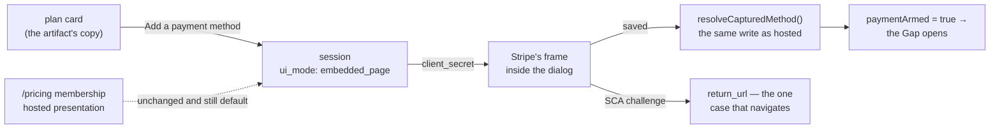
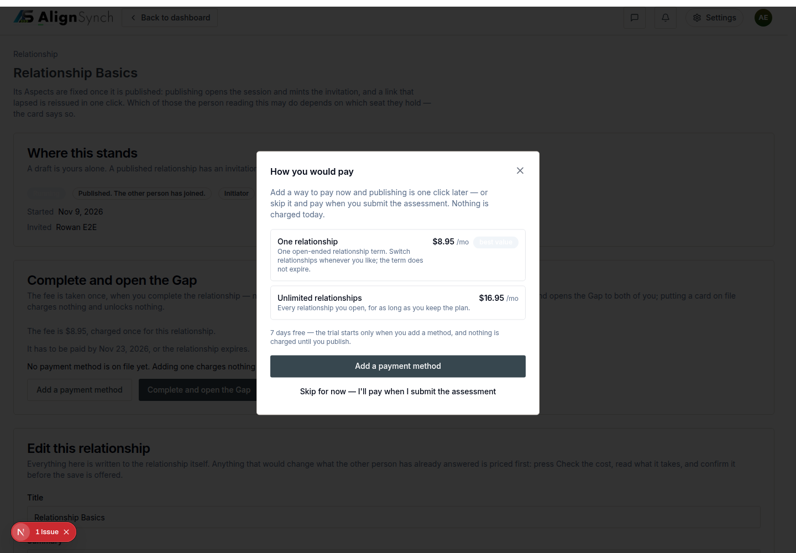
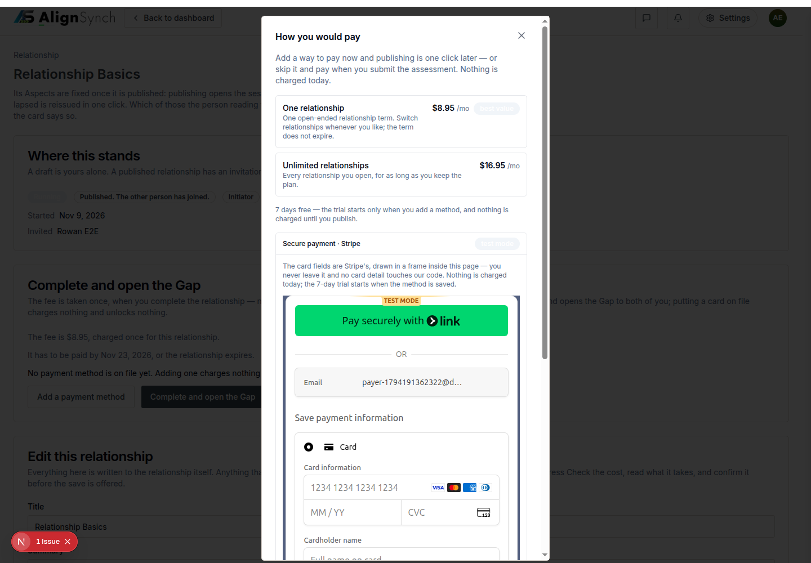
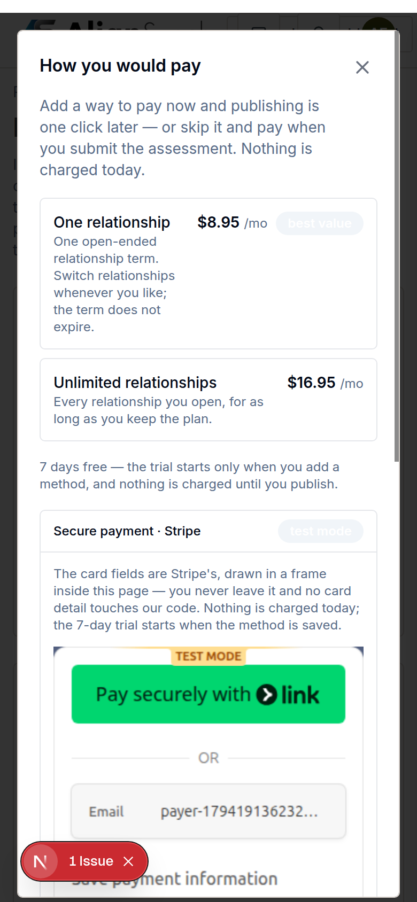

# v1.10.0 — the frame

<!-- docs-nav:begin -->

[Docs hub](../README.md) › **Release notes** › v1.10.0 · prev [v1.9.0](v1-9-0.md)

<!-- docs-nav:end -->

v1.9.0 gave the payer two acts to perform. v1.10.0 moves those acts **inside the frame the artifact
draws**: `Add a payment method` no longer opens Stripe's own page and comes back — it mounts Stripe's
form in a dialog over the relationship, so the flow never leaves the screen it belongs to. The
session is requested as `ui_mode: embedded_page` with a `return_url` rather than a `success_url`,
and the dialog mounts the returned `client_secret` through `@stripe/stripe-js`.

The change is narrow on purpose. The hosted presentation is untouched and remains the default, so
`/pricing`'s membership checkout still behaves exactly as it did — the relationship fee and the
membership are two different checkout shapes, and only the relationship fee moved into a frame.

## What was painful before

- **Paying left the product.** Capture worked in v1.9.0, but it worked by sending the payer to
  Stripe's page and back, so the one moment the artifact draws as a card **inside** the flow was a
  navigation. A frame is the difference between "the relationship asked me for a method" and "I was
  handed off to a payment processor".
- **A refusal was invisible.** An embedded session has its own failure modes — a `ui_mode` the
  provider no longer accepts, a missing `currency` — and the first attempt at this work proved them
  the hard way: Stripe answered *"The ui_mode value `embedded` is no longer supported. Use
  `embedded_page`"*. That refusal now renders as a sentence on the dialog instead of a 500.

## What it does now

- **The capture is a dialog with Stripe's frame in it.** `components/dashboard/payment-capture-dialog.tsx`
  draws the artifact's plan card (`How you would pay`, `$9.95` / `$19.85`, `best value`, the 7-day
  trial line) and mounts Stripe's checkout page in a frame beside it, destroyed on close. Measured
  at 1440 and 390 — at 390 the dialog is 356px wide with `scrollWidth == clientWidth`, so nothing
  spills sideways (#748).
- **One request, two presentations.** `lib/billing/adapters/stripe.ts` takes
  `presentation: "embedded"` or omits it for hosted; embedded sends `ui_mode: embedded_page`,
  `return_url`, `redirect_on_completion=if_required` and `currency`, and answers the session's
  `client_secret`. Hosted callers before this release are unaffected, which is why the membership
  path did not need to change (#748).
- **A provider refusal is copy, not a crash.** The embedded path turns Stripe's error into a
  sentence on the dialog; a missing `STRIPE_TEST_SECRET_KEY` is likewise a sentence, and both are
  pinned by tests.
- **The capture still records the method the same way.** `resolveCaptureAction` records by session id
  through the same `resolveCapturedMethod()` the hosted return route uses, so the two presentations
  converge on one write rather than two.

## The capture, as the release ships it

## Screens

The artifact's plan card, drawn in the dialog rather than on a page of its own — `How you would
pay`, the two plans, and the trial sentence that says nothing is charged today.

Stripe's checkout page inside the frame, with the flow still behind it. This is the screen that used
to be a navigation.

The same frame at 390 — 356px wide with no horizontal overflow, which is the measurement the 390 walk
exists to produce.

## The entry, as published

<!-- changelog-view:begin entry -->
<!-- generated from CHANGELOG.md by scripts/changelog-view.mjs — edit the entry, not this block -->

- **Released** 2026-11-09
- **Tag** [`v1.10.0`](https://github.com/riolabs-ai/alignsynch/releases/tag/v1.10.0)
- **Pull requests named** 1
- **The entry** [`CHANGELOG.md`](../../CHANGELOG.md)

### Added

- `feat(payment)` — the capture is an embedded form in the dialog, not a hosted link (#748) ([#751](https://github.com/riolabs-ai/alignsynch/pull/751))
<!-- changelog-view:end -->

## Known limits

<!-- changelog-view:begin limits -->
<!-- generated from CHANGELOG.md by scripts/changelog-view.mjs — edit the entry, not this block -->

- **Paying happens in a frame inside our page, not a navigation.** `presentation: "embedded"` asks the
  provider for `ui_mode: embedded_page` with a `return_url` instead of a `success_url`, and the
  session answers a `client_secret` the dialog mounts (`lib/billing/adapters/stripe.ts`,
  `components/dashboard/payment-capture-dialog.tsx`). The **hosted** presentation is still the
  default, and `/pricing`'s membership checkout still uses it — the relationship fee and the
  membership are two different checkout shapes on purpose.
- **One case still leaves the page: an SCA challenge.** The embedded frame has no `success_url` to
  return to, so the single path that must navigate is the bank's own check, and it comes back
  through `return_url`. Every other capture completes without the flow being left.
- **Only Stripe test keys are configured.** The adapter reads `STRIPE_TEST_SECRET_KEY`, so a method
  is captured in test mode and this release cannot take a real charge.
- **The artifact's frame caption says `ui_mode: embedded`, and this build does not send that word.**
  Stripe refuses it — "The ui_mode value `embedded` is no longer supported. Use `embedded_page`" —
  so the code sends `embedded_page` and an embedded session also carries `currency`. The caption in
  the artifact is the artifact's copy and was left alone; the deviation is recorded on `#748`
  rather than silently rewritten.
- **A lapsed membership still answers 500 instead of the read-only screen.** A trial or subscription
  that ends is exactly the state this release's payment work makes reachable, and
  `POST /assessment/instances/<id>/answers` asks the `problems` section for an item named `lapsed`
  that the fixture does not carry (`data/pages/assessment-instance.ts`), so the request fails rather
  than rendering the sentence written for it in `data/pages/assessment-answer.ts`. Named in this
  block because shipping payment without saying so would be the dishonest half; `#752` fixes it,
  and that fix landed on `main` as `#755` after this tag was cut.
- **The hard gate sits at completion, and it is the only gate.** With no method on file a
  relationship reports `awaiting_payment` and opinions stay withheld (`lib/flow/state.ts`);
  answering, sharing and inviting are never gated, and there is still no login wall to reach them.
- **The conformance slices C3, C4 and C5 are not in this release.** The admin console's left edge
  (`#717`), the marketing content cards' shadows (`#718`) and the right-aligned numbers and explicit
  empty states (`#719`) sit in the `v1.11.0` milestone, not here.
- **One payment path still carries a known risk, unchanged.** Publishing can start a trial or
  checkout while completion also writes a `relationship_payment` obligation (ADR-1), so a
  double-created obligation is possible; reachable only with test keys today.
<!-- changelog-view:end -->

<!-- docs-nav:begin -->

[Docs hub](../README.md) › **Release notes** › v1.10.0 · prev [v1.9.0](v1-9-0.md)

<!-- docs-nav:end -->
