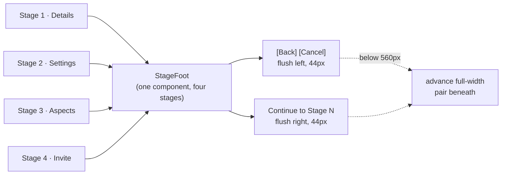
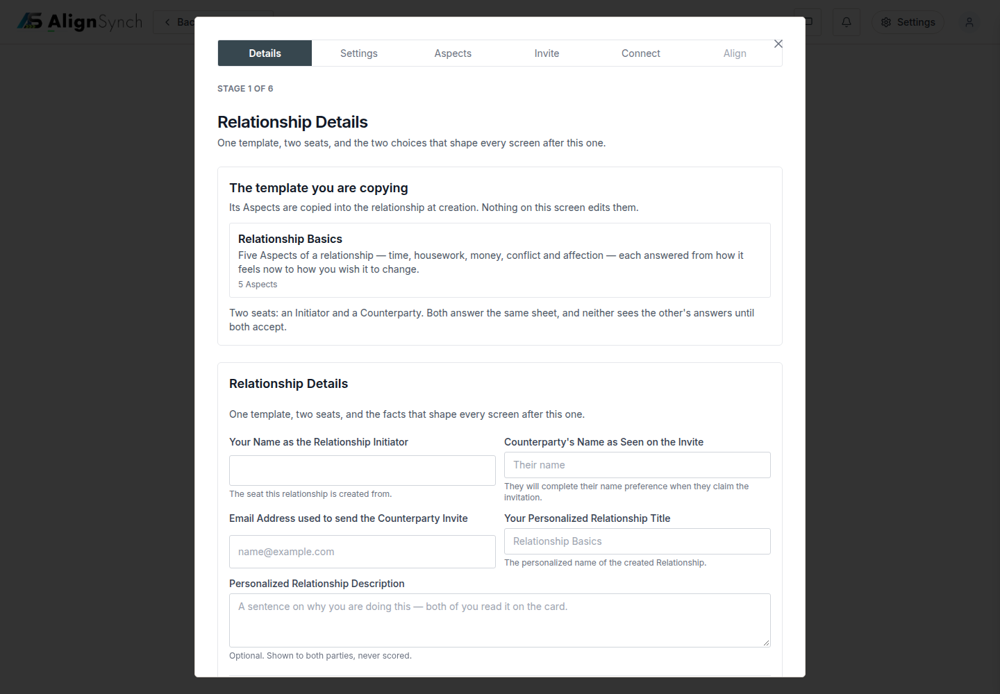
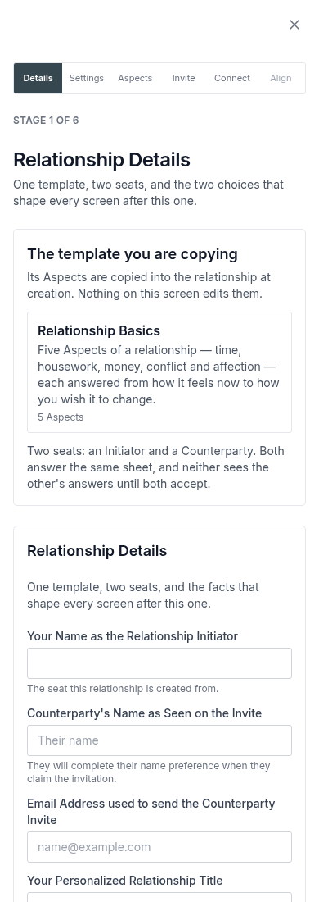

# v1.11.0 — the build draws what the review approved

<!-- docs-nav:begin -->

[Docs hub](../README.md) › **Release notes** › v1.11.0 · prev [v1.10.0](v1-10-0.md) · next [v1.12.0](v1-12-0.md)

<!-- docs-nav:end -->

v1.10.1 was the release the prototype got. v1.11.0 is the one the product got: the six-stage create flow
now draws what the owner approved in the v7 artifact, instead of a screen that described it.

The panel stops growing with the window. `StageShell` was `fixed inset-0` with `lg:inset-6`, so a 1920px
screen drew an 1872px dialog; it is now `min(100% - 48px, 880px)`, centred, and measured at **880px on
1024, 1440, 1920 and 3400** — the same number the artifact draws. A wizard is read as one column, and a
panel that stretches to the monitor is not one.

Every stage shares one foot. Before this release stage 1 drew `Back` and its advance inside the form's
action row while stages 2–4 drew a bare `text-sm` link at the top of the column, 17px tall, with no
`Cancel` anywhere. Now `[Back][Cancel]` is one left group and the advance is flush right; measured at
1440 the pair sits at x330–602 and `Continue to Stage 2` at x945–1110 against a panel that ends at
1160, and at 390 the advance is a full-width row above the pair. All three measure **44px** tall, which
is the floor #745 measured them against — the fix is the row, not a min-height patch on a link.

Settings asks its two questions as peers. The mode and the setting were two full-width stacked
fieldsets; they are now two columns from `sm` up, the same single-select component for both, because
they are two independent questions and stacking them read as one question asked twice.

An Aspect row reads `01 · ⠿ · name · opinions · ✎`. The ordinal comes from the row index, so dragging a
row renumbers it; it is a plain span, so it cannot be typed into; the edit control is an icon at the far
right instead of a word at the far left; and the editor **stays open** until Save or Cancel — the
artifact had to be repaired for exactly that, because a click into a field re-toggled the row shut.

This is a `feat`, so it is a minor: `1.11.0`. The patch that would have carried only the prototype was
prepared and dropped rather than shipped, because release notes are a claim about what changed.

## What the product draws now

- **The panel.** `components/assessment-flow/stage-shell.tsx` — `min(100% - 48px, 880px)`, centred with
  auto margins above 928px, bordered and rounded with no shadow. The below-1024 full-height sheet is
  untouched.
- **The foot.** `StageFoot` in `components/assessment-flow/create-relationship.tsx` is one component for
  stages 1–4: a left group holding `Back` (the stage before) and `Cancel` (the same act as the shell's
  close — a dismissal is a page change, not a step backwards), and the advancing act on the right. One
  row above 560px, the advance alone on top below it.
- **The labels.** `Continue to Stage 2/3/4` in `data/pages/assessment-create.ts`. The spec's stage table
  said `Continue to settings / aspects / invite`, which is why #744 measured a button reading
  `Continue to create` — a verb two stages ahead. The artifact replaced the family; the spec table was
  amended in the same change so the two documents agree.
- **Settings.** Two peer fieldsets — `Opinions Mode` (Basic: two questions per Aspect, Advanced: four)
  and `Alignment Setting` (Soft / Full) — one `ChoiceFieldset` radio component, two columns from `sm`.
- **The aspects.** `components/assessment-flow/aspect-list.tsx` — ordinals off the index, an icon edit
  control at the far right, no per-row origin chip, and an editor that closes only through Save or
  Cancel, asking before it discards unsaved changes.

## One foot, one row

## Screens

The product, not the artifact: the panel is 880px and centred in a 1440px window, and the foot is one
row — `Back` and `Cancel` flush left at x330–602, `Continue to Stage 2` flush right at x945–1110.

The same stage at 390. The full-height sheet is unchanged by this release, the advance is a full row
above the pair, and all three controls still measure 44px.

## Measured in this release

| What                | 1440                                   | 390                             |
| ------------------- | -------------------------------------- | ------------------------------- |
| Panel               | 880px, x280–1160                       | 390px (sheet)                   |
| `Back` / `Cancel`   | 44 / 44px, x330–462 and x470–602       | 44 / 44px, 175px each           |
| Advance             | `Continue to Stage 2`, 44px, x945–1110 | full width, 33–357              |
| Horizontal overflow | `scrollWidth 1440 == innerWidth`       | `scrollWidth 390 == innerWidth` |

Stages 2–4's geometry and the Settings/Aspect rows were measured over CDP in the PR that shipped them
([#761](https://github.com/riolabs-ai/alignsynch/pull/761)): two 384px fieldsets sharing a top edge at
1440 and stacked at 390, Aspect rows 62px at 1440 and 78px at 390, ordinals `01`–`05`, zero horizontal
overflow at 1440/680/390.

## The entry, as published

<!-- changelog-view:begin entry -->
<!-- generated from CHANGELOG.md by scripts/changelog-view.mjs — edit the entry, not this block -->

- **Released** 2026-11-09
- **Tag** [`v1.11.0`](https://github.com/riolabs-ai/alignsynch/releases/tag/v1.11.0)
- **Pull requests named** 4
- **The entry** [`CHANGELOG.md`](../../CHANGELOG.md)

### Added

- `feat(flow)` — the build matches the v7 artifact — shell width, footers, Settings peers, Aspect rows (#760) ([#761](https://github.com/riolabs-ai/alignsynch/pull/761))

### Fixed

- `fix(answer-sheet)` — a refusal code with no sentence 500s, and `lapsed` answers 404 (#752) ([#755](https://github.com/riolabs-ai/alignsynch/pull/755))

### Maintenance

- `docs(review)` — fold the owner's prototype review pass into the v7 artifact ([#759](https://github.com/riolabs-ai/alignsynch/pull/759))
- `chore(health)` — re-record the platform record at 1.10.0 ([#758](https://github.com/riolabs-ai/alignsynch/pull/758))
<!-- changelog-view:end -->

## Known limits

<!-- changelog-view:begin limits -->
<!-- generated from CHANGELOG.md by scripts/changelog-view.mjs — edit the entry, not this block -->

- **The build matches the artifact on four screens; the artifact is still the reference.** The v7
  file (`docs/review/artifacts/prototype-relationship-lifecycle-v7.html`) is what the review approved,
  and it keeps being revised on its own. A revision to the artifact does not reach the product until a
  card lands, so the two can diverge between releases by design — this release closes the gap that was
  open, it does not close the mechanism.
- **Settings agrees on the question and still differs on the shape.** The build draws the two
  dimensions as two peer fieldsets side by side (`components/assessment-flow/create-relationship.tsx`);
  the artifact stacks two cards with a two-up option row inside each. Same two choices — **Basic** /
  **Advanced** and **Soft** / **Full** — different layout. Recorded in #761 rather than quietly
  reconciled.
- **The 44px tap floor is measured on stage 1 and inherited by the rest.** Measured in this release at
  1440 and 390: the Details foot's `Back`, `Cancel` and advance are 44, 44 and 44px tall. Stages 2–4 use
  the same `StageFoot` component, so they hold by construction; there is no per-stage measurement for
  them in this release.
- **The stage-3 exit now reads `Continue to Stage 4`, not the spec's older `Continue to invite`.** The
  approved artifact replaced that whole family of exits, and `docs/specs/flow-stages.md` was amended in
  the same change so the spec and the artifact do not contradict each other. A reader who learned the
  older wording will find a different label on the button.
- **Copy lives in the fixtures, and the artifact's `Edit copy` tool is not in the build.** Every string
  the flow renders comes from `data/pages/assessment-create.ts` (E23 forbids a literal in a component).
  The artifact's browser-side override tool is a review device and does not exist in the product.
- **`Align` is still drawn unavailable from the create flow.** The relationship this flow creates has no
  shared assessment until somebody claims the invitation and answers, which is unchanged by this
  release and is what the spec requires.
- **No database, auth or API change.** `db/migrations/`, `lib/auth/` and `lib/db/` are untouched; this
  release is the create flow's markup, its fixture copy, the spec table, and the tests that pin them.
<!-- changelog-view:end -->

<!-- docs-nav:begin -->

[Docs hub](../README.md) › **Release notes** › v1.11.0 · prev [v1.10.0](v1-10-0.md) · next [v1.12.0](v1-12-0.md)

<!-- docs-nav:end -->
