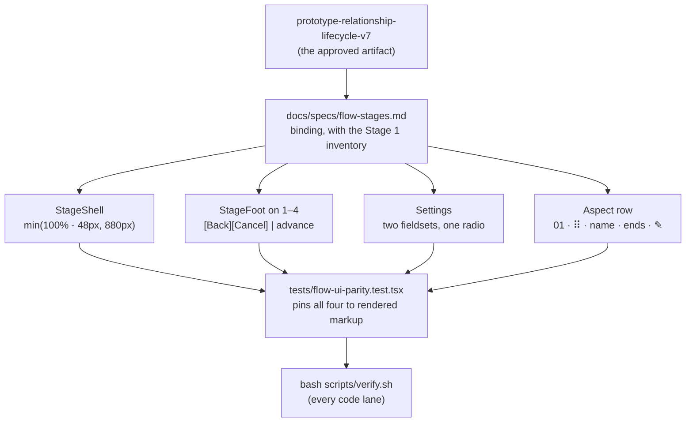
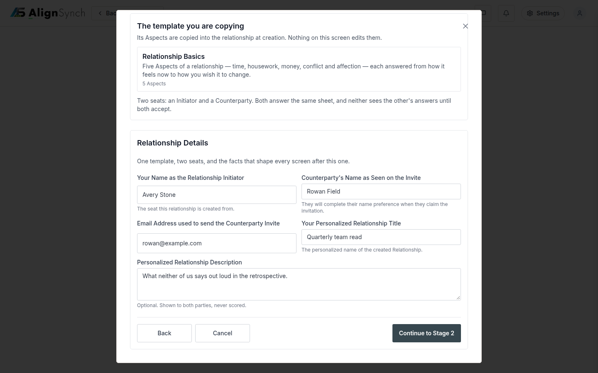
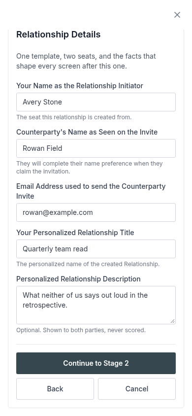
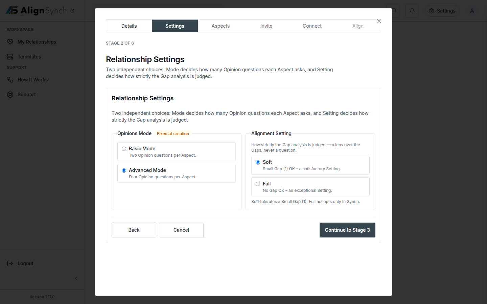
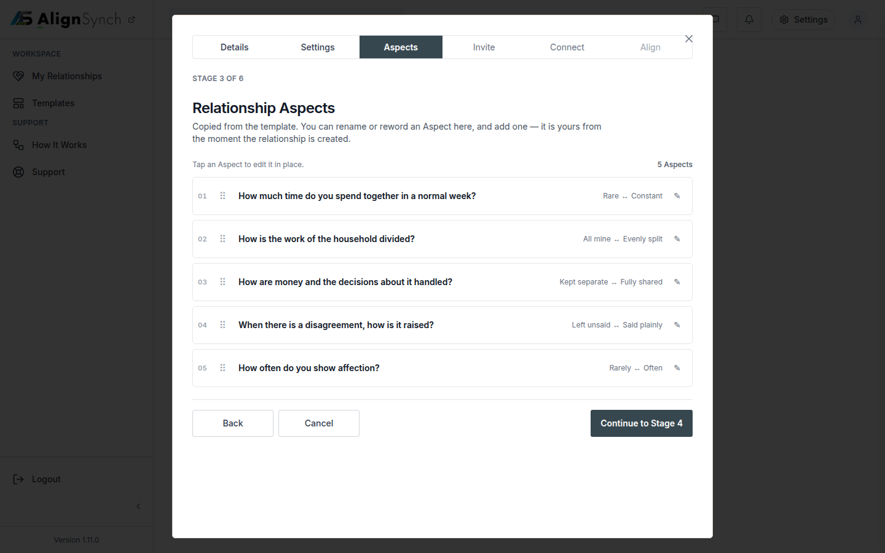

# v1.11.0 — the conformance

<!-- docs-nav:begin -->

[Docs hub](../README.md) › **Release notes** › v1.11.0 · prev [v1.10.0](v1-10-0.md)

<!-- docs-nav:end -->

v1.8.0 renamed the flow's stages and v1.9.0–v1.10.0 made it pay. v1.11.0 is the release where the
build stopped _resembling_ the approved artifact and started **matching** it: the panel is capped and
centred, every stage 1–4 screen ends in one foot, Settings draws its two dimensions as two peers of
one control, and an Aspect row reads as the single line the artifact draws (#760).

The reference is the review artifact `prototype-relationship-lifecycle-v7`, served at
`/admin/review?artifact=prototype-relationship-lifecycle-v7`. `docs/specs/flow-stages.md` now names it
as the binding reference and carries the Stage 1 field inventory, character for character from the
owner's Edit-copy pass — so the next screen that drifts from the artifact is a defect with a document
to point at rather than a matter of taste.

## What was painful before

- **The dialog grew with the screen.** Above 1024 the flow was a dialog whose width followed the
  viewport, so a 3400px monitor put a field's label an unreadable distance from its input. Four of the
  seven conformance slices the owner's review pass named were about this shape, not about features.
- **Every stage ended differently.** One stage drew `Back` as a bare text link at the top of the
  column; another drew its own pair in the action row. Two controls meant two gaps, two orders and two
  alignments — and at 390 a 17px link sat in a foot that was otherwise 44px controls.
- **Settings read as a control and a toolbar.** Mode and Setting are two dimensions of equal weight,
  but they were drawn as two different things, so one looked like the primary question.
- **An Aspect row described itself twice.** A per-row origin chip repeated the template's name on
  every line, and opening a row had more than one way out.

## What it does now

- **The panel is `min(100% - 48px, 880px)`, centred, from `lg` up.** Measured **880px at 1024, 1440,
  1920 and 3400** — the wizard is read as one column, and past the cap it stops growing
  (`components/assessment-flow/stage-shell.tsx`). Below 1024 it stays the full-height sheet it was.
- **One foot on stages 1–4.** `[Back][Cancel]` is a single left group and the act that advances the
  flow is flush right; the advance names the stage it goes to. Measured at 1440: one row 780px wide,
  the pair left-flush at x=330 and the advance right-flush at x=945–1110 — and at 390 the advance is a
  full-width 358px row above a 175 + 8 + 175 pair, with `scrollWidth == innerWidth` at both widths.
- **Settings draws `Opinions Mode` and `Alignment Setting` as two peers of one radio component** — two
  `fieldset`s with their own legends, one bordered cell per option, and the option's one-line glossary
  help. There is one single-select implementation on the screen, not a control and a toolbar.
- **An Aspect row is one line:** `01 · ⠿ · name · opinions · ✎`. The position is read off the row's
  index, so a drag renumbers it; the edit control is an icon carrying the fixture's own word as its
  accessible name. An open row closes through **Save or Cancel only**, and Cancel with unsaved words
  asks first instead of discarding them.
- **The owner's saved copy across stages 1–3**, fixture-only, with `tests/create-fields.test.ts`
  pinning the inventory so a silent sixth field or a dropped fifth is red.

## The conformance, as the release ships it

## Screens

Details' foot at 1440: `[Back][Cancel]` as one left group at x=330, the advance right-flush at
x=945–1110, both 44px tall. This is the row four stages now share.

The same foot at 390 — the advancing act takes a full-width 358px row of its own above the pair,
because the row cannot hold three controls at that width.

`Opinions Mode` and `Alignment Setting` as two peers of one radio component, each with its own legend,
cells and glossary help. `Fixed at creation` rides beside the Opinions Mode legend as a chip.

The Aspect rows reading `01 · ⠿ · name · opinions · ✎`. The ordinals are the row indexes, so a drag
renumbers them; the edit control is the icon, and its accessible name is the fixture's own word.

The measurements behind these stills, and the harness that produced them, are in
[`docs/qa-flow-v7/`](../qa-flow-v7/README.md).

## The entry, as published

<!-- changelog-view:begin entry -->
<!-- generated from CHANGELOG.md by scripts/changelog-view.mjs — edit the entry, not this block -->

- **Released** 2026-11-09
- **Tag** [`v1.11.0`](https://github.com/riolabs-ai/alignsynch/releases/tag/v1.11.0)
- **Pull requests named** 4
- **The entry** [`CHANGELOG.md`](../../CHANGELOG.md)

### Added

- `feat(flow)` — the build matches the v7 artifact — shell width, footers, Settings peers, Aspect rows (#760) ([#761](https://github.com/riolabs-ai/alignsynch/pull/761))

### Fixed

- `fix(answer-sheet)` — a refusal code with no sentence 500s, and `lapsed` answers 404 (#752) ([#755](https://github.com/riolabs-ai/alignsynch/pull/755))

### Maintenance

- `docs(review)` — fold the owner's prototype review pass into the v7 artifact ([#759](https://github.com/riolabs-ai/alignsynch/pull/759))
- `chore(health)` — re-record the platform record at 1.10.0 ([#758](https://github.com/riolabs-ai/alignsynch/pull/758))
<!-- changelog-view:end -->

## Known limits

<!-- changelog-view:begin limits -->
<!-- generated from CHANGELOG.md by scripts/changelog-view.mjs — edit the entry, not this block -->

- **The 880px panel is a desktop-only measurement.** The cap is `min(100% - 48px, 880px)` from
  `lg` up (`components/assessment-flow/stage-shell.tsx`), and it was measured at 1024, 1440, 1920
  and 3400. Below 1024 the flow is a full-height sheet with no inset and no border, so a screen
  between 560px and 1023px gets the sheet, not the narrower dialog.
- **Settings draws the two peer fieldsets side by side, which is not what the artifact draws.** The
  v7 artifact stacks `Opinions Mode` and `Alignment Setting` as two cards with their options
  two-up; this build makes them two peers in one row from `sm` up (one column below it), with each
  fieldset's options on one row. The deviation is the card's shape and is recorded on `#760` rather
  than silently resolved in the artifact's favour — the artifact is never edited to match the build.
- **The create flow's copy is a fixture, not an edit surface.** Every label, help line and button
  the stages 1–3 screens render lives in `data/pages/assessment-create.ts` and reaches the
  components already resolved, which is what `data:check` E23 holds. Nothing in the product lets a
  member reword it: the owner's v7 Edit-copy pass is a commit to that fixture.
- **An Aspect row still closes only through Save or Cancel, and that is deliberate.** There is no
  click-outside dismissal and no Escape handler on an open row; Cancel with unsaved words asks
  first instead of discarding them (`components/assessment-flow/aspect-list.tsx`). A reader
  expecting a row to collapse on blur will read the prompt as a second step.
- **The conformance slices C3, C4 and C5 are still not in this release.** The admin console's left
  edge (`#717`), the marketing content cards' shadows (`#718`) and the right-aligned numbers and
  explicit empty states (`#719`) remain open in the `v1.11.0` milestone. This cut ships the flow
  conformance alone (`#760`); the milestone's other three slices are not claimed by it.
- **Only Stripe test keys are configured.** The adapter reads `STRIPE_TEST_SECRET_KEY`
  (`lib/billing/adapters/stripe.ts`), so a payment method is captured in test mode and this release
  cannot take a real charge.
- **The hard gate sits at completion, and it is the only gate.** With no method on file a
  relationship reports `awaiting_payment` and opinions stay withheld (`lib/flow/state.ts`);
  answering, sharing and inviting are never gated, and there is still no login wall to reach them.
- **One payment path still carries a known risk, unchanged.** Publishing can start a trial or
  checkout while completion also writes a `relationship_payment` obligation (ADR-1), so a
  double-created obligation is possible; reachable only with test keys today.
<!-- changelog-view:end -->

<!-- docs-nav:begin -->

[Docs hub](../README.md) › **Release notes** › v1.11.0 · prev [v1.10.0](v1-10-0.md)

<!-- docs-nav:end -->
