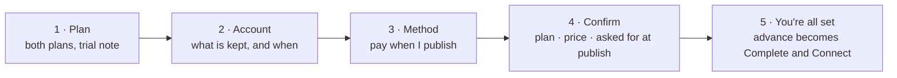
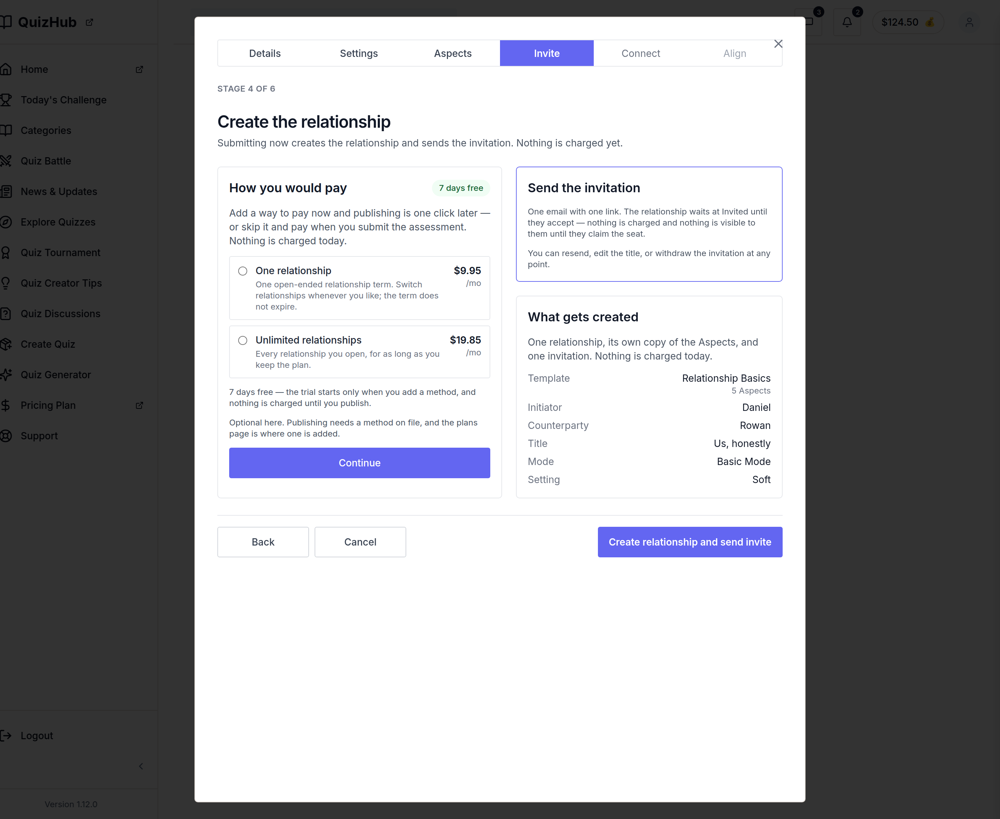
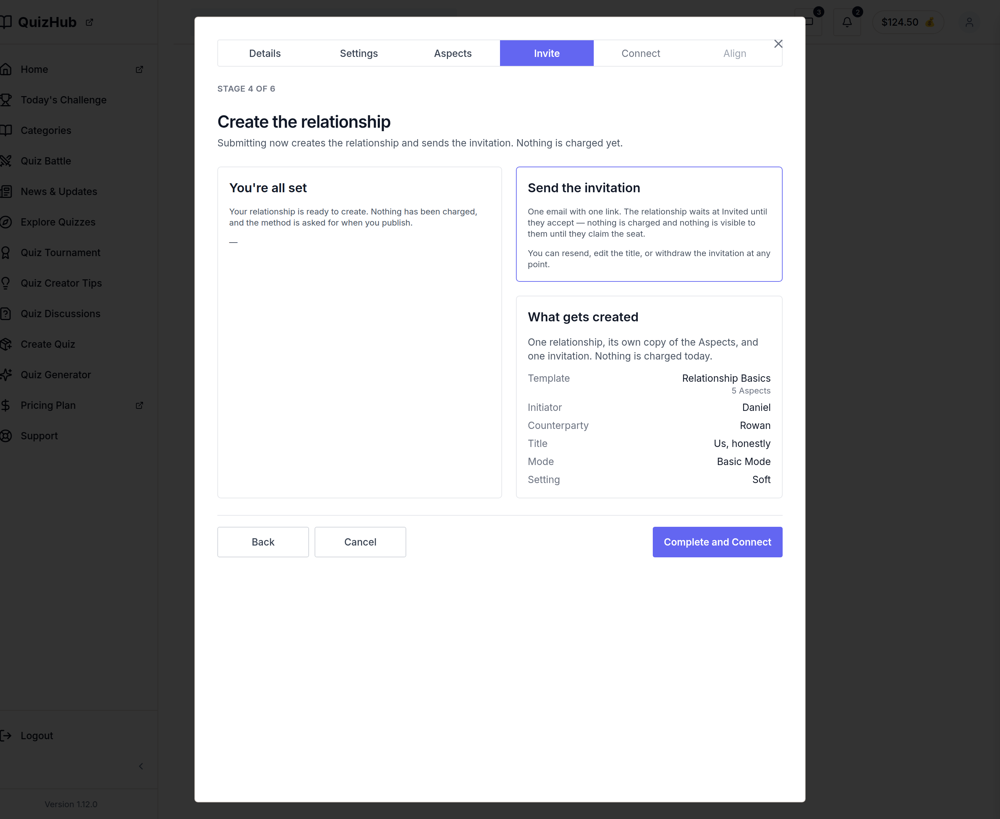

# v1.12.0 — the payment decision moves into the stage that asks for it

<!-- docs-nav:begin -->

[Docs hub](../README.md) › **Release notes** › v1.12.0 · prev [v1.11.0](v1-11-0.md)

<!-- docs-nav:end -->

Stage 4's left column used to end in a link to `/pricing`. That link was the whole payment story the
create flow told: choose a plan, then leave the flow to go and do something about it on another page.
The owner called it the wrong flow in review, and this release is that correction in the product.

The walk is five panels, in one card, on one screen: **plan → account → method → confirmation →
you're all set**. Each panel fades in (`.pay-flow-panel`, 220ms), nothing navigates, and the stage keeps
its own `Stage n of 6` rail.

The two ends of the walk, captured from this build at 1440:

 The stage's advance control reads the create label through the first four
panels and **Complete and Connect** on the last one — the same form, so the flip is a word and never a
second write path.

**Nothing is charged on this screen, and that is deliberate.** The method panel says _Pay when I
publish_, and the confirmation prints the method's answer as _Asked for at publish_. A relationship
created here is a draft; the method is asked for once, when its opinions are published, which is where
the hard gate has lived since #690 (`components/dashboard/relationship-detail.tsx`,
`lib/flow/payment.ts`). Drawing a card field on the create screen would have been the flow telling a
story the charge does not tell.

The account panel names the account instead of collecting it. The shipped gate
(`account-gate.tsx`) still follows the commit, and a second sign-up form on this screen would have been
a second form to keep in step with `/register`.

Structurally, stage 4 moved into `components/assessment-flow/stage-four.tsx` — a client component,
because the walk's step and the foot's label are one piece of state in two places — and the foot was
lifted out into `components/assessment-flow/stage-foot.tsx` unchanged. Stages 1–3 stay in
`create-relationship.tsx`.

This release also carries the review passes the prototype took to get here: the pre-stage losing its
duplicate chip, the change-request bar moving to the left edge, Stage 4's flow being drawn in the
artifact first, and the same artifact's `Save .json` now writing its copy into the repository instead of
into a download the pane swallows.

This is a `feat`, so it is a minor: `1.12.0`.

## What changed on the screen

- **The walk.** `components/assessment-flow/stage-four.tsx` — `StageFour` draws the five panels and owns
  the step; every word comes from `data/pages/assessment-create.ts`'s `payment-flow` section.
- **The advance.** `components/assessment-flow/stage-foot.tsx` — `StageFoot` is now its own module, with
  `SECONDARY_CLASSES` and `ADVANCE_CLASSES` beside it, so both the server-rendered stages and the client
  walk draw the same foot.
- **The fade.** `app/globals.css` — `@keyframes pay-flow-in` and `.pay-flow-panel`, outside every media
  query so the lockup rule keeps its block to itself.
- **The pricing door is gone.** `PRICING_PATH` is no longer imported by the create flow; a tier is still
  sold on `/pricing`.

## What pins it

`tests/payment-flow.test.ts` renders the stage at each of the five steps and asserts: the panels in the
artifact's order, **no `href` anywhere in the stage**, no password field and no card field on the method
panel, the six review facts on every panel, and the advance reading the create label on the first four
panels and `Complete and Connect` only on the last — attached to the same `create-commit-form`.

`tests/create-commit.test.tsx` used to assert the `/pricing` href; it now asserts its absence, which is
the same fact the other way round.

## The entry

<!-- changelog-view:begin entry -->
<!-- generated from CHANGELOG.md by scripts/changelog-view.mjs — edit the entry, not this block -->

- **Released** 2026-11-09
- **Tag** [`v1.12.0`](https://github.com/riolabs-ai/alignsynch/releases/tag/v1.12.0)
- **Pull requests named** 6
- **The entry** [`CHANGELOG.md`](../../CHANGELOG.md)

### Added

- `feat(flow)` — stage 4 walks the payment in place, and the create is a draft that pays at publish ([#771](https://github.com/riolabs-ai/alignsynch/pull/771))
- `feat(review)` — the prototype's Save writes its copy into the repository (#767) ([#768](https://github.com/riolabs-ai/alignsynch/pull/768))

### Fixed

- `fix(review)` — Stage 4's payment runs in place, and the CTA becomes Complete and Connect ([#770](https://github.com/riolabs-ai/alignsynch/pull/770))
- `fix(review)` — the pre-stage loses its duplicate chip, and the change-request bar moves left ([#769](https://github.com/riolabs-ai/alignsynch/pull/769))
- `fix(flow)` — every in-card control reaches the 44px floor, and the floor is pinned (#745) ([#765](https://github.com/riolabs-ai/alignsynch/pull/765))

### Maintenance

- `chore(health)` — re-record platform health for 1.11.0 ([#766](https://github.com/riolabs-ai/alignsynch/pull/766))
<!-- changelog-view:end -->

<!-- changelog-view:begin limits -->
<!-- generated from CHANGELOG.md by scripts/changelog-view.mjs — edit the entry, not this block -->

- **The create screen takes no card.** Stage 4's walk defers the capture by design: the method is
  asked for once, when the relationship's opinions are published. The confirmation says "Asked for
  at publish" rather than drawing a field that would take nothing.
- **`/pricing` is no longer linked from stage 4.** Choosing a plan commits nothing and buys nothing;
  a tier is still sold on `/pricing` and from the account screens.
- **The account panel names the account, it does not collect it.** The shipped gate
  (`components/assessment-flow/account-gate.tsx`) still follows the commit, and the walk's panel
  only says what happens.
- **Publishing still needs a method on file** — the hard gate is unchanged
  (`components/dashboard/relationship-detail.tsx`, `lib/flow/payment.ts`). A draft created without
  one asks for it at publish; nothing about the charge moved.
- **Stripe is still test-mode on the demo deployment.** No real charge is possible from any screen
  in this release, and `BILLING_HOST` is unset in the local checkout, so a checkout attempt there
  answers `503 not-configured`.
- **The walk is a client component.** Stage 4 moved to `components/assessment-flow/stage-four.tsx`
  and the foot to `components/assessment-flow/stage-foot.tsx`; stages 1–3 are unchanged in
  `components/assessment-flow/create-relationship.tsx`.
<!-- changelog-view:end -->

<!-- docs-nav:begin -->

[Docs hub](../README.md) › **Release notes** › v1.12.0 · prev [v1.11.0](v1-11-0.md)

<!-- docs-nav:end -->
