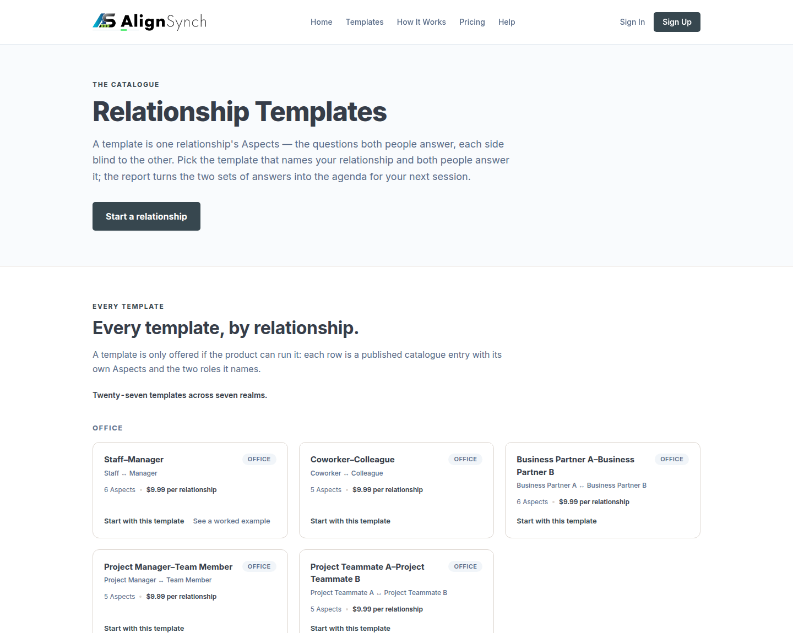
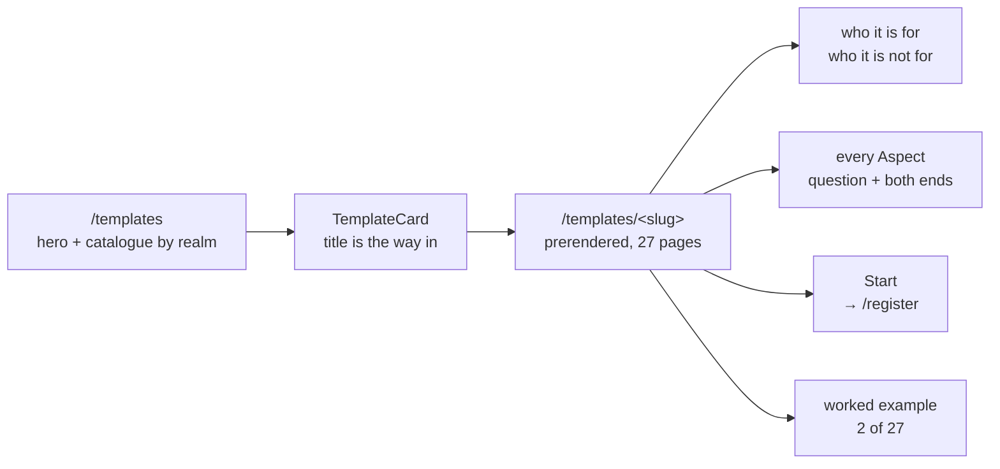
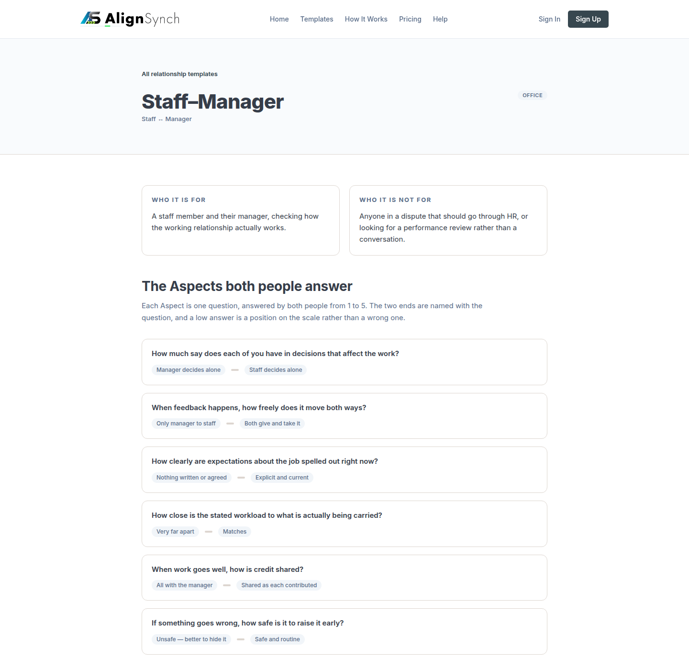

# v1.13.0 — the templates directory becomes a directory

<!-- docs-nav:begin -->

[Docs hub](../README.md) › **Release notes** › v1.13.0 · prev [v1.12.0](v1-12-0.md) · next [v1.14.0](v1-14-0.md)

<!-- docs-nav:end -->

`/templates` was four marketing sections around a catalogue: what a template is, what a purchase
buys, and a closing _start with one_. The catalogue it is named for was section four. A stranger
who came to look at templates read three pitches first, and then found twenty-seven cards and no way
to open any of them.

This release is that page becoming the thing it claims to be, and the thing behind each card.

The page is now two bands: a hero — eyebrow, heading, one sentence, **one** action — and the
catalogue, grouped by realm, with the count derived from the taxonomy rather than typed. Nothing new
was drawn: the cards were already `TemplateCard`, and the realm grouping was already
`templateRealms`.

The cards were the second problem. Twenty-seven templates carrying a hundred and forty-four Aspects
offered a stranger exactly two public doors: `/register`, and a worked example on two of the
twenty-seven. The dashboard had always had a detail page; the shop never did.

So every purchasable template now has a public page at `/templates/<slug>`: its name and realm, the
roles it joins, the who-it-is-for and who-it-is-not-for pair, every Aspect with its question and
both named ends, the price, one Start action, and the worked example where the fixture holds one.
One record, two projections — the page and the card are built from the same
`data/relationship-types.ts` row, so the questions a stranger reads are the ones the product asks.

All twenty-seven are static. `generateStaticParams()` emits one page per purchasable type and
`notFound()` answers anything else — a typo, or one of the dating types the owner excluded — because
absence is the honest answer and it is the same 404 either way. The page reads no clock, no cookie,
no session and no store, which is what lets `next build` list it with a prerender marker rather than
`ƒ`.

The third change is the one a member feels. My Templates listed two unrelated things: the templates
a member owns, and every template one of their relationships had been copied from. The second was a
bug. Starting a relationship from a platform template put that template into the member's library,
wearing an ownership-shaped card with an _Adopted_ chip — a word chosen because there was no honest
one for a template you do not own.

Nothing was ever written on create: `createRelationship()` inserts the record, the items, the
relationship and its members, and never a template. So this was one predicate doing the wrong thing,
`owner_user_id = $1` **OR** `EXISTS(session JOIN party … p.user_id = $1)`. The `OR` branch is gone.
Membership of a relationship is not authorship of a template — the relationship _uses_ the template
— and what followed it is deleted rather than relabelled: the _Adopted_ chip, the read-only branch
that routed around the member's own editor, the adopted copy item, and the `LibraryRow.owned` field
that was always true once the branch existed.

The fourth change is the word itself. _"Instance"_ named two different things depending on the
sentence, and the schema had not used it for a while — the tables are `relationship`,
`relationship_member`, `session`, `session_invite`, `party`. Only the copy still said instance, and
`data/pages/assessment-instance.ts` contradicted itself on one screen: a docstring explaining
relationship, session and assessment, a table column labelled _Sessions_, and a page called
_Instances_. Every reader-visible string is now one of the two words the model has, chosen per
string: a **session** is one cycle of answering inside a published relationship, and a
**relationship** is the container, bought once, holding every cycle. Eleven copy fixtures moved;
no count, number or promise changed. What is left of the word is a code handle — export names, the
`{instances}` view token, the cookie names — and handles are not copy.

This is a `feat`, so it is a minor: `1.13.0`.

## What changed on the screen

- **The directory.** `components/templates/templates-page.tsx` — the hero keeps one action, and the
  catalogue draws `TemplateCard` grouped by `templateRealms`, counted from the taxonomy.
- **The page.** `app/(marketing)/templates/[slug]/page.tsx` — prerendered through
  `generateStaticParams()`; the view is `components/templates/template-detail.tsx` over
  `lib/template-detail.ts`.
- **The card's way in.** `components/templates/template-card.tsx` — the public card's title links to
  the page, the way the dashboard card's already did.
- **The library.** `lib/member/library.ts` — `IN_LIBRARY` is `owner_user_id = $1` and nothing else;
  `data/pages/dashboard-templates.ts` loses the copy the _Adopted_ chip needed.
- **One Aspect editor.** `feat(ui)` #775, in this census: the modal and the dashboard draw the same
  Aspect editor, which is one ruleset in one place instead of two that could drift.

## What pins it

`tests/member-templates-tabs.test.ts` fails if `IN_LIBRARY` ever gains a party join again — the
predicate is the bug, so the assertion is on the predicate rather than on a screenshot of it.

The terminology rename has its own guard: `tests/terminology.test.ts` walks every `data/pages`
fixture, masks `{token}` and `<token>`, skips `id` and `href`, and fails with the file, the key path
and the offending string when a reader-visible _instance_ returns. It was red-checked by putting one
back, and it named the fixture the reinserted string was in.

The template pages are pinned twice: `data:check`'s E23 budget is 0 on both routes, and the release's
own gate builds all twenty-seven pages, so a slug that stops resolving is a red build rather than a
404 nobody notices.

## The entry

<!-- changelog-view:begin entry -->
<!-- generated from CHANGELOG.md by scripts/changelog-view.mjs — edit the entry, not this block -->

- **Released** 2026-11-11
- **Tag** [`v1.13.0`](https://github.com/riolabs-ai/alignsynch/releases/tag/v1.13.0)
- **Pull requests named** 9
- **The entry** [`CHANGELOG.md`](../../CHANGELOG.md)

### Added

- `feat(templates)` — every template has a page, not just a card (#782) ([#782](https://github.com/riolabs-ai/alignsynch/pull/782))
- `feat(templates)` — the directory, not the pitch — /templates drops its three explainer bands (#781) ([#781](https://github.com/riolabs-ai/alignsynch/pull/781))
- `feat(ui)` — one Aspect editor for the modal and the dashboard (#774) ([#775](https://github.com/riolabs-ai/alignsynch/pull/775))

### Fixed

- `fix(copy)` — a relationship has sessions, a template has neither (#783) ([#787](https://github.com/riolabs-ai/alignsynch/pull/787))
- `fix(templates)` — a relationship does not make a template yours (#783) ([#784](https://github.com/riolabs-ai/alignsynch/pull/784))

### Maintenance

- `docs(review)` — v8 — the draft path is "Continue as Draft" (#780) ([#780](https://github.com/riolabs-ai/alignsynch/pull/780))
- `docs(review)` — v8 — membership heading, the two invitation states, and a plainer plan note (#779) ([#779](https://github.com/riolabs-ai/alignsynch/pull/779))
- `docs(review)` — prototype v8 — Stage 4 condensed, drawn as the release draws it (#777) ([#778](https://github.com/riolabs-ai/alignsynch/pull/778))
- `chore(health)` — re-record platform health for 1.12.0 ([#773](https://github.com/riolabs-ai/alignsynch/pull/773))
<!-- changelog-view:end -->

<!-- changelog-view:begin limits -->
<!-- generated from CHANGELOG.md by scripts/changelog-view.mjs — edit the entry, not this block -->

- **A relationship does not put its template in your library, and no action adds it yet.** My
  Templates lists the templates a member owns: `lib/member/library.ts::listMemberLibrary` reads
  `r.owner_user_id = $1`, and the party-join branch that pulled in every template one of their
  relationships had been copied from is deleted. The explicit door the owner asked for — take a
  template from a relationship I am in, and make it mine — is not in this release: #785 needs an
  approved mockup first, and with the old predicate gone there is no route that clones a template.
- **Twenty-five of the twenty-seven template pages show no worked example.** The page draws one only
  where the fixture holds a demo sheet — two types today, `staff-manager` and `co-founders`
  (`data/relationship-types.ts::demoAnswersFor`). A link that would 404 is worse than none, so the
  other twenty-five pages end at the Start action.
- **The template pages are built from the fixture, not from the database.** All twenty-seven are
  prerendered by `app/(marketing)/relationship-types/[slug]/page.tsx::generateStaticParams` over
  `data/relationship-types.ts`, so a template that exists only in the tenant store an imported
  bundle writes (`data/generated/`) has no public page until the next build. _(The page moved in
  #794, when the catalogue left the template noun: at this tag the file was
  ~~`app/(marketing)/templates/[slug]/page.tsx::generateStaticParams`~~, and its address is
  `/relationship-types/<slug>` now.)_
- **Three templates are deliberately absent.** The public pages are the purchasable types only; a
  slug that names a dating type the owner excluded, or nothing at all, answers 404.
- **The terminology rename is copy, not schema: the code handles still say `instance`.** The
  `{instances}` view token, the fixture module named `data/pages/assessment-instance.ts` and the
  `flow_invite_<id>` cookie names are handles rather than words a reader sees, and they are left
  alone. What changed is the copy, guarded by `tests/terminology.test.ts`, which fails on a
  reader-visible _instance_ in a `data/pages` fixture.
- **URLs are unchanged.** `/assessment/instances/<id>/…` still serves the relationship workspace;
  the route rename to `/relationships/<id>/sessions/…` needs redirects and its own pass, and it is
  not in a minor.
- **A template cannot be authored from the public site.** `/templates` and `/templates/<slug>` are
  read-only projections: starting a relationship from one copies it into a relationship, and
  creating a template of your own is still the dashboard's editor.
<!-- changelog-view:end -->

<!-- docs-nav:begin -->

[Docs hub](../README.md) › **Release notes** › v1.13.0 · prev [v1.12.0](v1-12-0.md) · next [v1.14.0](v1-14-0.md)

<!-- docs-nav:end -->
