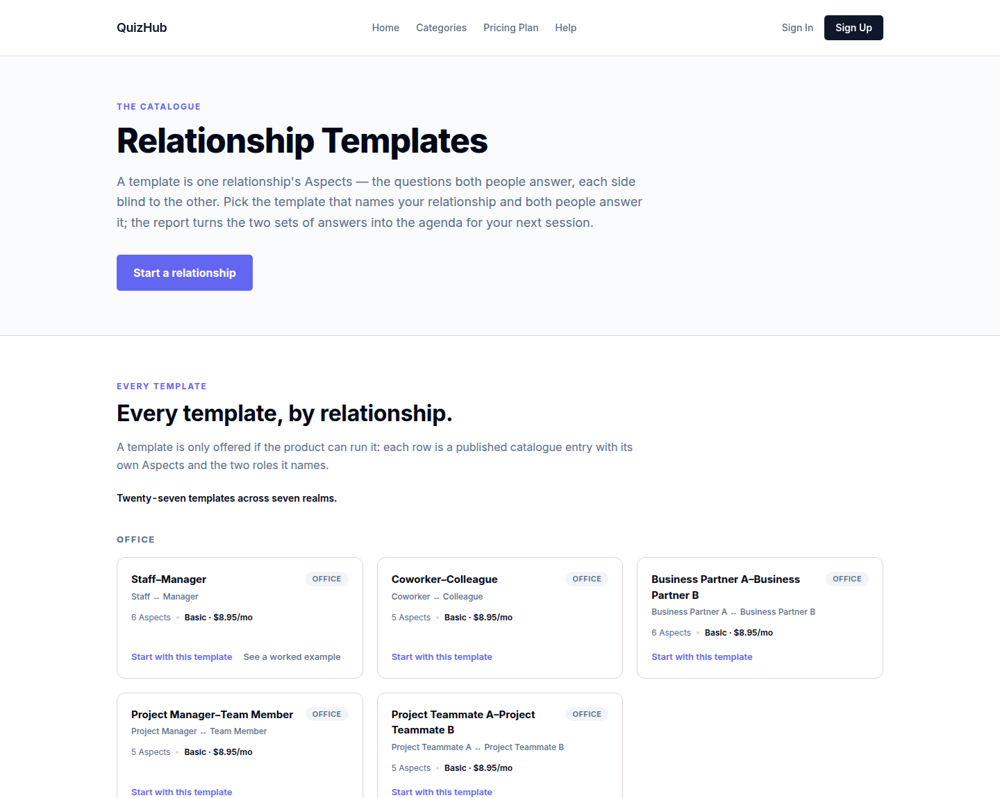
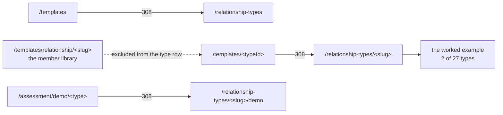
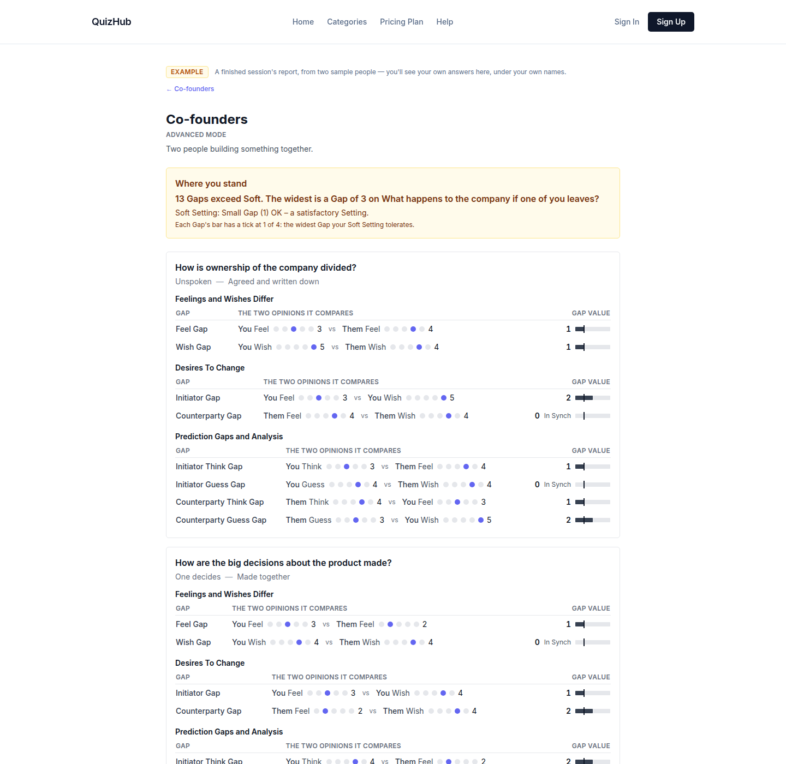

# v1.14.0 — the catalogue owns the noun

<!-- docs-nav:begin -->

[Docs hub](../README.md) › **Release notes** › v1.14.0 · prev [v1.13.0](v1-13-0.md)

<!-- docs-nav:end -->

Two public addresses were still spelled with words the product does not use with a visitor.
`/templates` was the shop's address _and_ the word a member's own shelf answers to, so a stranger
reading a card could not tell which one they were on. `/assessment/demo/<type>` was the worked
example, and it was the last public surface left hanging off the record kind — `assessment` is what
the database calls a record, not what a reader is buying.

This release moves both, permanently, and then fixes the number the moved pages were printing.

`/templates` answers a 308 to `/relationship-types`, and `/templates/<typeId>` to
`/relationship-types/<typeId>`. The member library keeps the `/templates` namespace, one segment in:
`/templates/relationship/<slug>` is where a signed-in member lists, duplicates and edits their own.
That split is why the type row carries a negative lookahead — `(?!relationship(?:/|$))` — because a
bare `:typeId` would catch the library's own segment and 308 the member shelf into a 404 that
`next build` would still list as a route.

The worked example follows the same noun: `/assessment/demo/<type>` → `/relationship-types/<slug>/demo`,
one segment wide with no wildcard, so `/assessment/demo/<type>/anything` stays a plain 404 rather than
a 308 into a second 404 — and `/assessment/instances/**`, which does not move in this pass, is
untouched by the row.

The third change is the figure on those cards. Three marketing surfaces printed `type.price` bare —
"$9.99 per relationship", a number the pricing page does not carry, in a unit the product does not
sell: the shop sells a plan, and one plan covers every relationship. Each surface now prints the
plan, `Basic · $8.95/mo`, read from `data/billing-plans.ts` through `cataloguePriceNote()` — the same
chip the member shelf and the template editor already drew, so no two shelves can disagree about the
number. `TemplateCard.price` is gone rather than left unread, because a field holding $9.99 is a field
one render away from being printed. The worked example's report is the same fix from the other end: it
quotes no per-relationship figure at all, names the plan, and hands the reader `/pricing`.

Underneath the copy, two surfaces got one shape each. `components/ui/badge.tsx::Chip` is the one chip:
`rounded-full`, four tones — `neutral`, `tint`, `soft`, `onBand` — and nothing else. The tone is the
variant, the radius never is, and none of them hovers, because a chip is a label and not a control.
Before it, one concept was drawn by three constants at three radii, which is why a chip could read as
the wrong noun on the wrong card.

`lib/member/card.ts::MemberCard` is the one member card: a template card and a relationship card are
the same type with the axis that genuinely differs filled in — a template card reports
`relationship: null`, a relationship card reports `summary: null` — so the arithmetic that used to
happen inside `components/assessment-flow/my-instances.tsx`'s JSX now happens in a module a test can
read. The relationship list's four metric tiles are that card's one meta line.

The browse rail left the template detail page, which is one column now: the template, its Aspects, its
price, and one Start. And `pnpm db:verify` stops calling a session an instance in its summary line —
the last place a reader of that output met the old noun.

## The entry

<!-- changelog-view:begin entry -->
<!-- generated from CHANGELOG.md by scripts/changelog-view.mjs — edit the entry, not this block -->

- **Released** 2026-11-11
- **Tag** [`v1.14.0`](https://github.com/riolabs-ai/alignsynch/releases/tag/v1.14.0)
- **Pull requests named** 16
- **The entry** [`CHANGELOG.md`](../../CHANGELOG.md)

### Added

- `feat(ia)` — the worked example lives at /relationship-types/<slug>/demo (#794 follow-up) ([#809](https://github.com/riolabs-ai/alignsynch/pull/809))
- `feat(ia)` — a relationship template lives at /templates/relationship/<slug> (#794) ([#803](https://github.com/riolabs-ai/alignsynch/pull/803))

### Fixed

- `fix(db-verify)` — the summary stops calling a session an instance (#783) ([#813](https://github.com/riolabs-ai/alignsynch/pull/813))
- `fix(routes)` — the worked example's old address answers a permanent 308 ([#810](https://github.com/riolabs-ai/alignsynch/pull/810))
- `fix(copy)` — the demo report prices the plan, not the relationship (#805) ([#807](https://github.com/riolabs-ai/alignsynch/pull/807))
- `fix(copy)` — the marketing template surfaces price the plan, not the relationship (#798) ([#804](https://github.com/riolabs-ai/alignsynch/pull/804))
- `fix(copy)` — the template card prices the plan, not the relationship (#796) ([#799](https://github.com/riolabs-ai/alignsynch/pull/799))
- `fix(ui)` — drop the browse rail from the template detail page (#791) ([#793](https://github.com/riolabs-ai/alignsynch/pull/793))

### Maintenance

- `refactor(ui)` — the relationship card's tiles are the card's one meta line (#795 F4) ([#814](https://github.com/riolabs-ai/alignsynch/pull/814))
- `refactor(ui)` — one chip primitive, rounded-full, four tones (#795) ([#808](https://github.com/riolabs-ai/alignsynch/pull/808))
- `refactor(ui)` — one member card projection feeds both shelves (#795 F2) ([#811](https://github.com/riolabs-ai/alignsynch/pull/811))
- `test(routes)` — prove every #794 old address answers a permanent 308 ([#806](https://github.com/riolabs-ai/alignsynch/pull/806))
- `docs(mockup)` — #795 v2 — the provenance cells wrap, and three §0 claims get exact ([#802](https://github.com/riolabs-ai/alignsynch/pull/802))
- `docs(mockup)` — re-derive §0 provenance at 89beff68 — one-card-one-detail-v2 (#795) ([#800](https://github.com/riolabs-ai/alignsynch/pull/800))
- `docs(mockup)` — one card, one detail — the approval artifact for #795 ([#797](https://github.com/riolabs-ai/alignsynch/pull/797))
- `chore(health)` — re-record the platform record at 1.13.0 ([#790](https://github.com/riolabs-ai/alignsynch/pull/790))
<!-- changelog-view:end -->

<!-- changelog-view:begin limits -->
<!-- generated from CHANGELOG.md by scripts/changelog-view.mjs — edit the entry, not this block -->

- **The redirects map address families, not records.** `/assessment/demo/:type` is one segment wide,
  so `/assessment/demo/<type>/anything` is still a plain 404, and a type with no worked example
  answers 404 at `/relationship-types/<type>/demo` even though its _old_ address still 308s — the
  table cannot look a row up (`next.config.mjs`).
- **The rename stops at the public noun.** The member routes still live at `/assessment/instances/**`
  and the schema still spells `assessment_instance` / `instance_invite`. What changed is what
  `db:verify`'s summary line _says_: `${instances.length} session(s) checked`. Renaming the tables and
  the member routes is #783's remainder and needs a production snapshot and a restore plan
  (`scripts/db-verify.mjs`, `db/migrations/0002_two_party_flow.sql`).
- **IA v2 is not in this release.** The rail keeps the groups it has; the four-group rail is drawn
  and pushed on `feat/app-ia` and waits for its review before it ships.
- **A relationship's template cannot be saved as the member's own template** (#785). There is no
  clone path, and nothing here adds one.
- **The relationship's own amount still exists as data and is printed nowhere.**
  `data/relationship-types.ts::RELATIONSHIP_PRICE_CENTS` keeps $9.99 for a future per-relationship
  charge; the catalogue card, the member shelf and the template editor read the plan from
  `data/billing-plans.ts` instead, which is why they read `Basic · $8.95/mo` and cannot disagree,
  and the worked example's report names the plan and hands the reader `/pricing` rather than
  quoting any figure of its own.
- **One card type, two shelves, deliberate nulls.** `lib/member/card.ts::MemberCard` is a template
  card with `relationship: null` and a relationship card with `summary: null`; a third shelf
  adopting it is the moment to split it into a discriminated `kind` rather than widen it again.
<!-- changelog-view:end -->

<!-- docs-nav:begin -->

[Docs hub](../README.md) › **Release notes** › v1.14.0 · prev [v1.13.0](v1-13-0.md)

<!-- docs-nav:end -->
