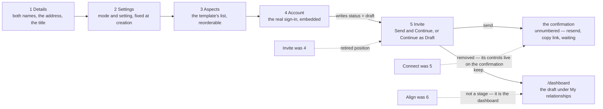
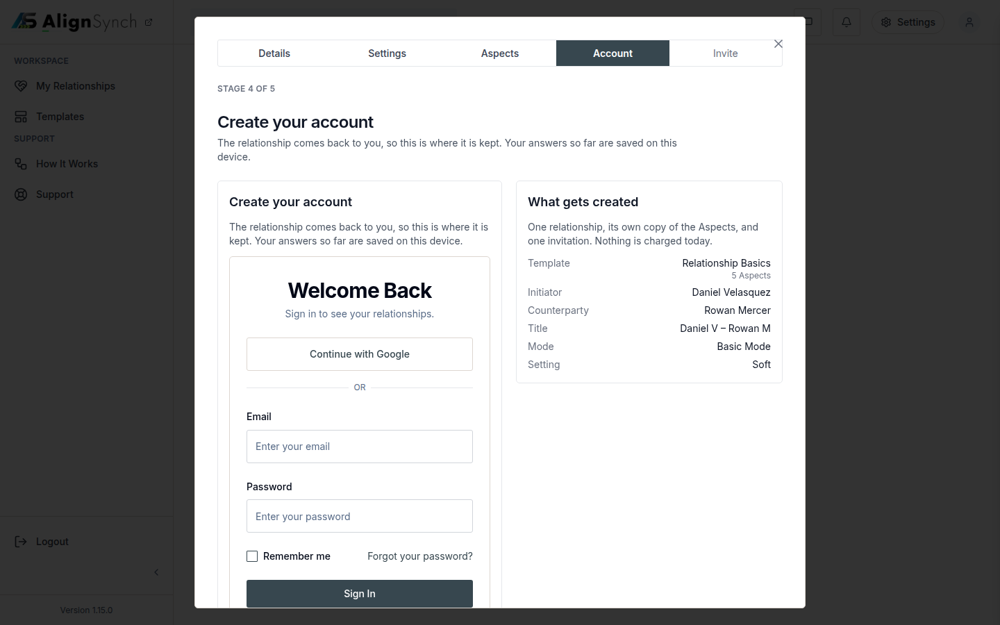
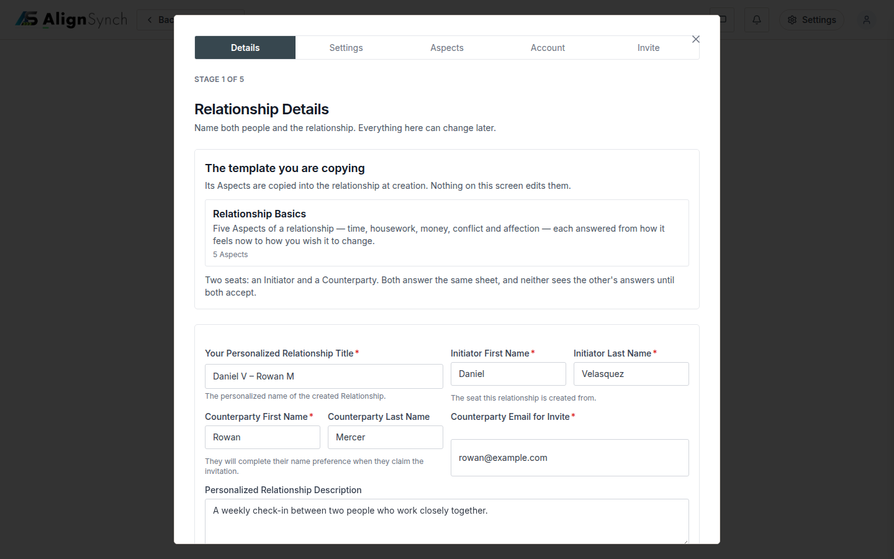

# v1.15.0 — the flow is five stages

<!-- docs-nav:begin -->

[Docs hub](../README.md) › **Release notes** › v1.15.0 · prev [v1.14.0](v1-14-0.md) · next [v1.16.0](v1-16-0.md)

<!-- docs-nav:end -->

The create flow promised six stages and delivered four of them, and the one it left out was the
one nobody can complete the flow without: an account. `Account` was a gate _after_ the create —
a page whose whole job was to demand a sign-up — while `Connect` held a stage slot for controls
(resend, copy link, the waiting status) that the dashboard's relationship detail already owned, and
`Align` sat at number six as a stage a visitor could never reach from inside the flow.

This release makes the flow five stages and writes it down as a spec first, then builds to it:
**1 Details · 2 Settings · 3 Aspects · 4 Account · 5 Invite**.

**Account is stage 4, and it is the real thing.** The stage mounts the app's own
`components/auth/login-view.tsx` with `layout="embedded"` — the same component both brands ship,
sized for the stage column — instead of the inert panel that used to sit here. What _this tag_ does
with it is worth being exact about: the embedded view opens on _Sign in_, and its sign-up control is
still a link to `/register`. #831 mounts it behind an in-place toggle that opens on _Create your
account_, and it landed **after** this tag — so it is on `main` and not in `v1.15.0`.

Completing the stage posts
`POST /assessment/new` with `draft=1`, which writes the relationship with `status = 'draft'`,
`published_at` NULL, a session and an invitation row — and sends nothing. The relationship's shape
(one template, two seats, the aspect count, both parties, the title) is drawn beside the form,
because all of that is known before an account is chosen and repeating it on the next stage would
be one card too many.

**Invite is stage 5, and it is two decisions.** `Send and Continue` posts to
`/assessment/instances/[instanceId]/send`, which reissues the token and moves the row
`draft → published` through the same transition table every other send uses, then mails the one
invitation — so a broken mailer can never un-publish a relationship. `Continue as Draft` is a link
to the dashboard and sends nothing. The confirmation that follows is **unnumbered**: it is proof
the invitation left, not a sixth stage, and it is where the retired Connect stage's resend and
copy-link controls now live.

The rail follows the words: five cells, `Stage {n} of 5`, and no `Ongoing` — completion lands on the
relationship detail page in the member dashboard, which is where every later cycle of that
relationship happens. A bookmarked `/templates/relationship/<slug>/create/account` answers a
permanent 308 to `/create/commit`, the stage that now asks for the account, so the retired address
does not become a 404 in somebody's history.

**Stage 1 asks for the names it always meant.** Each seat is first and last name rather than one
string, the title's default is derived from them (`Daniel V – Rowan M`) and stops the moment
somebody types in it, five fields carry the required mark, and a name pair is two controls in one
column with its help line under the pair rather than under one half of it.

The spec those screens answer to is [`docs/specs/flow-stages.md`](../specs/flow-stages.md), and it is
binding: the stage table, stage 1's field inventory and the tests that hold both are in that file.
`tests/flow-stages.test.ts` fails unless the stage words are exactly these five in this order,
`tests/create-fields.test.ts` pins the seven fields, and `tests/stage-one-title.test.tsx` types into
the form to prove the title follows the names and then stops.

## The entry

<!-- changelog-view:begin entry -->
<!-- generated from CHANGELOG.md by scripts/changelog-view.mjs — edit the entry, not this block -->

- **Released** 2026-11-12
- **Tag** [`v1.15.0`](https://github.com/riolabs-ai/alignsynch/releases/tag/v1.15.0)
- **Pull requests named** 4
- **The entry** [`CHANGELOG.md`](../../CHANGELOG.md)

### Added

- `feat(flow)` — Account is stage 4 and Invite is stage 5 — the five-cell rail (#825) ([#828](https://github.com/riolabs-ai/alignsynch/pull/828))
- `feat(flow)` — the spec is five stages, and Stage 1 asks first and last names (#825, PR 1 of 2) ([#826](https://github.com/riolabs-ai/alignsynch/pull/826))

### Fixed

- `fix(flow)` — a Stage 1 control fills its cell, so the name pair stops overflowing (#825) ([#827](https://github.com/riolabs-ai/alignsynch/pull/827))

### Maintenance

- `chore(health)` — re-record the platform record at 1.14.0 ([#820](https://github.com/riolabs-ai/alignsynch/pull/820))
<!-- changelog-view:end -->

<!-- changelog-view:begin limits -->
<!-- generated from CHANGELOG.md by scripts/changelog-view.mjs — edit the entry, not this block -->

- **The flow takes no payment.** `Send and Continue` posts to
  `/assessment/instances/[instanceId]/send`, which reissues the token and moves the row
  `draft → published`; nothing in the five stages charges anything. The two plans on stage 5 are a
  soft prompt — `data/pages/assessment-create.ts` says so in the `payment-flow` section, "a soft
  prompt, not a checkout" — and buying a tier is `/pricing`
  (`components/pricing/plan-checkout-button.tsx`). A real checkout inside the flow is #823 with #690.
- **Stage 4 is only as good as the app's auth environment.** The stage mounts the real
  `components/auth/login-view.tsx`, so its form submits to the app's own auth proxy: on a tree with no
  `NEON_AUTH_*` the submit raises the configuration error rather than signing anybody in
  (`lib/auth/session.ts::currentUser`). The gate carries no auth env by design, so this stage is
  proven by a request, never by `pnpm build`.
- **Stage 3 still cannot add or remove an Aspect.** V4 keeps the template's list fixed until #699:
  the shared editor names `Add an Aspect` and `Remove {name}`, and stage 3 draws neither
  (`data/pages/assessment-create.ts`).
- **The Invite copy is not condensed.** #777 is open — stage 5 states the same promise several times,
  and the OAuth button carries no provider mark.
- **A kept draft sends nothing and has no surface of its own.** `Continue as Draft` leaves the
  relationship at `status = 'draft'` with `published_at` NULL, no mail sent and no token handed out;
  the confirmation that owns resend and copy-link is reached by sending, and a kept draft is picked up
  from the dashboard's relationship detail.
- **The retired account gate is a redirect, not a screen.** A bookmarked
  `/templates/relationship/<slug>/create/account` answers a permanent 308 to `/create/commit`, the
  stage that now asks for the account; the flow has five stages and nothing after the fifth
  (`next.config.mjs`, `docs/specs/flow-stages.md`).
<!-- changelog-view:end -->

<!-- docs-nav:begin -->

[Docs hub](../README.md) › **Release notes** › v1.15.0 · prev [v1.14.0](v1-14-0.md) · next [v1.16.0](v1-16-0.md)

<!-- docs-nav:end -->
