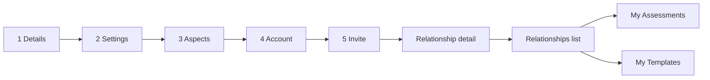

# v1.16.0 — the relationship is a destination

<!-- docs-nav:begin -->

[Docs hub](../README.md) › **Release notes** › v1.16.0 · prev [v1.15.0](v1-15-0.md) · next [v1.17.0](v1-17-0.md)

<!-- docs-nav:end -->

Fourteen features and fifteen fixes, and the through-line is that the app stopped treating a
finished relationship as the last step of a wizard. Completion used to leave you on a page that
still looked like a flow — same rail, same focus header, a back-link labelled as though you could
walk backwards out of an agreement two people had already signed. It is now a place: its own
detail view, its own door, and a rail that says where you are instead of counting stages at you.

Around that, the shell got quieter. Every dashboard page sits in one left-justified column unless
it is registered as an exception, and the rail folds to a handle that straddles its border rather
than a form that submitted nothing. The front page is the AS2 redesign, the header and footer each
say one thing, and the footer's link column mirrors the marketing menu so the two cannot drift.

The flow itself gained the two things it was missing. An Aspect can be added and removed at stage
3, and the last one cannot be removed at all — the control is disabled, and the store refuses the
commit anyway, because a `disabled` attribute is not a rule. Stage 5 stopped being a dead end:
the payment walk, the send-or-draft choice and the template guard at stage 1 each name their own
way forward instead of returning a link that does not exist.

The member's sessions are finally listed as their own surface: `/assessments` reads the same data
the app already held, beside `/dashboard/relationships` and `/dashboard/templates`, and the old
`/assessment/instances` path answers `308` to it rather than becoming a second page. Nothing in
that listing is new data — it is the visibility the relationship list already had, applied to the
sessions underneath it.

## The entry

<!-- changelog-view:begin entry -->
<!-- generated from CHANGELOG.md by scripts/changelog-view.mjs — edit the entry, not this block -->

- **Released** 2026-11-12
- **Tag** [`v1.16.0`](https://github.com/riolabs-ai/alignsynch/releases/tag/v1.16.0)
- **Pull requests named** 34
- **The entry** [`CHANGELOG.md`](../../CHANGELOG.md)

### Added

- `feat(ui)` — /assessments is the member's session listing (#877) ([#888](https://github.com/riolabs-ai/alignsynch/pull/888))
- `feat(flow)` — add and remove an Aspect at stage 3, and record the copy as authored (#699) ([#876](https://github.com/riolabs-ai/alignsynch/pull/876))
- `feat(infra)` — pnpm qa:links derives the clickable QA list for a change range (#863) ([#869](https://github.com/riolabs-ai/alignsynch/pull/869))
- `feat(flow)` — the counterparty forks the relationship's template into their own (#785) ([#872](https://github.com/riolabs-ai/alignsynch/pull/872))
- `feat(ux)` — one left-justified column for every dashboard page, and a registered exception list (#858) ([#871](https://github.com/riolabs-ai/alignsynch/pull/871))
- `feat(templates)` — delete an authored template, behind a confirm (#743) ([#866](https://github.com/riolabs-ai/alignsynch/pull/866))
- `feat(infra)` — the admin rail is a versioned document with a validator (#861) ([#864](https://github.com/riolabs-ai/alignsynch/pull/864))
- `feat(ui)` — measure rules 6 and 7 as E40, then fix all 18 (#719 C5) ([#860](https://github.com/riolabs-ai/alignsynch/pull/860))
- `feat(billing)` — the publish trial is the Advanced entitlement (#835) ([#859](https://github.com/riolabs-ai/alignsynch/pull/859))
- `feat(home)` — the AS2 front page at / with the surface-token layer it needs (#853) ([#857](https://github.com/riolabs-ai/alignsynch/pull/857))
- `feat(copy)` — stage 4 says each fact once, and the OAuth control has its mark (#777) ([#855](https://github.com/riolabs-ai/alignsynch/pull/855))
- `feat(ui)` — the relationships list is the My Quizzes record list (#841 part 2) ([#852](https://github.com/riolabs-ai/alignsynch/pull/852))
- `feat(admin)` — the eighteen admin pages render in one shared column (#717) ([#851](https://github.com/riolabs-ai/alignsynch/pull/851))
- `feat(billing)` — the Free card is the trial card, and a lapse closes the Gap not the pairing (#848) ([#849](https://github.com/riolabs-ai/alignsynch/pull/849))

### Fixed

- `fix(flow)` — the counterparty's read-only screen gets a door (#873) ([#887](https://github.com/riolabs-ai/alignsynch/pull/887))
- `fix(copy)` — the AlignSynch footer's link column is "Website Links" ([#886](https://github.com/riolabs-ai/alignsynch/pull/886))
- `fix(home)` — the marketing header's lockup is a link to the front page ([#884](https://github.com/riolabs-ai/alignsynch/pull/884))
- `fix(theme)` — render next-themes during SSR so its pre-paint script lands (#880) ([#885](https://github.com/riolabs-ai/alignsynch/pull/885))
- `fix(flow)` — stage 5 is not a dead end — payment walk, send/draft, and the template guard at stage 1 (#870) ([#878](https://github.com/riolabs-ai/alignsynch/pull/878))
- `fix(home)` — the footer Quick Links mirror the marketing header menu ([#883](https://github.com/riolabs-ai/alignsynch/pull/883))
- `fix(home)` — the hero's "See how it works" was 60px tall because its arrow sized itself ([#882](https://github.com/riolabs-ai/alignsynch/pull/882))
- `fix(ui)` — the rail's collapse control is a button on its border, not a form (#875) ([#881](https://github.com/riolabs-ai/alignsynch/pull/881))
- `fix(ui)` — the relationship detail is a destination, not a flow (#873) ([#879](https://github.com/riolabs-ai/alignsynch/pull/879))
- `fix(db)` — the demo seed converges a drifted branch instead of refusing it (#865) ([#868](https://github.com/riolabs-ai/alignsynch/pull/868))
- `fix(flow)` — the draft lands on the relationships list, and the list titles by the relationship (#841) ([#850](https://github.com/riolabs-ai/alignsynch/pull/850))
- `fix(billing)` — the hosted capture sends the currency the provider requires (#844) ([#845](https://github.com/riolabs-ai/alignsynch/pull/845))
- `fix(billing)` — publishing a relationship opens its trial, so the counterparty can claim (#840) ([#843](https://github.com/riolabs-ai/alignsynch/pull/843))
- `fix(deploy)` — demo.alignsynch.com serves again — one command creates it, one rule keeps it (#838) ([#839](https://github.com/riolabs-ai/alignsynch/pull/839))
- `fix(flow)` — a draft is not gated, and stage 5 says the plan without refusing it (#834) ([#837](https://github.com/riolabs-ai/alignsynch/pull/837))
- `fix(flow)` — stage 4 opens on Create account and toggles in place (#829) ([#831](https://github.com/riolabs-ai/alignsynch/pull/831))

### Maintenance

- `docs(legal)` — photography credits at /terms, and the AS2 handoff package committed (#853) ([#856](https://github.com/riolabs-ai/alignsynch/pull/856))
- `test(flow)` — the e2e walks the five stages, signed in, and proves draft vs send (#844) ([#842](https://github.com/riolabs-ai/alignsynch/pull/842))
- `chore(health)` — re-record the platform record at 1.15.0 ([#836](https://github.com/riolabs-ai/alignsynch/pull/836))
- `docs(changelog)` — v1.15.0 says what the tag's stage 4 actually does ([#832](https://github.com/riolabs-ai/alignsynch/pull/832))
<!-- changelog-view:end -->

<!-- changelog-view:begin limits -->
<!-- generated from CHANGELOG.md by scripts/changelog-view.mjs — edit the entry, not this block -->

- The public Templates catalogue at `/relationship-types` is **unchanged** in this release. The approved `spec-as2-style-templates-redesign` build is still in review, so the page visitors see today is the previous one.
- Selecting a template does not carry through sign-up. A card's use action opens registration without the chosen template, because the intent parameter is not implemented yet.
- The relationship card's kind chip still prints "Template" where the record is a relationship; templates are products and a relationship is a pairing.
- `/assessments` lists assessment sessions over data the app already holds. Comments, notes and gap analytics are not part of it.
- Payments run in test mode: no charge is processed, and the pricing page's disclosure stands unchanged.
- The demo environment serves the previous version until its next refresh; the verification recorded here applies to the tagged tree on production.
- Two records still share one wording: the relationship detail's read-only notice and the counterparty's way-forward door both point at the relationships list, which is the only destination that exists today.
<!-- changelog-view:end -->

<!-- docs-nav:begin -->

[Docs hub](../README.md) › **Release notes** › v1.16.0 · prev [v1.15.0](v1-15-0.md) · next [v1.17.0](v1-17-0.md)

<!-- docs-nav:end -->
