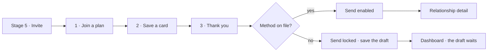

# v1.17.0 — the pay-flow ship

<!-- docs-nav:begin -->

[Docs hub](../README.md) › **Release notes** › v1.17.0 · prev [v1.17.1](v1-17-1.md) · next [v1.16.0](v1-16-0.md)

<!-- docs-nav:end -->

Stage 5 of the create flow used to be a form that handed you a decision it could not take. It asked
for an email address, drew a send button, and left the money somewhere else entirely — a relationship
could be sent with no card on file as long as nobody looked too closely, and the one answer reserved
for that case arrived after the fact as a refusal. This release makes the last stage one decision
drawn in two columns that answer each other: a **three-step payment walk on the left** — join a plan,
save a card, thank you — and the send it unlocks on the right. A person now sees what they are buying
and what it buys, in the same frame, at the moment they are asked to commit.

The gate is real and it is enforced twice. In the panel the send control is `disabled` until the walk
has a card on file, and the aside beside it carries the one sentence that says what unlocks it, wired
to the control with `aria-describedby` — a greyed button with no reason next to it is where people
close the tab. On the server, `sendDraftInvitation()` refuses a relationship with no captured method
with `no-payment-method`, so a crafted POST cannot publish an unpaid draft. The UI half is the
courtesy; the server half is the rule.

Nothing in the walk charges anything. Saving a card puts a method on file and starts the seven-day
trial; the fee itself is taken later, by the product's own completion path, which is why the card step
says so and why "save the draft" sits inside the send card at every state — it needs no plan, no card
and no money, and it lands on the dashboard where the draft waits. Since #912 the walk is
`components/billing/stripe-frame.tsx`'s **only** caller: the dashboard's capture dialog is deleted, so
the product has one set of card fields instead of two.

### The send itself was answering 500

Building the gate exposed the harder defect, and it was not in the UI at all. The send read the
captured method by asking `relationship` for a column called `method_captured_at` — a column
migration `0036` puts on `relationship_payment`. Postgres answered `42703` and every Send returned a
500, for every relationship, with no path that skipped it. The read now joins
`relationship_payment` on its primary key (`relationship_id`, so the join cannot fan out) and selects
`p.method_captured_at`; a relationship with no payment row still reads `null` and still answers
`no-payment-method` — the same refusal as before, never a 500 and never "not found". **No migration
ships with this release**: the column was always on the right table, and `0039` is still the newest.

### Around it, the catalogue and the console

The public catalogue moved onto the approved V2 redesign at `/relationship-templates`, and the front
page is the V2 home reference. The operator's side grew the two things it was missing: `/admin/docs`
renders the docs tree from the repo (with its own rail row), and `/admin/brand` plus a sticky notice
bar give whoever runs the instance a place to see and say what changed.

The member's screens settled the same way. A relationship's edit form is a dialog/sheet rather than a
permanent column, and it stops printing the Aspects a second time; the relationship screen reads its
own Aspects instead of the template's. The rail carries the owner's standard order for every role, and
a relationship's kind chip says **Relationship** instead of borrowing the word for a template.

### What else is in it

A browser driver (`pnpm demo:flow`) now walks create, draft and unpaid in real Chrome, screenshots
every screen and records the transcript — it found breaks an HTTP harness cannot see, and they are
fixed in this release. The demo dataset gained a deterministic growth model to $3M ARR. The repo
gained the files a public project needs: MIT `LICENSE`, `CONTRIBUTING.md`, `SECURITY.md`,
`CODE_OF_CONDUCT.md` and `SUPPORT.md`.

## The entry

<!-- changelog-view:begin entry -->
<!-- generated from CHANGELOG.md by scripts/changelog-view.mjs — edit the entry, not this block -->

- **Released** 2026-11-13
- **Tag** [`v1.17.0`](https://github.com/riolabs-ai/alignsynch/releases/tag/v1.17.0)
- **Pull requests named** 27
- **The entry** [`CHANGELOG.md`](../../CHANGELOG.md)

### Added

- `feat(admin)` — the sticky notice bar and /admin/brand (#906) ([#947](https://github.com/riolabs-ai/alignsynch/pull/947))
- `feat(catalogue)` — /relationship-templates, the V2 catalogue (#905) ([#933](https://github.com/riolabs-ai/alignsynch/pull/933))
- `feat(qa)` — one demo driver walks create/draft/unpaid in a browser — and the breaks it found (#898) ([#930](https://github.com/riolabs-ai/alignsynch/pull/930))
- `feat(review)` — the comments mockup on the review shelf — 3 subjects × 2 placements (#921) ([#928](https://github.com/riolabs-ai/alignsynch/pull/928))
- `feat(review)` — register lifecycle v8 + v9 on the review shelf, and sync it without a full seed (#914) ([#919](https://github.com/riolabs-ai/alignsynch/pull/919))
- `feat(home)` — clone the V2 home reference onto / (#904) ([#924](https://github.com/riolabs-ai/alignsynch/pull/924))
- `feat(flow)` — stage 5 is the three-step payment walk and the send it gates (#911) ([#918](https://github.com/riolabs-ai/alignsynch/pull/918))
- `feat(nav)` — /admin/docs gets a rail row (#901) ([#907](https://github.com/riolabs-ai/alignsynch/pull/907))
- `feat(data)` — the platform package — kind platform, deterministic zip, subsets (#899) ([#902](https://github.com/riolabs-ai/alignsynch/pull/902))
- `feat(ui)` — rebuild /relationship-types from the approved templates redesign (#889) ([#891](https://github.com/riolabs-ai/alignsynch/pull/891))
- `feat(admin)` — /admin/docs renders the docs tree (#892) ([#900](https://github.com/riolabs-ai/alignsynch/pull/900))

### Fixed

- `fix(flow)` — stage 5's Send reads the captured method from the payment row (#948) ([#949](https://github.com/riolabs-ai/alignsynch/pull/949))
- `fix(member)` — the relationship screen reads its own Aspects, not the template's (#936) ([#944](https://github.com/riolabs-ai/alignsynch/pull/944))
- `fix(ui)` — the relationship edit panel stops printing the Aspects a second time (#935) ([#942](https://github.com/riolabs-ai/alignsynch/pull/942))
- `fix(admin)` — /admin/audit reads a row with no reason instead of throwing (#938) ([#941](https://github.com/riolabs-ai/alignsynch/pull/941))
- `fix(nav)` — the owner's standard rail order, for every role (#929) ([#939](https://github.com/riolabs-ai/alignsynch/pull/939))
- `fix(ui)` — the relationship detail's edit form is a dialog/sheet, not a permanent column (#923) ([#932](https://github.com/riolabs-ai/alignsynch/pull/932))
- `fix(demo)` — prune preserved branches by policy before the reset (#909) ([#917](https://github.com/riolabs-ai/alignsynch/pull/917))
- `fix(pay)` — the modal is the only way to pay (#912) ([#925](https://github.com/riolabs-ai/alignsynch/pull/925))
- `fix(copy)` — a relationship's kind chip says Relationship, not Template (#874) ([#916](https://github.com/riolabs-ai/alignsynch/pull/916))
- `fix(flow)` — a visitor's chosen template survives the account gate (#867) ([#915](https://github.com/riolabs-ai/alignsynch/pull/915))

### Maintenance

- `test(ui)` — the Escape close waits for Radix's focus restore ([#950](https://github.com/riolabs-ai/alignsynch/pull/950))
- feat(demo) · #920 — a deterministic growth model to $3M ARR, and an operational demonstration set ([#934](https://github.com/riolabs-ai/alignsynch/pull/934))
- `docs(oss)` — LICENSE (MIT), SECURITY.md, CODE_OF_CONDUCT.md, SUPPORT.md (#922) ([#927](https://github.com/riolabs-ai/alignsynch/pull/927))
- `docs(oss)` — CONTRIBUTING.md for humans + audit issue/PR templates and CODEOWNERS (#922) ([#926](https://github.com/riolabs-ai/alignsynch/pull/926))
- `spec(design)` — banner + /admin/brand added to the V2 package (#903) ([#910](https://github.com/riolabs-ai/alignsynch/pull/910))
- `docs(workflow)` — codify request → release, and add the release-train card template ([#890](https://github.com/riolabs-ai/alignsynch/pull/890))
<!-- changelog-view:end -->

<!-- changelog-view:begin limits -->
<!-- generated from CHANGELOG.md by scripts/changelog-view.mjs — edit the entry, not this block -->

- **`demo.alignsynch.com` is still down.** The hostname answers `DEPLOYMENT_NOT_FOUND` (#833); the demo dataset is reachable through `pnpm demo:verify` and the review rig, not through that address. Deferred by owner decision, not by oversight.
- **Stripe runs in test mode, structurally.** `lib/billing/adapters/stripe.ts` refuses any credential that is not an `sk_test_…` key, and the webhook endpoints still belong to the test account (#846, #847). The payment walk is the real three-step UI; the capture it performs is a test capture.
- **Production has no admin seat yet.** `ADMIN_EMAILS` is unset on the production branch, so no operator reaches `/admin/**` there; the demo branch carries two (#423).
- **The modal rule has not been audited screen by screen.** #913 asks for every screen, page, menu and button to be validated against it. This version applies the rule where it touched a surface — the relationship edit form is a dialog and the pay step is a modal — and does not claim the audit.
- **The edit panel still posts a snapshot of the Aspects.** Reorder in the detail's list, then save the panel in the same page session without a refresh, and the pre-reorder order is written back (#943). It was scheduled to land before this release and is not in it; the fix ships in the next patch.
<!-- changelog-view:end -->

<!-- docs-nav:begin -->

[Docs hub](../README.md) › **Release notes** › v1.17.0 · prev [v1.17.1](v1-17-1.md) · next [v1.16.0](v1-16-0.md)

<!-- docs-nav:end -->
