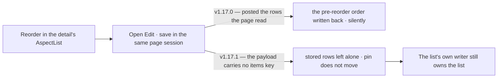

# v1.17.1 — the patch the last note promised

<!-- docs-nav:begin -->

[Docs hub](../README.md) › **Release notes** › v1.17.1 · prev [Release blog](README.md) · next [v1.17.0](v1-17-0.md)

<!-- docs-nav:end -->

v1.17.0's release notes ended with a promise in writing: the relationship edit panel still posted a
snapshot of the Aspects, the fix was scheduled to land before that release and did not, and _the fix
ships in the next patch_. This is that patch. It carries no new surface and claims no new capability
— three fixes, five maintenance commits, and the limit sentence retired.

### The edit panel stops posting a list it does not own

#935 took the Aspects out of the edit dialog's drawing but left them in its payload:
`buildTemplateRecord({ …, aspects: state.aspects })` rebuilt the record from the rows the page had
read, so dragging an Aspect in the detail's list and then saving the dialog in the same page session
wrote the pre-reorder array back over the drag. Nothing refused it and nothing said so — a reorder
strands no answer, so it states no cost.

The item list is now **optional** on the edit action, and omitted means _leave the stored rows
exactly as they are_: the writer's "after" list is its "before" list, no item statement and no
version statement runs, and the pin does not move. A list that _is_ supplied is still applied in
full — `.min(1)`, the scale, the two named ends and the id rule all still come from `zAssessment`, so
`buildTemplateRecord` keeps its `.min(1)` for callers building a new record and `saveAspects` keeps
`validateTemplateRecord`. The panel builds its payload with `buildEditedRecord`, which emits no
`items` key at all: the shape makes "this panel does not edit Aspects" true rather than stated. Both
mounts — the member's relationship detail and the console's instance screen — go through the one
action, so both are fixed.

`tests/relationship-edit-reorder-race.test.ts` drives the real writer over a scripted `ActSql` and is
red at `480a3a96` (the drag is written back) and green here.

### One create path, and it is the flow's door

The catalogue had stopped being just a catalogue. `/assessment` shipped a six-field form on every
card that posted `POST /assessment/new` with no `draft` flag, and the endpoint's non-draft path is
the whole Invite stage: it writes the relationship at `published`, sets `published_at`, opens the
payment obligation, mints the invitation and mails it. One press on that surface created a live
relationship with no plan, no card and none of stages 2–5 — a second create path beside the flow, in
exactly the class `tests/one-create-path.test.ts` was written for.

The form is **deleted, not converted**. The door was already on the same card and is the shared one:
`TemplateCard` renders `Create Relationship` as an anchor into `createRelationshipPath(...)` for
`/assessment` and `/templates/relationship` alike, so removing the form left the path both
catalogues already used, and the two surfaces cannot differ again without editing the shared card.

The list route settled the same way. `RelationshipStart` replaced `RelationshipCreate`: the start band
picks a template and navigates into the flow instead of copying one through a server action, so a
draft's Invite Members has a pay modal to open and its Publish has an invitation to mint.
`lib/member/relationships.ts` no longer exports `createRelationship` — the flow store is the only
module that inserts a relationship row — and `flow:e2e` walks the round trip again, including #911's
refusal with no card on file.

### What the maintenance is for

The gate learned to charge for what it actually runs: the slot now covers the heavy section rather
than only the build (#951), and the Turbopack and TypeScript caches are shared across worktrees
(#952), so a worktree pays one warm build instead of a cold one per card. The owner's spec packages
and manuals are published and registered in the docs hub (#940), and platform health was re-recorded
at v1.17.0 (#955) so the dashboard reports the version that shipped rather than the one before it.

## The entry

<!-- changelog-view:begin entry -->
<!-- generated from CHANGELOG.md by scripts/changelog-view.mjs — edit the entry, not this block -->

- **Released** 2026-11-13
- **Tag** [`v1.17.1`](https://github.com/riolabs-ai/alignsynch/releases/tag/v1.17.1)
- **Pull requests named** 8
- **The entry** [`CHANGELOG.md`](../../CHANGELOG.md)

### Fixed

- `fix(flow)` — /assessment's one-click create is the flow's door, not a publish (#957) ([#964](https://github.com/riolabs-ai/alignsynch/pull/964))
- `fix(relationships)` — one create path, and it is the flow's modal (#913) ([#959](https://github.com/riolabs-ai/alignsynch/pull/959))
- `fix(flow)` — the edit panel posts no Aspect list, and the server leaves an omitted list alone (#943) ([#960](https://github.com/riolabs-ai/alignsynch/pull/960))

### Maintenance

- `chore(gate)` — the slot covers the heavy section, not just the build (default 3, measured) ([#951](https://github.com/riolabs-ai/alignsynch/pull/951))
- `perf(gate)` — share the Turbopack and tsc caches across worktrees ([#952](https://github.com/riolabs-ai/alignsynch/pull/952))
- `docs(specs)` — publish the owner's spec packages and manuals, registered in the hub (#931) ([#940](https://github.com/riolabs-ai/alignsynch/pull/940))
- `docs(release)` — v1.17.0's Known limits name the fix that did not ship ([#956](https://github.com/riolabs-ai/alignsynch/pull/956))
- `chore(health)` — re-record platform health at v1.17.0 ([#955](https://github.com/riolabs-ai/alignsynch/pull/955))
<!-- changelog-view:end -->

<!-- changelog-view:begin limits -->
<!-- generated from CHANGELOG.md by scripts/changelog-view.mjs — edit the entry, not this block -->

- **`demo.alignsynch.com` is still down.** The hostname answers `DEPLOYMENT_NOT_FOUND` (#833); the demo dataset is reachable through `pnpm demo:verify` and the review rig, not through that address. Deferred by owner decision, not by oversight.
- **Stripe runs in test mode, structurally.** `lib/billing/adapters/stripe.ts` refuses any credential that is not an `sk_test_…` key, and the webhook endpoints still belong to the test account (#846, #847). The payment walk is the real three-step UI; the capture it performs is a test capture.
- **Production has no admin seat yet.** `ADMIN_EMAILS` is unset on the production branch, so no operator reaches `/admin/**` there; the demo branch carries two (#423).
- **The modal rule has not been audited screen by screen.** #913 asks for every screen, page, menu and button to be validated against it. This version applies the rule where it touched a surface and does not claim the audit.
<!-- changelog-view:end -->

<!-- docs-nav:begin -->

[Docs hub](../README.md) › **Release notes** › v1.17.1 · prev [Release blog](README.md) · next [v1.17.0](v1-17-0.md)

<!-- docs-nav:end -->
