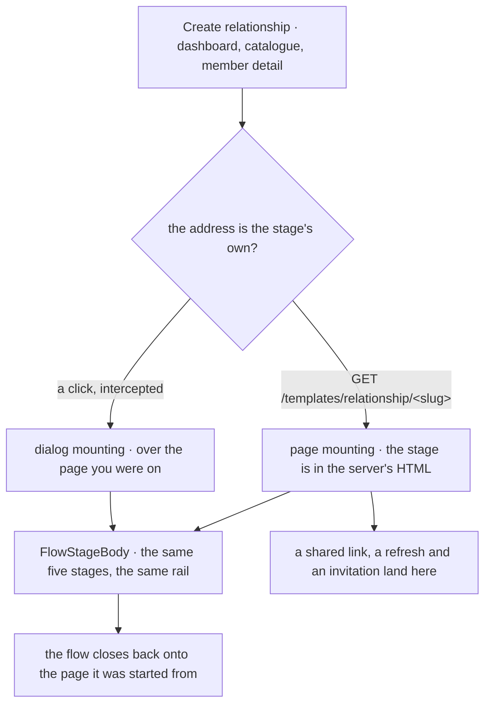
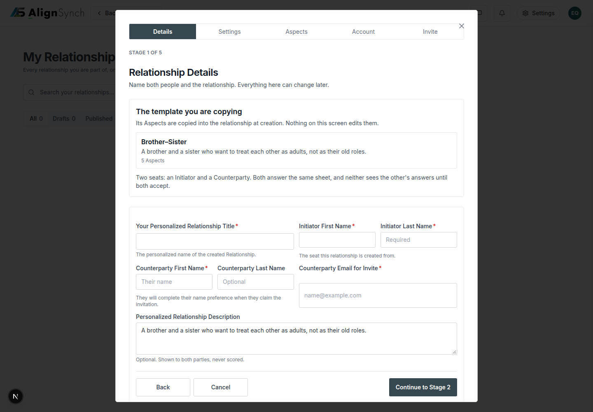

# v1.19.0 — the flow stops being a page

<!-- docs-nav:begin -->

[Docs hub](../README.md) › **Release notes** › v1.19.0 · prev [v1.18.0](v1-18-0.md) · next [v1.2.0](v1-2-0.md)

<!-- docs-nav:end -->

The five stages of the create flow have drawn one panel since v1.15.0, and every entry into them was
still a navigation. Pressing Create relationship on `/dashboard/relationships` left the page you were
standing on, and five screens later the flow handed you back somewhere you had not chosen — the
dashboard's relationship list, which is not where you were. This release makes the flow _mountable_:
one shell, drawn either as the stage's own address or as a dialog over the page the flow started
from, with the page underneath left in place. The address stays the stage's own in both cases, and
the dialog behaves like a route — Back, deep links, focus trap, `Esc`, and full-bleed at 390 — because
it _is_ one.

The other half of the release is the tree you are reading this in. `docs/` was 156 pages in one flat
directory; #965 regrouped them into nine sections, each one a question a reader arrives with. Nothing
about a page's content changed, and every old address still answers — what changed is that a reader
who does not already know the filename can find the page.

### Two mountings, one element tree

`components/assessment-flow/relationship-flow-shell.tsx` is the answer to one question — _where are
the stages mounted_ — and to nothing else. The stages, their fields, their order, their words and
their prices are untouched by this release.

- **`page`** — a stage's own address draws the flow in place, in the server's HTML, with no hook
  called at all. A refresh, a shared link and an invitation link all land here, which is why this
  mounting cannot depend on a Next router that a static render does not have.
- **`dialog`** — the same frame, the same column and the same rail, drawn over the page the flow was
  started from, mounted by an intercepted route beside that page. Four pages carry one:
  `/assessment`, `/templates/relationship`, `/dashboard/relationships` and `/dashboard/templates`.

Both draw the same `FlowStageBody`, so the dialog cannot number or order a screen differently from
the page it claims to be. What the dialog adds is the two behaviours a dialog over a live page needs:
it captures its own form submits and posts them with `fetch` — a native submit would tear the
dashboard down before stage 2 drew — and its dismissal is a history pop rather than a push.

### The dialog behaves like a route

#1009 holds the shell to the behaviours that make a dialog a surface rather than an overlay: a deep
link to a stage opens that stage with the page behind it, Back closes the dialog instead of leaving
the page, `Esc` dismisses it, focus is trapped inside it while it is open, and at 390 it is
full-bleed. `tests/flow-dialog-shell.test.tsx` holds the page mounting to zero hooks.

### `/how-it-works` replays the walk instead of drawing it

#996 turned the onboarding page into a playback: the steps come from `docs/qa/demo-flow/`, the walk
`pnpm demo:flow` recorded against the demo instance and committed, so the page cannot describe a flow
the product no longer performs. It answers a signed-out visitor, because a walkthrough nobody can see
until they have signed up is a drawing again. `pnpm demo:flow:verify` is a gate step, so a transcript
that stops matching its screenshots fails by name.

### The docs tree is grouped by the question it answers

`docs/` is nine sections now — Start here · Guides · Reference · Operations · Specs & design briefs ·
Records & QA · Code wiki · Diagrams · Release notes — and `docs/docs.json` is the manifest every page's
nav block is generated from. The hub lists all 156 documents with the question each one answers, and
`pnpm docs:check` fails when a page is missing from it, listed twice, or carries a link that does not
resolve.

### What the fixes are for

Five of them are the same class of defect told five times: a surface that said something the data did
not. A relationship's detail page now says whose relationship it is (#986), the Edit relationship
dialog names the Aspects and hands back the page's editor (#991), the Sent screen has words for a
relationship with no invitation row (#988), the seeded relationship carries the invitation that put
the counterparty in their seat (#985), and a member pressing the flow's door is sent into the flow
rather than told to sign in again (#992).

## The entry

<!-- changelog-view:begin entry -->
<!-- generated from CHANGELOG.md by scripts/changelog-view.mjs — edit the entry, not this block -->

- **Released** 2026-11-14
- **Tag** [`v1.19.0`](https://github.com/riolabs-ai/alignsynch/releases/tag/v1.19.0)
- **Pull requests named** 21
- **The entry** [`CHANGELOG.md`](../../CHANGELOG.md)

### Added

- feat(flow) · #979 B — every wizard-route entry opens the flow in place; marketing keeps navigating ([#1007](https://github.com/riolabs-ai/alignsynch/pull/1007))
- feat(flow) · #979 B — the shell behaves like a route: Back, deep links, focus trap, Esc, full-bleed at 390 ([#1009](https://github.com/riolabs-ai/alignsynch/pull/1009))
- feat(ui) · #898 /how-it-works replays the recorded demo walk ([#996](https://github.com/riolabs-ai/alignsynch/pull/996))
- feat(flow) · #979 B one dialog shell hosting the five stages, mounted from the dashboard Create control ([#1004](https://github.com/riolabs-ai/alignsynch/pull/1004))

### Fixed

- `fix(auth)` — #971 /register pays the two welcome tiles /login draws ([#995](https://github.com/riolabs-ai/alignsynch/pull/995))
- `fix(admin)` — the reissue address is one controlled input (#980) ([#989](https://github.com/riolabs-ai/alignsynch/pull/989))
- fix(relationship) · #975 D2/D9 the detail page says whose relationship it is ([#986](https://github.com/riolabs-ai/alignsynch/pull/986))
- fix(auth) · #979 a member is sent into the flow, and the shell's menu is the session's ([#992](https://github.com/riolabs-ai/alignsynch/pull/992))
- fix(dashboard) · #975 D12 the Edit relationship dialog names the Aspects and hands back the page's editor ([#991](https://github.com/riolabs-ai/alignsynch/pull/991))
- fix(copy) · #976 the Sent screen has words for a relationship with no invitation row ([#988](https://github.com/riolabs-ai/alignsynch/pull/988))
- fix(seed) · #975 the seeded relationship now says what its own session says, and carries the invitation that put the counterparty in their seat ([#985](https://github.com/riolabs-ai/alignsynch/pull/985))

### Maintenance

- `docs(oss)` — reorganise docs/ into a by-question tree and regenerate the hub (#922c) ([#965](https://github.com/riolabs-ai/alignsynch/pull/965))
- `perf(gate)` — the build's type check resumes from the typecheck the gate already runs ([#1005](https://github.com/riolabs-ai/alignsynch/pull/1005))
- `copy(auth)` — the welcome panel takes the owner's tagline and the Aspects/Opinions tiles ([#1001](https://github.com/riolabs-ai/alignsynch/pull/1001))
- `chore(qa)` — the demo transcript cannot go stale — demo:flow:verify as a gate step (#898) ([#1003](https://github.com/riolabs-ai/alignsynch/pull/1003))
- `chore(qa)` — the atlas holds current + 2 past cuts, and the check enforces it ([#1002](https://github.com/riolabs-ai/alignsynch/pull/1002))
- `docs(oss)` — the README states the four OSS questions before the feature tour (#922) ([#993](https://github.com/riolabs-ai/alignsynch/pull/993))
- `test(demo)` — demo:verify expectations match the shipped routes and read a marker, not copy ([#946](https://github.com/riolabs-ai/alignsynch/pull/946))
- `docs(qa)` — the v1.17.1 atlas is a capture of an unreleased tree — say so ([#997](https://github.com/riolabs-ai/alignsynch/pull/997))
- `chore(health)` — re-record platform health at v1.18.0 ([#994](https://github.com/riolabs-ai/alignsynch/pull/994))
- chore(qa) · publish the refreshed v1.17.1 atlas (77/74/71) and make a capture refuse a version mismatch (#983) ([#990](https://github.com/riolabs-ai/alignsynch/pull/990))
<!-- changelog-view:end -->

<!-- changelog-view:begin limits -->
<!-- generated from CHANGELOG.md by scripts/changelog-view.mjs — edit the entry, not this block -->

- **`demo.alignsynch.com` serves v1.17.0, not this release.** Measured while cutting 1.19.0: the hostname answers `200` and its `/api/version` reports `1.17.0` at `41d3efd2`. The demo dataset is reachable through `pnpm demo:verify` and the review rig; the public demo address is a stale deployment, deferred by owner decision (#833).
- **Stripe runs in test mode, structurally.** `lib/billing/adapters/stripe.ts` refuses any credential that is not an `sk_test_…` key, and the webhook endpoints still belong to the test account (#846, #847). The payment walk is the real three-step UI; the capture it performs is a test capture.
- **Production has no admin seat yet.** `ADMIN_EMAILS` is unset on the production branch, so no operator reaches `/admin/**` there; the demo branch carries two (#423).
- **The dialog shell has not been audited screen by screen.** This version mounts it at every wizard entry and at the dashboard's Create control, and makes it behave like a route — Back, deep links, focus trap, Esc, full-bleed at 390. It does not claim an audit of the modal rule across the rest of the app; #913 was closed by the narrower fix it produced.
- **Two v1.19.0 milestone items are not in this release.** #921 (comments on aspect opinions, assessments and relationships) is still at its mockup-first stage, and #854 (the AS2 visual language across the public routes) has not started. Both stay open in the milestone, and neither is half-landed here.
- **The docs reorganisation left stale provenance pointers outside `docs/`.** #965 moved the pages into a tree grouped by question; five comments in code still name the directories it moved (#1006). Every page resolves, so this is a docs-only follow-up rather than a broken link.
- **`/how-it-works` replays a recording, not the live app.** The page plays the committed walk under `docs/qa/demo-flow/` (#996), and `pnpm demo:flow:verify` fails when the transcript stops matching those screenshots — but re-recording needs a live demo instance and a browser, which no gate run has. A UI change after this release is replayed as the version that was recorded.
- **The QA atlas is a capture of the tagged commit, and its checks are static.** `pnpm qa:atlas:check` proves every registered route has a row and a thumbnail, and that each row states what the boundary table derives — it does not re-screenshot. The images in the release's atlas directory describe the tree at the tag, not the commits after it.
<!-- changelog-view:end -->

<!-- docs-nav:begin -->

[Docs hub](../README.md) › **Release notes** › v1.19.0 · prev [v1.18.0](v1-18-0.md) · next [v1.2.0](v1-2-0.md)

<!-- docs-nav:end -->
