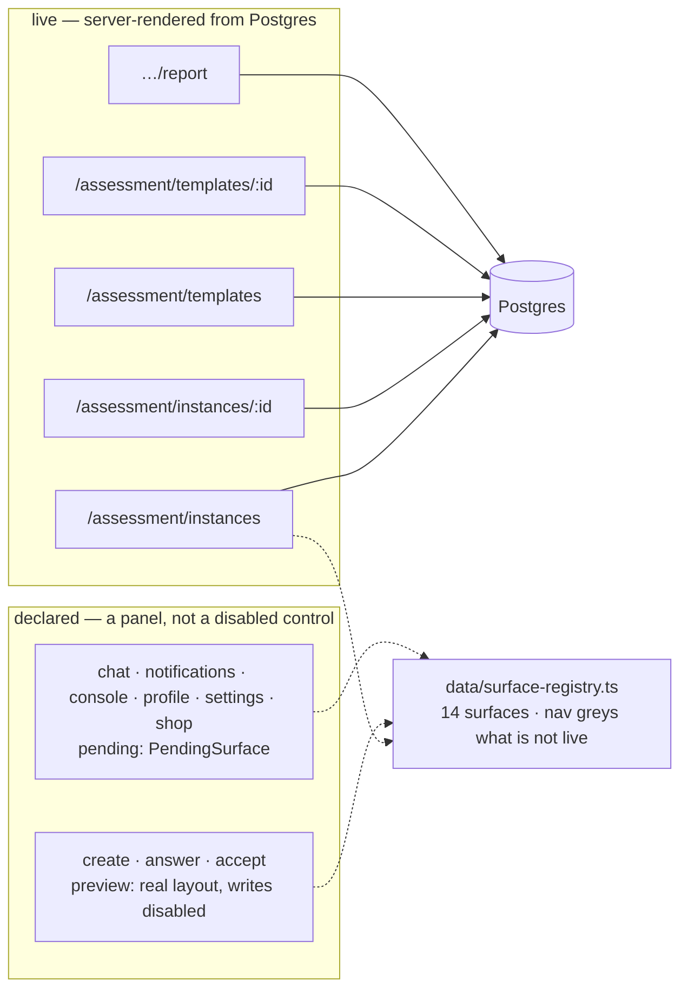
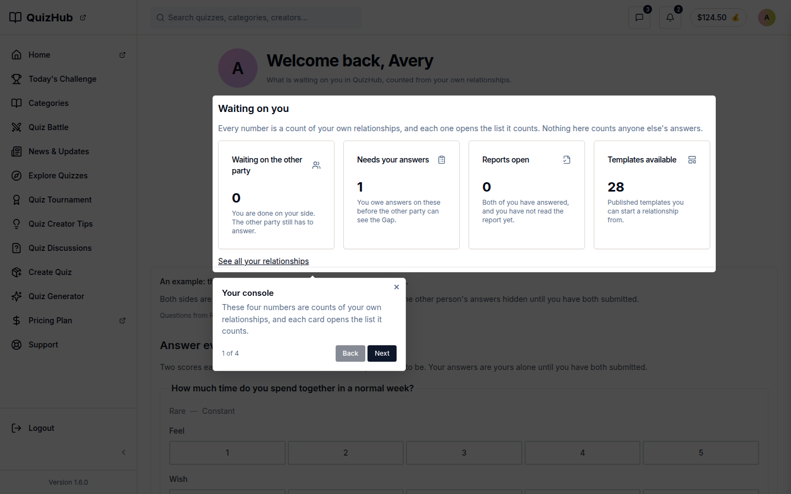

# v1.2.0 — five surfaces read the database, and every other one says it cannot write

<!-- docs-nav:begin -->

[Docs hub](../README.md) › **Release notes** › v1.2.0 · prev [v1.17.1](v1-17-1.md) · next [v1.3.0](v1-3-0.md)

<!-- docs-nav:end -->

The release that drew the line the product had been missing: a screen either reads real rows, or it
renders a panel that says what it would do and that it is not wired.

## What was painful before

- **A screenshot could not tell live from mock.** The `/v1` prototype held 118 screens; the ones
  reading a fixture and the ones that were a drawing of a screen looked identical, and two people
  reading the same review list disagreed about whether a feature existed.
- **The relationships list was the quiz product's list.** It had been a My Quizzes variation with no
  stage tabs, no search, invented metrics — a screen that looked like data and was not.
- **Every relationship was one instance.** A relationship could hold one assessment, so the second
  round of the same relationship had nowhere to live.

## What it does now

- **The line is data.** `data/surface-registry.ts` declares 14 surfaces and the navigation greys the
  ones that are not live; v1.2.0's own entry counts them — 5 live, 3 shipped-but-unwired (`preview`),
  6 declared and not built (`pending`). A pending surface renders `PendingSurface`, not a disabled
  button.
- **Five read surfaces come from Postgres, gated at the session**: your relationships, a
  relationship, the template catalogue, a template, and the relationship report. A signed-out
  request redirects to `/login`; the report answers `404` for an id that is not a row.
- **Every write surface is honest instead of nearly done.** Create, answer and accept render their
  real layouts with every control visibly disabled and the label "Not wired yet — … Nothing was
  saved." Chat, notifications, the console, profile, settings and the shop are declared and greyed
  with the reason on the row.
- **A relationship holds sessions.** The relationship/session split (`#340`) is what makes rounds
  possible, and the instance rename followed it.
- **The list became a variation with its own behaviour** — stage tabs, search, cards, honest
  metrics — built as a My Quizzes variation rather than as a new shape.
- **A coach is a role on the relationship**, with a hard read-only boundary.

## Where the line is drawn

Read the arrows carefully, because the release's claim is exactly what they show: **only the live
five reach the database**. `preview` means the layout is real and the write is not; `pending` means
there is no layout, only the promise of one. Neither is a screen that half-works.

## Screens

The QuizHub build's dashboard — the My Quizzes surface the relationships list was built as a
variation of (`#396`), and the same shell both brands render. The frame is current (2026-11-07): the
rail around it is v1.6.0's two-row version, not the five-row menu this release shipped, and the
caption says so because a release page that quietly shows a later layout teaches the wrong history.

## The entry, as published

<!-- changelog-view:begin entry -->
<!-- generated from CHANGELOG.md by scripts/changelog-view.mjs — edit the entry, not this block -->

- **Released** 2026-11-02
- **Tag** [`v1.2.0`](https://github.com/riolabs-ai/alignsynch/releases/tag/v1.2.0)
- **Pull requests named** 64
- **The entry** [`CHANGELOG.md`](../../CHANGELOG.md)

### Added

- `feat(v1)` — the demo seed carries parties, chat, notices and every subscription state (#415) ([#418](https://github.com/riolabs-ai/alignsynch/pull/418))
- `feat(v1)` — template catalogue, template landing, and the relationship report (#409) ([#414](https://github.com/riolabs-ai/alignsynch/pull/414))
- `feat(assessment)` — relationship list and detail as server-rendered DB surfaces ([#412](https://github.com/riolabs-ai/alignsynch/pull/412))
- `feat(shell)` — the surface registry, PendingSurface and nav greying (#409) ([#410](https://github.com/riolabs-ai/alignsynch/pull/410))
- `feat(v1)` — the template page becomes a conversion landing (#404) ([#405](https://github.com/riolabs-ai/alignsynch/pull/405))
- `feat(v1)` — admin console — counts that open their lists, the registry, templates, seats and stated limits ([#402](https://github.com/riolabs-ai/alignsynch/pull/402))
- `feat(v1)` — print the two Opinions behind every Gap, per Aspect ([#398](https://github.com/riolabs-ai/alignsynch/pull/398))
- `feat(v1)` — acceptance first — both sides side by side, reviewable before accepting ([#400](https://github.com/riolabs-ai/alignsynch/pull/400))
- `feat(v1)` — profile and settings for all four personas (#384) ([#397](https://github.com/riolabs-ai/alignsynch/pull/397))
- `feat(v1)` — the relationships list becomes a My Quizzes variation — stage tabs, search, cards, honest metrics (#384) ([#396](https://github.com/riolabs-ai/alignsynch/pull/396))
- `feat(v1)` — template library and shop — role-gated actions, per-relationship subscription, initiator-only billing ([#393](https://github.com/riolabs-ai/alignsynch/pull/393))
- `feat(v1)` — chat and notifications — relationship threads, unread state, blind-safe before scoring ([#392](https://github.com/riolabs-ai/alignsynch/pull/392))
- `feat(v1)` — relationships list, detail, Aspects CRUD, clone, library and invite state (#384) ([#390](https://github.com/riolabs-ai/alignsynch/pull/390))
- `feat(v1)` — seed Basic and Advanced modes, Soft and Full settings, and derive flag counts (#384) ([#389](https://github.com/riolabs-ai/alignsynch/pull/389))
- `feat(v1)` — persona-scoped sidebar, dashboard overview and per-section stubs (#384) ([#388](https://github.com/riolabs-ai/alignsynch/pull/388))
- `feat(v1)` — relationship catalogue — 29 source rows + kept co-founders, grouped by realm, dating gated (#385) ([#387](https://github.com/riolabs-ai/alignsynch/pull/387))
- `feat(v1)` — review list states who each screen is for, per the #384 persona matrix ([#386](https://github.com/riolabs-ai/alignsynch/pull/386))
- `feat(db)` — seed durable platform admins from ADMIN_* env, idempotently ([#383](https://github.com/riolabs-ai/alignsynch/pull/383))
- `feat(v1)` — contain /v1 inside /v1 and add a persisted review list ([#374](https://github.com/riolabs-ai/alignsynch/pull/374))
- `feat(auth)` — grant admin at sign-in from the ADMIN_EMAILS allowlist ([#382](https://github.com/riolabs-ai/alignsynch/pull/382))
- `feat(shell)` — pin control collapses the expanded sidebar; sign-out lands on marketing ([#381](https://github.com/riolabs-ai/alignsynch/pull/381))
- `feat(v1)` — the onboarding panel becomes a stepped wizard (no assistant) ([#378](https://github.com/riolabs-ai/alignsynch/pull/378))
- `feat(v1)` — persona bar becomes a notice banner with environment context ([#377](https://github.com/riolabs-ai/alignsynch/pull/377))
- `feat(v1)` — answer sheet — inline errors, top summary, pinned submit on mobile ([#373](https://github.com/riolabs-ai/alignsynch/pull/373))
- `feat(v1)` — report verdict, relationship types + demo, and the session timeline (three sets, one branch) ([#370](https://github.com/riolabs-ai/alignsynch/pull/370))
- `feat(ui)` — a component template ancestor is a checked header, not a convention (#336) ([#345](https://github.com/riolabs-ai/alignsynch/pull/345))
- `feat(brand)` — the book is the mark, and the icon set is generated from it ([#363](https://github.com/riolabs-ai/alignsynch/pull/363))
- `feat(coach)` — a coach is a role on the relationship, with a hard read-only boundary ([#358](https://github.com/riolabs-ai/alignsynch/pull/358))
- `feat(db)` — a relationship holds sessions — the split, the backfill and the instance rename (#340) ([#352](https://github.com/riolabs-ai/alignsynch/pull/352))
- `feat(v1)` — the template editor — a variation of the quiz editor, store-backed ([#343](https://github.com/riolabs-ai/alignsynch/pull/343))
- `feat(marketing)` — the public top menu, the shell footer and header identity ([#335](https://github.com/riolabs-ai/alignsynch/pull/335))
- `feat(auth)` — name Google-only accounts on the password form (#281) ([#333](https://github.com/riolabs-ai/alignsynch/pull/333))
- `feat(auth)` — a Google button beside the password form (#281) ([#330](https://github.com/riolabs-ai/alignsynch/pull/330))
- `feat(deploy)` — codify the preview rule and add a freshness check that never guesses ([#329](https://github.com/riolabs-ai/alignsynch/pull/329))

### Fixed

- `fix(auth)` — /login and the 404 draw the brand's marks, not the quiz product's ([#417](https://github.com/riolabs-ai/alignsynch/pull/417))
- `fix(auth)` — the sign-up screen draws the brand's marks, not the quiz product's ([#413](https://github.com/riolabs-ai/alignsynch/pull/413))
- `fix(v1)` — the acceptance status line says what the blind rule actually hides ([#403](https://github.com/riolabs-ai/alignsynch/pull/403))
- `fix(v1)` — one review control, in the footer, deep-linking to its own review row ([#399](https://github.com/riolabs-ai/alignsynch/pull/399))
- `fix(shell)` — remove the sidebar pin — the rail is always expanded ([#394](https://github.com/riolabs-ai/alignsynch/pull/394))
- `fix(auth)` — measure the flow cookie's age and the verifier's fingerprint at the finish (#351 follow-up) ([#362](https://github.com/riolabs-ai/alignsynch/pull/362))
- `fix(auth)` — capture the Google finish failure before fixing it (#351 follow-up) ([#359](https://github.com/riolabs-ai/alignsynch/pull/359))
- `fix(auth)` — exchange the Neon verifier at our own callback, so Google sign-in ends signed in (#351) ([#357](https://github.com/riolabs-ai/alignsynch/pull/357))
- `fix(404)` — render the brand's heading and drop the empty suggestion band (#351) ([#355](https://github.com/riolabs-ai/alignsynch/pull/355))
- `fix(auth)` — land the post-sign-in destination per brand (#351) ([#354](https://github.com/riolabs-ai/alignsynch/pull/354))
- `fix(auth)` — start the Google handshake on the Neon origin, not the proxy ([#350](https://github.com/riolabs-ai/alignsynch/pull/350))
- `fix(demo)` — the Admin button lands on the console, not the gate proof ([#334](https://github.com/riolabs-ai/alignsynch/pull/334))

### Maintenance

- R1-E: create, answer and accept as in-progress UI (#409) ([#416](https://github.com/riolabs-ai/alignsynch/pull/416))
- DRAFT — V1 create entry, metadata CRUD by Setting, and the Steps primitive (one per Aspect, rewordable, closed status) — for discussion, do not merge ([#406](https://github.com/riolabs-ai/alignsynch/pull/406))
- `test(v1)` — a deterministic demo seeder over every catalogue type, and the test factories that pin the shape ([#407](https://github.com/riolabs-ai/alignsynch/pull/407))
- `auth` — password reset, and a set-password path for Google-only accounts ([#395](https://github.com/riolabs-ai/alignsynch/pull/395))
- `docs` — the UI/UX audit — every surface scored against its template ancestor ([#364](https://github.com/riolabs-ai/alignsynch/pull/364))
- `docs(deploying)` — §1 quotes the widened ignoreCommand and names its one exception ([#361](https://github.com/riolabs-ai/alignsynch/pull/361))
- `chore(deploy)` — one branch builds besides production, and it is named in the file ([#360](https://github.com/riolabs-ai/alignsynch/pull/360))
- `docs(deploy)` — §1 states the production-only rule, not the [preview] opt-in ([#353](https://github.com/riolabs-ai/alignsynch/pull/353))
- `deploy(vercel)` — build production only — previews are local ([#348](https://github.com/riolabs-ai/alignsynch/pull/348))
- `refactor(css)` — one token layer — the second stylesheet's chart and sidebar sets fold into app/globals.css ([#347](https://github.com/riolabs-ai/alignsynch/pull/347))
- `refactor(marketing)` — the landing page's eleven boxes, two CTAs and three chips ([#346](https://github.com/riolabs-ai/alignsynch/pull/346))
- `refactor(console)` — the gap table, the failure panels and the title bands compose the primitives ([#344](https://github.com/riolabs-ai/alignsynch/pull/344))
- `docs(prototype)` — correct the one claim in the wiring plan the board does not support ([#342](https://github.com/riolabs-ai/alignsynch/pull/342))
- `docs(prototype)` — the wiring plan — one screen exists, four cohorts never did ([#341](https://github.com/riolabs-ai/alignsynch/pull/341))
- `docs(quiz)` — the capability map — every quiz surface, what it is made of, what full-stack costs ([#338](https://github.com/riolabs-ai/alignsynch/pull/338))
- `docs(ui)` — the quiz-surface map — every ancestor, its AlignSynch variation, and the mobile mechanics ([#337](https://github.com/riolabs-ai/alignsynch/pull/337))
- `docs(ui)` — the divergence table — every bespoke surface, one verdict per file ([#332](https://github.com/riolabs-ai/alignsynch/pull/332))
- `docs(deploy)` — record that preview creation, not just the build, is disabled upstream ([#331](https://github.com/riolabs-ai/alignsynch/pull/331))
<!-- changelog-view:end -->

## Known limits

<!-- changelog-view:begin limits -->
<!-- generated from CHANGELOG.md by scripts/changelog-view.mjs — edit the entry, not this block -->

- **Five read surfaces are live**: your relationships (`/assessment/instances`), a relationship (`/assessment/instances/[instanceId]`), the template catalogue (`/assessment/templates`), a template (`/assessment/templates/[templateId]`) and the relationship report (`/assessment/instances/[instanceId]/report`). They are server-rendered from Postgres and gated at the session: a signed-out request is redirected to `/login` (the report answers 404 for a relationship id that is not a row). **They have not yet been exercised with a signed-in session** — nobody has opened the list, the catalogue or a report with real rows on screen. They are wired and gated, and that is the whole of what has been verified.
- **Every write surface is not wired yet.** Creating a relationship, answering, accepting, chat, notifications and the admin console cannot record anything. They are not missing pages: create (`/assessment/templates/[templateId]/create`), answer (`/assessment/instances/[instanceId]/answer`) and accept (`/assessment/instances/[instanceId]/accept`) render their real layouts and every write control is visibly disabled, labelled "Not wired yet — … Nothing was saved." Chat, notifications, the admin console, profile, settings and the shop are declared in `data/surface-registry.ts` and are greyed in the navigation with the reason on the row. The registry declares 14 surfaces: 5 live, 3 shipped-but-unwired (`preview`), 6 declared and not built (`pending`).
- **The report is read-only.** It renders the two opinions and the gap between them; it has no control that changes the relationship, records an acceptance or edits an answer. It is also blind until both parties have submitted: with the other party unanswered it renders the locked page and nothing about their answers.
- **No deploy follows this tag.** The tag fixes the artefact; whether and when it is deployed is a separate decision, so a tag in this repository is not a claim that the site is serving it.
<!-- changelog-view:end -->

<!-- docs-nav:begin -->

[Docs hub](../README.md) › **Release notes** › v1.2.0 · prev [v1.17.1](v1-17-1.md) · next [v1.3.0](v1-3-0.md)

<!-- docs-nav:end -->
