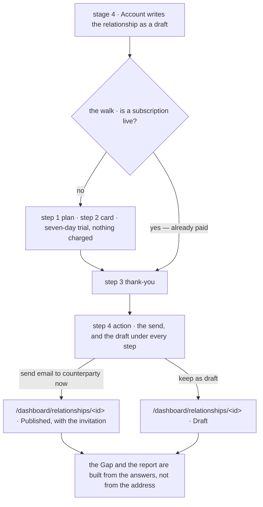
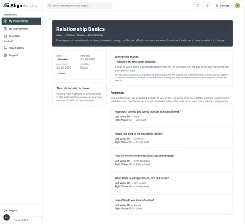

# v1.20.0 — the walk can be paid

<!-- docs-nav:begin -->

[Docs hub](../README.md) › **Release notes** › v1.20.0 · prev [v1.2.0](v1-2-0.md) · next [v1.3.0](v1-3-0.md)

<!-- docs-nav:end -->

The five stages of the create flow had one ending that was not a screen of theirs: press the send, and
the flow handed you back to a confirmation page that described what had just happened, then left you
to find the thing it had just created. The draft door left for the relationship. The two endings of
one decision therefore landed in two places, and neither of them was the record.

That changed in `#1019`, and nothing in this release changes it again. Stage 5 is one four-step column
— **plan → card → thank-you → action** — and the send lives on its last step, with the draft drawn
under every step. Both endings land on `/dashboard/relationships/<id>`, the relationship's own member
view, showing it in the state the act produced: `Published` with a live invitation, or `Draft`.

**What this version actually claims is narrower than its theme, and the honest sentence is this: the
code was already live.** Production answered `/api/version` with
`{"version":"1.19.0","commit":"ede96472"}` while these notes were being written — the head of `main`
this version is cut from, which means all fifteen commits below were serving users behind a 1.19.0
label. v1.20.0 makes the number true; it deploys no product code, and no part of these notes should be
read as "now live".

## Why the walk was paid for by nobody

`#1019` put the send behind a gate. The gate asked `membership.writable`, and a `draft` reads writable
**on purpose** — nothing has been sold, so there is nothing to lapse. Stage 5 renders on exactly such a
draft, so every brand-new relationship opened on its thank-you, skipped the plan and the card, and was
then refused by the send with `no-payment-method`: a screen saying the plan was active about an account
holding nothing. `lib/flow/store.ts` now reads `subscriptionLive` — the same `billing_subscription` row
that refusal names — and the walk is handed that, drawn on the step as `data-send-gate`.

The gate is drawn as well as enforced: before the membership is live the walk carries
`data-send-gate="locked"` and no send control exists at any step, and `sendDraftInvitation()` refuses
an unpaid draft on its own, so a crafted POST cannot publish one either.

### Getting from the plan to the card

Four repairs in this window are all the same defect seen from four angles — the walk could not reach
its own payment frame.

- **The plan row posted its id as a billing tier.** Stage 5's panel is keyed by the prototype's row ids
  (`one`, `unlimited`), and the walk posted that id to the checkout, while the catalogue sells
  `free` / `basic` / `principal`. `startCheckout` refused it with _`"one" is not a plan this product
  sells`_ and the card frame never mounted. `PLAN_BILLING_TIER`, exported from
  `data/pages/assessment-create.ts` beside the prices it produces, is the one map, and a plan row the
  map does not price is a compile error (#1033).
- **The rows read `Basic` and `Principal`,** the names of the tiers they sell, with the relationship
  count as the note under each, and the mode words left the trial sentence (#1036).
- **Choosing a row is the act.** The `Enter the card` press between the choice and the fields is gone:
  the selection advances the walk and starts the checkout, so the card step opens with its mount point
  already drawn and `data-checkout-frame` on screen. A failure to start the checkout is now a band on
  the step, not an alert over a control that would have failed the same way again (#1038).
- **The Sent screen's status band no longer throws on a missing key.** `invite.state` is derived by the
  read rather than authored, so the id the band asks the copy fixture for is not a literal every check
  can resolve; a missing key now renders the fallback line instead of a 500 (#1037).

### The instruments this window repaired

Nothing a visitor sees changes in these, and each was a way for a green build to mean less than it
said: `docs:check` now asks the git index which files are pages, so an ignored file is not reported as
an orphan (#1023); the entry classifier reads `·` and `—` beside `: `, and a test pins all three
separators (#1021); `docs/qa/` has a retention rule instead of a habit (#1029); the email bodies leave
the source for `content/email-bodies.md`, with `pnpm email:bodies:check` in every lane (#1017);
`qa:atlas:check` accepts a declared deferral so a release may ship without a sweep, but never silently
(#1030); `--tag-only` re-records the platform health or refuses the cut, so a published tag can no
longer leave the dashboard naming the previous version (#1041); and `pnpm flow:e2e` follows the gates
that exist — a membership stand-in instead of a real checkout, the retirement of three fee-gate
assertions and a 6e that posts `/api/billing/checkout` — which is what turns its nine failures into
**174 passing assertions, exit 0, in 3m13s** (#1039); and the gate resolves its diff base before it
classifies a lane, so a fresh worktree stops paying for a full run it cannot need (#1008).

## The entry

<!-- changelog-view:begin entry -->
<!-- generated from CHANGELOG.md by scripts/changelog-view.mjs — edit the entry, not this block -->

- **Released** 2026-11-14
- **Tag** [`v1.20.0`](https://github.com/riolabs-ai/alignsynch/releases/tag/v1.20.0)
- **Pull requests named** 15
- **The entry** [`CHANGELOG.md`](../../CHANGELOG.md)

### Added

- `feat(flow)` — #1014 steps 4–5 — send-or-draft inside the walk, and both endings land on the relationship ([#1019](https://github.com/riolabs-ai/alignsynch/pull/1019))

### Fixed

- `fix(release)` — --tag-only re-records the platform health, or refuses the cut (#961) ([#1041](https://github.com/riolabs-ai/alignsynch/pull/1041))
- `fix(test)` — flow:e2e follows the gates that exist — the membership stand-in, the checkout route ([#1039](https://github.com/riolabs-ai/alignsynch/pull/1039))
- `fix(flow)` — #998 the Sent screen's status band renders a fallback, never throws ([#1037](https://github.com/riolabs-ai/alignsynch/pull/1037))
- `fix(flow)` — stage 5 buys the tier the plan row names, not the row's id ([#1033](https://github.com/riolabs-ai/alignsynch/pull/1033))
- `fix(release)` — #1011 the entry classifier reads the em dash, and a test pins all three separators ([#1021](https://github.com/riolabs-ai/alignsynch/pull/1021))
- `fix(gate)` — #1020 — "is this a page?" is the index, not the disk ([#1023](https://github.com/riolabs-ai/alignsynch/pull/1023))
- `ux(flow)` — #1031 the card step mounts its payment frame on reveal; the "Enter the card" button goes ([#1038](https://github.com/riolabs-ai/alignsynch/pull/1038))
- `copy(flow)` — the plan rows read Basic and Principal, and the mode clause leaves the trial sentence ([#1036](https://github.com/riolabs-ai/alignsynch/pull/1036))
- `copy(email)` — the 11 bodies move to content/email-bodies.md, and the marker is retired ([#1017](https://github.com/riolabs-ai/alignsynch/pull/1017))

### Maintenance

- `perf(gate)` — resolve the diff base before classifying ([#1008](https://github.com/riolabs-ai/alignsynch/pull/1008))
- `ci(qa)` — #1030 — a declared deferral replaces a mandatory manifest, and the pass says so ([#1032](https://github.com/riolabs-ai/alignsynch/pull/1032))
- `chore(health)` — re-record platform health at v1.19.0 ([#1022](https://github.com/riolabs-ai/alignsynch/pull/1022))
- `chore(docs)` — #1024 — one retention rule for the qa/ capture shelf ([#1029](https://github.com/riolabs-ai/alignsynch/pull/1029))
- `docs(provenance)` — #1006 — the comments outside docs/ point at the paths #965 moved ([#1028](https://github.com/riolabs-ai/alignsynch/pull/1028))
<!-- changelog-view:end -->

<!-- changelog-view:begin limits -->
<!-- generated from CHANGELOG.md by scripts/changelog-view.mjs — edit the entry, not this block -->

- **Production already serves this tree, under a 1.19.0 label.** `https://alignsynch.com/api/version`
  answered `{"version":"1.19.0","commit":"ede96472"}` while this release was prepared — the head of
  `main` this version is cut from, so all fifteen commits below are live already. 1.20.0 makes the
  version number true; it deploys no product code.
- **The five-stage walk is verified end to end, by a command no gate runs.** After #1039 repaired
  `scripts/flow-e2e.mjs` — a membership stand-in instead of a real checkout, three retired fee-gate
  assertions deleted, 6e repointed at `POST /api/billing/checkout` —
  `BASE_URL=http://localhost:3411 pnpm flow:e2e` exits **0** with **174** passing assertions in 3m13s
  against a local dev server on this release's tree. It needs a live demo branch and a browser, so it
  stays out of `scripts/verify.sh` and no CI run performs it.
- **The atlas captures the routes, not the walk's hardest screens.** It has no auth modal, no
  stage-form embed and nothing of the sign-in, sign-up or Stripe steps, so the sweep that would
  document the create walk is deferred to 1.20.x, or to 1.21 if it still has misses.
- **No dependency majors.** `jsdom` 31 (#1025) and `swiper` 14 (#1027) are open and are not in this
  version.
<!-- changelog-view:end -->

<!-- docs-nav:begin -->

[Docs hub](../README.md) › **Release notes** › v1.20.0 · prev [v1.2.0](v1-2-0.md) · next [v1.3.0](v1-3-0.md)

<!-- docs-nav:end -->
