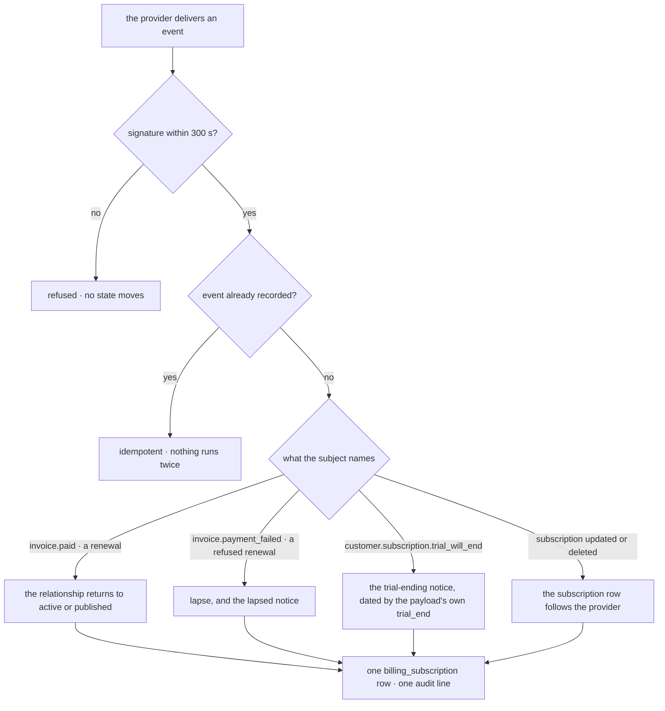
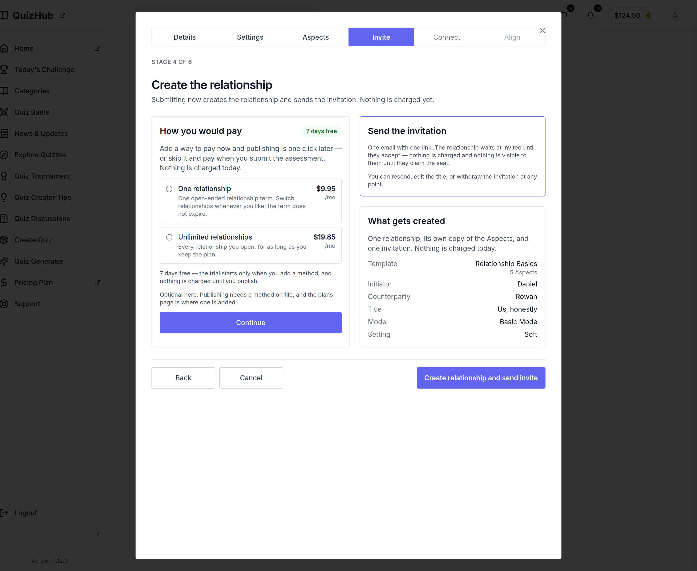

# v1.20.1 — six fixes, no new surface

<!-- docs-nav:begin -->

[Docs hub](../README.md) › **Release notes** › v1.20.1 · prev [v1.20.0](v1-20-0.md) · next [v1.3.0](v1-3-0.md)

<!-- docs-nav:end -->

This release adds nothing. Six defects that a green build could not see are closed, and every one of
them is a place where the app was confident about something that was not true: a price table pointing
at another account's Prices, a state machine waiting for events nobody had subscribed to, two doors
that opened onto the wrong thing, a plan choice that did not survive the walk, and a health remedy
that named a command the repo does not have.

The honest sentence about this cut is the same one v1.20.0 had to write: **the code was already
live.** `https://alignsynch.com/api/version` answered `{"version":"1.20.0","commit":"5310f69b"}` while
these notes were being written — the head of `main` all six fixes are on — so 1.20.1 makes the number
true rather than deploying a product change. What it does deploy is the release commit itself.

## The billing wiring was half-connected, and test mode hid it

Two of the six fixes are one cause. The billing state machine and the email band assumed events the
receiver had never subscribed to. `lib/relationship/status.ts` names `invoice.paid`
as the trigger of the `expired → active` recovery, and `lib/email/templates/trial-ending.ts` and
`membership-lapsed.ts` were written with no event that could reach them — so a renewal would have
moved no state and sent no notice, silently, forever.

The receiver now acts on six events, and `tests/billing-webhook-events.test.ts` holds
`STRIPE_WEBHOOK_EVENTS` equal to the list the dashboard's endpoints actually deliver — a member added
in code without the subscription in the provider is a red test, not a green build over a delivery that
never arrives. That is the whole assertion, and it is worth being precise about what it does not
prove: the events a renewal produces need a live clock, and no renewal has been observed on this tree.

No money moves in any of it: the checkout runs on test keys — `/pricing` says so on the page — so the
price table this release repoints at the AlignSynch test account is a table of test Prices, and the
notices are written text that nothing in test mode has to trigger.

## The doors that opened onto the wrong thing

- **The Templates door** rendered the wrong catalogue on AlignSynch: `/templates` — the canonical door
  the marketing header uses — drew the v1 shop listing rather than the templates the product sells.
  The canonical route and the one the header links are now the same page (#1040).
- **Every create-intent action** now opens one wizard door. There were two, and which one answered
  depended on where you clicked from; a create-intent press from any surface reaches the same flow
  (#1042).
- **The chosen plan survives `/pricing`.** Picking a plan on the marketing page and then entering the
  walk used to drop the choice, so stage 5 asked again. The plan now carries to the step that buys it
  (#1043) — the still below is that step.
- **The stale-record remedy names a command that runs.** `pnpm db:verify`'s failure text pointed at a
  remedy the repo does not have; the line a reader copies is now the line that works (#696).

## The entry

<!-- changelog-view:begin entry -->
<!-- generated from CHANGELOG.md by scripts/changelog-view.mjs — edit the entry, not this block -->

- **Released** 2026-11-14
- **Tag** [`v1.20.1`](https://github.com/riolabs-ai/alignsynch/releases/tag/v1.20.1)
- **Pull requests named** 9
- **The entry** [`CHANGELOG.md`](../../CHANGELOG.md)

Six fixes and no new surface: the billing receiver now subscribes the events its own state machine
and email band were waiting for, the price table points at the AlignSynch test account, and four
doors open onto the thing they name. The ledger below the fixes is provenance — the three commits in
this window that are not fixes, named so the entry accounts for every commit the tag covers.

### Fixed

- `fix(pricing)` — carry the chosen plan from /pricing to stage 5 (#1043) ([#1061](https://github.com/riolabs-ai/alignsynch/pull/1061))
- `fix(onboarding)` — #1042 — one wizard door for every create-intent action ([#1050](https://github.com/riolabs-ai/alignsynch/pull/1050))
- `fix(health)` — the stale-record remedy names a command that runs (#696) ([#1045](https://github.com/riolabs-ai/alignsynch/pull/1045))
- `fix(marketing)` — #1040 the canonical Templates door renders the v1 shop listing on AlignSynch ([#1048](https://github.com/riolabs-ai/alignsynch/pull/1048))
- `fix(billing)` — subscribe the three live-money events and fire the two written notices (#1055) ([#1060](https://github.com/riolabs-ai/alignsynch/pull/1060))
- `fix(billing)` — point the price table at the AlignSynch test account (#846) ([#1051](https://github.com/riolabs-ai/alignsynch/pull/1051))

### Commits

- `test(md-normalise)` — snapshot docs/operations/stripe-go-live.md (#1057) ([#1059](https://github.com/riolabs-ai/alignsynch/pull/1059))
- `docs(billing)` — land the Stripe account dossier and the go-live pre-flight (#1054) ([#1056](https://github.com/riolabs-ai/alignsynch/pull/1056))
- `chore(health)` — re-record platform health at v1.20.0 ([#1052](https://github.com/riolabs-ai/alignsynch/pull/1052))
<!-- changelog-view:end -->

<!-- changelog-view:begin limits -->
<!-- generated from CHANGELOG.md by scripts/changelog-view.mjs — edit the entry, not this block -->

- **Stripe is in test mode, and no card is charged.** The card step runs on test keys — `/pricing`
  says so in as many words, _"Test mode: the card checkout runs on test keys, so no card is
  charged"_ — so the price table this release points at the AlignSynch test account and the six
  events it subscribes move no money. Going live is `#847`, and it is not in this release.
- **The trial-ending and lapsed notices are wired and unit-proven, not observed.** `#1055`
  subscribes six billing events and fires the two written notices; the wiring is proven by
  `tests/billing-webhook-events.test.ts` against the endpoint's own event list. The events a
  renewal produces come from a live clock, and no renewal has been observed on this tree — so read
  this as "the notices exist and are tested", never as "a renewal has been seen to notify anyone".
- **`demo.alignsynch.com` serves an older build until it is redeployed.** It answered
  `{"version":"1.17.0","commit":"41d3efd2"}` while this release was prepared, against
  `alignsynch.com` answering `1.20.0` at `5310f69b`. The demo host is not a deployment of this tag
  and does not carry these six fixes yet.
- **The atlas captures the routes, not the walk's hardest screens.** It has no auth modal, no
  stage-form embed step and nothing for sign-in, sign-up or the Stripe card flow — the surfaces most
  of these six fixes live in — so the v1.20.1 sweep documents that every registered route renders,
  not that these six paths were walked. `docs/qa-atlas/README.md` states the criterion it does meet.
- **No dependency majors.** `jsdom` 31 (`#1025`) and `swiper` 14 (`#1027`) are open and are not in
  this version; no dependency moved in this window.
<!-- changelog-view:end -->

<!-- docs-nav:begin -->

[Docs hub](../README.md) › **Release notes** › v1.20.1 · prev [v1.20.0](v1-20-0.md) · next [v1.3.0](v1-3-0.md)

<!-- docs-nav:end -->
