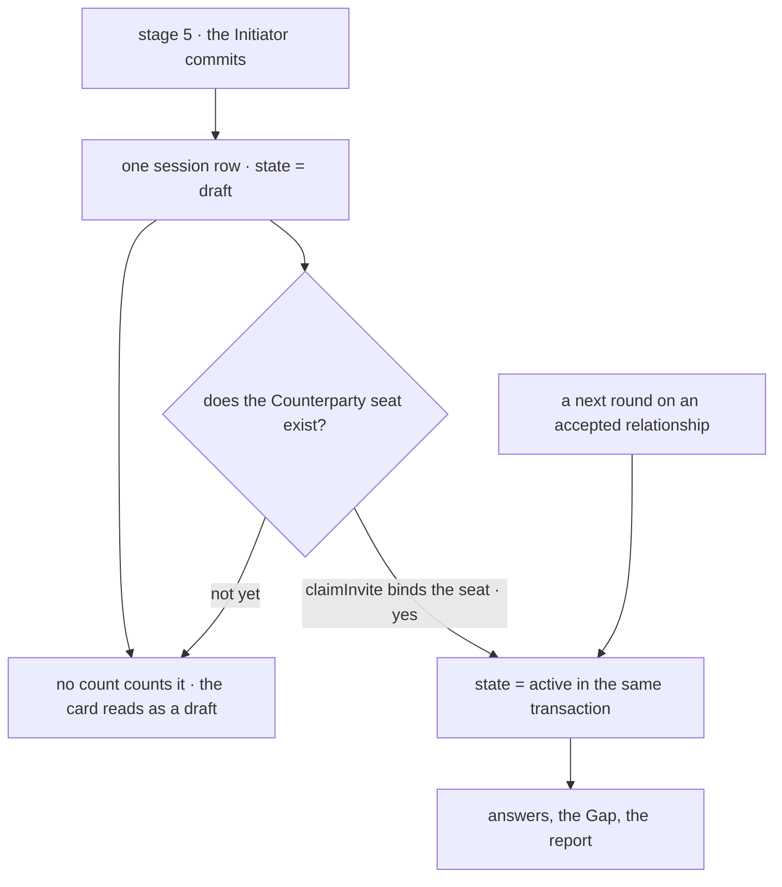
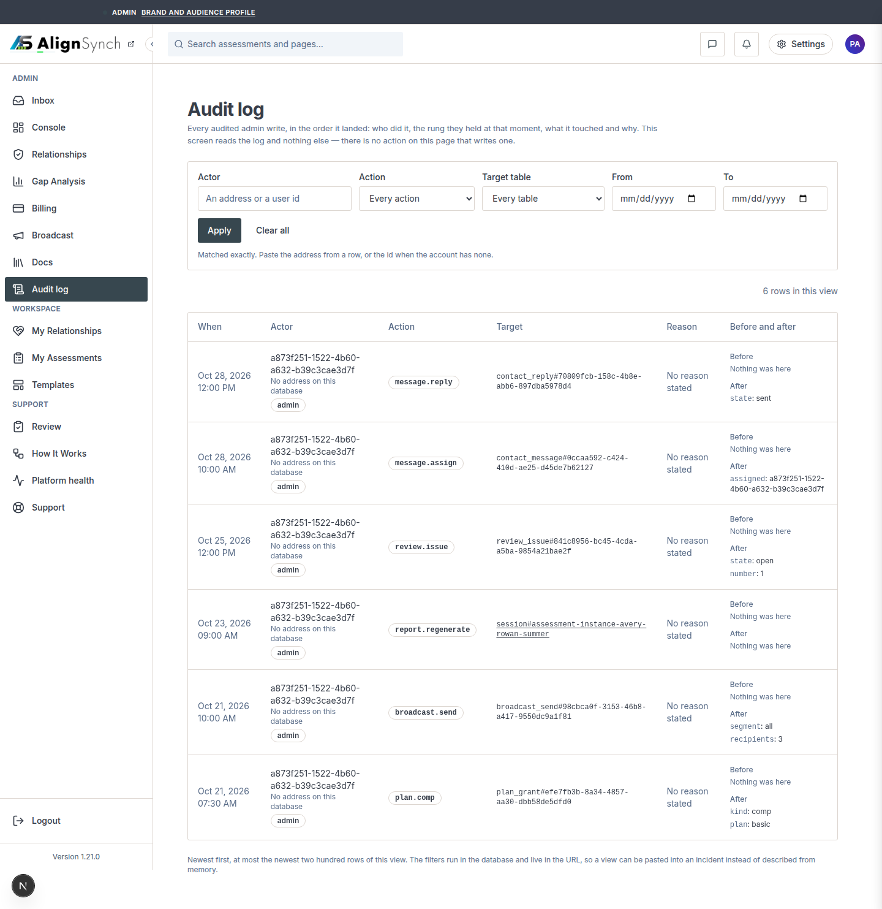
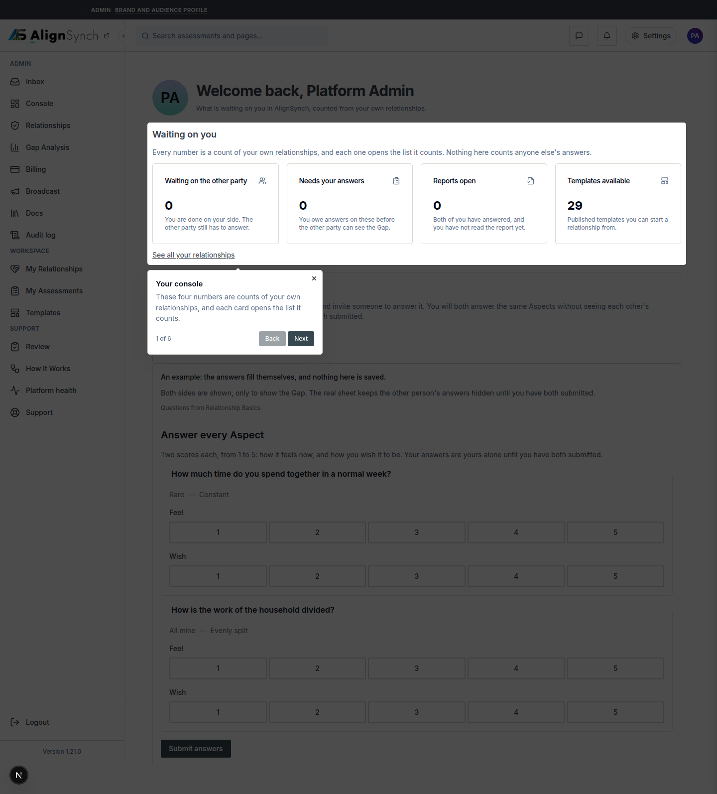

# v1.21.0 — a draft session is not a live session

<!-- docs-nav:begin -->

[Docs hub](../README.md) › **Release notes** › v1.21.0 · prev [v1.20.1](v1-20-1.md) · next [v1.3.0](v1-3-0.md)

<!-- docs-nav:end -->

This release makes three facts the product already believed into rows a reader can check. A session
row has existed since the Initiator's commit — it is the only home for the session's `mode`, its
Setting, `aspects_authored_at` and the Initiator's own seat — and nothing distinguished a session
somebody created and never accepted from a session two people are in. An invitation could only reach
its relationship by joining through the session it points at. And the demo could not show any of it:
one lifecycle state in the dataset, and an admin rail of empty lists.

Five feature commits answer those, and twenty-one fixes, chores and docs commits ride with them.

## A session carries the state that was always implied

`db/migrations/0041_session_state.sql` adds one column, one `CHECK` and a backfill: `state` is
`draft` while the relationship has no Counterparty seat, `active` once it does. The row is not moved
or deferred — a create that had nowhere to put the session's own facts would have needed a second
model — but no count in the product sees a draft, and the card reads as a draft rather than as a
session with zero answers.

The writers are three, and they share the one rule: `createInstanceFromTemplate` writes `draft` in
the same `INSERT` that writes the session, `claimInvite` flips it to `active` in the transaction that
binds the Counterparty's seat, and a next round on an accepted relationship writes `active` because
it is live from its first row. "Accepted but still draft" is therefore not a state the rows can hold.

## An invitation knows its relationship

`db/migrations/0040_session_invite_relationship.sql` gives `session_invite` a `relationship_id`,
backfills it from the session each invitation already points at, and refuses to finish if any row is
still unset — an exception that names the count and the first five ids rather than a bare
`column contains null values`. Until this release, "the invitations of this relationship" was a join,
and an invitation that had not yet produced a session had no way to name its relationship at all.

## Config, one source

`#1088` puts the environment in one manifest, generates the `.env` files from it, and adds a gate
check that fails when a secret-shaped value reaches a committed file. It is not a product surface,
which is why it is easy to under-report: a repo where the key list lives in nine documents is a repo
whose gate can pass while the deployment is missing a key.

## And the demo finally shows both halves

`#1079` spreads the dataset across the whole relationship lifecycle instead of one state, and `#1081`
seeds the admin half so the console's rail is not empty states — `admin_action`, the contact and
broadcast tables, the plan and billing rows, the review queue. Both are gated on `DEMO_AUTH` inside
the seed, so production keeps its own rows; the stills below are this release's own tree rendered
from the demo branch at 1440.

## The honest sentence

This release is a model release, and it lands two migrations the production branch has not been given.
Production's ledger still names `db/migrations/0039_session_aspects_authored_at.sql` as its newest
entry while production already serves this release's base, so the create and acceptance paths write a
column the production `session` table does not have until somebody runs the migration deliberately.
That is the first bullet of the limits below, where it belongs — no gate step can see it, because CI
has no connection string and `pnpm build` has no database.

## The entry

<!-- changelog-view:begin entry -->
<!-- generated from CHANGELOG.md by scripts/changelog-view.mjs — edit the entry, not this block -->

- **Released** 2026-11-16
- **Tag** [`v1.21.0`](https://github.com/riolabs-ai/alignsynch/releases/tag/v1.21.0)
- **Pull requests named** 26
- **The entry** [`CHANGELOG.md`](../../CHANGELOG.md)

### Added

- `feat(demo)` — #1081 — seed the admin half so the console rail is not empty states ([#1104](https://github.com/riolabs-ai/alignsynch/pull/1104))
- `feat(model)` — a draft session is not a live session — state draft -> active at acceptance (#1100b) ([#1105](https://github.com/riolabs-ai/alignsynch/pull/1105))
- `feat(model)` — session_invite gains relationship_id, backfilled (#1100a) ([#1101](https://github.com/riolabs-ai/alignsynch/pull/1101))
- `feat(config)` — one env manifest, generated .env files, and a no-secret gate check (#1088) ([#1089](https://github.com/riolabs-ai/alignsynch/pull/1089))
- `feat(demo)` — #1079 the demo dataset spans the whole relationship lifecycle ([#1083](https://github.com/riolabs-ai/alignsynch/pull/1083))

### Fixed

- `fix(templates)` — make the catalogue and the create route one set, and import the templates additively (#1099) ([#1102](https://github.com/riolabs-ai/alignsynch/pull/1102))
- `fix(demo)` — preserve the pre-reset state with the restore, not before it ([#1098](https://github.com/riolabs-ai/alignsynch/pull/1098))
- `fix(demo)` — retry the trusted-origin step on 5xx and restore the pre-reset state when it cannot converge ([#1091](https://github.com/riolabs-ai/alignsynch/pull/1091))
- `fix(demo)` — the demo holds 2 subscriptions, not 1 — one row per plan-initiating demo account, and the number is now computed ([#1090](https://github.com/riolabs-ai/alignsynch/pull/1090))
- `fix(billing)` — pin Stripe-Version, resolve Prices by lookup key, and run test-mode only ([#1085](https://github.com/riolabs-ai/alignsynch/pull/1085))
- `fix(demo)` — re-apply the branch's trusted origin in demo:reset, and prove sign-in ([#1086](https://github.com/riolabs-ai/alignsynch/pull/1086))
- `fix(demo)` — #1083 left the seed reading a field it deleted — `pnpm demo:reset` emptied the branch ([#1087](https://github.com/riolabs-ai/alignsynch/pull/1087))
- `fix(db)` — the seed proves every admin seat can sign in (#1080) ([#1082](https://github.com/riolabs-ai/alignsynch/pull/1082))
- `fix(flow)` — #975 D8/D13 — stage 1 refuses in words, and the rail stops offering `Logout` to a visitor ([#1078](https://github.com/riolabs-ai/alignsynch/pull/1078))
- `fix(dashboard)` — a payment opened from a relationship stays on the dashboard, and Cancel returns to it (#975 D10) ([#1076](https://github.com/riolabs-ai/alignsynch/pull/1076))
- `fix(flow)` — a never-sent draft is no longer an invited assessment (#975, D6) ([#1077](https://github.com/riolabs-ai/alignsynch/pull/1077))
- `fix(docs)` — one file scope for the md-normalise snapshot and its test (#1073) ([#1074](https://github.com/riolabs-ai/alignsynch/pull/1074))
- `fix(gate)` — stage5-send-live writes the row the send actually reads (#1069) ([#1071](https://github.com/riolabs-ai/alignsynch/pull/1071))

### Maintenance

- `chore(admin)` — make /admin/growth URL-only — drop the nav row, keep the page (#1095) ([#1097](https://github.com/riolabs-ai/alignsynch/pull/1097))
- `chore(qa)` — #1094 demote the QA atlas — drop qa:atlas:check from the gate, defer all sweeps, delete nothing ([#1096](https://github.com/riolabs-ai/alignsynch/pull/1096))
- `docs(readme)` — rewrite README for the AlignSynch build only (#1092) ([#1093](https://github.com/riolabs-ai/alignsynch/pull/1093))
- `docs(ux)` — #975 every row names a card or a declared deferral (#975) ([#1075](https://github.com/riolabs-ai/alignsynch/pull/1075))
- `docs(ux)` — #975 the inventory lands in the tree, and every row names its commit or says uncarded ([#1047](https://github.com/riolabs-ai/alignsynch/pull/1047))
- `chore(repo)` — #683 — a repeatable worktree prune, with the squash witness ancestry cannot see ([#1046](https://github.com/riolabs-ai/alignsynch/pull/1046))
- `ci(release)` — pnpm release:cut computes the number, refuses disagreement, and is the only tag path (#1064) ([#1065](https://github.com/riolabs-ai/alignsynch/pull/1065))
- `chore(health)` — re-record platform health at v1.20.1 ([#1072](https://github.com/riolabs-ai/alignsynch/pull/1072))
<!-- changelog-view:end -->

<!-- changelog-view:begin limits -->
<!-- generated from CHANGELOG.md by scripts/changelog-view.mjs — edit the entry, not this block -->

- **A draft session is not a live session, and `session.state` defaults to `active`.** The row exists
  from the Initiator's commit — it is the only home for `mode`, the Setting, `aspects_authored_at` and
  the Initiator's own seat — so a session's presence is not evidence that anybody joined. `draft`
  means the relationship has no Counterparty seat; `lib/flow/store.ts::claimInvite` is the one write
  that flips it, and a draft session is counted by none of the dashboard's three filters and reads as
  a draft rather than as a session with no answers. The column's default is `active`
  (`db/migrations/0041_session_state.sql`), because every row older than that file was written by a
  create that opened a session for a pair, so the backfill corrects only the rows the seat rule can
  see — a row written by a path that does not set the column is live by default.

- **Production's schema is two migrations behind the code it already serves.** Production's
  `schema_migrations` ledger names `db/migrations/0039_session_aspects_authored_at.sql` as its newest
  entry and its `session` table carries no `state` column, while `https://alignsynch.com/api/version` answers
  `{"version":"1.20.1","commit":"1ce29064"}` — this release's own base, whose create and acceptance
  paths write that column (`lib/flow/store.ts::createInstanceFromTemplate` inserts `state = 'draft'`,
  and the claim flips it to `active`). So the next create or acceptance on production writes a column
  the table does not have until somebody runs `pnpm db:migrate` against production deliberately. No
  gate step can see this: CI has no connection string, and `pnpm build` has no database.

- **The noun sweep is not in this release.** `instance` → `session` in the code (issue `#1103` phase 2,
  PR `#1106`) and the bundle format's version 3 (phase 3, PR `#1107`) are open and `DIRTY` against
  `main`, deferred to v1.22.0; `content/bundle.ts` still declares `bundleVersion: 2`. Both nouns are
  therefore still in the tree, the code comments and parts of the docs, and a bundle exported today
  is a version-2 document.

- **No dependency majors.** `#1027` (swiper `14.4.0`) and `#1025` (jsdom `31.0.0`) are open and are
  not in this version — both deferred to the v2.0 sweep. `package.json` still resolves `^12.2.0` and
  `^30.1.3`, so no dependency moved in this window.

- **Production's two `ADMIN_EMAILS` seats still answer 401.** `walt1@alignsynch.com` and
  `alignsynch@riolabs.ai` return `INVALID_EMAIL_OR_PASSWORD` against `https://alignsynch.com`
  (`#1084`). That is an existing limit, not a regression: `#1080` measured it on the demo branch and
  `#1082` provisioned both seats there, in the seed and across a reseed; production has no equivalent
  and this release adds none.

- **The demo dataset is a demo-branch dataset.** `#1083` and `#1104` make the seed author every stage
  of the relationship lifecycle and the admin half of the console, and they are gated on `DEMO_AUTH`
  inside the seed — so production carries its own rows, not these. A reader comparing the demo host
  with `alignsynch.com` is comparing two datasets, and the counts will not agree.
<!-- changelog-view:end -->

<!-- docs-nav:begin -->

[Docs hub](../README.md) › **Release notes** › v1.21.0 · prev [v1.20.1](v1-20-1.md) · next [v1.3.0](v1-3-0.md)

<!-- docs-nav:end -->
