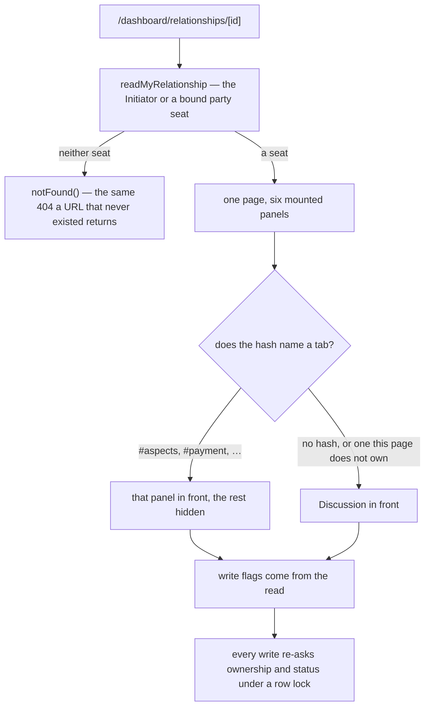

# v1.22.0 — the relationship is six sections you can read

<!-- docs-nav:begin -->

[Docs hub](../README.md) › **Release notes** › v1.22.0 · prev [v1.21.0](v1-21-0.md) · next [v1.3.0](v1-3-0.md)

<!-- docs-nav:end -->

v1.21.0 made two facts into rows: a session that says whether anybody joined, and an invitation that
knows which relationship it belongs to. It left the relationship itself as one long page. Everything
about a pair — the discussion, the Aspects, the two seats, the settings, the money — arrived in the
order the screen happened to draw it, and the reader's question ("what did they say about Aspect 4?")
was answered by scrolling.

This release makes the relationship a surface with sections instead of a page with headings. Six
tabs, a hash that names one, a Counterparty who joins the pair rather than being described by the
Initiator, Aspects that are numbered and carry a tolerance in words, and a Stage 6 that pauses when a
trial ends instead of closing the relationship quietly. Ten feature commits answer that, and five
fixes, chores and docs commits ride with them.

## Six sections, one record

`components/dashboard/relationship-tabs.tsx` draws the strip and nothing else: Discussion, Aspects,
Members, Details, Settings, Payment (#1124, `#1148`). Three properties are the whole design, and each
one is a bug avoided rather than a feature added.

**The hash is the tab id.** `#aspects` opens the Aspects tab on load, and switching tabs writes the
hash back with `history.replaceState` — never a push, because moving between two views of one record
is not a new page in the history, and Back has to leave the record rather than step through its
tabs.

**Every panel stays mounted.** `forceMount` plus `data-[state=inactive]:hidden` keeps the inactive
sections in the document, so one page carries six sections without a server round trip each time a
reader comes back to a tab — and `display: none` keeps an invisible panel out of the accessibility
tree and out of the tab order exactly as an unmounted one would be.

**The tabs decide nothing.** The relationship, its seat rules and its write flags arrive as props, so
the same six tabs serve an Initiator, a Counterparty, a draft and a paused relationship without a
conditional in the component. `readMyRelationship` asks the membership question first: a stranger's
id is a 404, a Counterparty's id is not.

## A Counterparty joins in three steps

The pair used to be a description — the Initiator typed who the other person was, and the product
believed them. `#1125` (`#1147`) makes the Counterparty a participant: **Invite · Join · Accept**.
The invitation is a real party seat with claims of its own (two fields, `#1117`), and "connected" is
derived from the seat that exists rather than stored as a flag somebody can set: a relationship is
connected when the second seat does, and not before.

## Aspects are numbered, and tolerance is a word

`#1122` (`#1145`) numbers the Aspects — so "Aspect 4" is an address a person can use — and re-scores
them against the relationship's Setting. `content/assessment.ts` carries the two settings as
`soft` and `full`, with the tolerance each one means: soft reads _Small Gap (1) OK – a satisfactory
Setting_, full has no such allowance. The re-score runs on the same rows the report reads, so the
number the screen shows and the number the Gap is computed from cannot be two different answers.

## A trial that ends pauses; it does not close

`#1121` (`#1143`) is one owner decision with three consequences, and `lib/relationship/pause.ts` is
where they live. **When the trial ends with no card, Stage 6 pauses — it never closes.** Both parties
keep reading, nothing is deleted, adding a card resumes the relationship immediately, and the
Initiator gets **one** free seven-day extension. The Counterparty is never asked to pay and never
sees a price.

Two smaller rules in the same file are the ones a reader feels. `lapsed` is not `paused`: a
cancelled subscription or a failed payment is a different sentence with a different action, and
offering "7 more days free" to somebody who has already paid would be a lie about money. And
`daysLeft` is `ceil`, never `floor` — _0 Days Left_ on a trial that is still running reads as a
defect, so an hour before the end still reads **1**.

## The create wizard draws the same rail

`#1123` (`#1144`) has the Create Relationship wizard draw the v2 rail and one stage card, so the
walk into a relationship and the page that relationship becomes are one visual system rather than
two. The rail still prints `Stage {n} of 5`; what is new is that a stage is one card, not a column of
sections.

## One palette, and a gate that reads the router

`#1120` (`#1142`) ports the v2.0 token layer: the party palette and the locked 1–5 answer scale live
as tokens in `data/brand.ts`, painted through `bg-action` / `text-action` / `border-action` by
`lib/brand-theme.ts`. A brand colour is a token, never a palette step — `pnpm lint` fails on
`indigo-*`, `purple-*`, `violet-*` and any `bg-gradient-to-*` under `components/` and `app/`, with no
allowlist and no suppression.

`#1113` (`#1114`) adds `routes:check`, and it is a one-function call over an artifact the build
already wrote. `next start` refuses to boot a build with two different dynamic segment names at one
level — `/dashboard/templates/[id]` beside `/dashboard/templates/[slug]/create` is the pair that cost
a boot — while `next build` compiles it happily, so the gate went green and the first request to the
deployment was a 500. The check runs Next's own `getSortedRoutes()` over
`.next/routes-manifest.json` immediately after the build, in the code lane, in about 0.3 ms. No
server, no port.

## The admin matrix

`app/(mainlayout)/admin/permissions/page.tsx` draws the CRUD and Permissions matrix (`#1126`) —
admin-only, read-only, and it states its own failure rather than drawing an empty table that reads as
"nobody has any permissions".

## The screen this release is about

This still is this release's own tree. A dev server was started from the branch that carries this
page, and `GET /api/version` answered `{"version":"1.22.0","commit":"7eb8ed0d"}` before a browser
opened — the same commit the branch is cut from. Then it was captured at 1440 CSS pixels, signed in
as the demo branch's own Initiator, on a live trial relationship.

## The honest sentence

This is a surface release and it is not the v2.0 launch, which is the first thing the limits below
say and the thing a reader of the entry is most likely to assume otherwise. Ten open pull requests
carry the v2.0 shell and are excluded from this tag by name; the noun sweep that would retire
`instance` in favour of `session` has not happened and both nouns are still in this tree; no
dependency major moved; and **no migration rides this tag** — the newest file under `db/migrations/`
is `0041_session_state.sql`, from v1.21.0, and this release neither adds one nor applies one. A
production database whose ledger has not been run with `pnpm db:migrate` is a deliberate step
somebody takes, not something this tag performs.

## The entry

<!-- changelog-view:begin entry -->
<!-- generated from CHANGELOG.md by scripts/changelog-view.mjs — edit the entry, not this block -->

- **Released** 2026-11-17
- **Tag** [`v1.22.0`](https://github.com/riolabs-ai/alignsynch/releases/tag/v1.22.0)
- **Pull requests named** 15
- **The entry** [`CHANGELOG.md`](../../CHANGELOG.md)

### Added

- `feat(admin)` — the CRUD and Permissions matrix — admin-only, read-only, with the honest failure state (#1126) ([#1157](https://github.com/riolabs-ai/alignsynch/pull/1157))
- `feat(v2)` — #1124 — Relationship Detail's six-tab layer ([#1148](https://github.com/riolabs-ai/alignsynch/pull/1148))
- `feat(v2)` — #1125 — Counterparty join — a 3-step role flow (Invite · Join · Accept) ([#1147](https://github.com/riolabs-ai/alignsynch/pull/1147))
- `feat(v2)` — Align v2 — Soft/Full Alignment Tolerance re-score, numbered Aspects (#1122) ([#1145](https://github.com/riolabs-ai/alignsynch/pull/1145))
- `feat(v2)` — #1123 the Create Relationship wizard draws the v2 rail and one stage card ([#1144](https://github.com/riolabs-ai/alignsynch/pull/1144))
- `feat(billing)` — trial-ended states — Stage 6 pauses read-only, one free 7-day extension (#1121) ([#1143](https://github.com/riolabs-ai/alignsynch/pull/1143))
- `feat(onboarding)` — the counterparty claims with two fields, and connected is derived (#1115 tasks 4-5) ([#1117](https://github.com/riolabs-ai/alignsynch/pull/1117))
- `feat(style)` — port the v2.0 token layer — calm party palette, locked 1–5 answer scale (#1120) ([#1142](https://github.com/riolabs-ai/alignsynch/pull/1142))
- `feat(onboarding)` — #1115 tasks 1-3 - trial anchored at creation, one trialStateOf() read, payment out of the create path ([#1116](https://github.com/riolabs-ai/alignsynch/pull/1116))
- `feat(ia)` — #1109 — retire /templates/relationship and move its three writes to the dashboard ([#1111](https://github.com/riolabs-ai/alignsynch/pull/1111))

### Fixed

- `fix(dashboard)` — delete the dead publish gate (#1140) ([#1141](https://github.com/riolabs-ai/alignsynch/pull/1141))

### Maintenance

- `chore(deps)` — bump next from 16.4.1 to 16.4.5 ([#1118](https://github.com/riolabs-ai/alignsynch/pull/1118))
- `docs(specs)` — v2.0 UI handoff bundles (01–11) ([#1137](https://github.com/riolabs-ai/alignsynch/pull/1137))
- `chore(gate)` — routes:check — Next's own router validation over the built manifest (#1113) ([#1114](https://github.com/riolabs-ai/alignsynch/pull/1114))
- `chore(health)` — re-record platform health at v1.21.0 ([#1110](https://github.com/riolabs-ai/alignsynch/pull/1110))
<!-- changelog-view:end -->

<!-- changelog-view:begin limits -->
<!-- generated from CHANGELOG.md by scripts/changelog-view.mjs — edit the entry, not this block -->

- **The v2.0 lane is not in this release.** Ten open pull requests — `#1149`, `#1150`, `#1151`,
  `#1152`, `#1153`, `#1154`, `#1155`, `#1156`, `#1158` and `#1159` — carry the v2.0 surface (app
  shell, templates, chat, payment, CRUD, the admin matrix, conversion, the answer screen). Every one
  of them is `DIRTY` or `BEHIND` against `main`, and all ten are excluded from this tag by name: they
  land in v2.0.0, not here. `#1112` (templates retirement, phase 2) is excluded the same way.

- **The noun sweep has not happened.** `#1103` retires `instance` in favour of `session` — `#1106`
  in the code and `#1107` in the bundle format — and both are deferred to v2.0.0, so both nouns are
  still in this tree's comments, its docs and its schema, and the platform bundle this build writes
  is still version 2 (`content/bundle.ts::PLATFORM_BUNDLE_VERSION`).

- **No dependency majors.** `#1027` (swiper `14.4.0`) and `#1025` (jsdom `31.0.0`) are open and
  deferred to v2.0.0. The only dependency that moved in this window is `next` `16.4.1` → `16.4.5`
  (`#1118`), a patch release taken for an advisory that stopped `next build`.

- **No migration rides this tag.** Nothing under `db/migrations/` changed between `v1.21.0` and this
  release — the newest file in the tree is `db/migrations/0041_session_state.sql`, applied on the
  demo branch on 2026-11-16. Production's schema is applied by hand with `pnpm db:migrate` and this
  release neither adds nor applies a migration, so a create against a production database whose
  ledger has not been run is a separate, deliberate step rather than something this tag performs.

- **`#1115` is still open in this milestone.** Its two landings — the trial anchored at creation
  (`#1116`) and the counterparty claims (`#1117`) — are in this release; the issue itself is not
  closed by it and moves to v2.0.0, so the trial's acceptance anchor is shipped but unproven end to
  end by an issue that has not closed.

- **Production's two `ADMIN_EMAILS` seats still answer `401`** (`#1084`). `walt1@alignsynch.com` and
  `alignsynch@riolabs.ai` fail `INVALID_EMAIL_OR_PASSWORD` against `https://alignsynch.com`. Carried
  from v1.21.0 unchanged: this release provisions neither seat, and the issue is open in the backlog.
<!-- changelog-view:end -->

<!-- docs-nav:begin -->

[Docs hub](../README.md) › **Release notes** › v1.22.0 · prev [v1.21.0](v1-21-0.md) · next [v1.3.0](v1-3-0.md)

<!-- docs-nav:end -->
