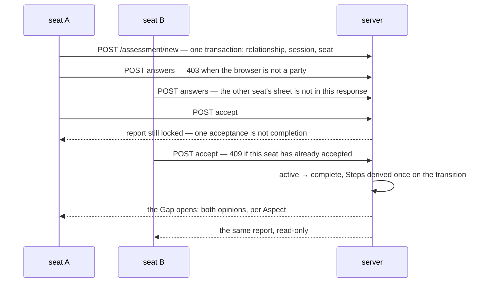
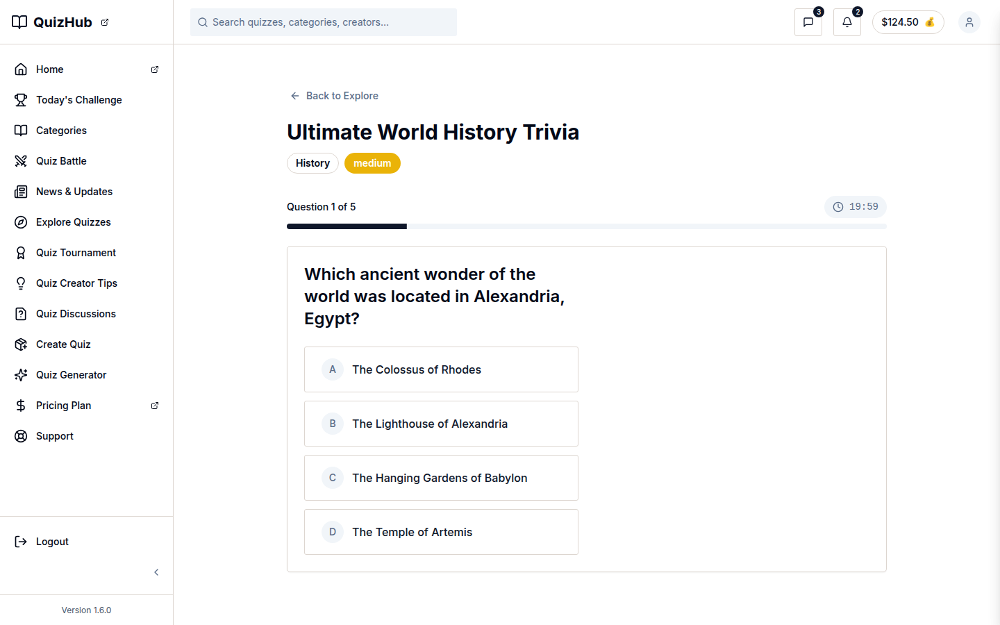

# v1.3.0 — the flow closes

<!-- docs-nav:begin -->

[Docs hub](../README.md) › **Release notes** › v1.3.0 · prev [v1.2.0](v1-2-0.md) · next [v1.4.0](v1-4-0.md)

<!-- docs-nav:end -->

Until this release a relationship could be read on five screens and changed on none. v1.3.0 is the
first tag that can say the three write surfaces are wired: create, answer and accept each write to
Postgres, the second acceptance completes the session, and the Gap opens.

## What was painful before

- **A session could not finish.** v1.2.0 shipped the accept screen with every control disabled and
  the label "Not wired yet — … Nothing was saved." A two-party assessment that cannot accept twice
  is a demo of a two-party assessment.
- **Acceptance was a checkbox, not the hinge.** Nothing derived the Steps on completion, so the
  report had nothing to print even after both sheets existed.
- **The answer sheet was a page, not a gate.** Whether the other party could see your answers was a
  claim the render made afterwards, instead of the shape of the query it was given.
- **The create form had no writer.** A template's CTA led to a form; the form's submit went nowhere.
- **A signed-in session could be dropped by its own render.** Next 16 refuses `cookies().set()`
  inside a server-component render, and Better Auth re-signs the cookie as it ages — so an ordinary
  render periodically attempted a write, and the refusal was being read as "signed out".

## What it does now

- **Three write paths, each with its refusals proved.** Create copies a template into a relationship,
  a session and the initiating seat in one transaction; an answer sheet records one party's whole
  sheet; the second acceptance completes the session, opens the report and derives the Steps. 403
  for a browser that is not a party, 409 once the submitting party has accepted, 409 for an opinion
  kind the session's mode does not ask — and the race: two concurrent accepts derive the Steps once.
- **The report stays locked until both parties accept**, because the blind rule is the query the
  page is given, not a check made after it renders. After completion it prints both opinions and the
  Gap between them, and it is read-only: no control changes a relationship, records an acceptance or
  edits an answer.
- **A valid session survives a render that cannot write its cookie.** `lib/auth/session.ts` reads
  through a request context with no write to refuse, and the first attempt still persists the
  refresh where a write is legal.
- **The catalogue is a product**: 27 relationship types across seven realms, priced from the
  fixture and filterable, with `pnpm demo:verify` diffing a versioned demo dataset against a
  versioned expectation in one command.
- **No public page prints an email address**; `/help` carries one no-captcha form instead.

## The completion hinge

Two of those arrows are the release:

- **The Steps are derived on the transition, not stored.** `lib/flow/state.ts` states the status as
  a function of stored instants, and the derivation runs once, on the transition — which is why
  "two concurrent accepts" is a test and not a hope.
- **The blind rule is a query.** The locked page is not a page that hides fields; it is a page whose
  read did not ask for the other seat's answers.

## Screens

The blind answer sheet is a **variation** of this surface rather than a new one: a five-segment
radio group per question, the same input the quiz product plays with, gated behind a party check.
The frame is current (2026-11-07) and belongs to the quiz brand, because the answer sheet itself is
session- and relationship-scoped and is not in the captured set — the page says that rather than
presenting the quiz product's screen as the assessment flow's.

## The entry, as published

<!-- changelog-view:begin entry -->
<!-- generated from CHANGELOG.md by scripts/changelog-view.mjs — edit the entry, not this block -->

- **Released** 2026-11-03
- **Tag** [`v1.3.0`](https://github.com/riolabs-ai/alignsynch/releases/tag/v1.3.0)
- **Pull requests named** 38
- **The entry** [`CHANGELOG.md`](../../CHANGELOG.md)

### Added

- `feat(templates)` — the catalogue the page carries — 27 types, seven realms, priced from the fixture, filterable ([#464](https://github.com/riolabs-ai/alignsynch/pull/464))
- `feat(demo)` — pnpm demo:verify — a versioned dataset, a versioned expectation, one diff ([#460](https://github.com/riolabs-ai/alignsynch/pull/460))
- `feat(contact)` — no email on any public page, one no-captcha form on /help (supersedes #448) ([#452](https://github.com/riolabs-ai/alignsynch/pull/452))
- `feat(v1)` — the staff–manager template demo renders a real report ([#447](https://github.com/riolabs-ai/alignsynch/pull/447))
- `feat(pricing)` — three tiers, Basic recommended, relationship alignment copy, real billing rows ([#444](https://github.com/riolabs-ai/alignsynch/pull/444))
- `feat(support)` — split the help centre from account support ([#445](https://github.com/riolabs-ai/alignsynch/pull/445))
- `feat(marketing)` — the AlignSynch home leads with the practice, the Gap is the proof ([#431](https://github.com/riolabs-ai/alignsynch/pull/431))
- `feat(flow)` — acceptance is the completion hinge, and Steps are derived on the transition (#427) ([#430](https://github.com/riolabs-ai/alignsynch/pull/430))
- `feat(flow)` — the create form posts to /assessment/new, refusals come back as a band, and the chosen Setting is written (#427) ([#429](https://github.com/riolabs-ai/alignsynch/pull/429))
- `feat(flow)` — /answer is a gated sheet, blind by construction (#427) ([#428](https://github.com/riolabs-ai/alignsynch/pull/428))
- `feat(v1)` — gate the prototype group behind a session or the demo unlock ([#426](https://github.com/riolabs-ai/alignsynch/pull/426))
- `feat(shell)` — the console rail opens on Dashboard and lists My Relationships · Library ([#425](https://github.com/riolabs-ai/alignsynch/pull/425))
- `feat(v1)` — the demo seed carries two rows per catalogue type ([#421](https://github.com/riolabs-ai/alignsynch/pull/421))

### Fixed

- `fix(how-it-works)` — the login redirect answers with no auth environment ([#467](https://github.com/riolabs-ai/alignsynch/pull/467))
- `fix(brand)` — the chrome draws the official lockup whole, and never squashed ([#470](https://github.com/riolabs-ai/alignsynch/pull/470))
- `fix(shell)` — the rail is a drawer below 768, icons to 1023, labels from 1024 ([#465](https://github.com/riolabs-ai/alignsynch/pull/465))
- `fix(auth)` — a valid session survives a render that cannot write its cookie ([#453](https://github.com/riolabs-ai/alignsynch/pull/453))
- `fix(shell)` — the rail expands from lg, not xl — labels are back at laptop widths ([#449](https://github.com/riolabs-ai/alignsynch/pull/449))
- `fix(copy)` — the relationships list carries a label for every invite state ([#435](https://github.com/riolabs-ai/alignsynch/pull/435))
- `fix(auth)` — step 1 of sign-up collects the email only; the names move to step 2 ([#422](https://github.com/riolabs-ai/alignsynch/pull/422))

### Maintenance

- `docs(gate)` — the 2026-10-29 → 2026-11-03 comparison states the per-step numbers, not a ratio ([#482](https://github.com/riolabs-ai/alignsynch/pull/482))
- `docs(gate)` — a measured baseline — 97.4 % yield / 144 s on 2026-11-02, and how to re-derive it ([#480](https://github.com/riolabs-ai/alignsynch/pull/480))
- `perf(db)` — pin TLS, timeouts and pool bounds; make a cold start visible (#440) ([#479](https://github.com/riolabs-ai/alignsynch/pull/479))
- `docs(readme)` — the share card leads, the pricing capture stays for the UI docs ([#477](https://github.com/riolabs-ai/alignsynch/pull/477))
- `docs(auth)` — the gated console routes say why no auth env is a 500, by design ([#475](https://github.com/riolabs-ai/alignsynch/pull/475))
- Home polish · the six defects the hero screenshot review found (copy and spacing) ([#471](https://github.com/riolabs-ai/alignsynch/pull/471))
- Share card · ship the owner's supplied PNG byte-identical, retire the drawn card ([#472](https://github.com/riolabs-ai/alignsynch/pull/472))
- `docs(templates)` — re-capture the catalogue on the rail v4 shell — and prove the v2 branch deletes no sibling ([#473](https://github.com/riolabs-ai/alignsynch/pull/473))
- `test(brand)` — E37 — the AlignSynch brand never names the template, with a guard that proves it can fail ([#466](https://github.com/riolabs-ai/alignsynch/pull/466))
- Share card · the brand's own lockup, one sentence, the Gap drawn ([#469](https://github.com/riolabs-ai/alignsynch/pull/469))
- `docs(readme)` — open on the pricing page, retire the stale captures, keep five flows ([#468](https://github.com/riolabs-ai/alignsynch/pull/468))
- Home v2 · the AlignSynch practice page, finished, gated and screenshotted ([#463](https://github.com/riolabs-ai/alignsynch/pull/463))
- `docs(readme)` — say what AlignSynch is, and show the six finished screens ([#462](https://github.com/riolabs-ai/alignsynch/pull/462))
- `chore(dx)` — pnpm check:fast — a fast inner loop, and the cohort rhythm written down ([#450](https://github.com/riolabs-ai/alignsynch/pull/450))
- Pricing · readable CTA, centred signup band, Title Case chrome ([#451](https://github.com/riolabs-ai/alignsynch/pull/451))
- Footer · the news signup on every marketing page (Neon stores, Resend sends) + the brand-immutability guard ([#446](https://github.com/riolabs-ai/alignsynch/pull/446))
- copy · relationships, not assessments — and the auth surfaces get the brand, a way home, and a password meter ([#436](https://github.com/riolabs-ai/alignsynch/pull/436))
- `chore(gitignore)` — never commit a .hermes/ directory that lands in a workspace ([#432](https://github.com/riolabs-ai/alignsynch/pull/432))
<!-- changelog-view:end -->

## Known limits

<!-- changelog-view:begin limits -->
<!-- generated from CHANGELOG.md by scripts/changelog-view.mjs — edit the entry, not this block -->

- **Production is not this tag, and the entry says which build it was written against.** On 2026-11-03, `alignsynch.com/api/version` answers `94070089318162818dac03db4a42e63c993f80da` (`perf(db)`, #479) with version `1.2.0` — the number baked into the bundle at build time, which is why the live badge still reads `1.2.0`. The `v1.3.0` tag sits on the release commit above that build: it carries this entry, the version in `package.json`, the release and deployment docs, and the parity hashes the version string moves — no application code — so deploying it rebuilds the same app with a new badge. Any later commit moves production again, and `node scripts/deploy-check.mjs --expect "$(git rev-parse v1.3.0^{commit}")"` is what answers that question; this paragraph can only date the answer.
- **The three write surfaces are wired, and this is the first tag that can say so.** Create (`POST /assessment/new`), answer (`POST /assessment/instances/[instanceId]/answers`) and acceptance (`POST /assessment/instances/[instanceId]/accepts`) each write to Postgres: create copies a template into a relationship, a session and the initiating seat in one transaction; an answer sheet records one party's whole sheet; the second acceptance completes the session, opens the report and derives the Steps. Refusals are proved too — 403 for a browser that is not a party, 409 once the submitting party has accepted, 409 for an opinion kind the session's mode does not ask — and so is the race (two concurrent accepts derive the Steps once). All of it against the **demo** database; no run in this repository has driven the flow against production's rows, because `pnpm demo:verify` refuses production by design.
- **The report stays locked until both parties accept.** Before the second acceptance it renders the locked page and nothing of the other party's answers: the blind rule is the query the page is given, not a check the render makes afterwards. After completion it prints both parties' opinions and the Gap between them, and it is read-only — no control changes a relationship, records an acceptance or edits an answer.
- **Neither write screen has a nav destination.** Create is reachable from a template's own CTA (`components/assessment-flow/template-card.tsx` renders `createRelationshipPath`), and the answer sheet from the accept screen's answer-first band — `lib/flow/paths.ts::answerSheetPath`, passed into `AcceptSession` as `answerHref` by `instances/[instanceId]/accept/page.tsx` and rendered as the `<Link>` in `components/assessment-flow/accept-session.tsx`, which the acceptance hinge shipped (#427, [#430](https://github.com/riolabs-ai/alignsynch/pull/430)) — so the sheet is reached from `/assessment/instances/<id>/accept` while the viewer's own sheet is still incomplete, and never from the navigation: `components/layout/nav-menus.tsx` draws rows for `/assessment/instances` and `/assessment/templates` only, so no row exists for either write route. This release's registry called both `preview` at the cut, a status that had no rendered effect for exactly that reason; #485 corrected it to `live` once both write paths had shipped (#428, #429). _(Corrected after publication — this bullet first said ~~`lib/flow/paths.ts::answerPath`~~, a symbol the tree does not carry, and that nothing links to the sheet. Both were false at this tag, and the fragment now names its parent segment: two routes under `app/**` end with that file.)_
- **Six surfaces are declared and not wired**: chat, notifications, the relationship product's profile and settings, the shop, and the admin console. Each answers with the product's own pending panel and gains no nav destination. The admin console's two reads exist, but the shell cannot grant the capability — `lib/nav.ts` reads no role — so the registry names the missing operator role rather than calling a working read shipped.
- **The public contact form keeps a message before it mails it.** `/help` posts to `/api/contact`, which inserts into `contact_message` (migrations `0020` and `0021`) and only then calls Resend; `mail_outcome` records `sent`, `unset` or `failed`, so a provider outage delays the notification instead of losing the message. There is no operator inbox in the app — the table is read in SQL. The throttle counts a salted SHA-256 of the client address and never the address itself.
- **`/v1` is gated, not retired.** Every prototype route answers `307 → /login?next=/v1` for a visitor carrying neither a session nor the demo PIN unlock. The demo path itself is refused on a production deployment unless `DEMO_ALLOW_PRODUCTION=1` is set explicitly (`lib/auth/demo-mode.ts`).
- **No preview URL exists for a branch under review.** Vercel creation stays deliberately production-only, so a branch is reviewed by reading its diff and running it locally, and production is the only deployed artefact of this repository.
<!-- changelog-view:end -->

<!-- docs-nav:begin -->

[Docs hub](../README.md) › **Release notes** › v1.3.0 · prev [v1.2.0](v1-2-0.md) · next [v1.4.0](v1-4-0.md)

<!-- docs-nav:end -->
