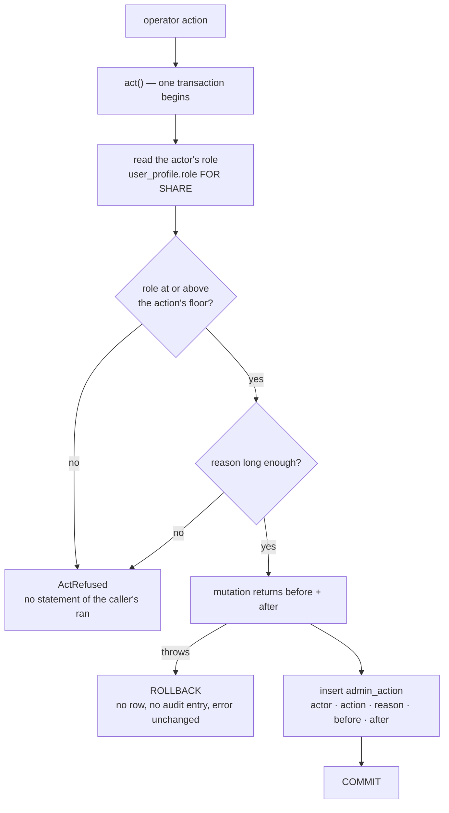
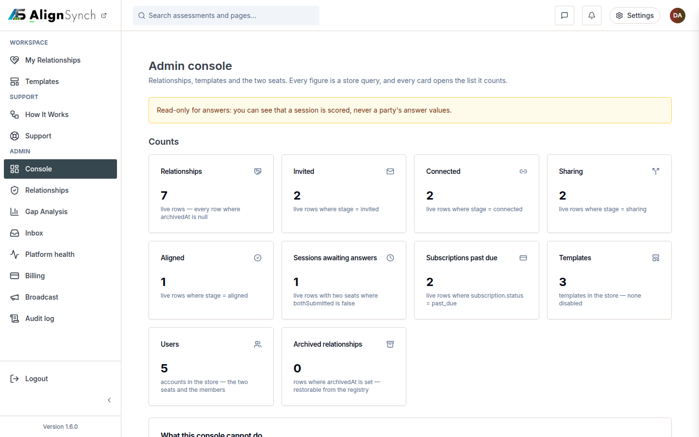

# v1.4.0 — the console, and templates become products

<!-- docs-nav:begin -->

[Docs hub](../README.md) › **Release notes** › v1.4.0 · prev [v1.3.0](v1-3-0.md) · next [v1.5.0](v1-5-0.md)

<!-- docs-nav:end -->

The release where an operator could act on a relationship without opening `psql`, and where every
action left a row saying who did it, why, and what it changed.

## What was painful before

- **Operator work happened in SQL.** Fixing a stuck relationship, regenerating a report, granting a
  comp or reading a support thread were queries in a terminal, with no role check and no record.
- **A template was a fixture.** Changing one meant changing the tree, and a relationship could not be
  bound to the version of the template it was answered against — so a reworded question changed what
  an old answer meant.
- **The rail knew two classes of person** — operator and not — so "which rung does this action need"
  had no home, and the console's own hub page had no entry anywhere in the UI. (That last defect is
  the one v1.6.0's rail rewrite closed; the console reached the rail here only row by row.)
- **Nobody could see what the platform was doing**: platform health, billing state, the send failure
  on a support reply, and the broadcast to news signups were all invisible to the operator.

## What it does now

- **One audited write path.** `lib/admin/act.ts` is three steps in a fixed order — begin, read the
  actor's role, refuse or run the mutation, insert `admin_action`, commit — and every property the
  epic promises is a property of that order.
- **`product.admin` is a capability, not a build flag.** A derived template inherits the console or
  turns it off and answers `404` when off, which is what makes the console removable without
  deleting it.
- **Template versioning.** `template_version` holds an immutable published revision, a relationship
  is bound to the version it was answered against, and publishing again creates a revision instead of
  rewriting history.
- **The console's surfaces**: users and the role ladder, template authoring validated by
  `zAssessment`, relationship repair with per-action floors, report regeneration with a PII-gated
  read and JSON/PDF export, billing control with audited comps and a visible test-mode banner, the
  support inbox, broadcast and platform health.
- **Relationship templates as products**: an owner, a visibility, a lifecycle
  `draft → pending → published → active → complete` with `void` and `expired`, a 14-day trial from
  publish, one active trial per user at a time, a 7-day invite, unlimited rounds while paid, and
  read-only for both sides when membership lapses.
- **Onboarding**: a first-run tour with six steps and a three-step counterparty wizard whose auth
  round-trip keeps the invite token and returns to the same step.

## `act()` — the order that makes the audit trustworthy

Three consequences, each one the reason a step is where it is:

- **The role is read, never claimed.** It comes from the same transaction that writes, `FOR SHARE`,
  so a concurrent demotion cannot commit between the check and the write. The caller passes a
  `userId` and no role at all, so there is no argument a call site can get wrong.
- **A refusal happens before the mutation.** A too-short reason, a role below the floor, an unknown
  action — each throws with nothing of the caller's having run.
- **The audit insert is the last statement before `COMMIT`.** A mutation that throws never reaches
  it, and the transaction is rolled back, so the row and the entry always exist together.

## Screens

`/admin/console` at 1440×900: counts that open their lists, and the group the rail now leads with.
The frame is current (2026-11-07) rather than a picture of the tag — the console's routes have moved
twice since this release (`/admin/console` behind the allowlist in #486, the hub row in #620), and a
reader is better served by the surface as it is than by a screenshot of a layout that no longer
exists.

## The entry, as published

<!-- changelog-view:begin entry -->
<!-- generated from CHANGELOG.md by scripts/changelog-view.mjs — edit the entry, not this block -->

- **Released** 2026-11-04
- **Tag** [`v1.4.0`](https://github.com/riolabs-ai/alignsynch/releases/tag/v1.4.0)
- **Pull requests named** 55
- **The entry** [`CHANGELOG.md`](../../CHANGELOG.md)

The admin console, and relationship templates become products.

### Admin

- **An audited operations console** (epic #500): roles, an action log, template authoring,
  relationship repair, report regeneration, billing control, support inbox, broadcast and
  platform health. Every write passes one `act()` path that cannot mutate without a reason,
  and a PII read records itself.
- `product.admin` is a **template capability** — a derived product inherits the console or
  turns it off, and answers 404 when off.

### Relationship templates as products (#533)

- Templates carry an owner and a visibility; public listing stays admin-curated.
- Relationship lifecycle `draft → pending → published → active → complete`, with void/expired.
- **Per-relationship membership**: 14-day trial from publish, one active trial per user,
  invite expires in 7 days, unlimited assessment rounds while paid, read-only for both sides
  when membership lapses.
- Initiator CRUD: clone or start blank, edit Aspects, publish → trial or checkout,
  one-click re-publish.

### Onboarding

- First-run tour (driver.js, MIT) and a three-step counterparty wizard whose auth round-trip
  keeps the invite token and returns to the same step.

### Brand and system

- Icon set generated from the **real mark**, transparent ground (`E38` guards it).
- Palette: graphite `#37474F` action, cyan `#08ADD5` accent (surface-only — contrast measured).
- New checks: `E39` fails a dashboard→marketing link without a new tab; `E35` remains the
  ancestor rule.

### Commits

- `feat(nav)` — the rail is a role-constrained menu, and the admin console leads its own group (#542) ([#552](https://github.com/riolabs-ai/alignsynch/pull/552))
- `feat(templates)` — a public Relationship Templates catalogue, and a home band that sells it ([#544](https://github.com/riolabs-ai/alignsynch/pull/544))
- `feat(flow)` — counterparty onboarding — a three-step wizard, and a next on every login hop ([#538](https://github.com/riolabs-ai/alignsynch/pull/538))
- `feat(relationship)` — #533 phase 3 — one trial, day-14 hard stop, read-only both sides, payment reactivates ([#537](https://github.com/riolabs-ai/alignsynch/pull/537))
- `feat(member)` — #533 phase 2 — initiator CRUD, publish, one-click re-publish ([#535](https://github.com/riolabs-ai/alignsynch/pull/535))
- `feat(relationship)` — template ownership, lifecycle, trial read and rounds (#533 phase 1) ([#534](https://github.com/riolabs-ai/alignsynch/pull/534))
- `feat(billing)` — claim the host on a checkout and refuse another host's events ([#532](https://github.com/riolabs-ai/alignsynch/pull/532))
- `feat(admin)` — broadcast to news signups (#507) ([#531](https://github.com/riolabs-ai/alignsynch/pull/531))
- `feat(admin)` — #506 support inbox — triage, Resend replies with visible failure, bounce state, throttle visibility ([#530](https://github.com/riolabs-ai/alignsynch/pull/530))
- `feat(email)` — #439b Resend inbound — signed webhook, idempotent email_event, bounce suppression ([#528](https://github.com/riolabs-ai/alignsynch/pull/528))
- `feat(admin)` — #502b template versioning — template_version, relationships bound to a version, immutable publish ([#524](https://github.com/riolabs-ai/alignsynch/pull/524))
- `feat(admin)` — #505 billing control — subscription state, test-mode banner, audited comps, server-side limits ([#525](https://github.com/riolabs-ai/alignsynch/pull/525))
- `feat(admin)` — #504 report operations — regenerate, PII-gated read, JSON + PDF export ([#523](https://github.com/riolabs-ai/alignsynch/pull/523))
- `feat(admin)` — #502a template authoring — a draft editor validated by zAssessment, saved through act() ([#522](https://github.com/riolabs-ai/alignsynch/pull/522))
- `feat(admin)` — /admin/health — the platform-health screen, every number naming its source (#508) ([#520](https://github.com/riolabs-ai/alignsynch/pull/520))
- `feat(admin)` — the five #503 actions, their floors, and a reason gate proven per operation ([#517](https://github.com/riolabs-ai/alignsynch/pull/517))
- `feat(admin)` — #503 relationship operations ([#516](https://github.com/riolabs-ai/alignsynch/pull/516))
- `feat(admin)` — /admin/audit — the filtered, read-only audit screen (#501b) ([#515](https://github.com/riolabs-ai/alignsynch/pull/515))
- `feat(admin)` — the role ladder, admin_invite, admin_action and act() (#501) ([#511](https://github.com/riolabs-ai/alignsynch/pull/511))
- `feat(admin)` — product.admin — the console's capability switch (#509) ([#512](https://github.com/riolabs-ai/alignsynch/pull/512))
- `feat(db-verify)` — V21 — a seeded instance reads `complete`, or the run names it ([#499](https://github.com/riolabs-ai/alignsynch/pull/499))
- `feat(onboarding)` — the first-run tour's shell — driver.js, six steps, skip a missing target (#455) ([#496](https://github.com/riolabs-ai/alignsynch/pull/496))
- `feat(onboarding)` — the tour's "seen" mark is one column and one guarded route (#456) ([#494](https://github.com/riolabs-ai/alignsynch/pull/494))
- `feat(assessment)` — the Steps render on the instance screen, and the v1 release rows retire (#478) ([#493](https://github.com/riolabs-ai/alignsynch/pull/493))
- `feat(demo)` — move the worked example to /assessment/demo/[type] and delete the prototype group (#478) ([#492](https://github.com/riolabs-ai/alignsynch/pull/492))
- `feat(release)` — --check-limits re-derives a Known limits block from the tree ([#489](https://github.com/riolabs-ai/alignsynch/pull/489))
- `feat(admin)` — move the console to /admin/console, behind the allowlist (#478) ([#486](https://github.com/riolabs-ai/alignsynch/pull/486))
- `fix(brand)` — the lockup is 2rem in every expanded-header viewport (#549 follow-up) ([#553](https://github.com/riolabs-ai/alignsynch/pull/553))
- `fix(help)` — a sticky category rail beside the answers, and the person band beside the form ([#549](https://github.com/riolabs-ai/alignsynch/pull/549))
- `fix(brand)` — the chrome draws the full lockup again, and the auth mark is a seal (#539) ([#547](https://github.com/riolabs-ai/alignsynch/pull/547))
- `fix(db)` — serialise db:seed on the branch with an advisory lock ([#529](https://github.com/riolabs-ai/alignsynch/pull/529))
- `fix(demo)` — record the #464 dataset in the demo expectations — 33 records, 172 items ([#526](https://github.com/riolabs-ai/alignsynch/pull/526))
- `fix(demo)` — record the #464 template catalogue in demo:verify's counts ([#527](https://github.com/riolabs-ai/alignsynch/pull/527))
- `fix(admin)` — #503 a revoke is terminal — a resend refuses a withdrawn invitation ([#519](https://github.com/riolabs-ai/alignsynch/pull/519))
- `fix(assessment)` — the locked report's continue CTA opens the sheet, not the POST-only endpoint ([#488](https://github.com/riolabs-ai/alignsynch/pull/488))
- feat(email) — the release note: one band, plain text first, sent once per tag (#548) ([#551](https://github.com/riolabs-ai/alignsynch/pull/551))
- feat(dashboard) — support, help and the library live in the console (#542) ([#546](https://github.com/riolabs-ai/alignsynch/pull/546))
- `polish(v1.x)` — the ten owner UI items — icon size, auth gap, Gap scale, tokens, footer band, one measure, rails (#539) ([#543](https://github.com/riolabs-ai/alignsynch/pull/543))
- `copy(home)` — the register pass — title, practice band and boundary body ([#545](https://github.com/riolabs-ai/alignsynch/pull/545))
- `copy(home)` — the hero pitches a leader's outcome, not a practitioner's practice ([#541](https://github.com/riolabs-ai/alignsynch/pull/541))
- `ux(rules)` — a link out of the dashboard opens a new tab; a form surface carries no shadow ([#540](https://github.com/riolabs-ai/alignsynch/pull/540))
- `chore(ops)` — version env-sync with the policy lists, --confirm-production and --diff ([#536](https://github.com/riolabs-ai/alignsynch/pull/536))
- `test(admin)` — #503 the five repairs, their rung and the rollback ([#521](https://github.com/riolabs-ai/alignsynch/pull/521))
- `docs(brand)` — the icon docs name the transparent ground, and parity only moves on a path ([#514](https://github.com/riolabs-ai/alignsynch/pull/514))
- `test(admin)` — #503 the void and force-close screens, read as markup ([#518](https://github.com/riolabs-ai/alignsynch/pull/518))
- `brand` — the icon set is the AS mark on transparency, and E38 fails when it is not ([#510](https://github.com/riolabs-ai/alignsynch/pull/510))
- `docs(release)` — a seeded instance reading `answering` is stamped, never reseeded ([#498](https://github.com/riolabs-ai/alignsynch/pull/498))
- `docs(db-verify)` — V11's comment says why a legitimate mark can still go stale ([#497](https://github.com/riolabs-ai/alignsynch/pull/497))
- `docs(release)` — a V11 is repaired by clearing the mark, and a rule change is what creates one ([#495](https://github.com/riolabs-ai/alignsynch/pull/495))
- `refactor(v1)` — delete the 95-row customer half of /v1, and prove /v1 404s (#478) ([#491](https://github.com/riolabs-ai/alignsynch/pull/491))
- `docs(registry)` — the answer sheet's inbound paths name the report's CTA too ([#490](https://github.com/riolabs-ai/alignsynch/pull/490))
- `docs(release)` — the v1.3.0 Known limit said the answer sheet had no link — it has one ([#487](https://github.com/riolabs-ai/alignsynch/pull/487))
- fix(shell) — the surface registry calls create and answer live, because they are ([#485](https://github.com/riolabs-ai/alignsynch/pull/485))
- `docs(v1)` — disposition all 118 /v1 items into docs/operations/history/V1-RETIREMENT.md (#478) ([#484](https://github.com/riolabs-ai/alignsynch/pull/484))
- `docs(release)` — a merge deploys production, measured during the v1.3.0 cut ([#483](https://github.com/riolabs-ai/alignsynch/pull/483))
- **Stripe is test mode only** — no `sk_live` path exists in the code; checkout cannot charge
- **Chat has no persistence** — `/chat` is a mocked surface with no tables behind it.
- **The Doubt gap kind is not computable** — `opinion` keeps one value per kind, so the report
- **Neon-hosted auth mail is unverified** — app mail sends through Resend and is proven;
- **Role-constrained menus and focused-flow chrome are not in this release** (#542 phase 2).
- **An invite token is shown once** (hashed at rest) — a lost link needs a re-publish.
- No merge queue (#442); merges stay serial because `main` requires an up-to-date branch.
<!-- changelog-view:end -->

## Known limits

<!-- changelog-view:begin limits -->
<!-- generated from CHANGELOG.md by scripts/changelog-view.mjs — edit the entry, not this block -->

- **Stripe is test mode only** — no `sk_live` path exists in the code; checkout cannot charge
  a card, and the test-mode banner stays visible on purpose.
- **Chat has no persistence** — `/chat` is a mocked surface with no tables behind it.
- **The Doubt gap kind is not computable** — `opinion` keeps one value per kind, so the report
  states it rather than printing a number.
- **Neon-hosted auth mail is unverified** — app mail sends through Resend and is proven;
  a Neon-side SMTP credential was rotated and its replacement is not yet confirmed by a reset.
- **Role-constrained menus and focused-flow chrome are not in this release** (#542 phase 2).
- **An invite token is shown once** (hashed at rest) — a lost link needs a re-publish.
- No merge queue (#442); merges stay serial because `main` requires an up-to-date branch.
<!-- changelog-view:end -->

<!-- docs-nav:begin -->

[Docs hub](../README.md) › **Release notes** › v1.4.0 · prev [v1.3.0](v1-3-0.md) · next [v1.5.0](v1-5-0.md)

<!-- docs-nav:end -->
