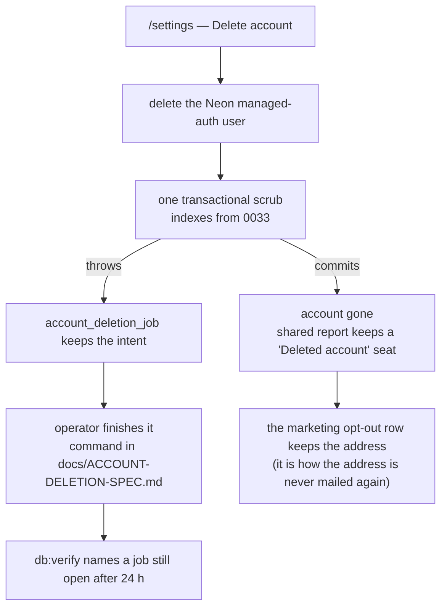
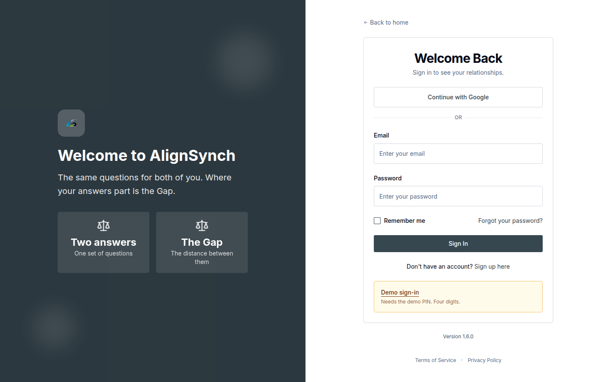

# v1.5.0 — account deletion, and a dependency cohort that changed no source

The release where a person can delete their own account, and the deletion is an operation with a
recorded intent rather than a cascade somebody hopes completes.

## What was painful before

- **There was no self-service account deletion.** `/privacy` and `/terms` said so and routed the
  request to a support address, which put a person's removal in someone's inbox and in nobody's
  transaction.
- **A half-finished deletion had nowhere to be visible.** Deleting a Neon managed-auth user and then
  scrubbing application rows are two systems; when the second step threw, the first had already
  committed and nothing in any check could see the wreckage.
- **The tour's fourth step described an answer sheet instead of filling one**, so the one screen the
  tour exists to show was an illustration.
- **The dependency tree had grown majors nobody could move**: react 19.3, recharts 3.x (13 typecheck
  errors on 2.15), swiper 12 (two critical advisories), zod 4.

## What it does now

- **One in-app control, on `/settings`.** It deletes the managed-auth user, then runs one
  transactional scrub of the application's own rows — the indexes that make the scrub a set of
  seeks rather than a scan landed as migration `0033`.
- **A failed scrub resumes from a recorded intent.** `account_deletion_job` holds the inside of the
  operation, an operator finishes it with the command in
  [`docs/ACCOUNT-DELETION-SPEC.md`](../ACCOUNT-DELETION-SPEC.md), and `scripts/db-verify.mjs` names a
  job left open past 24 hours. That is a check somebody runs, not a pager — the entry says so.
- **A shared report survives one participant leaving.** The other person keeps their report; the
  deleted seat reads "Deleted account" and their answers stay inside the completed report with the
  identifying prose rewritten. The marketing opt-out row keeps the address on purpose, so the
  address is never mailed again.
- **The tour fills the real answer sheet**, which is the difference between a walkthrough and a demo.
- **The dependency cohort moved with no application change**: react 19.3.1, recharts 3.10.1,
  swiper 12.2.0, zod 4 and next 16.4.1 all landed as version bumps; the carousel evidence is in
  `docs/qa-swiper-12/`, and the two frames that differ are autoplay timing.

## The deletion, as a sequence of two systems

The point of drawing it is the two arrows out of the scrub. The happy path is one transaction in one
database. The failure path is a **row that outlives the process**, which is the only reason an
operator can finish a deletion that a request started and a crash interrupted.

## Screens

Deletion is behind this session, and only behind it: the control acts on the signed-in person, so
anyone whose managed-auth user is already gone cannot self-serve the rest. The captured set has no
frame of `/settings` itself — this is the door it sits behind, and the page says so rather than
borrowing a picture of a different surface.

## The entry, as published

<!-- changelog-view:begin entry -->
<!-- generated from CHANGELOG.md by scripts/changelog-view.mjs — edit the entry, not this block -->

- **Released** 2026-11-07
- **Tag** [`v1.5.0`](https://github.com/riolabs-ai/alignsynch/releases/tag/v1.5.0)
- **Pull requests named** 31
- **The entry** [`CHANGELOG.md`](../../CHANGELOG.md)

### Added

- `feat(privacy)` — account deletion — 0033 indexes, the Neon auth-user delete, one transactional scrub, an in-app control (#597) ([#597](https://github.com/riolabs-ai/alignsynch/pull/597))
- `feat(tour)` — step 4 fills the real answer sheet as an example (#457) ([#596](https://github.com/riolabs-ai/alignsynch/pull/596))
- `feat(email)` — templates 6-10 through the v0.9 band (#548) ([#568](https://github.com/riolabs-ai/alignsynch/pull/568))
- `feat(email)` — templates 2–5 through the band (#548) ([#558](https://github.com/riolabs-ai/alignsynch/pull/558))

### Fixed

- `fix(account)` — db:verify names an unfinished deletion (#278) ([#613](https://github.com/riolabs-ai/alignsynch/pull/613))
- `fix(settings)` — the delete card carries §5 verbatim, and the retention line stops denying the address (#278) ([#602](https://github.com/riolabs-ai/alignsynch/pull/602))
- `fix(deps)` — migrate recharts 2.15.3 -> 3.10.1 (13 typecheck errors -> 0; supersedes #571) ([#587](https://github.com/riolabs-ai/alignsynch/pull/587))
- `fix(account)` — a failed scrub resumes from a recorded intent (#278) ([#601](https://github.com/riolabs-ai/alignsynch/pull/601))
- `fix(deps)` — better-auth 1.7.18 (patches CVE-2026-114607) via @neon/auth 0.8.2 ([#576](https://github.com/riolabs-ai/alignsynch/pull/576))
- `fix(demo)` — a restore of a branch with children sends preserve_under_name ([#561](https://github.com/riolabs-ai/alignsynch/pull/561))
- `fix(email)` — the `### Commits` ledger is provenance, not a highlight ([#555](https://github.com/riolabs-ai/alignsynch/pull/555))

### Maintenance

- `chore(deps)` — remove the unused DatePicker wrapper and react-day-picker ([#593](https://github.com/riolabs-ai/alignsynch/pull/593))
- `chore(deps)` — react 19.3.1 + radix slot 1.5.0, dialog/popover 1.3.1 — one cohort (#592) ([#592](https://github.com/riolabs-ai/alignsynch/pull/592))
- `chore(deps)` — bump mdast-util-to-hast from 13.2.0 to 13.2.1 ([#600](https://github.com/riolabs-ai/alignsynch/pull/600))
- `chore(ci)` — bump actions/upload-artifact from 4 to 7 ([#569](https://github.com/riolabs-ai/alignsynch/pull/569))
- `chore(deps)` — bump yaml from 2.7.1 to 2.9.1 ([#589](https://github.com/riolabs-ai/alignsynch/pull/589))
- `chore(deps)` — bump postcss from 8.5.3 to 8.5.23 ([#585](https://github.com/riolabs-ai/alignsynch/pull/585))
- `chore(deps)` — bump picomatch from 2.3.1 to 2.3.2 ([#588](https://github.com/riolabs-ai/alignsynch/pull/588))
- `chore(deps)` — bump lodash from 4.17.21 to 4.18.1 ([#590](https://github.com/riolabs-ai/alignsynch/pull/590))
- `chore(deps)` — bump browserslist from 4.24.5 to 4.29.5 ([#584](https://github.com/riolabs-ai/alignsynch/pull/584))
- `chore(deps)` — swiper 11.2.7 -> 12.2.0, clearing two critical advisories ([#595](https://github.com/riolabs-ai/alignsynch/pull/595))
- `chore(ci)` — dependabot — weekly, 3 at a time, majors only ([#591](https://github.com/riolabs-ai/alignsynch/pull/591))
- `chore(deps)` — clear 7 Dependabot alerts — combined nanoid/source-map-js/baseline-browser-mapping + sucrase 3.35.1 (drops glob and minimatch) ([#586](https://github.com/riolabs-ai/alignsynch/pull/586))
- `chore(deps)` — migrate content/ to zod 4 and bump zod to ^4.6.6 ([#578](https://github.com/riolabs-ai/alignsynch/pull/578))
- `chore(deps)` — bump @hookform/resolvers from 5.0.1 to 5.4.0 ([#574](https://github.com/riolabs-ai/alignsynch/pull/574))
- `chore(deps)` — bump glob 10.5.0, minimatch 9.0.9, postcss-selector-parser 6.1.5 ([#583](https://github.com/riolabs-ai/alignsynch/pull/583))
- `chore(deps)` — bump next from 16.1.6 to 16.4.1 ([#563](https://github.com/riolabs-ai/alignsynch/pull/563))
- `chore(ci)` — dependabot.yml and CODEOWNERS for the security surfaces (#441) ([#567](https://github.com/riolabs-ai/alignsynch/pull/567))
- `docs(ops)` — the twelve non-main branches, triaged by what proves each removal safe ([#560](https://github.com/riolabs-ai/alignsynch/pull/560))
- `docs(agents)` — ## Numbers points at docs/GATE.md instead of copying the figures ([#559](https://github.com/riolabs-ai/alignsynch/pull/559))
- `docs(gate)` — re-measure the baseline over 2026-11-04 — 156 s a run, 176 s to the last job ([#557](https://github.com/riolabs-ai/alignsynch/pull/557))
<!-- changelog-view:end -->

## Known limits

<!-- changelog-view:begin limits -->
<!-- generated from CHANGELOG.md by scripts/changelog-view.mjs — edit the entry, not this block -->

- **Account deletion needs a live session.** The control lives on `/settings` and acts on the signed-in person. Anyone whose managed-auth user is already gone cannot self-serve it, and there is no operator tool in the product for that case.
- **A failed scrub is resumable, not automatic.** When the auth deletion succeeds and the sweep then throws, the intent survives in `account_deletion_job`, an operator finishes it with the command in `docs/ACCOUNT-DELETION-SPEC.md`, and `scripts/db-verify.mjs` fails on a row still open after 24 hours. That is a check somebody runs, not a pager: nothing alerts on its own and nothing retries automatically, so an abandoned row is visible only to whoever runs the verify.
- **The marketing opt-out row keeps the email address on purpose.** It is the one retained identifier, it exists so the address is never mailed again, and the privacy policy says so rather than claiming no address is kept. Billing records (7 years) and security audit entries (24 months) carry no name or address.
- **A shared assessment survives the deletion of one participant.** The other person keeps their report; the deleted person's seat reads "Deleted account" and their answers remain inside that completed report with the identifying prose rewritten. That is the product decision, recorded in `docs/ACCOUNT-DELETION-SPEC.md`.
- **The dependency cohort moved major versions with no application change.** react 19.3.1, recharts 3.10.1 and swiper 12.2.0 all landed without source edits; the carousel screenshots in `docs/qa-swiper-12/` are the visual evidence, and the two pairs that differ are autoplay timing rather than regressions.
<!-- changelog-view:end -->
