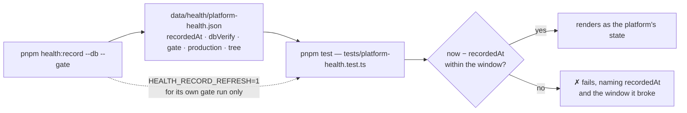
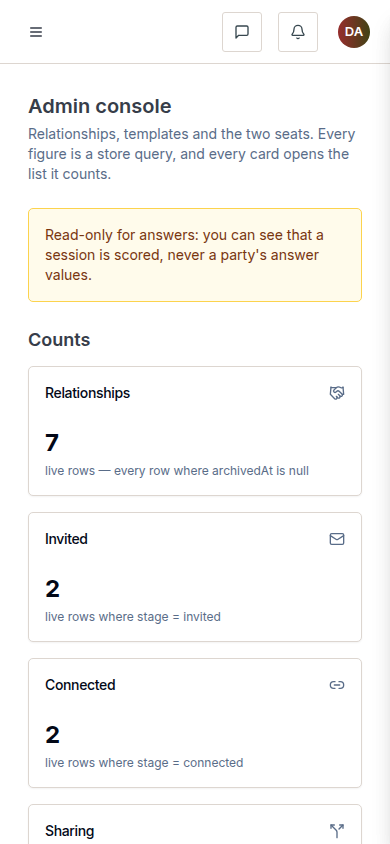

# v1.5.1 — the gate stops believing a stale record

A patch release about the gate's own honesty, plus a door for the one screen a real flow could not
reach.

## What was painful before

- **The platform-health record was four days old and rendered as the platform's state.** A snapshot
  is not telemetry, but a dashboard cannot tell one from the other — so an operator read a green
  board that described last Tuesday. Worse, a probe's deliberate `exitCode: 1` had been written into
  the record for a proof, and it read as _Fail_ forever.
- **The accept step had no entry point.** The completion hinge shipped in v1.3.0 and a real session
  still could not finish, because the accept screen was reachable only by typing its URL. That is
  the kind of defect a flow walk finds and no unit test does.
- **Saving a template in the console demanded a typed reason**, which an operator typed as "saved"
  and the audit log then carried as the justification for a version publish.
- **The news signup and the auth proxy were outside the form guard** — the honeypot and token
  checks lived in one route's handler rather than in `lib/forms/`.

## What it does now

- **A stale record fails the gate, and names itself.** `tests/platform-health.test.ts` compares the
  committed record's `recordedAt` against a declared window — 72 hours by default, movable with
  `PLATFORM_HEALTH_FRESHNESS_HOURS` — and the failure prints the instant and the window. The
  recorder sets `HEALTH_RECORD_REFRESH=1` for its own gate run only, because it runs the gate
  _before_ it writes the record it would otherwise be judged against.
- **`exitCode: 1` is no longer a record.** The record was re-recorded from demo and the #508 probe
  moved to `data/health/probes/`, so the dashboard reads the demo branch's real state.
- **The accept step is a link.** `AcceptSession` renders it, and a test walks the step rather than
  asserting that a button exists.
- **Template saves generate their audit sentence.** "Saved by <person> on <date>" is derived, not
  typed; console publish, withdraw and create-from-scratch still require a justification, because a
  server cannot reconstruct an operator's intent.
- **One form guard.** `lib/forms/` holds the honeypot and token checks, and the news signup and auth
  proxy both call it.

## The freshness assertion

The threshold is a policy about the record, so it is **not** stored in the record: moving the knob
must not require re-recording anything.

Two boundaries the tests pin, because both are arguments nobody should re-open by hand:

- **The window is inclusive at 72 h and exclusive at 72.5 h.** A record exactly at the edge is fresh;
  half an hour later it is history.
- **A record dated in the future is not stale** — it is a clock disagreement, reported as such rather
  than silently treated as current.

## Screens

The console at 390×844 — the surface #625's change is read on: a template save no longer carries a
typed reason, because the sentence that lands in `admin_action` is generated from the fact of the
save. The desktop frame of the same surface is on the [v1.4.0 page](v1-4-0.md); this one is the
narrow viewport, and the frame is current rather than a picture of the tag.

## The entry, as published

<!-- changelog-view:begin entry -->
<!-- generated from CHANGELOG.md by scripts/changelog-view.mjs — edit the entry, not this block -->

- **Released** 2026-11-07
- **Tag** [`v1.5.1`](https://github.com/riolabs-ai/alignsynch/releases/tag/v1.5.1)
- **Pull requests named** 7
- **The entry** [`CHANGELOG.md`](../../CHANGELOG.md)

### Fixed

- `fix(ui)` — no typed Reason field on template saves — the audit sentence is generated (#625) ([#630](https://github.com/riolabs-ai/alignsynch/pull/630))
- `fix(health)` — a stale health record fails the gate instead of rendering as current (#599) ([#629](https://github.com/riolabs-ai/alignsynch/pull/629))
- `fix(flow)` — give the accept step an entry point, and a test that walks it (#617) ([#628](https://github.com/riolabs-ai/alignsynch/pull/628))
- `fix(health)` — re-record platform health from demo and move the #508 probe out of the record (#599) ([#627](https://github.com/riolabs-ai/alignsynch/pull/627))
- `fix(ui)` — no typed Reason field on template saves — the audit sentence is generated (#625) ([#626](https://github.com/riolabs-ai/alignsynch/pull/626))

### Maintenance

- `docs(qa)` — the assessment flow walked end to end on demo — first breakpoint is the accept step ([#622](https://github.com/riolabs-ai/alignsynch/pull/622))
- `chore(security)` — lift the form guard into lib/forms/ and guard the news signup + auth proxy (#615) ([#616](https://github.com/riolabs-ai/alignsynch/pull/616))
<!-- changelog-view:end -->

## Known limits

<!-- changelog-view:begin limits -->
<!-- generated from CHANGELOG.md by scripts/changelog-view.mjs — edit the entry, not this block -->

- **A session still completes without payment.** The pay-to-complete model — optional payment method at invite, a 7-day trial, payment required to publish a sheet and open the Gap, per-relationship price, 14-day unpaid expiry — is decided and specified in #619, and nothing in it ships in this version. Completing a session remains free.
- **A relationship cannot be edited after it is created.** No edit surface exists, and five `relationship` columns have no writer at all (`template_version_id`, `completed_at`, `void_reason`, `expired_at`, `lapse_reason`). #623 carries both.
- **The accept entry point is a link, not a policy.** This version makes the accept step reachable, so a real session can now complete; it does not change what completion requires, and a session whose parties never accept still never completes.
- **Only template _saves_ generate their audit reason.** Console publish, withdraw and create-from-scratch still require a typed justification, because a server cannot reconstruct an operator's intent. If those are automated later, that is a deliberate change to `lib/admin/act.ts`'s contract, not a follow-up.
- **Platform health is a point-in-time snapshot.** The record is re-measured on demand, from the demo branch; a stale record now fails the gate rather than being rendered as current, but the record itself is not live telemetry and does not update by itself.
- **The news signup answers 200 to a refused submission.** A submission the guard refuses (honeypot filled, unverifiable token, address window) receives the same `subscribed` answer as a real subscriber and writes no `news_signup` row — deliberately, so a bot learns nothing. The cost is that a person caught by a false positive gets no error and no subscription either.
<!-- changelog-view:end -->
