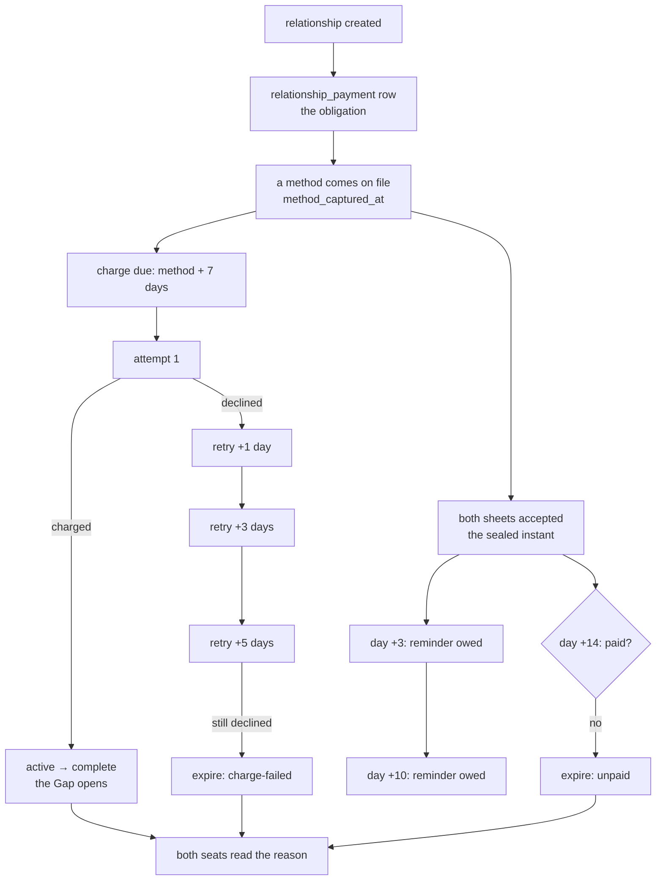
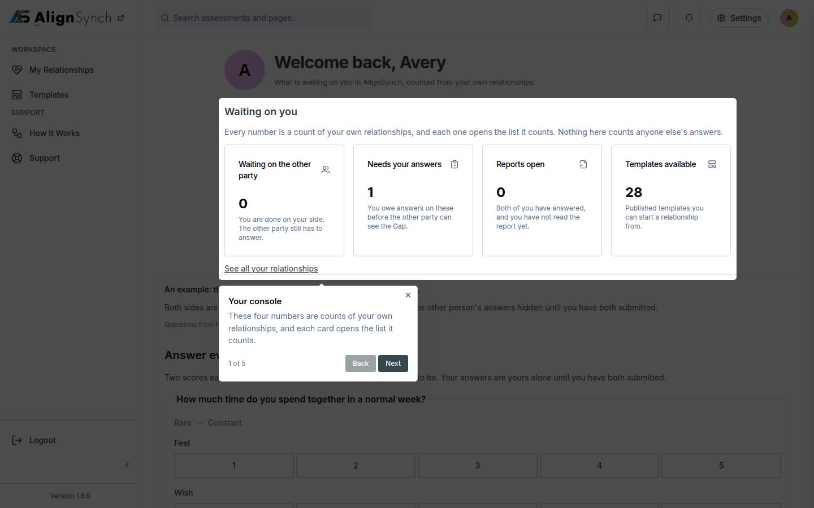
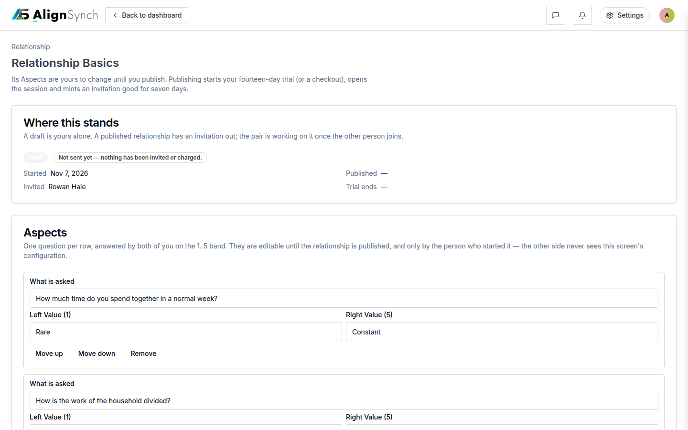

# v1.6.0 — pay-to-complete

<!-- docs-nav:begin -->

[Docs hub](../README.md) › **Release notes** › v1.6.0 · prev [v1.5.1](v1-5-1.md)

<!-- docs-nav:end -->

The fee moved from creation to completion. Until this release a relationship was charged for when it
was _created_, before either person had answered a question; v1.6.0 builds the payment engine that
takes the money when a relationship actually completes, on a trial that waits seven days, a ladder
that retries a declined charge three times across a week, two reminders, and an expiry that says why
it ended.

It also ships **none of the door**. The relationship card's `Activate Relationship` and `Gap
Analysis` still render disabled and nothing in `components/` calls `capturePaymentMethodAction` or
`completeRelationshipAction`, so nothing can request a charge and nothing charges. The entry's Known
limits block — copied below, verbatim — says that and eight other things. Read it before enabling
anything. It is the honest half of this release.

**And one correction this page must carry, because the tag cannot.** `v1.6.0` was cut at `034878a3`;
reminder delivery landed immediately after it in #638 (#640), so **this tag does not send its
reminders**. Its cron computes the day-3 and day-10 nags and the day-14 expiry, records
`pending-delivery`, and sends nothing, because `notify` was still an optional seam with no caller.
Production runs `main`, which wires `paymentNotice()` and does send. The corrected changelog entry
(#648) says so in the limits; this page repeats it because a reader who takes "the reminders work"
from a release blog has been misled by exactly one line.

## What was painful before

- **A relationship was billed before it did anything.** Publishing started a 14-day trial or opened
  a checkout (`lib/member/publish-basis.ts`), so the money and the outcome were unrelated events: a
  member who never completed a sheet had paid for one.
- **There was no obligation to be late on.** No row recorded "this relationship owes money", so
  nothing could nag, retry, or expire — a declined card was a state nobody could see.
- **The member rail asked a person to tell three shelves apart.** `Overview`, `My Templates` and
  `Library` were three rows naming the same work, and `/dashboard/library` was a fourth destination
  that existed only to be a 308.
- **The create journey dead-ended at the library.** Choosing a template before signing in lost the
  choice, and landing after auth dropped the person on a list with no continuation.

## What it does now

- **An obligation exists from creation.** `relationship_payment` is written when the relationship
  is, so "unpaid" is a measured state rather than an absence — and a relationship created before
  this release reads `undefined` (nobody asked) instead of being retroactively called unpaid.
- **The charge is a decision over stored instants, not a metaphor.** Seven days after a method comes
  on file, the job takes the fee; the obligation's clock is the _second acceptance_ plus fourteen
  days; the nags are +3 and +10 from that same sealed instant. All of it is arithmetic in
  `lib/flow/payment.ts`, so a test pins "day 3 has arrived" exactly and a job that was down for a
  week finds every nag already owed instead of skipping it.
- **Every write is idempotent.** A charge is `charged_at IS NULL`-guarded, an expiry `expired_at IS
  NULL`-guarded, a completion only moves `active → complete` — two runs racing cannot take the fee
  twice or expire a paid relationship.
- **The rail is two rows.** `My Relationships` (`/dashboard/relationships` — the relationship and its
  assessment in one list) and `Templates` (`/dashboard/templates`, one destination with two tabs: the
  catalogue and what this member owns). The Overview still answers at `/dashboard`; it is no longer
  a rail row, because the two rows above are the work.
- **The create journey keeps its product across auth.** A person who chooses a template, signs in
  and comes back still has the thing they chose.

## The payment ladder

Every edge is a stored instant, and every arrow is a job that reads one. `expire` outranks
everything: nothing else is owed on an obligation that has ended.

Three properties of that drawing are worth naming, because each one is a bug the code refuses:

- **A retry must not re-price the fee.** The second attempt charges `charge_amount_cents` — what the
  first attempt recorded — never the plan's current price.
- **A nag is stamped only after it is sent.** `notify` is called first, and `reminder_day3_at` is
  written because the call resolved. With no delivery function wired, the job reports
  `pending-delivery` and stamps nothing, which is why the day-3 nag is still owed today rather than
  claimed as sent.
- **Expiry names the cause.** `charge-failed` when the ladder is spent, `unpaid` when fourteen days
  passed with both sheets sealed. A relationship that ended for lack of money says so.

## Screens

The rail in this frame is the two-row Workspace group #620 introduced — `My Relationships` and
`Templates`, with the Overview gone from it. The frame is current (2026-11-07), taken from the code
#620 shipped, not a picture of the tag.

The card carries the two controls this release deliberately leaves disabled: `Activate Relationship`
and `Gap Analysis`. The engine behind them is complete and covered by a live suite; the door is the
next card, and it may not open until the creation-time billing path in the Known limits is removed.

## The entry, as published

<!-- changelog-view:begin entry -->
<!-- generated from CHANGELOG.md by scripts/changelog-view.mjs — edit the entry, not this block -->

- **Released** 2026-11-07
- **Tag** [`v1.6.0`](https://github.com/riolabs-ai/alignsynch/releases/tag/v1.6.0)
- **Pull requests named** 6
- **The entry** [`CHANGELOG.md`](../../CHANGELOG.md)

### Added

- `feat(billing)` — pay-to-complete — the fee moves from creation to completion (#619) ([#634](https://github.com/riolabs-ai/alignsynch/pull/634))
- `feat(ui)` — two-row member menu, two-tab Templates shelf, relationship cards (#620) ([#633](https://github.com/riolabs-ai/alignsynch/pull/633))
- `feat(flow)` — the create journey keeps its product across auth and stops dead-ending at the library (#618) ([#632](https://github.com/riolabs-ai/alignsynch/pull/632))

### Maintenance

- `docs(pay-to-complete)` — research, PRD, spec and ADR for v1.6.0 (#619, #623) ([#635](https://github.com/riolabs-ai/alignsynch/pull/635))
- `docs(pay-to-complete)` — the SPEC's row 0 requires the seal, and the job that does it has landed ([#636](https://github.com/riolabs-ai/alignsynch/pull/636))
- `docs(changelog)` — name #636 in the 1.6.0 entry ([#639](https://github.com/riolabs-ai/alignsynch/pull/639))
<!-- changelog-view:end -->

## Known limits

<!-- changelog-view:begin limits -->
<!-- generated from CHANGELOG.md by scripts/changelog-view.mjs — edit the entry, not this block -->

- **No member can pay yet.** The payment engine is complete and covered by a live suite, but nothing in `components/` calls `capturePaymentMethodAction` or `completeRelationshipAction`, and the relationship card's `Activate Relationship` and `Gap Analysis` still render **disabled**. Nothing can request a charge, so nothing charges. The door is tracked as the next card.
- **Two billing shapes are alive at once.** Publishing a relationship _still_ starts a 14-day trial or opens a checkout (`lib/member/publish-basis.ts`, unchanged in this release), and completion now _also_ creates a `relationship_payment` obligation. ADR-1's rule — remove the creation-time trigger in the same change that adds the completion charge — has **not** been carried out. A relationship whose creation checkout completed can therefore be billed twice: once at creation, once at completion. Do not enable the payment door before this is resolved.
- **The provider is the mock adapter.** `BILLING_PROVIDER` unset means `mock`, the keyless demo path. The `stripe` adapter is carried but never resolved unless the variable names it, so this release claims no live charging and moves no money.
- **A relationship still cannot be edited.** #623 ships separately: there is no edit surface, and five `relationship` columns (`template_version_id`, `completed_at`, `void_reason`, `expired_at`, `lapse_reason`) have no writer at all.
- **The Free plan's consequence is unconfirmed.** Payment is required to complete a session, so a Free member with "one active relationship" cannot reach a Gap report unless the trial carries them. The rule is stated in #619; the product decision is not final.
- **A charge that needs the payer present has no path.** An unattended charge can be declined for reasons a retry cannot fix (expired card, and any payer-approved challenge). The ladder retries three times across a week and then expires with notice; there is no "come back and confirm" link.
- **The reminders in this tag do not send.** `v1.6.0` was cut at `034878a3`, and reminder delivery landed immediately after in #638 (#640): the tag's cron computes the day-3 and day-10 nags and the day-14 expiry, records `pending-delivery`, and sends nothing, because `notify` was still an optional seam with no caller. Production runs current `main`, which wires `paymentNotice()` and does send — a send that cannot happen leaves the nag owed rather than claiming it. The delivery belongs in the next release's notes, not this one's.
- **The counterparty is told nothing about billing.** Their card reads "waiting for &lt;name&gt; to publish". That is deliberate (ADR-8) and is worth knowing before reading a support thread about a stuck relationship.
- **`0036` is applied to production with no pre-migration snapshot.** The table is additive, has 0 rows, and its columns match the committed DDL exactly; `db:verify` is green. The snapshot condition attached to the approval was not honoured when it was applied — recorded here so the omission is visible rather than repaired by a later claim.
<!-- changelog-view:end -->

<!-- docs-nav:begin -->

[Docs hub](../README.md) › **Release notes** › v1.6.0 · prev [v1.5.1](v1-5-1.md)

<!-- docs-nav:end -->
