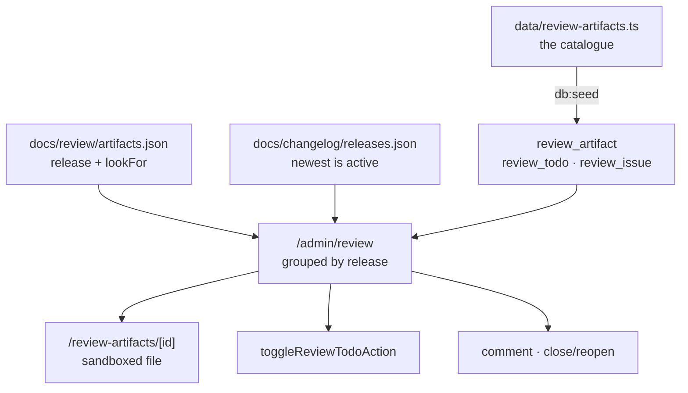
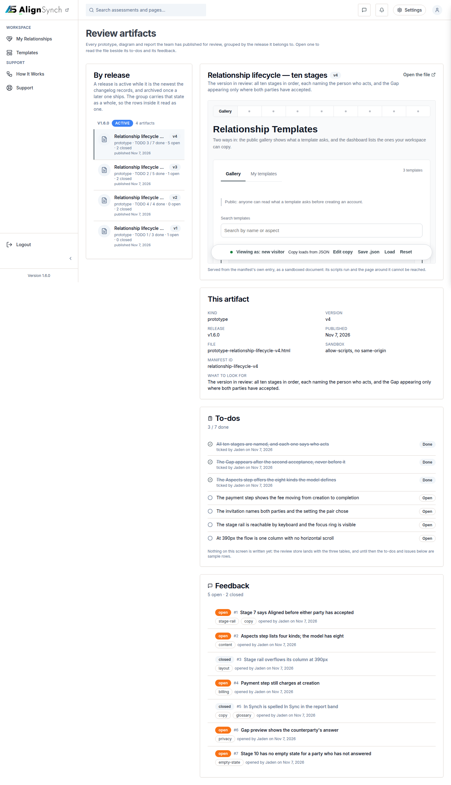

# v1.7.0 — the review shelf

<!-- docs-nav:begin -->

[Docs hub](../README.md) › **Release notes** › v1.7.0 · prev [v1.6.0](v1-6-0.md) · next [v1.8.0](v1-8-0.md)

<!-- docs-nav:end -->

The prototype moves from chat screenshots to a live surface. Until this release the six-stage
onboarding flow existed as a set of HTML captures reviewed one screenshot at a time; v1.7.0 ships
`/admin/review`, a console shelf that lists every published prototype grouped by the release it
ships with, the artifact itself in a sandboxed frame beside a to-do checklist and a GitHub-shaped
feedback list, and the three writes that turn a review into a conversation: tick a to-do, post a
comment, close and reopen a thread.

It ships **the shelf, not the whole flow**. The approved six-stage prototype is the shelf's first
artifact, and the shared stage shell (`StageRail` + `StageColumn`) plus stages 1–2 (Who + Mode,
#688) and stage 3 (Aspects, #689) landed, but the remaining stages are still open. The entry's
Known limits block — copied below, verbatim — says that and five other things. Read it before
assuming "onboarding works"; it is the honest half of this release.

## What was painful before

- **The prototype was a pile of screenshots.** Every cut of the six-stage flow was reviewed as a
  chat image, so a reviewer could not tick a to-do against a capture, post a comment that stuck to
  the artifact, or re-open a thread the author had closed.
- **There was no record of what shipped in which release.** A prototype was a file with no grouping,
  so "is this the approved flow or the one we superseded" was a memory test, not a shelf.
- **The onboarding flow had no shared stage.** Each stage would have drawn its own column and rail,
  so six screens would have disagreed about the six stage names.

## What it does now

- **A review shelf at `/admin/review`.** `listReviewArtifacts()` answers every artifact with its
  two counts in one statement; the list groups by release, and only the newest release is _active_
  — earlier groups render as _archived_ as one, whatever they hold.
- **A record, a manifest, a view — three files, one story.** `data/review-artifacts.ts` is the
  record (id, slug, title, kind, version, path, capturedAt), mirrored into `review_artifact` by
  `db:seed`; `docs/review/artifacts.json` is presentation only (which release each artifact ships
  with, and the one line a reviewer reads first); `docs/changelog/releases.json` decides which
  group is active. The shelf refuses to build when the manifest and the catalogue disagree.
- **Three writes complete the conversation.** The checklist toggle, the reply composer and the
  close/reopen control post to the store's actions (`components/admin/review-todos.tsx`,
  `review-thread.tsx`); each one re-reads `ADMIN_REVIEW_PATH` through `revalidatePath` and answers
  a refusal as a sentence, not a silent no-op.
- **The shared stage shell.** `StageColumn` (one column up to the approved 1126px) and `StageRail`
  (the six stage names over the rail) are the first onboarding slice — the six stages build on this
  shell rather than each drawing their own.
- **The payment reminders now deliver.** `paymentNotice()` is wired (`lib/member/payment-job-run.ts`
  calls `notify` before it stamps `reminder_day3_at`), closing the gap v1.6.0's tag carried.

## The review shelf

Two properties of that drawing are worth naming, because each is a refusal rather than a feature:

- **The frame's file comes from the record, never the request.** `reviewFilePath()` joins the
  artifact's own guarded `path` (`docs/review/**.html`, no scheme, no `..`) and the route answers
  for an id or slug the catalogue carries — there is no directory scan and no path parameter.
- **The shelf is admin-gated in order.** `requireAdminProduct()` first, then `requireAdmin()`: a
  signed-out visitor is sent to `/login`, a member gets the same 404 an unknown URL gets.

## Screens

The shelf as it renders for an admin: the six-stage prototype grouped under its release, the
sandboxed frame on one side, the to-do checklist and the feedback list beside it. The frame is the
capture from the review of #676/#677, not a picture of the tag.

## The entry, as published

<!-- changelog-view:begin entry -->
<!-- generated from CHANGELOG.md by scripts/changelog-view.mjs — edit the entry, not this block -->

- **Released** 2026-11-08
- **Tag** [`v1.7.0`](https://github.com/riolabs-ai/alignsynch/releases/tag/v1.7.0)
- **Pull requests named** 418
- **The entry** [`CHANGELOG.md`](../../CHANGELOG.md)

### Added

- `feat(onboarding)` — stage 3 Aspects — opinion labels, collapse on save, drag reorder (#689) ([#698](https://github.com/riolabs-ai/alignsynch/pull/698))
- `feat(onboarding)` — stage 1 Who and stage 2 Mode — two forms, one draft (#688) ([#697](https://github.com/riolabs-ai/alignsynch/pull/697))
- `feat(onboarding)` — the shared stage shell — one column, six-stage rail (#687) ([#694](https://github.com/riolabs-ai/alignsynch/pull/694))
- `feat(review)` — the approved six-stage prototype as the v5 review artifact ([#678](https://github.com/riolabs-ai/alignsynch/pull/678))
- `feat(admin)` — mount the review store's writes on /admin/review (#676) ([#677](https://github.com/riolabs-ai/alignsynch/pull/677))
- `feat(admin)` — a review shelf at /admin/review, artifacts grouped by release (#665) ([#673](https://github.com/riolabs-ai/alignsynch/pull/673))
- `feat(admin)` — the /admin/review store — artifacts, todos and GH-style issues (#667) ([#670](https://github.com/riolabs-ai/alignsynch/pull/670))
- `feat(P1)` — the payment door — capture a method, complete, open the Gap (#643) ([#644](https://github.com/riolabs-ai/alignsynch/pull/644))
- `feat(billing)` — deliver the payment reminders, and stamp only after a send (#638) ([#640](https://github.com/riolabs-ai/alignsynch/pull/640))
- `feat(billing)` — pay-to-complete — the fee moves from creation to completion (#619) ([#634](https://github.com/riolabs-ai/alignsynch/pull/634))
- `feat(ui)` — two-row member menu, two-tab Templates shelf, relationship cards (#620) ([#633](https://github.com/riolabs-ai/alignsynch/pull/633))
- `feat(flow)` — the create journey keeps its product across auth and stops dead-ending at the library (#618) ([#632](https://github.com/riolabs-ai/alignsynch/pull/632))
- `feat(privacy)` — account deletion — 0033 indexes, the Neon auth-user delete, one transactional scrub, an in-app control (#597) ([#597](https://github.com/riolabs-ai/alignsynch/pull/597))
- `feat(tour)` — step 4 fills the real answer sheet as an example (#457) ([#596](https://github.com/riolabs-ai/alignsynch/pull/596))
- `feat(email)` — templates 6-10 through the v0.9 band (#548) ([#568](https://github.com/riolabs-ai/alignsynch/pull/568))
- `feat(email)` — templates 2–5 through the band (#548) ([#558](https://github.com/riolabs-ai/alignsynch/pull/558))
- `feat(nav)` — the rail is a role-constrained menu, and the admin console leads its own group (#542) ([#552](https://github.com/riolabs-ai/alignsynch/pull/552))
- `feat(templates)` — a public Relationship Templates catalogue, and a home band that sells it ([#544](https://github.com/riolabs-ai/alignsynch/pull/544))
- `feat(flow)` — counterparty onboarding — a three-step wizard, and a next on every login hop ([#538](https://github.com/riolabs-ai/alignsynch/pull/538))
- `feat(relationship)` — #533 phase 3 — one trial, day-14 hard stop, read-only both sides, payment reactivates ([#537](https://github.com/riolabs-ai/alignsynch/pull/537))
- `feat(member)` — #533 phase 2 — initiator CRUD, publish, one-click re-publish ([#535](https://github.com/riolabs-ai/alignsynch/pull/535))
- `feat(relationship)` — template ownership, lifecycle, trial read and rounds (#533 phase 1) ([#534](https://github.com/riolabs-ai/alignsynch/pull/534))
- `feat(billing)` — claim the host on a checkout and refuse another host's events ([#532](https://github.com/riolabs-ai/alignsynch/pull/532))
- `feat(admin)` — broadcast to news signups (#507) ([#531](https://github.com/riolabs-ai/alignsynch/pull/531))
- `feat(admin)` — #506 support inbox — triage, Resend replies with visible failure, bounce state, throttle visibility ([#530](https://github.com/riolabs-ai/alignsynch/pull/530))
- `feat(email)` — #439b Resend inbound — signed webhook, idempotent email_event, bounce suppression ([#528](https://github.com/riolabs-ai/alignsynch/pull/528))
- `feat(admin)` — #502b template versioning — template_version, relationships bound to a version, immutable publish ([#524](https://github.com/riolabs-ai/alignsynch/pull/524))
- `feat(admin)` — #505 billing control — subscription state, test-mode banner, audited comps, server-side limits ([#525](https://github.com/riolabs-ai/alignsynch/pull/525))
- `feat(admin)` — #504 report operations — regenerate, PII-gated read, JSON + PDF export ([#523](https://github.com/riolabs-ai/alignsynch/pull/523))
- `feat(admin)` — #502a template authoring — a draft editor validated by zAssessment, saved through act() ([#522](https://github.com/riolabs-ai/alignsynch/pull/522))
- `feat(admin)` — /admin/health — the platform-health screen, every number naming its source (#508) ([#520](https://github.com/riolabs-ai/alignsynch/pull/520))
- `feat(admin)` — the five #503 actions, their floors, and a reason gate proven per operation ([#517](https://github.com/riolabs-ai/alignsynch/pull/517))
- `feat(admin)` — #503 relationship operations ([#516](https://github.com/riolabs-ai/alignsynch/pull/516))
- `feat(admin)` — /admin/audit — the filtered, read-only audit screen (#501b) ([#515](https://github.com/riolabs-ai/alignsynch/pull/515))
- `feat(admin)` — the role ladder, admin_invite, admin_action and act() (#501) ([#511](https://github.com/riolabs-ai/alignsynch/pull/511))
- `feat(admin)` — product.admin — the console's capability switch (#509) ([#512](https://github.com/riolabs-ai/alignsynch/pull/512))
- `feat(db-verify)` — V21 — a seeded instance reads `complete`, or the run names it ([#499](https://github.com/riolabs-ai/alignsynch/pull/499))
- `feat(onboarding)` — the first-run tour's shell — driver.js, six steps, skip a missing target (#455) ([#496](https://github.com/riolabs-ai/alignsynch/pull/496))
- `feat(onboarding)` — the tour's "seen" mark is one column and one guarded route (#456) ([#494](https://github.com/riolabs-ai/alignsynch/pull/494))
- `feat(assessment)` — the Steps render on the instance screen, and the v1 release rows retire (#478) ([#493](https://github.com/riolabs-ai/alignsynch/pull/493))
- `feat(demo)` — move the worked example to /assessment/demo/[type] and delete the prototype group (#478) ([#492](https://github.com/riolabs-ai/alignsynch/pull/492))
- `feat(release)` — --check-limits re-derives a Known limits block from the tree ([#489](https://github.com/riolabs-ai/alignsynch/pull/489))
- `feat(admin)` — move the console to /admin/console, behind the allowlist (#478) ([#486](https://github.com/riolabs-ai/alignsynch/pull/486))
- `feat(templates)` — the catalogue the page carries — 27 types, seven realms, priced from the fixture, filterable ([#464](https://github.com/riolabs-ai/alignsynch/pull/464))
- `feat(demo)` — pnpm demo:verify — a versioned dataset, a versioned expectation, one diff ([#460](https://github.com/riolabs-ai/alignsynch/pull/460))
- `feat(contact)` — no email on any public page, one no-captcha form on /help (supersedes #448) ([#452](https://github.com/riolabs-ai/alignsynch/pull/452))
- `feat(v1)` — the staff–manager template demo renders a real report ([#447](https://github.com/riolabs-ai/alignsynch/pull/447))
- `feat(pricing)` — three tiers, Basic recommended, relationship alignment copy, real billing rows ([#444](https://github.com/riolabs-ai/alignsynch/pull/444))
- `feat(support)` — split the help centre from account support ([#445](https://github.com/riolabs-ai/alignsynch/pull/445))
- `feat(marketing)` — the AlignSynch home leads with the practice, the Gap is the proof ([#431](https://github.com/riolabs-ai/alignsynch/pull/431))
- `feat(flow)` — acceptance is the completion hinge, and Steps are derived on the transition (#427) ([#430](https://github.com/riolabs-ai/alignsynch/pull/430))
- `feat(flow)` — the create form posts to /assessment/new, refusals come back as a band, and the chosen Setting is written (#427) ([#429](https://github.com/riolabs-ai/alignsynch/pull/429))
- `feat(flow)` — /answer is a gated sheet, blind by construction (#427) ([#428](https://github.com/riolabs-ai/alignsynch/pull/428))
- `feat(v1)` — gate the prototype group behind a session or the demo unlock ([#426](https://github.com/riolabs-ai/alignsynch/pull/426))
- `feat(shell)` — the console rail opens on Dashboard and lists My Relationships · Library ([#425](https://github.com/riolabs-ai/alignsynch/pull/425))
- `feat(v1)` — the demo seed carries two rows per catalogue type ([#421](https://github.com/riolabs-ai/alignsynch/pull/421))
- `feat(v1)` — the demo seed carries parties, chat, notices and every subscription state (#415) ([#418](https://github.com/riolabs-ai/alignsynch/pull/418))
- `feat(v1)` — template catalogue, template landing, and the relationship report (#409) ([#414](https://github.com/riolabs-ai/alignsynch/pull/414))
- `feat(assessment)` — relationship list and detail as server-rendered DB surfaces ([#412](https://github.com/riolabs-ai/alignsynch/pull/412))
- `feat(shell)` — the surface registry, PendingSurface and nav greying (#409) ([#410](https://github.com/riolabs-ai/alignsynch/pull/410))
- `feat(v1)` — the template page becomes a conversion landing (#404) ([#405](https://github.com/riolabs-ai/alignsynch/pull/405))
- `feat(v1)` — admin console — counts that open their lists, the registry, templates, seats and stated limits ([#402](https://github.com/riolabs-ai/alignsynch/pull/402))
- `feat(v1)` — print the two Opinions behind every Gap, per Aspect ([#398](https://github.com/riolabs-ai/alignsynch/pull/398))
- `feat(v1)` — acceptance first — both sides side by side, reviewable before accepting ([#400](https://github.com/riolabs-ai/alignsynch/pull/400))
- `feat(v1)` — profile and settings for all four personas (#384) ([#397](https://github.com/riolabs-ai/alignsynch/pull/397))
- `feat(v1)` — the relationships list becomes a My Quizzes variation — stage tabs, search, cards, honest metrics (#384) ([#396](https://github.com/riolabs-ai/alignsynch/pull/396))
- `feat(v1)` — template library and shop — role-gated actions, per-relationship subscription, initiator-only billing ([#393](https://github.com/riolabs-ai/alignsynch/pull/393))
- `feat(v1)` — chat and notifications — relationship threads, unread state, blind-safe before scoring ([#392](https://github.com/riolabs-ai/alignsynch/pull/392))
- `feat(v1)` — relationships list, detail, Aspects CRUD, clone, library and invite state (#384) ([#390](https://github.com/riolabs-ai/alignsynch/pull/390))
- `feat(v1)` — seed Basic and Advanced modes, Soft and Full settings, and derive flag counts (#384) ([#389](https://github.com/riolabs-ai/alignsynch/pull/389))
- `feat(v1)` — persona-scoped sidebar, dashboard overview and per-section stubs (#384) ([#388](https://github.com/riolabs-ai/alignsynch/pull/388))
- `feat(v1)` — relationship catalogue — 29 source rows + kept co-founders, grouped by realm, dating gated (#385) ([#387](https://github.com/riolabs-ai/alignsynch/pull/387))
- `feat(v1)` — review list states who each screen is for, per the #384 persona matrix ([#386](https://github.com/riolabs-ai/alignsynch/pull/386))
- `feat(db)` — seed durable platform admins from ADMIN_* env, idempotently ([#383](https://github.com/riolabs-ai/alignsynch/pull/383))
- `feat(v1)` — contain /v1 inside /v1 and add a persisted review list ([#374](https://github.com/riolabs-ai/alignsynch/pull/374))
- `feat(auth)` — grant admin at sign-in from the ADMIN_EMAILS allowlist ([#382](https://github.com/riolabs-ai/alignsynch/pull/382))
- `feat(shell)` — pin control collapses the expanded sidebar; sign-out lands on marketing ([#381](https://github.com/riolabs-ai/alignsynch/pull/381))
- `feat(v1)` — the onboarding panel becomes a stepped wizard (no assistant) ([#378](https://github.com/riolabs-ai/alignsynch/pull/378))
- `feat(v1)` — persona bar becomes a notice banner with environment context ([#377](https://github.com/riolabs-ai/alignsynch/pull/377))
- `feat(v1)` — answer sheet — inline errors, top summary, pinned submit on mobile ([#373](https://github.com/riolabs-ai/alignsynch/pull/373))
- `feat(v1)` — report verdict, relationship types + demo, and the session timeline (three sets, one branch) ([#370](https://github.com/riolabs-ai/alignsynch/pull/370))
- `feat(ui)` — a component template ancestor is a checked header, not a convention (#336) ([#345](https://github.com/riolabs-ai/alignsynch/pull/345))
- `feat(brand)` — the book is the mark, and the icon set is generated from it ([#363](https://github.com/riolabs-ai/alignsynch/pull/363))
- `feat(coach)` — a coach is a role on the relationship, with a hard read-only boundary ([#358](https://github.com/riolabs-ai/alignsynch/pull/358))
- `feat(db)` — a relationship holds sessions — the split, the backfill and the instance rename (#340) ([#352](https://github.com/riolabs-ai/alignsynch/pull/352))
- `feat(v1)` — the template editor — a variation of the quiz editor, store-backed ([#343](https://github.com/riolabs-ai/alignsynch/pull/343))
- `feat(marketing)` — the public top menu, the shell footer and header identity ([#335](https://github.com/riolabs-ai/alignsynch/pull/335))
- `feat(auth)` — name Google-only accounts on the password form (#281) ([#333](https://github.com/riolabs-ai/alignsynch/pull/333))
- `feat(auth)` — a Google button beside the password form (#281) ([#330](https://github.com/riolabs-ai/alignsynch/pull/330))
- `feat(deploy)` — codify the preview rule and add a freshness check that never guesses ([#329](https://github.com/riolabs-ai/alignsynch/pull/329))
- `feat(nav)` — the console's destinations reach the sidebar, the operator's stay behind the role ([#327](https://github.com/riolabs-ai/alignsynch/pull/327))
- `feat(console)` — /assessment/templates — built-in versus authored, per account ([#326](https://github.com/riolabs-ai/alignsynch/pull/326))
- `feat(console)` — /dashboard counts the viewer's own rows and links each number to its list ([#325](https://github.com/riolabs-ai/alignsynch/pull/325))
- `feat(console)` — the operator's relationship registry, behind the first requireAdmin surface ([#324](https://github.com/riolabs-ai/alignsynch/pull/324))
- `feat(console)` — the Gap across completed relationships, nameless and complete-only ([#323](https://github.com/riolabs-ai/alignsynch/pull/323))
- `feat(db)` — the three columns the console needs, all nullable and unfilled ([#322](https://github.com/riolabs-ai/alignsynch/pull/322))
- `feat(billing)` — the plan cards start a real checkout (#289) ([#315](https://github.com/riolabs-ai/alignsynch/pull/315))
- `feat(billing)` — the test-mode hosted adapter, its webhook, and .env.example (#289) ([#310](https://github.com/riolabs-ai/alignsynch/pull/310))
- `feat(invite)` — re-invite revokes and replaces the token, behind a 24h cooldown and a cap (#275) ([#303](https://github.com/riolabs-ai/alignsynch/pull/303))
- `feat(billing)` — a provider-free port, an offline adapter, and the plan gate ([#289](https://github.com/riolabs-ai/alignsynch/pull/289))
- `feat(legal)` — /terms and /privacy, version 1 draft, wired on both brands (#270) ([#296](https://github.com/riolabs-ai/alignsynch/pull/296))
- `feat(assessment)` — the report's three gap groups, a verdict band, and one stage sentence (#274) ([#301](https://github.com/riolabs-ai/alignsynch/pull/301))
- `feat(assessment)` — the answer input is a five-segment radio group (#273) ([#297](https://github.com/riolabs-ai/alignsynch/pull/297))
- `feat(invite)` — the initiator is told their invitation expired (#266) ([#283](https://github.com/riolabs-ai/alignsynch/pull/283))
- `feat(shell)` — show the app version, linked to its release tag (#269) ([#285](https://github.com/riolabs-ai/alignsynch/pull/285))
- `feat(assessment)` — four stages, derived — 4-6 documented as undefined (#261) ([#276](https://github.com/riolabs-ai/alignsynch/pull/276))
- `feat(assessment)` — the Soft/Full Setting is a lens over the Gaps (#259) ([#264](https://github.com/riolabs-ai/alignsynch/pull/264))
- `feat(assessment)` — the other party hears when the second answer lands (#258) ([#262](https://github.com/riolabs-ai/alignsynch/pull/262))
- `feat(invite)` — the invitation link has a copy control that never fails silently (#257) ([#260](https://github.com/riolabs-ai/alignsynch/pull/260))
- `feat(assessment)` — a person can author their own template (#255) ([#256](https://github.com/riolabs-ai/alignsynch/pull/256))
- `feat(assessment)` — the list marks an unlock you have not read (#252) ([#254](https://github.com/riolabs-ai/alignsynch/pull/254))
- `feat(brand)` — every route's share preview is the brand's own 1200x630 card (#187) ([#251](https://github.com/riolabs-ai/alignsynch/pull/251))
- `feat(assessment)` — creating or claiming an instance binds the caller's account (#213) ([#248](https://github.com/riolabs-ai/alignsynch/pull/248))
- `feat(brand)` — the palette has one home, enforced, and each brand has its own tab icon (#187) ([#246](https://github.com/riolabs-ai/alignsynch/pull/246))
- `feat(assessment)` — the report draws the glossary's eight Gap kinds (#219) ([#243](https://github.com/riolabs-ai/alignsynch/pull/243))
- `feat(assessment)` — a signed-in party can find the instances they are in (#213) ([#238](https://github.com/riolabs-ai/alignsynch/pull/238))
- `feat(brand)` — the affiliate and profile surfaces read the brand record (#187 stage 3) ([#236](https://github.com/riolabs-ai/alignsynch/pull/236))
- `feat(demo)` — /demo is a PIN gate, and /login draws the role buttons behind a signed unlock (#218) ([#235](https://github.com/riolabs-ai/alignsynch/pull/235))
- `feat(assessment)` — an instance records its mode, and asks the sheet it defines (#213) ([#234](https://github.com/riolabs-ai/alignsynch/pull/234))
- `feat(gate)` — a client component cannot reach the database, and the gate knows (#228) ([#233](https://github.com/riolabs-ai/alignsynch/pull/233))
- `feat(brand)` — the home, category and creator-tip bands read the brand record (#187 stage 2) ([#217](https://github.com/riolabs-ai/alignsynch/pull/217))
- `feat(search)` — the /search body is the brand's words, not the quiz product's (#156 follow-up) ([#201](https://github.com/riolabs-ai/alignsynch/pull/201))
- `feat(media)` — the profile cover is drawn from the handle, not one shared PNG (#130) ([#206](https://github.com/riolabs-ai/alignsynch/pull/206))
- `feat(demo-auth)` — a PIN-gated panel that signs in without sending a password (#183 part 2) ([#208](https://github.com/riolabs-ai/alignsynch/pull/208))
- `feat(shell)` — the footer speaks the brand's vocabulary, and "Quizes" is spelled right (#188) ([#195](https://github.com/riolabs-ai/alignsynch/pull/195))
- `feat(brand)` — the chrome, the assessment flow and the 404 read the brand record (#187 stage 1) ([#200](https://github.com/riolabs-ai/alignsynch/pull/200))
- `feat(demo)` — a reset that is one restore, a nightly reseed, and the docs (#185) ([#198](https://github.com/riolabs-ai/alignsynch/pull/198))
- `feat(flags)` — an admin reaches a surface the flag hides (#184) ([#199](https://github.com/riolabs-ai/alignsynch/pull/199))
- `feat(demo-auth)` — one role, a 404-not-403 gate, and three seeded demo accounts (#183 part 1) ([#189](https://github.com/riolabs-ai/alignsynch/pull/189))
- `feat(parity)` — a hash manifest and a summary instead of 1.4 MB of HTML (#171) ([#182](https://github.com/riolabs-ai/alignsynch/pull/182))
- `feat(shell)` — the rest of the chrome is the brand's, not the quiz product's (#156) ([#186](https://github.com/riolabs-ai/alignsynch/pull/186))
- `feat(media)` — one resolver, three tiers, and a fault-tolerant fallback (#155, phase 1) ([#180](https://github.com/riolabs-ai/alignsynch/pull/180))
- `feat(bundles)` — a template or a demo dataset as one versioned file, exported and imported (#147) ([#179](https://github.com/riolabs-ai/alignsynch/pull/179))
- `feat(flags)` — a surface on or off per template without a code change (#175) ([#181](https://github.com/riolabs-ai/alignsynch/pull/181))
- `feat(shell)` — navigation is brand- and capability-aware, not quiz-only (#156) ([#177](https://github.com/riolabs-ai/alignsynch/pull/177))
- `feat(registry)` — every mocked surface catalogued as a template resource (#173) ([#178](https://github.com/riolabs-ai/alignsynch/pull/178))
- `feat(assessment)` — the two-party flow — create, invite, answer blind, unlock the Gap (#146) ([#174](https://github.com/riolabs-ai/alignsynch/pull/174))
- `feat(tokens)` — tighter product surface in the Tailwind root (#160) ([#170](https://github.com/riolabs-ai/alignsynch/pull/170))
- `feat(identity)` — real sessions behind login, register, settings and profile (#164) ([#172](https://github.com/riolabs-ai/alignsynch/pull/172))
- `feat(marketing)` — a public landing page in its own chrome, no sidebar (#159) ([#169](https://github.com/riolabs-ai/alignsynch/pull/169))
- `feat(media)` — avatars are initials on a seed-derived gradient, nine duplicate files deleted (#152) ([#168](https://github.com/riolabs-ai/alignsynch/pull/168))
- `feat(db)` — six content tables, the DB-backed assessment screen, and the db scripts (#145) ([#166](https://github.com/riolabs-ai/alignsynch/pull/166))
- `feat(editorial)` — news, creator tips and support read article records (#165) ([#167](https://github.com/riolabs-ai/alignsynch/pull/167))
- `feat(theme)` — light default, AlignSynch tokens on white (#157) ([#162](https://github.com/riolabs-ai/alignsynch/pull/162))
- `feat(media)` — avatars are initials on a seed-derived gradient (#152, part 1) ([#161](https://github.com/riolabs-ai/alignsynch/pull/161))
- `feat(brand)` — the document description is a Brand field (#151) ([#153](https://github.com/riolabs-ai/alignsynch/pull/153))
- `feat(home)` — the AlignSynch build leads with the two questions (#143) ([#150](https://github.com/riolabs-ai/alignsynch/pull/150))
- `feat(brand)` — palette and mark sampled from the AlignSynch logo (#136) ([#142](https://github.com/riolabs-ai/alignsynch/pull/142))
- `feat(media)` — category tiles generated from the slug; delete the 23 duplicates (#130) ([#137](https://github.com/riolabs-ai/alignsynch/pull/137))
- `feat(assessment)` — render the answered Avery/Rowan instance at /assessment/[slug] ([#134](https://github.com/riolabs-ai/alignsynch/pull/134))
- `feat(data)` — assessment templates for three Relationship Types and four instances (#131) ([#133](https://github.com/riolabs-ai/alignsynch/pull/133))
- `feat(content)` — one record type, two templates — a quiz and an assessment (#128) ([#129](https://github.com/riolabs-ai/alignsynch/pull/129))
- `feat(brand)` — a second brand record, and one build flag that selects it ([#127](https://github.com/riolabs-ai/alignsynch/pull/127))
- `feat(brand)` — every QuizHub literal reads the brand record ([#126](https://github.com/riolabs-ai/alignsynch/pull/126))
- `feat(brand)` — data/brand.ts — the record the reskin reads ([#125](https://github.com/riolabs-ai/alignsynch/pull/125))
- `feat(tournaments)` — tournament copy comes from PageCopy, and the domain stays out (#58) ([#89](https://github.com/riolabs-ai/alignsynch/pull/89))
- `feat(pages)` — marketing copy out of JSX into PageCopy (#56) ([#94](https://github.com/riolabs-ai/alignsynch/pull/94))
- `feat(battle)` — modes and daily-challenge rewards are records, and the copy moves to PageCopy (#57) ([#92](https://github.com/riolabs-ai/alignsynch/pull/92))
- `feat(copy)` — shell, auth and 404 copy comes from PageCopy (#54) ([#96](https://github.com/riolabs-ai/alignsynch/pull/96))
- `feat(copy)` — categories and explore copy come from PageCopy fixtures (WU-8, #55) ([#88](https://github.com/riolabs-ai/alignsynch/pull/88))
- `feat(taxonomy)` — labels come from the schema, and data:check E20 enforces it (#50) ([#73](https://github.com/riolabs-ai/alignsynch/pull/73))
- `feat(leaderboard)` — one people fixture instead of six islands of their own records (#48) ([#77](https://github.com/riolabs-ai/alignsynch/pull/77))
- `feat(quiz)` — a record's detail page renders its own leaderboard and reviews (WU-2 follow-up, #75) ([#83](https://github.com/riolabs-ai/alignsynch/pull/83))
- `feat` — fixture generator (npm run gen) ([#71](https://github.com/riolabs-ai/alignsynch/pull/71))
- `feat(home)` — PageCopy fixture + E23 copy ratchet, home copy out of JSX (#53) ([#79](https://github.com/riolabs-ai/alignsynch/pull/79))
- `feat(quiz)` — the quiz surface reads the fixture, not a per-page mock (WU-2, #51) ([#76](https://github.com/riolabs-ai/alignsynch/pull/76))
- `feat` — typed media registry ([#65](https://github.com/riolabs-ai/alignsynch/pull/65))
- `feat(data)` — author the two Science overlays + E14/E15/E16/W6 promotion checks (B-01) ([#39](https://github.com/riolabs-ai/alignsynch/pull/39))
- `feat(data)` — port the 42-record migrated quiz collection into data/ (B-01 prerequisite) ([#26](https://github.com/riolabs-ai/alignsynch/pull/26))
- `feat(content)` — zQuizPromotion — per-slot campaign overlay merged in selectQuizCard (B-01) ([#21](https://github.com/riolabs-ai/alignsynch/pull/21))

### Fixed

- `fix(health)` — probes write evidence, never platform status; the recorder asserts its own postcondition (#680) ([#695](https://github.com/riolabs-ai/alignsynch/pull/695))
- `fix(ui)` — no typed Reason field on template saves — the audit sentence is generated (#625) ([#630](https://github.com/riolabs-ai/alignsynch/pull/630))
- `fix(health)` — a stale health record fails the gate instead of rendering as current (#599) ([#629](https://github.com/riolabs-ai/alignsynch/pull/629))
- `fix(flow)` — give the accept step an entry point, and a test that walks it (#617) ([#628](https://github.com/riolabs-ai/alignsynch/pull/628))
- `fix(health)` — re-record platform health from demo and move the #508 probe out of the record (#599) ([#627](https://github.com/riolabs-ai/alignsynch/pull/627))
- `fix(ui)` — no typed Reason field on template saves — the audit sentence is generated (#625) ([#626](https://github.com/riolabs-ai/alignsynch/pull/626))
- `fix(account)` — db:verify names an unfinished deletion (#278) ([#613](https://github.com/riolabs-ai/alignsynch/pull/613))
- `fix(settings)` — the delete card carries §5 verbatim, and the retention line stops denying the address (#278) ([#602](https://github.com/riolabs-ai/alignsynch/pull/602))
- `fix(deps)` — migrate recharts 2.15.3 -> 3.10.1 (13 typecheck errors -> 0; supersedes #571) ([#587](https://github.com/riolabs-ai/alignsynch/pull/587))
- `fix(account)` — a failed scrub resumes from a recorded intent (#278) ([#601](https://github.com/riolabs-ai/alignsynch/pull/601))
- `fix(deps)` — better-auth 1.7.18 (patches CVE-2026-114607) via @neon/auth 0.8.2 ([#576](https://github.com/riolabs-ai/alignsynch/pull/576))
- `fix(demo)` — a restore of a branch with children sends preserve_under_name ([#561](https://github.com/riolabs-ai/alignsynch/pull/561))
- `fix(email)` — the `### Commits` ledger is provenance, not a highlight ([#555](https://github.com/riolabs-ai/alignsynch/pull/555))
- `fix(brand)` — the lockup is 2rem in every expanded-header viewport (#549 follow-up) ([#553](https://github.com/riolabs-ai/alignsynch/pull/553))
- `fix(help)` — a sticky category rail beside the answers, and the person band beside the form ([#549](https://github.com/riolabs-ai/alignsynch/pull/549))
- `fix(brand)` — the chrome draws the full lockup again, and the auth mark is a seal (#539) ([#547](https://github.com/riolabs-ai/alignsynch/pull/547))
- `fix(db)` — serialise db:seed on the branch with an advisory lock ([#529](https://github.com/riolabs-ai/alignsynch/pull/529))
- `fix(demo)` — record the #464 dataset in the demo expectations — 33 records, 172 items ([#526](https://github.com/riolabs-ai/alignsynch/pull/526))
- `fix(demo)` — record the #464 template catalogue in demo:verify's counts ([#527](https://github.com/riolabs-ai/alignsynch/pull/527))
- `fix(admin)` — #503 a revoke is terminal — a resend refuses a withdrawn invitation ([#519](https://github.com/riolabs-ai/alignsynch/pull/519))
- `fix(assessment)` — the locked report's continue CTA opens the sheet, not the POST-only endpoint ([#488](https://github.com/riolabs-ai/alignsynch/pull/488))
- `fix(how-it-works)` — the login redirect answers with no auth environment ([#467](https://github.com/riolabs-ai/alignsynch/pull/467))
- `fix(brand)` — the chrome draws the official lockup whole, and never squashed ([#470](https://github.com/riolabs-ai/alignsynch/pull/470))
- `fix(shell)` — the rail is a drawer below 768, icons to 1023, labels from 1024 ([#465](https://github.com/riolabs-ai/alignsynch/pull/465))
- `fix(auth)` — a valid session survives a render that cannot write its cookie ([#453](https://github.com/riolabs-ai/alignsynch/pull/453))
- `fix(shell)` — the rail expands from lg, not xl — labels are back at laptop widths ([#449](https://github.com/riolabs-ai/alignsynch/pull/449))
- `fix(copy)` — the relationships list carries a label for every invite state ([#435](https://github.com/riolabs-ai/alignsynch/pull/435))
- `fix(auth)` — step 1 of sign-up collects the email only; the names move to step 2 ([#422](https://github.com/riolabs-ai/alignsynch/pull/422))
- `fix(auth)` — /login and the 404 draw the brand's marks, not the quiz product's ([#417](https://github.com/riolabs-ai/alignsynch/pull/417))
- `fix(auth)` — the sign-up screen draws the brand's marks, not the quiz product's ([#413](https://github.com/riolabs-ai/alignsynch/pull/413))
- `fix(v1)` — the acceptance status line says what the blind rule actually hides ([#403](https://github.com/riolabs-ai/alignsynch/pull/403))
- `fix(v1)` — one review control, in the footer, deep-linking to its own review row ([#399](https://github.com/riolabs-ai/alignsynch/pull/399))
- `fix(shell)` — remove the sidebar pin — the rail is always expanded ([#394](https://github.com/riolabs-ai/alignsynch/pull/394))
- `fix(auth)` — measure the flow cookie's age and the verifier's fingerprint at the finish (#351 follow-up) ([#362](https://github.com/riolabs-ai/alignsynch/pull/362))
- `fix(auth)` — capture the Google finish failure before fixing it (#351 follow-up) ([#359](https://github.com/riolabs-ai/alignsynch/pull/359))
- `fix(auth)` — exchange the Neon verifier at our own callback, so Google sign-in ends signed in (#351) ([#357](https://github.com/riolabs-ai/alignsynch/pull/357))
- `fix(404)` — render the brand's heading and drop the empty suggestion band (#351) ([#355](https://github.com/riolabs-ai/alignsynch/pull/355))
- `fix(auth)` — land the post-sign-in destination per brand (#351) ([#354](https://github.com/riolabs-ai/alignsynch/pull/354))
- `fix(auth)` — start the Google handshake on the Neon origin, not the proxy ([#350](https://github.com/riolabs-ai/alignsynch/pull/350))
- `fix(demo)` — the Admin button lands on the console, not the gate proof ([#334](https://github.com/riolabs-ai/alignsynch/pull/334))
- `fix(shell)` — the public pages stop carrying the app shell, and the sidebar is fixed (#317) ([#320](https://github.com/riolabs-ai/alignsynch/pull/320))
- `fix(release)` — cut and publish a pre-release, and order versions by semver ([#319](https://github.com/riolabs-ai/alignsynch/pull/319))
- `fix(support)` — the FAQ answers in each product's words, not the quiz product's ([#321](https://github.com/riolabs-ai/alignsynch/pull/321))
- `fix(support)` — one category taxonomy per product, and the select reads it (#309) ([#316](https://github.com/riolabs-ai/alignsynch/pull/316))
- `fix(shell)` — the four surfaces that advertise /affiliate follow the flag (#291 follow-up) ([#313](https://github.com/riolabs-ai/alignsynch/pull/313))
- `fix(news)` — the accessibility article stops selling a tab and three features, and the creator profile gets a subject that exists ([#314](https://github.com/riolabs-ai/alignsynch/pull/314))
- `fix(support)` — the help centre is per product and documents only what ships (#309) ([#312](https://github.com/riolabs-ai/alignsynch/pull/312))
- `fix(brand)` — gate the quiz product's routes off the alignsynch build (#300) ([#306](https://github.com/riolabs-ai/alignsynch/pull/306))
- `fix(news)` — the championship stops selling a tab and a plan, the monetization article drops invented creators ([#311](https://github.com/riolabs-ai/alignsynch/pull/311))
- `fix(news)` — the analytics article stops selling a plan tier and a tab that do not exist ([#308](https://github.com/riolabs-ai/alignsynch/pull/308))
- `fix(copy)` — sign-up asks nothing about quizzes, the 404 states a true fact, /affiliate is gated (#291) ([#307](https://github.com/riolabs-ai/alignsynch/pull/307))
- `fix(news)` — the AI quiz-creation article stops selling a suite we do not ship ([#304](https://github.com/riolabs-ai/alignsynch/pull/304))
- `fix(support)` — the contact form is disconnected, and says so (#290) ([#302](https://github.com/riolabs-ai/alignsynch/pull/302))
- `fix(support)` — the FAQ answers what the app does, not a business it never ran (#288) ([#295](https://github.com/riolabs-ai/alignsynch/pull/295))
- `fix(pricing)` — intended rates, real CTAs, and no trial the build cannot honour (#289) ([#299](https://github.com/riolabs-ai/alignsynch/pull/299))
- `fix(shell)` — the footer, the rail and the login card stop drawing links that go nowhere (#272) ([#298](https://github.com/riolabs-ai/alignsynch/pull/298))
- `fix(create)` — the generator builds a draft from templates, and stops claiming a model (#287) ([#294](https://github.com/riolabs-ai/alignsynch/pull/294))
- `fix(pricing)` — the FAQ answers only what the build can do (#286) ([#292](https://github.com/riolabs-ai/alignsynch/pull/292))
- `fix(assessment)` — Aligned is stage 4 — two ladders, not a missing row (#261) ([#284](https://github.com/riolabs-ai/alignsynch/pull/284))
- `fix(pricing)` — the security answer states what the app does, not what it never did (#271) ([#282](https://github.com/riolabs-ai/alignsynch/pull/282))
- `fix(copy)` — the marketing page stops denying the database (#265) ([#279](https://github.com/riolabs-ai/alignsynch/pull/279))
- `fix(invite)` — a refused email is not a missing key (#220) ([#253](https://github.com/riolabs-ai/alignsynch/pull/253))
- `fix(shell)` — the sidebar context has one specifier, not two (#242) ([#247](https://github.com/riolabs-ai/alignsynch/pull/247))
- `fix(copy)` — the footer and the meta description stop selling the Gap (#239) ([#241](https://github.com/riolabs-ai/alignsynch/pull/241))
- `fix(brand)` — the preview dialog's primary button reads the action token ([#240](https://github.com/riolabs-ai/alignsynch/pull/240))
- `fix(copy)` — the login hero ends at the Gap, not on its own slogan (#232) ([#237](https://github.com/riolabs-ai/alignsynch/pull/237))
- `fix(auth)` — the sign-in screen speaks its own brand, and the fake player count goes (#225) ([#231](https://github.com/riolabs-ai/alignsynch/pull/231))
- `fix(identity)` — "My Profile" opens the session's own handle, not a fixture (#226) ([#230](https://github.com/riolabs-ai/alignsynch/pull/230))
- `fix(demo)` — a refused sign-in says what happened, not "wrong PIN" (#216) ([#224](https://github.com/riolabs-ai/alignsynch/pull/224))
- `fix(shell)` — the signed-in avatar is the session's person, not a fixture (#212) ([#221](https://github.com/riolabs-ai/alignsynch/pull/221))
- `fix(demo)` — the reset names its source, and a source must be able to seed (#185) ([#223](https://github.com/riolabs-ai/alignsynch/pull/223))
- `fix(invite)` — a claim binds one party and never reassigns a session (#202) ([#211](https://github.com/riolabs-ai/alignsynch/pull/211))
- `fix(flags)` — the shell stops advertising a surface the flag hides (#175 follow-up) ([#209](https://github.com/riolabs-ai/alignsynch/pull/209))
- `fix(auth)` — an origin rejection says so, and a dev branch trusts 127.0.0.1 (#203) ([#207](https://github.com/riolabs-ai/alignsynch/pull/207))
- `fix(demo)` — the reset source is a schema-only base, never production (#185) ([#210](https://github.com/riolabs-ai/alignsynch/pull/210))
- `fix(demo)` — the demo holds the bundle and nothing else (#185, follow-up) ([#205](https://github.com/riolabs-ai/alignsynch/pull/205))
- `fix(release)` — the entry parser stops at the link footer, and the check stops racing SIGPIPE ([#144](https://github.com/riolabs-ai/alignsynch/pull/144))
- `fix(play)` — /quiz/<id>/play plays the quiz the URL names (#132) ([#135](https://github.com/riolabs-ai/alignsynch/pull/135))
- `fix(data)` — published quizzes carry questions, a date and a reward window ([#124](https://github.com/riolabs-ai/alignsynch/pull/124))
- `fix(profile)` — /profile/<username> resolves the handle from data/players.ts (#111) ([#123](https://github.com/riolabs-ai/alignsynch/pull/123))
- `fix(copy)` — QuizHub everywhere the copy renders, and no stray space after it ([#122](https://github.com/riolabs-ai/alignsynch/pull/122))
- `fix(routes)` — unknown ids 404 on /categories, /news and /tournaments (#112) ([#116](https://github.com/riolabs-ai/alignsynch/pull/116))
- `fix(promotions)` — anchor the campaign window to the fixture clock (#110) ([#121](https://github.com/riolabs-ai/alignsynch/pull/121))
- `fix(metadata)` — real document title on every route (#113) ([#115](https://github.com/riolabs-ai/alignsynch/pull/115))
- `fix(shell)` — mobile sidebar is CSS-closed below xl, drawer is its own state (#109) ([#119](https://github.com/riolabs-ai/alignsynch/pull/119))
- `fix(ci)` — fetch origin/main so the lane classifier actually runs in CI ([#114](https://github.com/riolabs-ai/alignsynch/pull/114))
- `fix(data-check)` — one code, one rule — E17 is the media registry, the slot guard is E28 (#103) ([#105](https://github.com/riolabs-ai/alignsynch/pull/105))
- `fix(images)` — the five next/image size bugs, and a gate for the rule ([#99](https://github.com/riolabs-ai/alignsynch/pull/99))
- `fix(p3)` — gen emits quizzes only, and data:check says why (E17/E26) ([#100](https://github.com/riolabs-ai/alignsynch/pull/100))
- `fix(chat)` — format fixture times against one clock, not the wall clock ([#23](https://github.com/riolabs-ai/alignsynch/pull/23))
- `fix(content)` — point the 11 baselined asset refs at files that exist ([#28](https://github.com/riolabs-ai/alignsynch/pull/28))
- `fix(qa)` — the pre-existing 404s and the Next 16 sync params (closes #20) ([#25](https://github.com/riolabs-ai/alignsynch/pull/25))
- `fix(seo)` — generate real metadata for /categories/[slug] (D14) ([#17](https://github.com/riolabs-ai/alignsynch/pull/17))

### Maintenance

- `docs(releasing)` — the eight-step run order, at the top of the page (#684) ([#693](https://github.com/riolabs-ai/alignsynch/pull/693))
- `docs(agents)` — prove the tree before the first edit — the detached-HEAD trap ([#686](https://github.com/riolabs-ai/alignsynch/pull/686))
- `chore(ci)` — one Node runtime — 24 in .nvmrc, engines and the Vercel project (#682) ([#685](https://github.com/riolabs-ai/alignsynch/pull/685))
- `docs(pay)` — a payer mockup with a source on every string (#659) ([#675](https://github.com/riolabs-ai/alignsynch/pull/675))
- `chore(deploy)` — a preview on demand, with the toolbar already on it ([#671](https://github.com/riolabs-ai/alignsynch/pull/671))
- `docs(pay)` — record that the payer-present state has no copy, and map what does (#659) ([#674](https://github.com/riolabs-ai/alignsynch/pull/674))
- `docs(pay)` — a verbatim payer copy inventory, with the gaps the mockup still asks for ([#672](https://github.com/riolabs-ai/alignsynch/pull/672))
- `docs(agents)` — point AGENTS.md at the docs hub and correct the gate's step order (#651) ([#668](https://github.com/riolabs-ai/alignsynch/pull/668))
- `docs(hub)` — one index, a generated nav on every page, and a docs:check gate step (#666) ([#666](https://github.com/riolabs-ai/alignsynch/pull/666))
- `docs(specs)` — the reference UX pattern spec, measured from the nine screens ([#663](https://github.com/riolabs-ai/alignsynch/pull/663))
- `docs(changelog)` — the release blog, a view of CHANGELOG.md (#652) ([#662](https://github.com/riolabs-ai/alignsynch/pull/662))
- `docs(readme)` — the root README as a feature showcase (#650) ([#661](https://github.com/riolabs-ai/alignsynch/pull/661))
- `docs(diagrams)` — one home for the flow charts — lifecycle, payment, brand boundary, data, gate (#654) ([#660](https://github.com/riolabs-ai/alignsynch/pull/660))
- `docs(assets)` — a current screenshot set, a registry that says which is current, and the new OG card (#649) ([#658](https://github.com/riolabs-ai/alignsynch/pull/658))
- `docs(wiki)` — the code wiki in docs/wiki (#653) ([#656](https://github.com/riolabs-ai/alignsynch/pull/656))
- `docs(changelog)` — v1.6.0's reminders do not send in that tag (#638) ([#648](https://github.com/riolabs-ai/alignsynch/pull/648))
- Revert "feat(P1): the payment door — capture a method, complete, open the Gap (#643) (#644)" ([#647](https://github.com/riolabs-ai/alignsynch/pull/647))
- `test(#623)` — render the edit panel — the surface itself was the one untested half ([#646](https://github.com/riolabs-ai/alignsynch/pull/646))
- v1.7.0 · #623 full CRUD for a relationship — every field editable, the invalidation stated before saving ([#642](https://github.com/riolabs-ai/alignsynch/pull/642))
- `docs(changelog)` — name #636 in the 1.6.0 entry ([#639](https://github.com/riolabs-ai/alignsynch/pull/639))
- `docs(pay-to-complete)` — the SPEC's row 0 requires the seal, and the job that does it has landed ([#636](https://github.com/riolabs-ai/alignsynch/pull/636))
- `docs(pay-to-complete)` — research, PRD, spec and ADR for v1.6.0 (#619, #623) ([#635](https://github.com/riolabs-ai/alignsynch/pull/635))
- `docs(qa)` — the assessment flow walked end to end on demo — first breakpoint is the accept step ([#622](https://github.com/riolabs-ai/alignsynch/pull/622))
- `chore(security)` — lift the form guard into lib/forms/ and guard the news signup + auth proxy (#615) ([#616](https://github.com/riolabs-ai/alignsynch/pull/616))
- `chore(deps)` — remove the unused DatePicker wrapper and react-day-picker ([#593](https://github.com/riolabs-ai/alignsynch/pull/593))
- `chore(deps)` — react 19.3.1 + radix slot 1.5.0, dialog/popover 1.3.1 — one cohort (#592) ([#592](https://github.com/riolabs-ai/alignsynch/pull/592))
- `chore(deps)` — bump mdast-util-to-hast from 13.2.0 to 13.2.1 ([#600](https://github.com/riolabs-ai/alignsynch/pull/600))
- `chore(ci)` — bump actions/upload-artifact from 4 to 7 ([#569](https://github.com/riolabs-ai/alignsynch/pull/569))
- `chore(deps)` — bump yaml from 2.7.1 to 2.9.1 ([#589](https://github.com/riolabs-ai/alignsynch/pull/589))
- `chore(deps)` — bump postcss from 8.5.3 to 8.5.23 ([#585](https://github.com/riolabs-ai/alignsynch/pull/585))
- `chore(deps)` — bump picomatch from 2.3.1 to 2.3.2 ([#588](https://github.com/riolabs-ai/alignsynch/pull/588))
- `chore(deps)` — bump lodash from 4.17.21 to 4.18.1 ([#590](https://github.com/riolabs-ai/alignsynch/pull/590))
- `chore(deps)` — bump browserslist from 4.24.5 to 4.29.5 ([#584](https://github.com/riolabs-ai/alignsynch/pull/584))
- `chore(deps)` — swiper 11.2.7 -> 12.2.0, clearing two critical advisories ([#595](https://github.com/riolabs-ai/alignsynch/pull/595))
- `chore(ci)` — dependabot — weekly, 3 at a time, majors only ([#591](https://github.com/riolabs-ai/alignsynch/pull/591))
- `chore(deps)` — clear 7 Dependabot alerts — combined nanoid/source-map-js/baseline-browser-mapping + sucrase 3.35.1 (drops glob and minimatch) ([#586](https://github.com/riolabs-ai/alignsynch/pull/586))
- `chore(deps)` — migrate content/ to zod 4 and bump zod to ^4.6.6 ([#578](https://github.com/riolabs-ai/alignsynch/pull/578))
- `chore(deps)` — bump @hookform/resolvers from 5.0.1 to 5.4.0 ([#574](https://github.com/riolabs-ai/alignsynch/pull/574))
- `chore(deps)` — bump glob 10.5.0, minimatch 9.0.9, postcss-selector-parser 6.1.5 ([#583](https://github.com/riolabs-ai/alignsynch/pull/583))
- `chore(deps)` — bump next from 16.1.6 to 16.4.1 ([#563](https://github.com/riolabs-ai/alignsynch/pull/563))
- `chore(ci)` — dependabot.yml and CODEOWNERS for the security surfaces (#441) ([#567](https://github.com/riolabs-ai/alignsynch/pull/567))
- `docs(ops)` — the twelve non-main branches, triaged by what proves each removal safe ([#560](https://github.com/riolabs-ai/alignsynch/pull/560))
- `docs(agents)` — ## Numbers points at docs/operations/gate.md instead of copying the figures ([#559](https://github.com/riolabs-ai/alignsynch/pull/559))
- `docs(gate)` — re-measure the baseline over 2026-11-04 — 156 s a run, 176 s to the last job ([#557](https://github.com/riolabs-ai/alignsynch/pull/557))
- feat(email) — the release note: one band, plain text first, sent once per tag (#548) ([#551](https://github.com/riolabs-ai/alignsynch/pull/551))
- feat(dashboard) — support, help and the library live in the console (#542) ([#546](https://github.com/riolabs-ai/alignsynch/pull/546))
- `polish(v1.x)` — the ten owner UI items — icon size, auth gap, Gap scale, tokens, footer band, one measure, rails (#539) ([#543](https://github.com/riolabs-ai/alignsynch/pull/543))
- `copy(home)` — the register pass — title, practice band and boundary body ([#545](https://github.com/riolabs-ai/alignsynch/pull/545))
- `copy(home)` — the hero pitches a leader's outcome, not a practitioner's practice ([#541](https://github.com/riolabs-ai/alignsynch/pull/541))
- `ux(rules)` — a link out of the dashboard opens a new tab; a form surface carries no shadow ([#540](https://github.com/riolabs-ai/alignsynch/pull/540))
- `chore(ops)` — version env-sync with the policy lists, --confirm-production and --diff ([#536](https://github.com/riolabs-ai/alignsynch/pull/536))
- `test(admin)` — #503 the five repairs, their rung and the rollback ([#521](https://github.com/riolabs-ai/alignsynch/pull/521))
- `docs(brand)` — the icon docs name the transparent ground, and parity only moves on a path ([#514](https://github.com/riolabs-ai/alignsynch/pull/514))
- `test(admin)` — #503 the void and force-close screens, read as markup ([#518](https://github.com/riolabs-ai/alignsynch/pull/518))
- `brand` — the icon set is the AS mark on transparency, and E38 fails when it is not ([#510](https://github.com/riolabs-ai/alignsynch/pull/510))
- `docs(release)` — a seeded instance reading `answering` is stamped, never reseeded ([#498](https://github.com/riolabs-ai/alignsynch/pull/498))
- `docs(db-verify)` — V11's comment says why a legitimate mark can still go stale ([#497](https://github.com/riolabs-ai/alignsynch/pull/497))
- `docs(release)` — a V11 is repaired by clearing the mark, and a rule change is what creates one ([#495](https://github.com/riolabs-ai/alignsynch/pull/495))
- `refactor(v1)` — delete the 95-row customer half of /v1, and prove /v1 404s (#478) ([#491](https://github.com/riolabs-ai/alignsynch/pull/491))
- `docs(registry)` — the answer sheet's inbound paths name the report's CTA too ([#490](https://github.com/riolabs-ai/alignsynch/pull/490))
- `docs(release)` — the v1.3.0 Known limit said the answer sheet had no link — it has one ([#487](https://github.com/riolabs-ai/alignsynch/pull/487))
- fix(shell) — the surface registry calls create and answer live, because they are ([#485](https://github.com/riolabs-ai/alignsynch/pull/485))
- `docs(v1)` — disposition all 118 /v1 items into docs/operations/history/V1-RETIREMENT.md (#478) ([#484](https://github.com/riolabs-ai/alignsynch/pull/484))
- `docs(release)` — a merge deploys production, measured during the v1.3.0 cut ([#483](https://github.com/riolabs-ai/alignsynch/pull/483))
- `docs(gate)` — the 2026-10-29 → 2026-11-03 comparison states the per-step numbers, not a ratio ([#482](https://github.com/riolabs-ai/alignsynch/pull/482))
- `docs(gate)` — a measured baseline — 97.4 % yield / 144 s on 2026-11-02, and how to re-derive it ([#480](https://github.com/riolabs-ai/alignsynch/pull/480))
- `perf(db)` — pin TLS, timeouts and pool bounds; make a cold start visible (#440) ([#479](https://github.com/riolabs-ai/alignsynch/pull/479))
- `docs(readme)` — the share card leads, the pricing capture stays for the UI docs ([#477](https://github.com/riolabs-ai/alignsynch/pull/477))
- `docs(auth)` — the gated console routes say why no auth env is a 500, by design ([#475](https://github.com/riolabs-ai/alignsynch/pull/475))
- Home polish · the six defects the hero screenshot review found (copy and spacing) ([#471](https://github.com/riolabs-ai/alignsynch/pull/471))
- Share card · ship the owner's supplied PNG byte-identical, retire the drawn card ([#472](https://github.com/riolabs-ai/alignsynch/pull/472))
- `docs(templates)` — re-capture the catalogue on the rail v4 shell — and prove the v2 branch deletes no sibling ([#473](https://github.com/riolabs-ai/alignsynch/pull/473))
- `test(brand)` — E37 — the AlignSynch brand never names the template, with a guard that proves it can fail ([#466](https://github.com/riolabs-ai/alignsynch/pull/466))
- Share card · the brand's own lockup, one sentence, the Gap drawn ([#469](https://github.com/riolabs-ai/alignsynch/pull/469))
- `docs(readme)` — open on the pricing page, retire the stale captures, keep five flows ([#468](https://github.com/riolabs-ai/alignsynch/pull/468))
- Home v2 · the AlignSynch practice page, finished, gated and screenshotted ([#463](https://github.com/riolabs-ai/alignsynch/pull/463))
- `docs(readme)` — say what AlignSynch is, and show the six finished screens ([#462](https://github.com/riolabs-ai/alignsynch/pull/462))
- `chore(dx)` — pnpm check:fast — a fast inner loop, and the cohort rhythm written down ([#450](https://github.com/riolabs-ai/alignsynch/pull/450))
- Pricing · readable CTA, centred signup band, Title Case chrome ([#451](https://github.com/riolabs-ai/alignsynch/pull/451))
- Footer · the news signup on every marketing page (Neon stores, Resend sends) + the brand-immutability guard ([#446](https://github.com/riolabs-ai/alignsynch/pull/446))
- copy · relationships, not assessments — and the auth surfaces get the brand, a way home, and a password meter ([#436](https://github.com/riolabs-ai/alignsynch/pull/436))
- `chore(gitignore)` — never commit a .hermes/ directory that lands in a workspace ([#432](https://github.com/riolabs-ai/alignsynch/pull/432))
- R1-E: create, answer and accept as in-progress UI (#409) ([#416](https://github.com/riolabs-ai/alignsynch/pull/416))
- DRAFT — V1 create entry, metadata CRUD by Setting, and the Steps primitive (one per Aspect, rewordable, closed status) — for discussion, do not merge ([#406](https://github.com/riolabs-ai/alignsynch/pull/406))
- `test(v1)` — a deterministic demo seeder over every catalogue type, and the test factories that pin the shape ([#407](https://github.com/riolabs-ai/alignsynch/pull/407))
- `auth` — password reset, and a set-password path for Google-only accounts ([#395](https://github.com/riolabs-ai/alignsynch/pull/395))
- `docs` — the UI/UX audit — every surface scored against its template ancestor ([#364](https://github.com/riolabs-ai/alignsynch/pull/364))
- `docs(deploying)` — §1 quotes the widened ignoreCommand and names its one exception ([#361](https://github.com/riolabs-ai/alignsynch/pull/361))
- `chore(deploy)` — one branch builds besides production, and it is named in the file ([#360](https://github.com/riolabs-ai/alignsynch/pull/360))
- `docs(deploy)` — §1 states the production-only rule, not the [preview] opt-in ([#353](https://github.com/riolabs-ai/alignsynch/pull/353))
- `deploy(vercel)` — build production only — previews are local ([#348](https://github.com/riolabs-ai/alignsynch/pull/348))
- `refactor(css)` — one token layer — the second stylesheet's chart and sidebar sets fold into app/globals.css ([#347](https://github.com/riolabs-ai/alignsynch/pull/347))
- `refactor(marketing)` — the landing page's eleven boxes, two CTAs and three chips ([#346](https://github.com/riolabs-ai/alignsynch/pull/346))
- `refactor(console)` — the gap table, the failure panels and the title bands compose the primitives ([#344](https://github.com/riolabs-ai/alignsynch/pull/344))
- `docs(prototype)` — correct the one claim in the wiring plan the board does not support ([#342](https://github.com/riolabs-ai/alignsynch/pull/342))
- `docs(prototype)` — the wiring plan — one screen exists, four cohorts never did ([#341](https://github.com/riolabs-ai/alignsynch/pull/341))
- `docs(quiz)` — the capability map — every quiz surface, what it is made of, what full-stack costs ([#338](https://github.com/riolabs-ai/alignsynch/pull/338))
- `docs(ui)` — the quiz-surface map — every ancestor, its AlignSynch variation, and the mobile mechanics ([#337](https://github.com/riolabs-ai/alignsynch/pull/337))
- `docs(ui)` — the divergence table — every bespoke surface, one verdict per file ([#332](https://github.com/riolabs-ai/alignsynch/pull/332))
- `docs(deploy)` — record that preview creation, not just the build, is disabled upstream ([#331](https://github.com/riolabs-ai/alignsynch/pull/331))
- `docs` — codify the template doctrine — one core, many expressions ([#318](https://github.com/riolabs-ai/alignsynch/pull/318))
- `docs` — account-deletion spec — a shared record when one side leaves (#278) ([#293](https://github.com/riolabs-ai/alignsynch/pull/293))
- `docs` — seven research specs, and SPEC-DRIFT corrected on review ([#277](https://github.com/riolabs-ai/alignsynch/pull/277))
- `docs` — SPEC-DRIFT, the specification against the build, tiered ([#268](https://github.com/riolabs-ai/alignsynch/pull/268))
- `docs` — the specification's mockups, with an index that says what is worth borrowing ([#267](https://github.com/riolabs-ai/alignsynch/pull/267))
- `refactor(lexicon)` — components/ and app/ name the record, not the quiz (#188) ([#249](https://github.com/riolabs-ai/alignsynch/pull/249))
- `docs(readme)` — the README opens with the product itself (#197) ([#250](https://github.com/riolabs-ai/alignsynch/pull/250))
- `docs(readme)` — the opener states the idea without the kicker (#244) ([#245](https://github.com/riolabs-ai/alignsynch/pull/245))
- `copy(alignsynch)` — a template nobody answered stops promising a copy button ([#229](https://github.com/riolabs-ai/alignsynch/pull/229))
- `perf(assessment)` — one round trip per render, and an honest screen when the database does not answer (#204) ([#227](https://github.com/riolabs-ai/alignsynch/pull/227))
- `copy(alignsynch)` — the home page reads as prose, not a spec ([#222](https://github.com/riolabs-ai/alignsynch/pull/222))
- `docs(readme)` — a demo reset replaces the branch, trusted domains included (#214) ([#215](https://github.com/riolabs-ai/alignsynch/pull/215))
- `refactor(lexicon)` — the platform's own words, not the template's (#188) ([#194](https://github.com/riolabs-ai/alignsynch/pull/194))
- `docs(readme)` — describe the product, not the arrangement (#193) ([#196](https://github.com/riolabs-ai/alignsynch/pull/196))
- `docs(readme)` — rewrite as the AlignSynch whitelabel template (#190) ([#192](https://github.com/riolabs-ai/alignsynch/pull/192))
- `docs` — add the AlignSynch glossary v2 as a reference PDF ([#149](https://github.com/riolabs-ai/alignsynch/pull/149))
- `docs(glossary)` — the glossary page is generated from the schema comments (#138) ([#141](https://github.com/riolabs-ai/alignsynch/pull/141))
- `chore(issues)` — three issue templates — feature, bug, new template type (#139) ([#140](https://github.com/riolabs-ai/alignsynch/pull/140))
- `docs(lanes)` — CI's win is the check's wall time, not contention ([#120](https://github.com/riolabs-ai/alignsynch/pull/120))
- `docs(gate)` — CI classifies now — record the measured lanes ([#118](https://github.com/riolabs-ai/alignsynch/pull/118))
- `docs(qa)` — P4 dogfood pass — every route, defects 1-5 with evidence ([#108](https://github.com/riolabs-ai/alignsynch/pull/108))
- `docs(p3)` — exit record with reproducible evidence ([#107](https://github.com/riolabs-ai/alignsynch/pull/107))
- `docs(data-model)` — tournaments are PageCopy-only and out of scope (#58) ([#106](https://github.com/riolabs-ai/alignsynch/pull/106))
- `test(vitest)` — adopt Vitest and the first app-side units, wired into the one gate (#8) ([#98](https://github.com/riolabs-ai/alignsynch/pull/98))
- `docs(p1)` — refresh ENV-SPEC §5 evidence and record what B-01 actually landed (#43) ([#97](https://github.com/riolabs-ai/alignsynch/pull/97))
- `docs(p2)` — the inventory says WU-7, WU-8 and WU-9 landed (#54/#55/#56) ([#102](https://github.com/riolabs-ai/alignsynch/pull/102))
- `docs(p2)` — the inventory says WU-10 landed, not that it is next (#57) ([#101](https://github.com/riolabs-ai/alignsynch/pull/101))
- `chore(git)` — ignore .worktrees/ ([#93](https://github.com/riolabs-ai/alignsynch/pull/93))
- `docs(readme)` — setup, prerequisites, the gate, the four layers and current phase (#7) ([#95](https://github.com/riolabs-ai/alignsynch/pull/95))
- `docs(p1)` — keep images.unoptimized and record why (#6) ([#91](https://github.com/riolabs-ai/alignsynch/pull/91))
- `docs` — lib/quizhub is vendored and ignored, not generated ([#90](https://github.com/riolabs-ai/alignsynch/pull/90))
- `build(pnpm)` — pin the package manager to 12.16.1 in package.json (#4) ([#87](https://github.com/riolabs-ai/alignsynch/pull/87))
- `docs(orchestration)` — the orchestrator's behavioural contract ([#86](https://github.com/riolabs-ai/alignsynch/pull/86))
- `docs(p2)` — the ranked list records WU-1, WU-2 and WU-4 as landed ([#85](https://github.com/riolabs-ai/alignsynch/pull/85))
- `docs(p2)` — record WU-5 as landed and E20's DUP tier at 0 ([#84](https://github.com/riolabs-ai/alignsynch/pull/84))
- `ci(gate)` — lanes — depth follows the diff, next build capped at 2 slots ([#82](https://github.com/riolabs-ai/alignsynch/pull/82))
- P2 WU-4 · invented metrics → computed analytics (#49) ([#80](https://github.com/riolabs-ai/alignsynch/pull/80))
- `refactor(search)` — derive the search index, bind chat to its fixture (WU-3, #52) ([#72](https://github.com/riolabs-ai/alignsynch/pull/72))
- `docs(p2)` — record WU-12's deletion in the inventory, not its dead paths ([#74](https://github.com/riolabs-ai/alignsynch/pull/74))
- `docs(agents)` — rejoin the CI sentence the #33 resolution split ([#69](https://github.com/riolabs-ai/alignsynch/pull/69))
- P3: pass the slot campaign into the card projections (shelves + detail-page prize) ([#41](https://github.com/riolabs-ai/alignsynch/pull/41))
- `chore(components)` — delete 14 components no route imports (#47) ([#66](https://github.com/riolabs-ai/alignsynch/pull/66))
- `ci` — one gate script, one caller in CI, one pre-push hook (ORD 0) ([#33](https://github.com/riolabs-ai/alignsynch/pull/33))
- `docs` — P2 literal-string and media inventory ([#59](https://github.com/riolabs-ai/alignsynch/pull/59))
- `docs(mimo)` — MiMo harness guide + reproducible probe suite ([#38](https://github.com/riolabs-ai/alignsynch/pull/38))
- `ci` — trigger on merge_group so the merge queue can report the required check ([#44](https://github.com/riolabs-ai/alignsynch/pull/44))
- `docs` — data model design page (ORD 2) ([#45](https://github.com/riolabs-ai/alignsynch/pull/45))
- `chore(deps)` — pin the 13 "latest" specs to their locked versions ([#14](https://github.com/riolabs-ai/alignsynch/pull/14))
- `docs(ops)` — voice memo → issue → card loop, and where Xiaomi stops (#32) ([#34](https://github.com/riolabs-ai/alignsynch/pull/34))
- `docs(p1)` — record the promotion rules, the W4 code collision and the shelf gap (B-01) ([#40](https://github.com/riolabs-ai/alignsynch/pull/40))
- P1: render every card grid from the quiz model (D2 remainder) ([#24](https://github.com/riolabs-ai/alignsynch/pull/24))
- `docs` — verify the command table, record P1 gates, fix the dev-only image crash ([#18](https://github.com/riolabs-ai/alignsynch/pull/18))
- `ci` — enforce data:check in the gate ([#36](https://github.com/riolabs-ai/alignsynch/pull/36))
- P1: zod content model as the single source of truth (closes #10) ([#16](https://github.com/riolabs-ai/alignsynch/pull/16))
- `chore(format)` — gate formatting in lint and CI
- `style` — reformat the repo at lineWidth 100 with Biome
- Toolchain: Biome + typecheck + CI (closes #2, #3) ([#12](https://github.com/riolabs-ai/alignsynch/pull/12))
- Initial commit
<!-- changelog-view:end -->

## Known limits

<!-- changelog-view:begin limits -->
<!-- generated from CHANGELOG.md by scripts/changelog-view.mjs — edit the entry, not this block -->

- **No member can pay yet.** The payment door landed in this range (`feat(P1)`, #644) and was reverted (#647): nothing in `components/` calls `capturePaymentMethodAction` or `completeRelationshipAction`, and the relationship card's `Activate Relationship` and `Gap Analysis` still render disabled (`components/dashboard/relationship-cards.tsx`). The payment engine and reminder delivery from v1.6.0 are present, but no path requests a charge, so nothing charges.
- **The onboarding flow is a shell, not a walk.** #687 ships `StageRail` and `StageColumn` — the six stage names and the left column they sit in; #688 ships stages 1–2 (Who + Mode) and #689 ships stage 3 (Aspects). The remaining stages (Create+gate #690, Sent #691, Ongoing #692, and the Aspect add/remove follow-up #699) are still open. The "six-stage prototype" is a review artifact (v5) rendered on `/admin/review`, not a live member flow a visitor can walk end to end.
- **`/admin/review` is an admin console, not a member surface.** The shelf answers `requireAdmin()` and `requireAdminProduct()` before any read: a signed-out visitor is sent to `/login` and a member gets the same 404 an unknown URL gets. It renders for the admin seat only.
- **Two billing shapes are still alive.** Publishing a relationship still starts a 14-day trial or opens a checkout (`lib/member/publish-basis.ts`, unchanged), and completion also creates a `relationship_payment` obligation. ADR-1's rule — remove the creation-time trigger in the same change that adds the completion charge — has still not been carried out. Do not enable the payment door before it resolves.
- **A relationship can now be edited, except the two scored columns.** #623 ships the edit panel (`components/relationship/relationship-edit-panel.tsx`): title, summary, the Aspects, the template version and the unclaimed invite. `mode` and `alignment_setting` are session columns a scored row may not be rewritten (`db:verify` V18), so the panel prints them as locked and they move to publish. `completed_at`, `void_reason`, `expired_at` and `lapse_reason` are still written only by the jobs that end a relationship, never by the editor.
- **The billing provider is still the mock adapter.** `BILLING_PROVIDER` unset means `mock` (the keyless demo path), so this release claims no live charging and moves no money.
<!-- changelog-view:end -->

<!-- docs-nav:begin -->

[Docs hub](../README.md) › **Release notes** › v1.7.0 · prev [v1.6.0](v1-6-0.md) · next [v1.8.0](v1-8-0.md)

<!-- docs-nav:end -->
