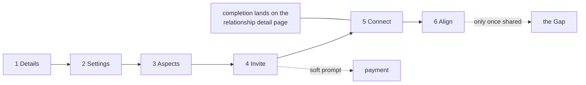
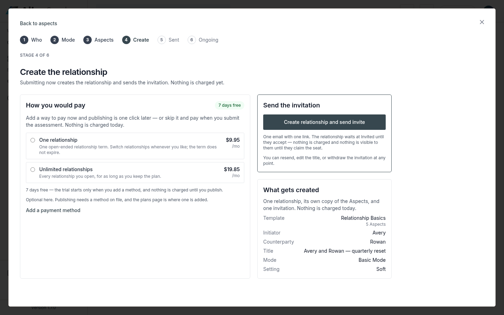
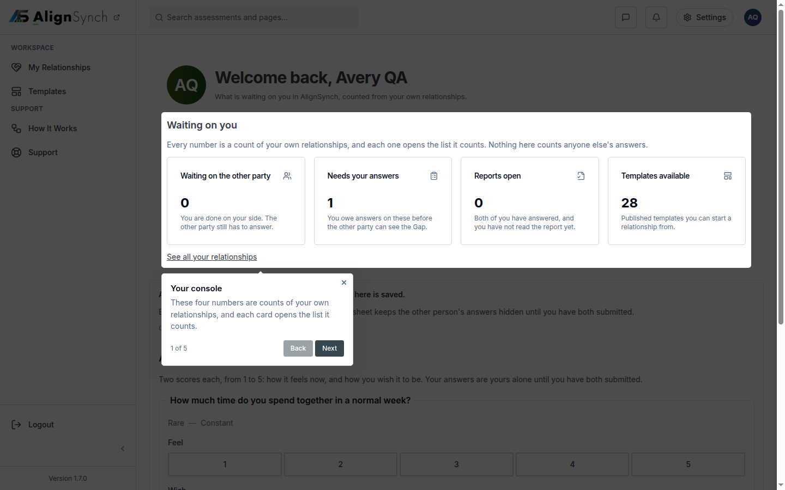

# v1.8.0 — the flow conforms

<!-- docs-nav:begin -->

[Docs hub](../README.md) › **Release notes** › v1.8.0 · prev [v1.7.0](v1-7-0.md)

<!-- docs-nav:end -->

The create-and-complete flow stops being five screens and a plan. v1.8.0 conforms the build to the
binding six-stage spec — **Details · Settings · Aspects · Invite · Connect · Align** — opens the
whole create journey as one modal that closes onto the dashboard, gives the answer sheet a single
progress pattern, and deletes the required Reason field from every action form. The stage model is
not a preference any more: it is written down in `docs/specs/flow-stages.md`, bound from
`AGENTS.md`, drawn in the approved v7 artifact, and now the app prints the same words.

## What was painful before

- **The rail said one thing and the spec said another.** The screens still read `Who · Mode ·
  Aspects · Create · Sent · Ongoing` while the approved artifact and the spec said `Details ·
  Settings · Aspects · Invite · Connect · Align` — a reader comparing the two could not tell which
  was the model.
- **Each stage route was its own page.** Walking the flow meant four full page loads and a
  dashboard that felt like somewhere else, not the end of the same journey.
- **Every action form demanded a Reason.** Twelve admin screens required at least eight characters
  of justification for routine operations, enforced twice — in `lib/admin/act.ts` and again by a
  database check — so operators typed filler to reach the button.
- **A counterparty could not see their own relationship.** `listMyRelationships` filtered on the
  initiator, so the invited side saw an empty list (#706).

## What it does now

- **Six stages, and the spec is the contract.** The rail prints `Stage {n} of 6` over `Details ·
  Settings · Aspects · Invite · Connect · Align`; `Ongoing` is deleted as a stage — completion lands
  on the relationship detail page in the dashboard — and `Align` goes live only once one or more
  assessments are shared (#735).
- **The flow is one modal.** `StageShell` is a client overlay over the existing stage routes: the
  journey opens over the dashboard and closes back onto it, while deep links and refreshes still
  resolve to the stage (#709).
- **One progress pattern on the answer sheet.** The cell rail is the only progress affordance
  across the flow (#716), shared with the stage rail's cell family.
- **A reason is optional.** No screen asks for one; `act()` records a stated reason and writes NULL
  when none arrives, and `admin_action.reason` stays nullable so the audit trail keeps what an
  operator actually said (#732).
- **The counterparty sees their relationship.** Party-based reads replace the initiator filter, and
  writes stay initiator-only (#706).
- **`ADMIN_EMAILS` is enforced at seed time.** `pnpm admin:ensure` and `pnpm db:seed` create or
  promote the profile for any allowlisted address that already has an account; `db:verify` reports
  an allowlisted account that is not admin as drift (#729).

## The flow, as the release ships it

## Screens

The create journey as v1.8.0 ships it: one modal over the dashboard, the stage rail printing the
spec's words, and the stage's own actions in the column.

The surface the flow closes onto — the relationship's home in the member dashboard, where
completion lands instead of an `Ongoing` stage.

## The entry, as published

<!-- changelog-view:begin entry -->
<!-- generated from CHANGELOG.md by scripts/changelog-view.mjs — edit the entry, not this block -->

- **Released** 2026-11-08
- **Tag** [`v1.8.0`](https://github.com/riolabs-ai/alignsynch/releases/tag/v1.8.0)
- **Pull requests named** 16
- **The entry** [`CHANGELOG.md`](../../CHANGELOG.md)

### Added

- `feat(flow)` — conform to the six-stage spec — Details · Settings · Aspects · Invite · Connect · Align (#735) ([#737](https://github.com/riolabs-ai/alignsynch/pull/737))
- `feat(admin)` — ADMIN_EMAILS is enforced at seed time, not only at sign-in ([#730](https://github.com/riolabs-ai/alignsynch/pull/730))
- `feat(admin)` — a reason is optional on every action form, and no screen asks for one (#732) ([#736](https://github.com/riolabs-ai/alignsynch/pull/736))
- `feat(ui)` — the answer flow shows one progress pattern — the cell rail (#716) ([#733](https://github.com/riolabs-ai/alignsynch/pull/733))
- `feat(flow)` — the create flow opens as one modal and closes onto the dashboard (#709) ([#728](https://github.com/riolabs-ai/alignsynch/pull/728))
- `feat(ui)` — the member console is left-justified on the shared StageColumn (C1) (#715) ([#722](https://github.com/riolabs-ai/alignsynch/pull/722))
- `feat(onboarding)` — stage 6 Ongoing — the Alignment, aspect by aspect (#692) ([#703](https://github.com/riolabs-ai/alignsynch/pull/703))
- `feat(onboarding)` — stage 5 Sent — the invitation's state, what happens next (#691) ([#702](https://github.com/riolabs-ai/alignsynch/pull/702))
- `feat(onboarding)` — stage 4 Create and the post-stage-4 account gate (#690) ([#701](https://github.com/riolabs-ai/alignsynch/pull/701))

### Fixed

- `fix(review)` — v6's capture is dated after v5's, so the console lists it first (#708) ([#727](https://github.com/riolabs-ai/alignsynch/pull/727))
- `fix(ui)` — a hover shade is painted as a color the parser accepts, not a bare triple ([#726](https://github.com/riolabs-ai/alignsynch/pull/726))
- `fix(member)` — a Counterparty sees their relationship, and writes stay initiator-only (#706) ([#720](https://github.com/riolabs-ai/alignsynch/pull/720))
- `fix(e2e)` — drive the four-stage create and register the instance before it throws (#704) ([#705](https://github.com/riolabs-ai/alignsynch/pull/705))

### Maintenance

- `docs(specs)` — the flow is six stages, and the spec is binding ([#734](https://github.com/riolabs-ai/alignsynch/pull/734))
- `docs(review)` — v6 — the flow as a modal, the dashboard it closes onto, and both viewports (#708) ([#725](https://github.com/riolabs-ai/alignsynch/pull/725))
- `docs(agents)` — Card carries no shadow — elevation is a border, not the primitive's default ([#724](https://github.com/riolabs-ai/alignsynch/pull/724))
<!-- changelog-view:end -->

## Known limits

<!-- changelog-view:begin limits -->
<!-- generated from CHANGELOG.md by scripts/changelog-view.mjs — edit the entry, not this block -->

- **`Align` is conditional, so a brand-new relationship shows five live stages.** The flow
  conformed to the spec in this release (#735): the rail prints `Stage {n} of 6`, the words are
  `Details · Settings · Aspects · Invite · Connect · Align`, `Ongoing` is gone, and completion
  lands on the relationship detail page in the dashboard. `Align` goes live only once one or more
  assessments are shared, so the sixth stage is visible but not enterable before then.
- **Prototype text and content revisions are not in this release.** The owner is preparing them for
  the next one; the `/admin/review/ia` rail proposal (#731) is parked and part of no release.
- **`pnpm db:seed` refuses on the demo branch.** Demo carries assessment rows the demo dataset does
  not author (eight at the time of writing), and the seed fails rather than clobber them. The
  documented recovery is `pnpm demo:reset`, which is destructive to demo only. Local and CI are
  unaffected: the gate never opens a connection.
- **`ADMIN_EMAILS` is enforced at seed time, not by the platform.** `pnpm admin:ensure` and
  `pnpm db:seed` create or promote the profile for any allowlisted address that already has an
  account; an address with no account on the branch is reported `pending sign-in` and is promoted
  the first time it signs in. Nothing creates an account.
- **A reason is now optional, but the column is kept.** No screen asks for one and `act()` writes
  NULL when none arrives; `admin_action.reason` stays nullable so an operator's stated reason is
  still recorded when they give one. The audit history before this release keeps its reasons.
- **The review artifacts are documents, not the product.** `/admin/review` serves the prototype
  HTML behind the admin gate; it draws the proposal and ships none of the behaviour it shows.
- **One payment path still carries a known risk.** Publishing can start a trial or checkout at
  creation while completion also writes a `relationship_payment` obligation (ADR-1). Unchanged by
  this release, and only reachable with test keys today.
<!-- changelog-view:end -->

<!-- docs-nav:begin -->

[Docs hub](../README.md) › **Release notes** › v1.8.0 · prev [v1.7.0](v1-7-0.md)

<!-- docs-nav:end -->
