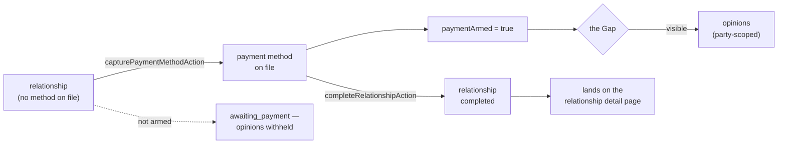
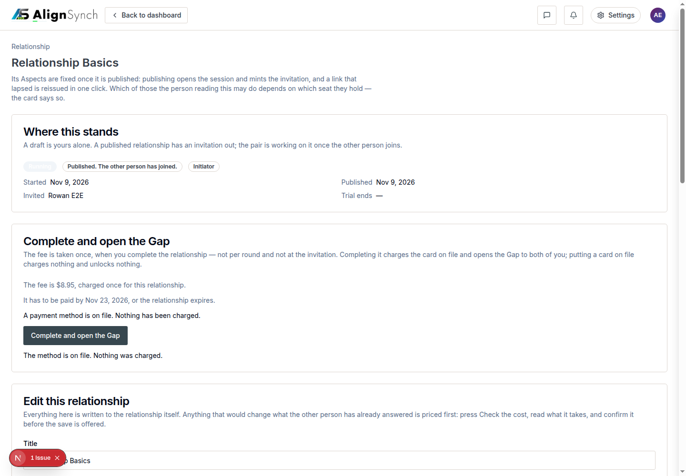
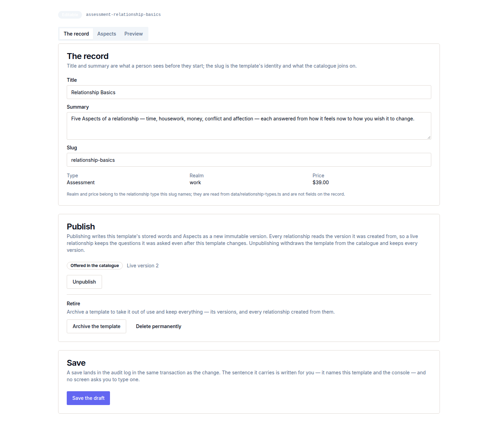
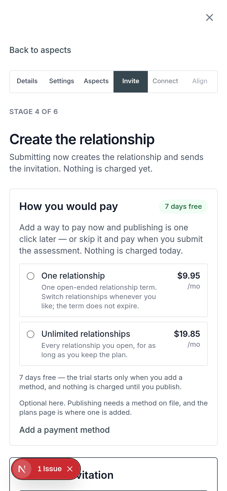

# v1.9.0 — the payer can pay

<!-- docs-nav:begin -->

[Docs hub](../README.md) › **Release notes** › v1.9.0 · prev [v1.8.0](v1-8-0.md) · next [v1.10.0](v1-10-0.md)

<!-- docs-nav:end -->

v1.8.0 conformed the flow to its six-stage spec. v1.9.0 makes the two ends of that flow **do
something**: a stranger who is invited answers inside the same modal and lands on their dashboard,
and a member who wants the Gap pays for it — a method is captured, the relationship completes, and
the opinions the hard gate was withholding become visible. It also adds real CRUD on the templates
the flow is built from: publishing a revision and retiring a template without destroying a
document a relationship already points at.

The payment work is the substantive one, and it is worth being precise about what shipped. The
engine was already complete and **unreachable** — `capturePaymentMethodAction` and
`completeRelationshipAction` existed with no caller, and the dashboard shipped `Activate
Relationship` and `Gap Analysis` visibly disabled. v1.9.0 wires them, so the controls stop being a
claim about a product that does not exist.

## What was painful before

- **The payment engine was built and unreachable.** The ledger, the two server actions, the routes
  and the hard gate all existed and 124 tests covered them, while the only caller-facing controls in
  the dashboard were disabled. A permanently disabled button is a statement about the product; it
  was the wrong one (#739).
- **An invited counterparty left the flow.** Answering an invitation was a page of its own, so the
  person who arrived from an email link never saw the rail, the frame or the step they were on (#710).
- **The modal was unmeasured below desktop.** The flow opened as one modal at 1440 and nothing had
  walked it at 390, where the close control and the stage column compete for the same rows (#713).
- **A template could only be edited in place.** Publishing a revision, or retiring a template
  without orphaning a relationship that referenced it, had no supported path (#711).

## What it does now

- **A member can pay, and the Gap opens.** `capturePaymentMethodAction` runs from the relationship
  detail page, `completeRelationshipAction` completes the relationship, and the controls that were
  disabled now work; `paymentArmed` is what the hard gate reads, so a relationship with no method
  reports `awaiting_payment` and withholds opinions until one is on file (#739).
- **Answering an invitation happens in the same modal.** `/invite/<token>` renders
  `CounterpartyWizard` inside `StageShell` under the six-stage `StageRail` at **Connect**, and closes
  onto `/dashboard` — the invited side walks the frame the initiator walks (#710).
- **The modal is measured at 390.** The shell clears the close control at 390×844 and 390×500, and
  the walk is pinned by a test rather than by a screenshot somebody remembers taking (#713).
- **Templates publish revisions and retire.** A new revision is a published version beside the old
  one, and a retired template keeps every revision readable — a relationship pointing at an older
  revision still has a document (#711).
- **Deployment retention is a command.** `pnpm deploy:prune` takes Vercel's Function Storage from a
  quota that fills with builds nobody will roll back to, protecting every aliased deployment, the
  newest three and anything under a day (#746).

## The payer's two acts, as the release ships them

## Screens

The state that did not exist before this release: a method on file, captured from the relationship
the Gap is for. The controls beside it were disabled in v1.8.0.

Publishing a revision rather than editing in place — the older revision stays readable, so a
relationship that references it still has a document.

An invitation answered inside the modal at 390 — the close control and the stage column lay out
without overlapping, which is what the 390 walk exists to prove.

## The entry, as published

<!-- changelog-view:begin entry -->
<!-- generated from CHANGELOG.md by scripts/changelog-view.mjs — edit the entry, not this block -->

- **Released** 2026-11-09
- **Tag** [`v1.9.0`](https://github.com/riolabs-ai/alignsynch/releases/tag/v1.9.0)
- **Pull requests named** 5
- **The entry** [`CHANGELOG.md`](../../CHANGELOG.md)

### Added

- `feat(crud)` — templates publish revisions and are retired, never destroyed in use (#711) ([#742](https://github.com/riolabs-ai/alignsynch/pull/742))
- `feat(flow)` — the invite-response path runs in the same modal and ends on /dashboard (#710) ([#740](https://github.com/riolabs-ai/alignsynch/pull/740))

### Fixed

- `fix(payment)` — a member can pay — capture a method and complete a relationship (#739) ([#747](https://github.com/riolabs-ai/alignsynch/pull/747))
- `fix(flow)` — the modal shell clears the close at 390, and the walk is pinned (#713) ([#741](https://github.com/riolabs-ai/alignsynch/pull/741))

### Maintenance

- `chore(deploy)` — prune stale Vercel deployments, and make it a command ([#746](https://github.com/riolabs-ai/alignsynch/pull/746))
<!-- changelog-view:end -->

## Known limits

<!-- changelog-view:begin limits -->
<!-- generated from CHANGELOG.md by scripts/changelog-view.mjs — edit the entry, not this block -->

- **A payer can pay, but paying still leaves the modal.** This release wires the two acts that
  were built and unreachable (`#739`): `capturePaymentMethodAction` and `completeRelationshipAction`
  now run from `app/(mainlayout)/dashboard/relationships/[id]/page.tsx`, and the controls that
  shipped visibly disabled no longer are. What it does not do is pay **inside** the flow: the
  adapter creates hosted sessions only (`lib/billing/adapters/stripe.ts`), so `Add a payment method`
  opens Stripe's page rather than the artifact's in-frame `Secure payment` frame. That frame is
  `#749`, not this release.
- **Only Stripe test keys are configured.** The adapter reads `STRIPE_TEST_SECRET_KEY`, so a method
  is captured in test mode and this release cannot take a real charge. Nothing in the product
  depends on test mode to work — the path is the same one live keys would drive.
- **The hard gate sits at completion, and it is the only gate.** With no method on file the
  relationship reports `awaiting_payment` and opinions are withheld (`lib/flow/state.ts`); answering,
  sharing and inviting are never gated, and no screen asks for a login to get that far. The artifact
  draws the same lock at _publish_; the code enforces it at _complete_. One gate, not two.
- **The conformance slices C3, C4 and C5 are not in this release.** The admin console's left edge
  (`#717`), the marketing content cards' shadows (`#718`) and the right-aligned numbers and explicit
  empty states (`#719`) moved to the `v1.10.0` milestone rather than being claimed here.
- **Template revisions are published, never destroyed.** Retiring a template keeps every published
  revision readable (`#711`); there is no hard delete, by design, so a relationship that points at an
  older revision keeps a document to point at.
- **Invite-response runs in the same modal and ends on `/dashboard`** (`#710`), and the modal is
  measured at 390×844 and 390×500 (`#713`). The measurement is a walk that a test pins, not a
  continuous check — a later screen added outside the six stages is not covered by it.
- **Deployment retention is a command, not a policy.** `pnpm deploy:prune` (dry run by default) is
  what stops Vercel's Function Storage filling with old builds (`#746`); nothing prunes on a
  schedule, so the quota grows with merges until someone runs it.
- **One payment path still carries a known risk, unchanged.** Publishing can start a trial or
  checkout while completion also writes a `relationship_payment` obligation (ADR-1), so a
  double-created obligation is possible; it is reachable only with test keys today.
- **`pnpm db:seed` still refuses on the demo branch.** Demo carries assessment rows the demo dataset
  does not author, and the seed fails rather than clobber them; the documented recovery is
  `pnpm demo:reset`, destructive to demo only. The gate never opens a connection, so local and CI
  are unaffected.
<!-- changelog-view:end -->

<!-- docs-nav:begin -->

[Docs hub](../README.md) › **Release notes** › v1.9.0 · prev [v1.8.0](v1-8-0.md) · next [v1.10.0](v1-10-0.md)

<!-- docs-nav:end -->
