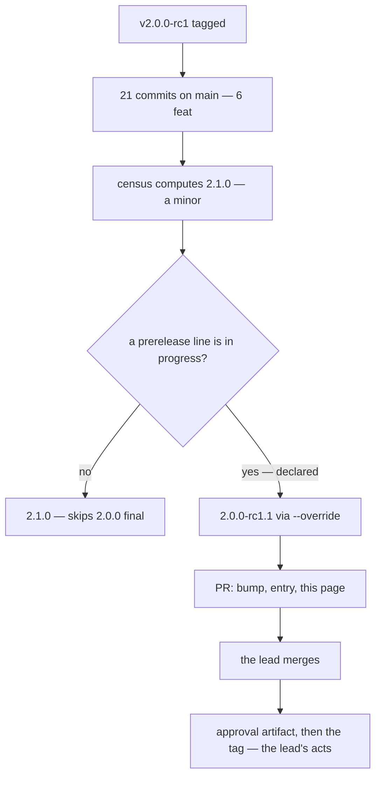
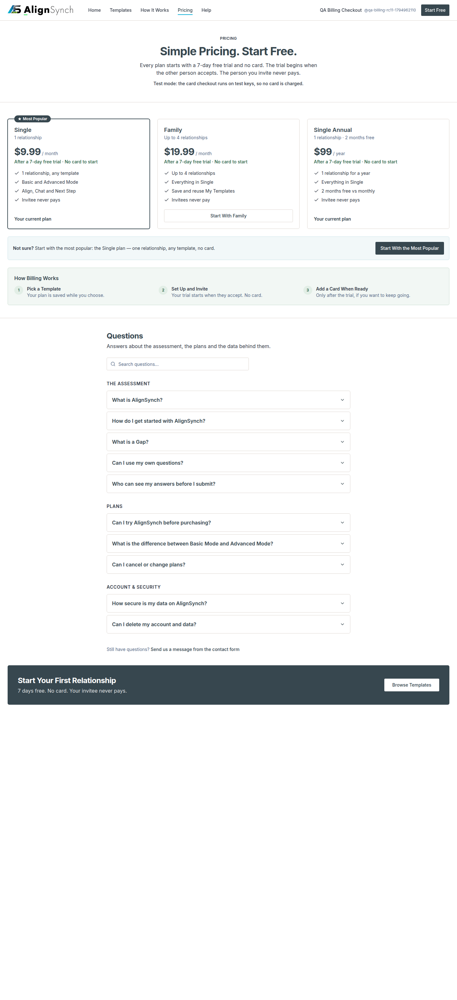

# v2.0.0-rc1.1 — the candidate's first patch, and the format change it carries

<!-- docs-nav:begin -->

[Docs hub](../README.md) › **Release notes** › v2.0.0-rc1.1 · prev [v2.0.0-rc1](v2-0-0-rc1.md) · next [v2.0.0-rc1.2](v2-0-0-rc1-2.md)

<!-- docs-nav:end -->

`v2.0.0-rc1` shipped a candidate and named its own exclusions. This is the patch on that
candidate: one reported symptom closed, the production ledger caught up and proved, a generated
environment example, and a bundle-format change that was merged with the noun sweep and therefore
ships here whether or not the note wants it.

It is not a health-only release, and the number is declared rather than computed. Both facts are
the interesting ones, so they are argued rather than stated.

## The symptom, and the fix

The owner reported an empty `500` on one hop: a signed-in creator finished stage 3 of the create
flow, and `POST /assessment/new` answered `500` with no body. The cause was two failures stacked:

1. **Production's schema was behind the code.** Its ledger stopped at `0039` while `main` had been
   writing `session.state` and `session_invite.relationship_id` since `v1.21.0`, so the insert raised
   `42703` and rolled back. The schema was caught up separately, on 2026-11-18, after the snapshot
   `production-preserved-20261118-023745`, and `db:verify` then reported six violations instead of
   ten — fixture drift, not schema drift.
2. **The failure was not named.** `#1210` makes an unhandled database error on that route answer a
   named 500 and makes `pnpm db:schema` print a ledger that is behind the code — so the next
   occurrence reads as a diagnosis instead of a shrug.

The production walk after both halves, as the QA account:

| hop                | answer                                                                       |
| ------------------ | ---------------------------------------------------------------------------- |
| 1 · Who            | `303 → /dashboard/templates/brother-sister/create/mode`                      |
| 2 · Mode           | `303 → …/create/aspects`                                                     |
| 3 · Aspects        | `200`, then `{"ok":true}`                                                    |
| 4 · Commit (draft) | `303 → …/create/invite?instance=cb06c368-f72f-4e19-9d24-1e11b6541609`        |
| rows written       | one `relationship` (`draft`), one `session` (`state='draft'`), a `party` row |

## Why the number is `rc1.1` and not `2.1.0`

The census of `v2.0.0-rc1..HEAD` is 21 commits with six `feat:` records, so the tool computes
`2.1.0` — minor — and both readers (the census and `release_boundary.py`) agree.

The tool has no model of a prerelease chain. `2.1.0` sorts **above** `2.0.0`, and `2.0.0` has never
been released, so cutting the minor would silently skip the final release and make every future
`2.0.0` a downgrade. The owner authorised the override; `pnpm release:cut` wrote it into the entry
as a banner, which is why the first thing a reader of the notes sees is the disagreement itself.

## The bundle format moved, deliberately

`#1195` carried the noun sweep, and its last surface was the file format: bundle version 3 spells
the record arrays `payload.sessions`, where version 1 spelled them `payload.instances`
(`content/bundle.ts:98`). A tenant holding a bundle does not lose it — a v1 file still imports,
prints one deprecation line, and the next export is v3 — and a half-migrated file is refused as
`B9` rather than guessed at. The bump was planned for the next candidate; it is on `main`, so it is
in this one, and the entry names it in its own section instead of folding it into maintenance.

## The evidence this page does not invent

The billing checkout was QA'd on production in test mode, and the record is
`docs/qa/release-2.0.0-rc1.1/billing-checkout.md`: one paid test session, one `billing_subscription`
row, one `billing_event` row, and a declined card that wrote nothing. The still below is the surface
that checkout lands on, captured during that run, as the account that paid:

What that run could **not** prove is the flow's purpose, because stage 4 answered `500` during it
and stage 5 does not open from stage 4's redirect (`?instance=` in `lib/flow/paths.ts:577` against
`?session` in `components/flow/template-create/invite.tsx:93`). So the billing checkout remains
unproven end to end (`#1053`, open), the entry says so, and no card is closed by this release.

## The entry

<!-- changelog-view:begin entry -->
<!-- generated from CHANGELOG.md by scripts/changelog-view.mjs — edit the entry, not this block -->

- **Released** 2026-11-18
- **Tag** [`v2.0.0-rc1.1`](https://github.com/riolabs-ai/alignsynch/releases/tag/v2.0.0-rc1.1)
- **Pull requests named** 21
- **The entry** [`CHANGELOG.md`](../../CHANGELOG.md)

> **Declared override.** The commit census computes 2.1.0 (minor, 21 commit(s) since v2.0.0-rc1); this release is cut as 2.0.0-rc1.1 by decision: a prerelease line is in progress and 2.0.0 final has not shipped, so the computed minor would sort above the candidate it belongs to
>
> `pnpm release:cut` printed this banner and wrote it here so the number is a declared artefact in a published document, never a silent one.

A patch on the candidate, and the fix inside it is the thing a person actually hit: **stage 4 of
the create flow no longer answers an empty `500`** (`#1205`). The production half landed too —
`0040`–`0042` applied to the production branch after a snapshot, with the create walked end to end
and its four rows read back — and `.env.example` became a generated projection, so a store census
is a build step rather than a checklist somebody remembers.

It is not a health-only window, though, and this entry does not pretend otherwise: six `feat:`
records landed since `v2.0.0-rc1`, and one chore in that window (`#1195`) carries a **breaking
bundle-format change that ships here deliberately**. It has its own section below, because a note
that calls itself maintenance while moving a file format is the kind of note that costs a tenant
an import.

### Fixed

- `fix(flow)` — #1205 a create that could not be written answers a named 500, and db:schema names a ledger behind the code ([#1210](https://github.com/riolabs-ai/alignsynch/pull/1210))
- `fix(seed)` — a seeded draft carries its invitation, because the create writes it (#1196) ([#1197](https://github.com/riolabs-ai/alignsynch/pull/1197))
- `fix(auth)` — #1187 stage 4 keeps the return after a demo role sign-in or a sign-up ([#1190](https://github.com/riolabs-ai/alignsynch/pull/1190))
- `fix(docs)` — the rc1 page says the chat screen warns — only the docstring does (#1188) ([#1191](https://github.com/riolabs-ai/alignsynch/pull/1191))
- `fix(copy)` — the design artifact promises immediate deletion, matching purge.ts ([#1163](https://github.com/riolabs-ai/alignsynch/pull/1163))
- `fix(email)` — #1139 — the lapse notice splits by seat, so the Counterparty never reads a plan ([#1168](https://github.com/riolabs-ai/alignsynch/pull/1168))
- `fix(gate)` — stage5-send-live writes the invitation the send reissues (#1183) ([#1186](https://github.com/riolabs-ai/alignsynch/pull/1186))

### Maintenance

- `chore(env)` — make .env.example a generated projection, census every store, fill Vercel development ([#1203](https://github.com/riolabs-ai/alignsynch/pull/1203))
- `docs(qa)` — #1053 a test-mode checkout on production — the session, the mode, the row the webhook wrote, and the decline path ([#1204](https://github.com/riolabs-ai/alignsynch/pull/1204))
- `perf(gate)` — a known-empty diff is the docs lane, unknown stays full (#1000) ([#1206](https://github.com/riolabs-ai/alignsynch/pull/1206))
- `docs(test)` — re-derive the three line citations #1195 moved in stage5-send-live ([#1208](https://github.com/riolabs-ai/alignsynch/pull/1208))
- `chore(noun)` — #1106 + #1107 + #1112 as one integration branch — the sweep, the bundle v3 and the create flow under the dashboard ([#1195](https://github.com/riolabs-ai/alignsynch/pull/1195))
- `chore(deps)` — swiper 12.2.0 → 14.4.0 and jsdom 30.1.3 → 31.0.1 (#1027, #1025) ([#1194](https://github.com/riolabs-ai/alignsynch/pull/1194))
- `docs(release)` — date the rc1 ledger paragraph, and state that chat does not persist (#1188) ([#1189](https://github.com/riolabs-ai/alignsynch/pull/1189))
- `chore(health)` — re-record platform health at v2.0.0-rc1 ([#1185](https://github.com/riolabs-ai/alignsynch/pull/1185))

- `ops(db)` — `0040`, `0041` and both `0042` files applied to the production branch after the
  snapshot `production-preserved-20261118-023745`, with stage 4 walked end to end: `303 →
  …/create/invite?instance=<uuid>`, one `relationship` (`draft`), one `session` (`state='draft'`),
  the Initiator `party` and one `session_invite`, read back from the rows

### Added

- `feat(release)` — pre-approved cut — a committed approval artifact tags without a TTY ([#1165](https://github.com/riolabs-ai/alignsynch/pull/1165))
- `feat(email)` — the release note carries the visuals that exist — EmailImage + EmailTable with an asset-exists refusal (#1169) ([#1193](https://github.com/riolabs-ai/alignsynch/pull/1193))
- `feat(admin)` — email templates — the register, an override, and a page to edit it (#1138) ([#1167](https://github.com/riolabs-ai/alignsynch/pull/1167))
- `feat(assessment)` — the v2 answer screen — one Aspect, locked 1–5, saved as you go (#1128) ([#1173](https://github.com/riolabs-ai/alignsynch/pull/1173))
- `feat(admin)` — render the CRUD matrix the source actually carries (#1126) ([#1179](https://github.com/riolabs-ai/alignsynch/pull/1179))
- `feat(assets)` — three release-comms banners under public/og/, drawn from the brand tokens (#1169) ([#1177](https://github.com/riolabs-ai/alignsynch/pull/1177))

### Breaking change — the bundle format is version 3, and it is included deliberately

`#1195` moved the bundle's record arrays from `payload.instances` to `payload.sessions` under
`bundleVersion: 3` (`content/bundle.ts:98`). **If you hold a bundle**: a version-1 file still
imports — it prints one deprecation line, is normalized in memory, and the next export of it is a
v3 document — while a v3 file still carrying the old key, a v1 file carrying the new one, or a
payload carrying both is refused as `B9` rather than half-read. Nothing else in the document moved,
and no row id was rewritten: `assessment-instance-*` remain the handles relationships and party
rows point at.

The format change was planned for the next candidate; the owner kept the `rc1.1` label and still
intends a format bump for rc2. It is already on `main`, so it ships — named here rather than
absorbed into a maintenance line.
<!-- changelog-view:end -->

<!-- changelog-view:begin limits -->
<!-- generated from CHANGELOG.md by scripts/changelog-view.mjs — edit the entry, not this block -->

- **The number is declared, and the census disagrees with it.** `v2.0.0-rc1..HEAD` is 21 commits
  including six `feat:` records, so `pnpm release:cut --check` computes `2.1.0` (minor) and both
  readers agree. This tree is cut as `2.0.0-rc1.1` by decision: the `2.0.0` line is a candidate
  still in progress and `2.0.0` final has not shipped, so a minor would sort above the release it
  belongs to and make every `2.0.0` a downgrade. The banner at the top of this entry is
  `pnpm release:cut`'s own record of that decision, not a note added afterwards.

- **Stage 5 does not open from stage 4's own redirect.** The commit answers
  `303 → …/create/invite?instance=<uuid>` (`lib/flow/paths.ts:577`) while the invitation stage reads
  `?session` (`components/flow/template-create/invite.tsx:93`), so a creator who finishes stage 4 is
  bounced back to stage 1; `?session=<uuid>` renders the stage with the send gate locked. It is live
  on this tree and on production, and it arrived with `#1195`.

- **The billing checkout is unproven end to end on production** (`#1053`, open). The test-mode run
  recorded in `docs/qa/release-2.0.0-rc1.1/billing-checkout.md` proved the checkout hop — one paid
  test session, one `billing_subscription` row, one `billing_event` row, `livemode=false` — and the
  decline path, which wrote nothing. It could not prove the flow's own purpose: stage 4 answered
  `500` during that run and stage 5 is broken (above), so no relationship was published, no publish
  trial was granted and no payment was made for one. This release fixes the `500`; it does not
  re-run the proof.

- **Production's `pnpm db:verify` reports six violations, and none of them are schema drift.**
  `V31`×4 and `V30`×2 compare production rows against `data/assessments.ts`, the demo fixture. The
  same command run against the pre-migration snapshot (`production-preserved-20261118-023745`)
  reported ten, four of them migration-shaped. Closing the remaining six means running `pnpm
  db:seed` against production, which no card has authorised and this release does not do.

- **The two `ADMIN_EMAILS` seats still answer `401`** (`#1084`), and `#1202` — creating those
  identities in production — is open. Admin surfaces are therefore unexercised over HTTP on
  production: `/admin/console/instances` answers `404` to an account without the `product.admin`
  capability, so `lib/db/admin-*.ts` is gated rather than proved.

- **The release audit and the amend path are filed, not shipped.** `#1201` (tag, Release, page and
  ledger row checked together) and `#1199` (`--amend` for a corrected note on a recorded tag) are
  open issues. Nothing in this release implements either, and this entry does not claim them.

- **Known limits named by the candidate are repeated here rather than re-proved.** The capture under
  `docs/qa/release-2.0.0-rc1/` still stands as the `rc1` surface evidence; `chat` still writes
  nothing durable, and no dependency majors moved in this window.

- **This is a pre-release.** A `-suffix` version is published with `--prerelease`, so
  `v2.0.0-rc1.1` is never `latest`: `v1.22.0` remains the newest stable release and the production
  deployment's `/api/version` is the only thing that says which build is live.
<!-- changelog-view:end -->

<!-- docs-nav:begin -->

[Docs hub](../README.md) › **Release notes** › v2.0.0-rc1.1 · prev [v2.0.0-rc1](v2-0-0-rc1.md) · next [v2.0.0-rc1.2](v2-0-0-rc1-2.md)

<!-- docs-nav:end -->
