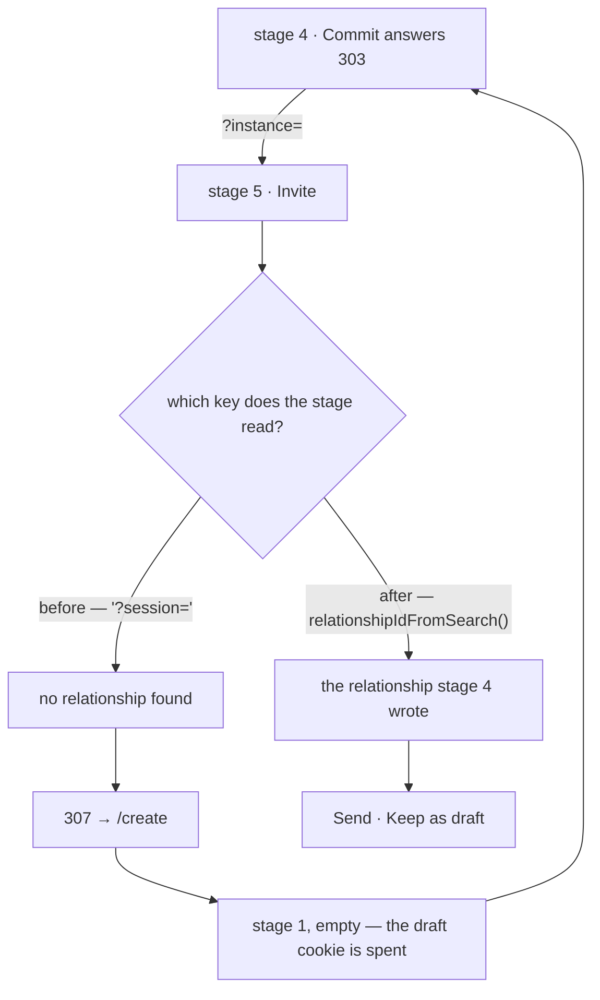
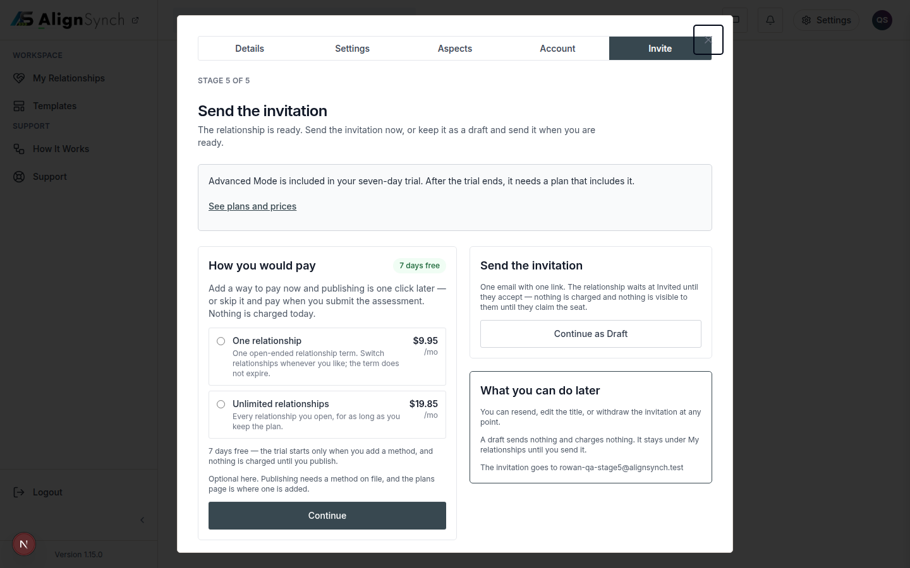

# v2.0.0-rc1.2 — the two loops the candidate left open, closed

<!-- docs-nav:begin -->

[Docs hub](../README.md) › **Release notes** › v2.0.0-rc1.2 · prev [v2.0.0-rc1.1](v2-0-0-rc1-1.md)

<!-- docs-nav:end -->

`v2.0.0-rc1.1` named two loops it could not close: stage 4 of the create flow redirected to an
address stage 5 never read, and a seeded `complete` relationship held a report with no money against
it. This patch closes both, and the rest of its six commits are the lane the release is cut from.

Neither fix is a new surface. One is a key with two spellings, and the other is a row written by a
hand instead of by the writer that owns it — which is why both were invisible to a green gate.

## The loop: stage 5 read a key stage 4 never wrote

The create answers `303 → …/create/invite?instance=<uuid>`, and stage 5 read `?session=` — a key
nothing in the tree has ever written. So a creator who had just finished stage 4 was told it had
created nothing and was sent to `/create`, where the draft cookie the create had already consumed
left **stage 1, empty**. No error, no message, no way forward.

`#1217` gives the key one home — `lib/flow/paths.ts::FLOW_RELATIONSHIP_PARAM`, from the `?instance=`
handle the noun ratchet sanctions — and one reader, `relationshipIdFromSearch()`, used by both
stage 5 and stage 4's own re-entry. Stage 5's **Back** now points at stage 4's path for the row it
already wrote, so the documented `?instance=` re-entry can actually fire.

The proof is `tests/flow-instance-key.test.ts`, which pins both directions: the reader resolves the
key the writer emits, and the `Back` link names stage 4's path. What this release does not do is
re-walk the flow on production — the last end-to-end create on production was the `rc1.1` QA run, and
it predates the fix. The entry says so under **Known limits** rather than implying a browser proof.

That still is the surface, not this release's tree: it was captured for `#870` on a dev server, and
`docs/qa/stage5/README.md` records the branch, the port and the two states.

## The fee: a complete relationship with no money

The demo held eight completed sessions and exactly one `relationship_payment` row, authored by hand
for the console's charge card; production's four hand-authored sessions carried `status = 'active'`,
no plan, no `completed_at` and no obligation. That is the shape `db:verify` **V31** names, and it is
the shape a reader of the relationship sees when a completed engagement reports nothing paid.

`#1220` writes the missing half through the product's own writers —
`openPaymentObligation` → `recordMethodCaptured` → `recordChargeResult` in
`lib/db/relationship-payment.ts` — so the seeded row cannot drift from the one the product writes.
The amount is the tier's month price from `data/billing-plans.ts`, and the instants are the
relationship's own `created_at` plus whole days, which is what `0036`'s chronology checks require.

| branch     | before                 | after                                                 |
| ---------- | ---------------------- | ----------------------------------------------------- |
| demo       | 8 complete · 1 payment | 8 complete · 2 charged · `db:verify` 4 V31 → 0        |
| production | 4 V31 rows             | unchanged — the seed refuses on a production snapshot |

A `complete` relationship whose initiator seat is an authored name cannot carry a fee at all:
`relationship_payment.payer_user_id` is `NOT NULL` and no account holds that seat. The seed prints
that census — six rows — instead of inventing a payer, and `tests/db-seed-payments.test.ts` proves
every complete row is either paid for or reported.

## What the rest of the window is

Four commits, none of them product-visible, and the entry files each under **Maintenance** at its
own size rather than inflating it:

- `#1214` — the noun walk honours `.gitignore` and fails on a directory it cannot read, so a ratchet
  whose verdict depended on where it ran no longer does (`lib/quizhub/` was the measured case).
- `#1218` — `pnpm release:preflight` states the ten cut-time facts with a ✓ or ✗ before the gate,
  called from `scripts/release.sh --tag-only`. It is out of `verify.sh` on purpose: two of the ten are
  false mid-development.
- `#1219` — `outputFileTracingExcludes` drops 79.82 MB of docs no route opens; the largest traced
  route went 151.4 MB → 66.5 MB and all nine docs-reading routes still trace their keep set.
- `#1215` — the platform record was re-recorded at `v2.0.0-rc1.1`, naming the tagged sha rather than
  the tree it ran in.

## The entry

<!-- changelog-view:begin entry -->
<!-- generated from CHANGELOG.md by scripts/changelog-view.mjs — edit the entry, not this block -->

- **Released** 2026-11-18
- **Tag** [`v2.0.0-rc1.2`](https://github.com/riolabs-ai/alignsynch/releases/tag/v2.0.0-rc1.2)
- **Pull requests named** 6
- **The entry** [`CHANGELOG.md`](../../CHANGELOG.md)

> **Declared override.** The commit census computes 2.0.1 (patch, 6 commit(s) since v2.0.0-rc1.1); this release is cut as 2.0.0-rc1.2 by decision: 2.0.0 final has never been released: a 2.0.1 patch would sit on a version that does not exist and would claim a stability the candidate line does not have, so the rc line stays until 2.0.0 is cut
>
> `pnpm release:cut` printed this banner and wrote it here so the number is a declared artefact in a published document, never a silent one.

A patch on the candidate, and both of its fixes close a loop a person could get stuck in: **a
creator who finished stage 4 landed on an empty stage 1 and could never send** (`#1217`), and **a
seeded `complete` relationship held a report with no money against it** (`#1220`).

The loop was one key with two spellings. The create answers `303 → …/create/invite?instance=<uuid>`,
and stage 5 read `?session=` — a key nothing has ever written — so it decided the browser had
created nothing, sent it back to `/create`, and the draft cookie the create had already consumed
left stage 1 empty. `?instance=` now has one home (`lib/flow/paths.ts::FLOW_RELATIONSHIP_PARAM`) and
one reader, and stage 5's **Back** re-enters stage 4 on the row it already wrote.

The fee is the same shape in the data: the demo's eight completed sessions carried one hand-authored
payment row, and production's four carry no plan, no `completed_at` and no obligation — exactly what
`db:verify` V31 names. `#1220` writes the obligation through the product's own writers, so the
seeded shape cannot drift from the real one.

The rest of the window is the lane the release is cut from rather than the product: the noun walk
honours `.gitignore` and fails on a directory it cannot read (`#1214`), `pnpm release:preflight`
states the ten cut-time facts before the gate (`#1218`), the build's function trace stops carrying
80 MB of docs no route opens (`#1219`), and the platform record was re-recorded at `v2.0.0-rc1.1`
(`#1215`).

### Fixed

- `fix(seed)` — a complete relationship carries its fee, written through the product's writers (t_b9679354) ([#1220](https://github.com/riolabs-ai/alignsynch/pull/1220))
- `fix(flow)` — #1216 stage 5 reads the address the create writes ([#1217](https://github.com/riolabs-ai/alignsynch/pull/1217))
- `fix(noun)` — #1213 the walk honours .gitignore, and an unreadable directory is a failure not a short green run ([#1214](https://github.com/riolabs-ai/alignsynch/pull/1214))

### Maintenance

- `perf(build)` — the tracer stops carrying 80 MB of never-read docs into every function ([#1219](https://github.com/riolabs-ai/alignsynch/pull/1219))
- `chore(release)` — release:preflight — the ten cut-time facts, one command, before the gate ([#1218](https://github.com/riolabs-ai/alignsynch/pull/1218))
- `chore(health)` — re-record platform health at v2.0.0-rc1.1 ([#1215](https://github.com/riolabs-ai/alignsynch/pull/1215))
<!-- changelog-view:end -->

<!-- changelog-view:begin limits -->
<!-- generated from CHANGELOG.md by scripts/changelog-view.mjs — edit the entry, not this block -->

- **The number is declared, and the census disagrees with it.** `v2.0.0-rc1.1..HEAD` is 6 commits — three `fix:`, two `chore:` and one `perf:` — so `pnpm release:cut --check` computes `2.0.1` (patch) and both readers agree. This tree is cut as `2.0.0-rc1.2` by decision: `2.0.0` final has never been released, so a `2.0.1` would sit on a version that does not exist and would claim a stability the candidate line does not have. The banner at the top of this entry is `pnpm release:cut`'s own record of that decision, not a note added afterwards.

- **The stage-4 → stage-5 loop is closed in code, and proved by `tests/flow-instance-key.test.ts` rather than by a browser walk on production.** `#1217` gives the `?instance=` key one home (`lib/flow/paths.ts::FLOW_RELATIONSHIP_PARAM`) and one reader (`relationshipIdFromSearch()`), and stage 5's **Back** now points at stage 4's own path. What is not re-run here is the production hop: the last end-to-end walk of the create flow on production was the rc1.1 QA run, and it predates this fix.

- **Production's four `V31` rows are still there.** `#1220` gives a seeded `complete` relationship its report _and_ its fee on the **demo** branch — written through the product's own writers (`openPaymentObligation` → `recordMethodCaptured` → `recordChargeResult`), `db:verify` 4 V31 → 0 after the seed. It is not a repair path for production: on a production snapshot the seed refuses at `record holds assessment row(s) this seed does not author`. Production's four rows are separate open work, and this release does not touch them.

- **The billing checkout is still unproven end to end on production** (`#1053`, open). The test-mode run recorded in `docs/qa/release-2.0.0-rc1.1/billing-checkout.md` proved the checkout hop and the decline path; it could not prove the flow's purpose, because stage 4 answered `500` during it and stage 5 did not open. Both of those are fixed in `#1210` and `#1217`; neither fix re-runs the proof.

- **The two `ADMIN_EMAILS` seats still answer `401`** (`#1084`), and `#1202` — creating those identities in production — is open. Admin surfaces remain gated rather than exercised over HTTP on production.

- **`#1219`'s 79.82 MB exclusion is measured against this tree's route set, and it is a keep-set rule a later page must honour.** `outputFileTracingExcludes` in `next.config.mjs` drops the vendored prototype payload, the mockup screenshots and the QA capture archives from every function's trace. A page that starts serving a file from one of those trees will trace a function that cannot open it; the file's keep set is the list to extend, and nothing in the gate reads it.

- **`pnpm release:preflight` is not a gate step, on purpose.** The ten cut-time facts run only from `scripts/release.sh --tag-only` (two of the ten are false mid-development), so they protect the cut and nothing else — a red push, a stale checkout or an open release PR is still found at the cut, not before it.

- **This is a pre-release.** A `-suffix` version is published with `--prerelease`, so `v2.0.0-rc1.2` is never `latest`: `v1.22.0` remains the newest stable release, and the production deployment's `/api/version` is the only thing that says which build is live.
<!-- changelog-view:end -->

<!-- docs-nav:begin -->

[Docs hub](../README.md) › **Release notes** › v2.0.0-rc1.2 · prev [v2.0.0-rc1.1](v2-0-0-rc1-1.md)

<!-- docs-nav:end -->
