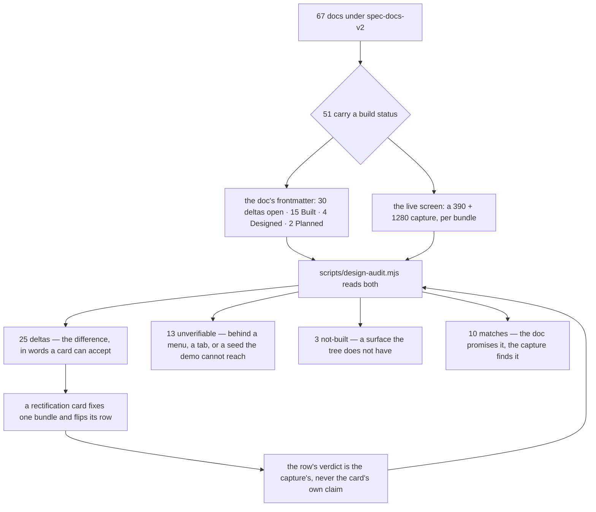

# v2.0.0-rc1.4 — the rectification cut

<!-- docs-nav:begin -->

[Docs hub](../README.md) › **Release notes** › v2.0.0-rc1.4 · prev [v2.0.0-rc1.3](v2-0-0-rc1-3.md)

<!-- docs-nav:end -->

Twenty-four commits, and the window is one argument told three ways: **the product now has an
instrument that reads it against its own design** (#1300), **the surfaces that instrument found
wrong were repaired in one tree** (#1314), and **the material the design is measured against —
the 2024 agreement — is now readable inside the app** (#1254, #1263, #1267, #1296, #1297).

The rest of the window follows from those three: a template page that stays in the app instead of
ejecting a member into the marketing catalogue (`#1259`, #1315), the featured-image slot that page
and the catalogue both draw (#1316), a walkthrough that photographs itself because a run report
nobody re-checks is not evidence (#1317), and four release-and-gate repairs that each closed a place
where a check could pass while the thing it measured was wrong (#1262, #1266, #1250, #1255).

## The register: 51 rows, and 15 that do not land where their status says

The gap this cut starts from is one sentence long: **33 docs said `· design deltas open` and not one
of them named a delta.** A status asserted thirty-three times and enumerated zero times is not a
backlog — it is a claim no card can accept and nobody can schedule.

`docs/specs/v2-rectification.md` (#1300) is the answer, and it is a _register_, not a fix. Sixty-seven
markdown docs under `spec-docs-v2`; fifty-one carry a build status. For each of those, the row prints
what the doc's own reference draws, what the live screen draws, and — where they differ — the
difference in words specific enough to become acceptance criteria. The verdict is derived at run time
from two sources, never typed: the status word in the doc's frontmatter, and a 390 + 1280 capture of
the screen.

The arithmetic is the honest half of the page, because **15 rows do not land on the verdict their
status word implies** and each one is a finding rather than a filing decision. Thirteen rows are
`unverifiable`: seven their frontmatter calls `· design deltas open`, five it calls `Built`, one
`Designed`. Every one of them draws what its doc promises behind a control a capture cannot open — a
⋮ menu, the avatar disclosure, a tab — or makes a claim only a person reading pixels can settle. A
`matches` written off a closed menu is exactly the optimism the register exists to end.

**Staleness is a column, not a footnote.** Each row prints the `code:` sha its own frontmatter was
written against and compares it with the tree the capture ran on: 40 of 51 rows were stale at
measurement. A verdict against an old sha is a stale verdict, so it is flagged rather than softened,
and re-running `node scripts/design-audit.mjs --capture` after the docs are re-checked is what clears
a flag — editing the page is not.

`#1314` is the other half: eleven rectification lanes landed as one tree, with the register
reconciled once and the full gate green, rather than eleven PRs each re-deriving the same table and
each leaving the page a little more wrong in a different way.

## The agreement, inside the app

The register asks what the product's screens promise. The Project Spec asks a different question —
what did the _contract_ promise — and until this window the answer lived in a PDF.

The reader (#1254, #1263, #1267, #1296, #1297) is three routes on one fixture:
`/admin/spec` is the Overview, `/admin/spec/validation` is the matrix, `/admin/spec/[group]` is one
group's story. Every row carries the requirement, its Definition of Done, the release that evidences
it, and what v2.0 does today, with `path:line` evidence — the rows come from
`data/spec/validation.json` because they are a _measurement_ of the agreement and not editorial copy,
while every word the page itself says is in `data/pages/admin-spec.ts` under a copy budget of `0`.

The still is this worktree's dev server, `/admin/spec`, 1440 CSS px, the AlignSynch brand, signed in
as `admin@demo.alignsynch.test` — the seat the route is gated for. `docs/qa/release-2.0.0-rc1.4/capture-admin-spec.mjs`
is the capture and it is re-runnable: before the shutter it asserts that `/api/version` names this
tree (`2.0.0-rc1.4 @ e2875d089`), that the frame is 1440 with a stylesheet that loaded, that the
page's own words are on it (`Project Spec`, `Read-only`, `Open Validation`, `Confidential`), and that
the brand is not QuizHub — the template build renders the same tree, so a still of it would pass three
of those four checks and show the wrong product.

**The spec is not in this page's claims.** No agreement wording, no fees, no addresses: the fixture is
a copy surface, and the one sentence allowed to say so is the NDA chip.

## A template page that stays in the app

`/templates/relationship/<slug>` used to answer a **308 to `/relationship-templates`** — so a
signed-in member who pressed `View Details` on their own shelf was ejected from the app shell into the
public marketing catalogue. That is the repo's own leaving-the-app rule inverted: the rule exists so
that a link out of the dashboard is deliberate, and a member reading their own library is not a
visitor reading marketing copy.

`#1259` (PR #1315) deleted that redirect and mounted the page under `app/(mainlayout)/`, so the rail,
the header and the account menu are the ones the member is already using, and `readLibraryTemplate()`
refuses exactly what the shelf refuses — a session, somebody else's template, a withdrawn draft — with
the same plain `notFound()`, because a page that distinguished them would tell a stranger which
handles exist. `#1316` gave the page and the catalogue their featured art through the media registry,
so a template's illustration is a registry row resolved once rather than a path in a component.

## The walkthrough photographs itself

`#1317` is `scripts/demo-walkthrough.mjs`: ten named steps, each walked by a real browser, each
captured at **390** and **1280**, each proved by the text on the screen. The failure mode a capture
harness invites is a green run that photographs the wrong screen — a redirect to `/login`, a session
that never arrived, a 404 with the app's chrome still around it — so every step carries the strings it
must say, the strings it must not say, and, where the step is about a control, the DOM facts that
prove it. A step whose text does not hold prints what was measured and exits 1. `--check` re-reads the
committed report offline: no browser, no network, no credentials.

## What else moved

- `#1262` — `pnpm release:postcheck <version>`: the seven facts a cut must still be true **after** it
  happened, each a `✗` naming what failed. The rc1.3 cut passed six of seven, and the seventh — the
  demo reseed — was found only because a human looked. A check somebody remembers to run is not a
  check.
- `#1266` — the docs lane runs the md-normalised check, so a page that drifts fails its own PR
  instead of the next release's.
- `#1250` — one normaliser: the release verbs accept the tagged spelling as well as the bare version.
- `#1255` — a migration number is one step. `db:migrate` refuses a shared prefix before it connects,
  rather than writing DDL no ledger can order.
- `#1325` — the five demo lanes land as one tree: one bundle, one expectations file, one seed path.
- `#1328` — the deploy mechanism documented and proved: a merge to `main` is the deploy, and
  production serves `main`'s tip once the build finishes.
- `#1265`, `#1257`, `#1264` — the migration inventory re-measured on both branches (47 files, 47
  rows), the 2026-11-19 branch retirements recorded including the unrecoverable one, and
  `0043_stakeholder_role.sql` published as the file the ledger had already applied.
- `#1247` — platform health re-recorded at v2.0.0-rc1.3.

`db/migrations/0044_activity_event.sql` predates this cut and is **applied to the production branch as
step 0 of it** — with `pnpm db:migrate` against production's unpooled URL and `pnpm db:verify` green
afterwards — because the deploy is the merge and the table the next writer needs has to exist before
the build that names it serves.

## The entry

<!-- changelog-view:begin entry -->
<!-- generated from CHANGELOG.md by scripts/changelog-view.mjs — edit the entry, not this block -->

- **Released** 2026-11-21
- **Tag** [`v2.0.0-rc1.4`](https://github.com/riolabs-ai/alignsynch/releases/tag/v2.0.0-rc1.4)
- **Pull requests named** 24
- **The entry** [`CHANGELOG.md`](../../CHANGELOG.md)

> **Declared override.** The commit census computes 2.1.0 (minor, 24 commit(s) since v2.0.0-rc1.3); this release is cut as 2.0.0-rc1.4 by decision: the 2.0.0-rc candidate line continues: 2.0.0 final has never been released and milestone #28 still holds 28 open spec issues, so the census' 2.1.0 would claim a public line that does not exist; milestone #29 names this candidate
>
> `pnpm release:cut` printed this banner and wrote it here so the number is a declared artefact in a published document, never a silent one.

### Added

- `feat(demo)` — the ten-step walkthrough as headless-Chrome scripted capture ([#1317](https://github.com/riolabs-ai/alignsynch/pull/1317))
- `feat(templates)` — the featured-image slot, resolved through the media registry, plus the first art tranche ([#1316](https://github.com/riolabs-ai/alignsynch/pull/1316))
- `feat(templates)` — #1259 the in-app template page, and the link that no longer leaves the app ([#1315](https://github.com/riolabs-ai/alignsynch/pull/1315))
- `feat(docs)` — the v2 rectification register — 34 delta sets named, every bundle reference paired with a live 390/1280 capture ([#1300](https://github.com/riolabs-ai/alignsynch/pull/1300))
- `feat(admin)` — a Docs row in the Project Spec submenu, leaving to the v2 docs preview ([#1297](https://github.com/riolabs-ai/alignsynch/pull/1297))
- `feat(admin)` — #1252 the project spec reader — submenu, validation matrix, eleven stories, the generated register ([#1263](https://github.com/riolabs-ai/alignsynch/pull/1263))
- `feat(release)` — the postcheck — seven after-cut facts, exit 1 naming what failed ([#1262](https://github.com/riolabs-ai/alignsynch/pull/1262))
- `feat(admin)` — #1252 the project spec R0 spine — stakeholder, spec-read, the gate, the landing, the rail row ([#1254](https://github.com/riolabs-ai/alignsynch/pull/1254))

### Fixed

- `fix(verify)` — demo-expectations — drop the duplicate /assessments row ([#1327](https://github.com/riolabs-ai/alignsynch/pull/1327))
- `fix(ui)` — land the eleven rectification lanes as one tree — register reconciled once, full gate green ([#1314](https://github.com/riolabs-ai/alignsynch/pull/1314))
- `fix(ui)` — /how-it-works names Stage 6 and the Extra Week (rect-09) ([#1313](https://github.com/riolabs-ai/alignsynch/pull/1313))
- `fix(admin)` — #1252 the spec submenu's responsive rows, the drawer's duplicate nav, and the surface's conformity audit ([#1267](https://github.com/riolabs-ai/alignsynch/pull/1267))
- `fix(gate)` — the docs lane runs the md-normalised check, so a page that drifts fails its own PR ([#1266](https://github.com/riolabs-ai/alignsynch/pull/1266))
- `fix(docs)` — regenerate the normalised snapshot for the v2 coverage matrix (#1251) ([#1258](https://github.com/riolabs-ai/alignsynch/pull/1258))
- `fix(release)` — #1248 one normaliser — the release verbs accept the tagged spelling ([#1250](https://github.com/riolabs-ai/alignsynch/pull/1250))

### Maintenance

- `docs(operations)` — the deploy mechanism: the author check, and the visibility it depends on ([#1328](https://github.com/riolabs-ai/alignsynch/pull/1328))
- `demo(reset)` — land the five demo lanes as one tree — one bundle, one expectations file, one seed path ([#1325](https://github.com/riolabs-ai/alignsynch/pull/1325))
- `chore(nav)` — the project spec sits above the Admin heading, in a title-less group ([#1296](https://github.com/riolabs-ai/alignsynch/pull/1296))
- `chore(db)` — #1252 publish 0043_stakeholder_role.sql — the file the ledger already applied ([#1264](https://github.com/riolabs-ai/alignsynch/pull/1264))
- `docs(operations)` — land the migration inventory on main, re-measured on both branches (47 files / 47 rows) ([#1265](https://github.com/riolabs-ai/alignsynch/pull/1265))
- `chore(db)` — #1249 a migration number is one step — db:migrate refuses a shared prefix ([#1255](https://github.com/riolabs-ai/alignsynch/pull/1255))
- `docs(demo)` — record the 2026-11-19 branch retirements, including the unrecoverable one ([#1257](https://github.com/riolabs-ai/alignsynch/pull/1257))
- `docs(specs)` — the 23-screen v2 coverage matrix — every row evidenced with file:line ([#1251](https://github.com/riolabs-ai/alignsynch/pull/1251))
- `chore(health)` — re-record platform health at v2.0.0-rc1.3 ([#1247](https://github.com/riolabs-ai/alignsynch/pull/1247))
<!-- changelog-view:end -->

<!-- changelog-view:begin limits -->
<!-- generated from CHANGELOG.md by scripts/changelog-view.mjs — edit the entry, not this block -->

- **The number is declared, and the census disagrees with it.** `v2.0.0-rc1.3..HEAD` is 24 commits — 8 `feat:` and 16 other — so `pnpm release:cut --check` computes `2.1.0` (minor) and `release_boundary.py` agrees with it. This tree is cut as `2.0.0-rc1.4` by decision: milestone #28 "v2.0.0 — the official release" still holds **28 open** spec issues (`#1268`–`#1295`), so the 2.0.0 line has not shipped and a `2.1.0` would claim a public line that does not exist and a stability the candidate line does not have. The banner at the top of this entry is `pnpm release:cut`'s own record of the override, not a note added afterwards.

- **Schema before code, and the order is a step rather than a hope.** `db/migrations/0044_activity_event.sql` — with `lib/db/activity-events.ts` and `lib/activity/events.ts` — is applied to the production branch, from the snapshot branch taken first, before this build serves: `pnpm db:migrate` against production's unpooled URL, then `pnpm db:verify` exit 0 on production. Nothing imports the activity modules yet — `git grep` for importers across `app/`, `components/` and `lib/` returns none — so a miss would not answer a request path with a 500; it would break `db:seed` and `db:verify`. That is one import away from mattering, which is why the apply is step 0 of the cut rather than a note.

- **The rectification register ships, and it is not a clean bill of health.** `docs/specs/v2-rectification.md` is the register this window added — 67 docs, 51 rows, read as **25 `deltas`**, **13 `unverifiable`**, **3 `not-built`** and **10 `matches`**. The 25 deltas and the 13 rows the instrument could not reach are real, user-visible work that stays open; nothing in this cut says the rectification is complete, and clearing a row's verdict is a docs-intake act on that doc's own frontmatter, not a decision this cut can take.

- **No browser walk of the changed screens on a live deployment.** Every change in this window is a drawn screen, a copy correction, a nav position, a demo lane or a document; the evidence is `bash scripts/verify.sh` green on this tree, the cases the pull requests added, and the register's own 390/1280 capture pairs. No part of this cut re-walks the changed screens over HTTP on production.

- **`2.0.0` is not released, and this entry is not that claim.** The 28 spec issues in milestone #28 are not in this cut, `v2.0.0-rc2` (milestone #26) is still a pool of 18 open items, and `v1.22.0` remains the newest stable release. `v2.0.0-rc1.4` is a candidate of the 2.0.0 line, not the line.

- **The atlas sweep for this version is deferred, and the deferral is on file.** `docs/qa-atlas/DEFERRED.md` carries the row for `v2.0.0-rc1.4` — the version, the date, the commit it is cut from, and the reason — rather than a capture, because the pool's subjects are states the atlas cannot reach from demo's seed: a lapsed trial, a completed engagement's payment tab, an admin seat with the console behind it.

- **Production moves on merge, and the label moves only here.** A squash merge to `main` is the deploy, through Vercel's Git integration — there is no second promotion path in this repository — so a cut with no merge behind it carries nothing, and a merge with no cut after it leaves production serving code that `/api/version` still names with the predecessor. This entry is what makes the label agree with the tree it already serves.

- **This is a pre-release.** A `-suffix` version publishes with `--prerelease`, so `v2.0.0-rc1.4` never becomes `latest`; production's `/api/version` is the only thing that says which build is live.
<!-- changelog-view:end -->

<!-- docs-nav:begin -->

[Docs hub](../README.md) › **Release notes** › v2.0.0-rc1.4 · prev [v2.0.0-rc1.3](v2-0-0-rc1-3.md)

<!-- docs-nav:end -->
