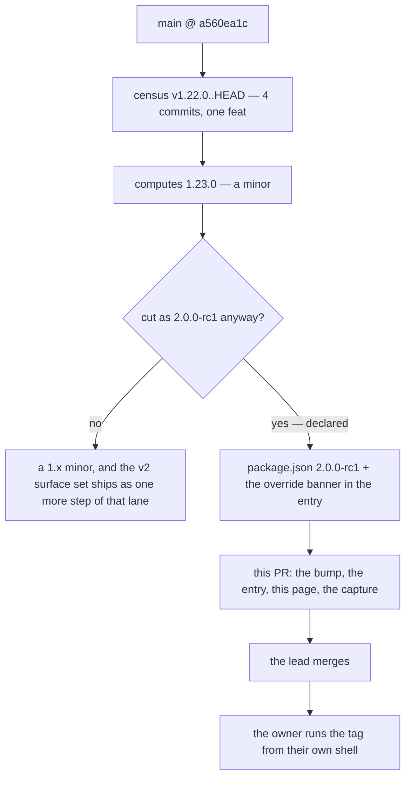
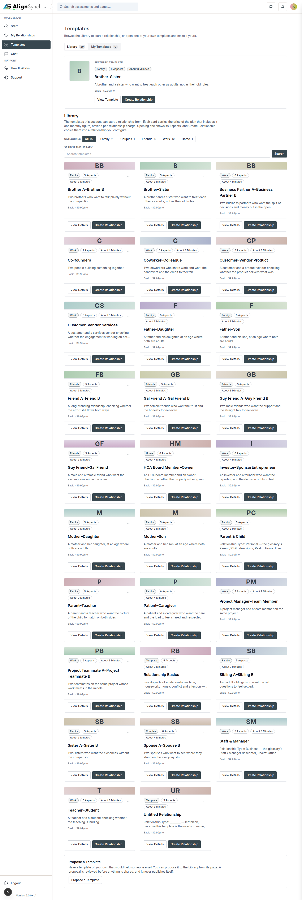
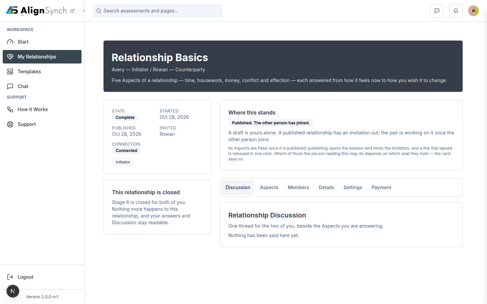

# v2.0.0-rc1 — the nine v2 surfaces, as one candidate

<!-- docs-nav:begin -->

[Docs hub](../README.md) › **Release notes** › v2.0.0-rc1 · prev [v1.9.0](v1-9-0.md)

<!-- docs-nav:end -->

v1.22.0 made the relationship a surface with six sections instead of a page with headings, and it
named ten v2.0 pull requests as open and excluded. This candidate is the rest of that lane,
compiled: the v2 surfaces arrived as **one integration branch** (`#1170`) that merges seven feature
branches with `--no-ff` on top of the two v2 landings already on `main`, so the census of
`v1.22.0..HEAD` counts a single `feat:` commit and this page has to name what that commit carries
rather than counting commits.

It is a release candidate, and that word is doing work. The number is **declared**, not computed;
the surfaces land as a set that the owner QA's on local dev before the stable cut; and the evidence
is a capture of the routes it actually ships, not an assertion that the gate went green.

## The number is declared, and the entry says so

`v1.22.0..HEAD` is four commits: one `feat:` (the integration branch) and three `chore:`. The census
therefore computes **1.23.0**. This tree bumps to **2.0.0-rc1**, because 2.0 is the boundary for the
v2 surface set and a minor would number the same tree as one more step of the 1.x lane.

The declared number is written into the `CHANGELOG.md` entry as a banner — what the census computed,
what was cut instead, and the reason in the words that were given — so the disagreement is an
artefact in a published document rather than a number in `package.json` that nobody can explain.
`pnpm release:cut --check` reads that banner and accepts the candidate.

## What the candidate carries

Nine surfaces, by the entry's own census. Seven arrive in this candidate:

- **Templates v2** (`#1130`, `#1151`) — `/dashboard/templates` is one Templates page with two tabs,
  **Library | My Templates**, replacing the retired `/templates/relationship` catalogue. The card
  menu's **Save a Copy** lands on the copy it wrote (`?tab=mine&new=<id>`), never on a duplicate
  (`#1134`, `#1153`).
- **Chat v2** (`#1131`, `#1154`) — a thread per relationship at `/dashboard/chat`, and the rail's
  fifth row. This is the AlignSynch build's chat: `/chat` is the quiz product's route and answers
  `404` here by capability (`requireQuizProduct`, `#300`), which is why `lib/flow/paths.ts`
  carries the address the rail row points at.
- **The Aspect drawer** (`#1155`) — numbered Aspects with a tolerance in words, behind the
  relationship's own tab.
- **Payment v2** (`#1156`) — a trial panel per relationship, priced from the one plan catalogue
  (`data/membership-plans.ts`), which is also what `/pricing` reads.
- **Conversion** (`#1127`, `#1159`) — the public template catalogue and its detail pages, now the
  only catalogue address.
- **The account menu** (`#1136`, `#1152`) — the top bar's account rows over the same nav data as
  the rail.

Two more landed in `v1.22.0`'s window and are therefore in this tree as well: **app shell v2**
(`#1129`, `#1150`) and **invitation hygiene** (`#1135`, `#1149`).

## The capture

An `rc` needs evidence, and the evidence is a capture: `docs/qa/release-2.0.0-rc1/capture.mjs` walks
eight routes on a dev server started from this tree, asserts before every shutter, and writes
`docs/qa/release-2.0.0-rc1/capture-report.json` beside the stills. Every still carries the
measurements it was allowed to be taken on:

- `GET /api/version` answered `{"version":"2.0.0-rc1","commit":"44df6f0b"}` before a browser opened. A
  commit cannot carry its own sha, so the report names the commit the dev server reported while it
  served this candidate's tree, not the sha of the commit that adds this page — the two trees differ
  only in the harness's own formatting and this paragraph.
- `1440` CSS pixels, `documentElement.scrollWidth === window.innerWidth` on all eight (no horizontal
  overflow), the fonts loaded, and at least 200 characters of real text per screen.
- The relationship's six tabs in the report are the six the page draws — **Discussion · Aspects ·
  Members · Details · Settings · Payment** — and the rail's rows read **Start · My Relationships ·
  Templates · Chat · Support**.
- An `envLeaks` scan of every page's text for `sk-…`, `postgres://`, `NEON_*=` and `BWS_*=` is empty
  on all eight.
- A page that renders the product's `404` fails the capture by name: a still of an error page is
  worse than no still, so the harness refuses it rather than photographing it.

The report is the reviewer's evidence: it names each route, the sha256 of each PNG, the `h1` and `h2`
it found, the tab labels, the rail text and the overflow measurement. The PNGs are committed beside
it, and nothing in either file is a placeholder.

## The honest sentence

This candidate is not a stable release, and the limits below say so in the entry's own words: a
`-suffix` version is published with `--prerelease`, so `v2.0.0-rc1` is never `latest` and `v1.22.0`
remains the newest stable release.

It also does not apply its own migration. `db/migrations/0042_billing_plan_prices.sql` arrives with
the approved three-plan catalogue, and the entry says it was applied to the demo branch for this
candidate's QA. At 20:38 on 2026-11-17, read from the cut's own tree, that was not what the branch
showed: its newest ledger row was `0041_session_state.sql`, and `pnpm db:verify` reported `V13`
three times (`billing_plan` holding `895`/`8592`/`1695` cents against `999`/`9900`/`1999` in
`data/billing-plans.ts`). The candidate's own `/pricing` reads the fixture, which is why the still
shows the approved catalogue — but a checkout against that database would have billed the previous
prices. That was a deliverable of `pnpm db:migrate` against the branch, not of this tag.

The deliverable has since landed, after `#1182` merged. The demo branch's ledger now reads
`0042_billing_plan_prices.sql` first, and `pnpm db:verify` exits `0` against it —
`6 billing plan row(s) matching data/billing-plans.ts`, `no drift`. The record is
`data/health/platform-health.json` rather than this paragraph: `#1185` ran `pnpm db:verify` at
2026-11-17T21:34:33Z and recorded `exitCode: 0`, `result: pass` on the demo branch. The paragraph
above is left dated instead of rewritten, because a release page that edits its own evidence is
worth less than one that says when the measurement was taken.

**Chat does not persist.** `/dashboard/chat` is a real surface of this candidate and the capture
shot it — Chat v2, `#1131`/`#1154` — and its composer appends what the reader sends to the session
and writes nothing durable (`app/(mainlayout)/dashboard/chat/page.tsx:36-41`). The thread model is
`#921`'s, that issue has not been approved for a schema, so `data/chat-threads.ts` holds the demo
bodies and the write is stated as absent in that route's docstring rather than faked — but **not on
the screen**: nothing in the composer tells the reader the message will not be kept, which is the
reason this limit belongs in the next cut's `--limits` file rather than only here. A message sent on
this build is gone on reload. It is not among the entry's limits, and it cannot be added to them by
editing this page — the block below is `changelog-view`'s verbatim copy of `CHANGELOG.md` and
`pnpm changelog:check` fails anything else there. It belongs in that file, which is where a limit is
written before it is generated.

## The entry

<!-- changelog-view:begin entry -->
<!-- generated from CHANGELOG.md by scripts/changelog-view.mjs — edit the entry, not this block -->

- **Released** 2026-11-17
- **Tag** [`v2.0.0-rc1`](https://github.com/riolabs-ai/alignsynch/releases/tag/v2.0.0-rc1)
- **Pull requests named** 4
- **The entry** [`CHANGELOG.md`](../../CHANGELOG.md)

> **Declared override.** The commit census computes 1.23.0 (minor, 4 commit(s) since v1.22.0); this release is cut as 2.0.0-rc1 by decision: 2.0 is the release-candidate boundary for the v2 surfaces; the commits are feat/minor by shape and would compute 1.23.0
>
> `pnpm release:cut` printed this banner and wrote it here so the number is a declared artefact in a published document, never a silent one.

### Added

- `feat(v2)` — the nine surfaces of 1.22 as one integration branch ([#1170](https://github.com/riolabs-ai/alignsynch/pull/1170))

### Maintenance

- `chore(repo)` — name the writer of every dirty path — release preflight, gate report, and .agents/ ignored ([#1180](https://github.com/riolabs-ai/alignsynch/pull/1180))
- `chore(repo)` — commit the gitnexus block and CLAUDE.md, so the shared checkout stops being dirty ([#1176](https://github.com/riolabs-ai/alignsynch/pull/1176))
- `chore(health)` — re-record platform health at v1.22.0 ([#1175](https://github.com/riolabs-ai/alignsynch/pull/1175))
<!-- changelog-view:end -->

<!-- changelog-view:begin limits -->
<!-- generated from CHANGELOG.md by scripts/changelog-view.mjs — edit the entry, not this block -->

- **This candidate's number is declared, not computed.** The census of `v1.22.0..HEAD` reads one `feat`
  commit and would compute `1.23.0`. `v2.0.0-rc1` is the release-candidate boundary for the v2 surface
  set by decision, and `pnpm release:cut` wrote that decision into the `CHANGELOG.md` entry as a banner
  rather than leaving a silent number in `package.json`.

- **The nine v2 surfaces arrive as one commit.** `#1170` merges seven branches with `--no-ff` on top of
  the two v2 landings already on `main`, so the census counts a single commit and the entry names a
  single pull request: Templates v2 (`#1130`, `#1151`), the account menu (`#1136`, `#1152`), card menus
  and Save a Copy (`#1134`, `#1153`), Chat v2 (`#1131`, `#1154`), the Aspect drawer (`#1155`), Payment v2
  (`#1156`) and conversion (`#1127`, `#1159`) — on top of app shell v2 (`#1129`, `#1150`) and invitation
  hygiene (`#1135`, `#1149`), which shipped in `v1.22.0`'s window.

- **The rest of the queue is excluded by name, and lands in `v2.0.0-rc2` (milestone 26, the pool).**
  Open and **not** in this candidate: `#1173` the locked 1–5 answer screen (`#1128`), `#1167` admin email
  templates (`#1138`), `#1168` the lapse notice splitting by seat (`#1139`), `#1163` the immediate-deletion
  copy fix, `#1112` templates retirement phase 2 (`#1109`), and `#1165` the pre-approved cut artifact —
  which is why this cut ran through `scripts/release.sh --tag-only` instead of `pnpm release:cut
  --execute`. `#1161` (the three-plan catalogue) is still open, and the catalogue it carries is already in
  this tree (`data/membership-plans.ts`, migration `0042`) via the integration branch; it is closed by
  reference, not re-merged.

- **The noun sweep has not happened.** `#1103` retires `instance` in favour of `session` — `#1106` in the
  code and `#1107` in the bundle format — and both stay deferred under `t_6258b560`, so both nouns are
  still in this tree's comments, its docs and its schema, and the platform bundle this build writes is
  still version 2 (`content/bundle.ts::PLATFORM_BUNDLE_VERSION`).

- **No dependency majors.** `#1027` (swiper `14.4.0`) and `#1025` (jsdom `31.0.0`) are open and deferred
  under `t_6258b560` to `v2.0`. Nothing in the dependency graph moves between `v1.22.0` and this tag.

- **One migration rides this tag, and this tag does not apply it.** `db/migrations/0042_billing_plan_prices.sql`
  arrives with the approved three-plan catalogue: `Single` `$9.99`/mo, `Family` `$19.99`/mo (≤4), `Single
  Annual` `$99`/yr, mapped onto the four existing lookup keys, with `principal/year` deliberately left at
  its seeded amount because no approved plan claims it. It was applied to the demo branch for this
  candidate's QA. Production's ledger is run by hand — `pnpm db:migrate` — and a create against a
  production database whose ledger has not been run is a separate, deliberate step, not something this
  tag performs.

- **The precondition QA covered a capture, not the atlas sweep.** `docs/qa-atlas/DEFERRED.md` records
  `v1.22.0` as a declared deferral and the sweep for this candidate is deferred the same way, so the
  evidence for `v2.0.0-rc1` is the capture under `docs/qa/release-2.0.0-rc1/` — the routes it exercised,
  the assertions each still made, and the stills taken from this tree. Every route outside that capture
  is gated by `scripts/verify.sh` (4154 tests, `data:check`, `parity`, `next build`) and not by a human
  eye.

- **This is a pre-release, and GitHub is told so.** A `-suffix` version is published with
  `--prerelease`, so `v2.0.0-rc1` is never `latest`: `v1.22.0` remains the newest stable release and the
  production deployment's `/api/version` is the only thing that says which build is live.

- **Production's two `ADMIN_EMAILS` seats still answer `401`** (`#1084`). `walt1@alignsynch.com` and
  `alignsynch@riolabs.ai` fail `INVALID_EMAIL_OR_PASSWORD` against `https://alignsynch.com`. Carried from
  `v1.22.0` unchanged: this candidate provisions neither seat, and the issue is open in the backlog.
<!-- changelog-view:end -->

<!-- docs-nav:begin -->

[Docs hub](../README.md) › **Release notes** › v2.0.0-rc1 · prev [v1.9.0](v1-9-0.md)

<!-- docs-nav:end -->
