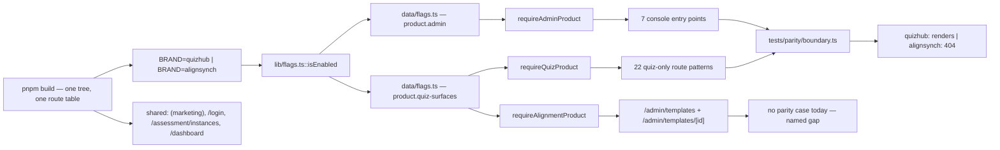

# One tree, two brands

<!-- docs-nav:begin -->

[Docs hub](../README.md) › **Diagrams** › Brand boundary · next [Schemas → fixtures → tables](data.md)

<!-- docs-nav:end -->

`BRAND` picks a template at build time, and the difference is mostly copy. The quiz product is not a
skin of the alignment product — it is a product that does not exist on the other build — so its
surfaces are **gated, not deleted**: the route answers the same 404 an unknown URL gets. Two
capabilities carry the whole boundary, both resolved through one flag store
(`lib/flags.ts`, `data/flags.ts`).

The three helpers are one file, `lib/brand-boundary.ts`. A page calls the helper and nothing else; it
never reads `BRAND` directly, because a second place that knows which product a build is would be a
second answer that can disagree.

## What each gate closes

| Gate                        | Flag                                        | Closes                                                                                                                                                                                                                                                                                                                                                                                                                                                                                    |
| --------------------------- | ------------------------------------------- | ----------------------------------------------------------------------------------------------------------------------------------------------------------------------------------------------------------------------------------------------------------------------------------------------------------------------------------------------------------------------------------------------------------------------------------------------------------------------------------------- |
| `requireQuizProduct()`      | `product.quiz-surfaces`                     | 22 patterns: catalogue and discovery (`/explore`, `/explore/featured`, `/categories`, `/categories/[slug]`, `/daily-challenge`), a quiz in play (`/quiz/[id]`, `/play`, `/discussion`, `/quiz-discussions`), authoring (`/create/editor`, `/create/generator`, `/my-quizzes`, `/my-quizzes/[id]`, `/my-quizzes/[id]/statistics`), community (`/battle`, `/tournaments`, `/tournaments/[id]`, `/creator-tips`, `/creator-tips/[slug]`, `/chat`), account (`/dashboard/user`, `/affiliate`) |
| `requireAdminProduct()`     | `product.admin`                             | the operator console — `/admin/console` (its layout closes the subtree), `/admin/audit`, `/admin/billing`, `/admin/broadcast`, `/admin/gaps`, `/admin/health`, `/admin/inbox`, `/admin/instances` and the instance report                                                                                                                                                                                                                                                                 |
| `requireAlignmentProduct()` | `product.quiz-surfaces`, read the other way | `/admin/templates` and `/admin/templates/[id]` — assessment authoring, which a quiz-only build does not sell                                                                                                                                                                                                                                                                                                                                                                              |

`/dashboard` deliberately does **not** call any of them; its docstring says so, and both builds serve
it. Only one of them links to it.

## Why a flag and not a brand check

`product.quiz-surfaces` is `default: false` with `templates: ["quizhub"]`, and `product.admin` is
`default: false` with `templates: ["quizhub", "alignsynch"]`. The resolver is the same one
`/leaderboard` reads, so the operator's `FLAG_PRODUCT_QUIZ_SURFACES=1` escape hatch comes for free: a
reviewer can look at the quiz product on an alignment build without editing code. Nothing is deleted —
the surfaces are the catalogue asset and the quiz build still ships them.

## The order that matters

`notFound()` is the **first** statement of each gated page, ahead of `await params` and ahead of every
fixture or row read. On the console routes it is also ahead of `requireAdmin()`: a template that does
not sell the console answers 404, rather than sending a visitor to a sign-in page for a surface that
does not exist there.

## What the gate proves, and what it does not

`tests/parity/boundary.ts` carries the two lists, statically imported so `tsc` sees them — renaming or
deleting a gated page breaks the typecheck before any status is compared. `tests/parity/parity.check.ts`
walks them per brand and asserts a status, not a hash:

| List                 | Routes | Asserted                                                       |
| -------------------- | ------ | -------------------------------------------------------------- |
| `quizOnlyRoutes`     | 22     | renders on `quizhub`; 404 on `alignsynch`                      |
| `adminProductRoutes` | 7      | renders on both shipped templates; 404 on the fixture template |

`tests/brand-boundary.test.ts` proves the resolver's three answers (the flag decides, a closed gate is
a 404, the operator can look) without rendering a page.

**The gap this diagram makes visible:** `/admin/templates` and `/admin/templates/[id]` call
`requireAlignmentProduct()`, and no parity list carries them — the refusals are checked by nothing
that renders the route. Until a third list exists, that pair is a convention with a helper behind it,
not a measured gate.

## Where to read the rest

- [`lib/brand-boundary.ts`](../../lib/brand-boundary.ts) — the three helpers and why each exists.
- [`tests/parity/boundary.ts`](../../tests/parity/boundary.ts) — the route lists.
- [`data/flags.ts`](../../data/flags.ts) — every flag, its default and the templates that claim it.
- [`docs/specs/ui-divergence.md`](../specs/ui-divergence.md) — what the two brands say differently.

<!-- docs-nav:begin -->

[Docs hub](../README.md) › **Diagrams** › Brand boundary · next [Schemas → fixtures → tables](data.md)

<!-- docs-nav:end -->
