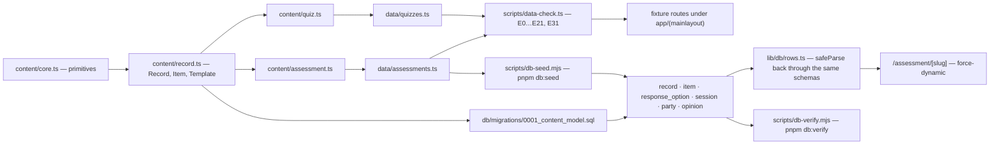

# Schemas → fixtures → tables

One content model, three layers. `content/` says what a record **is**, `data/` holds the authored
records, and the six Postgres tables are the same model in rows. The arrow that matters is the
validator: a fixture drifts from its schema and `pnpm data:check` fails the build, which is why the
gate never needs a database connection.

## The six tables

| Table             | Content type         | What it carries                                                                                   |
| ----------------- | -------------------- | ------------------------------------------------------------------------------------------------- |
| `record`          | `Record`             | one row per template and per copy — the post, its title, status and owner                         |
| `item`            | `Item` / `Aspect`    | the Aspects of a copy, copied from the template it names                                          |
| `response_option` | the scale's options  | a quiz's answer options; an assessment Aspect is a 1..5 score and carries none                    |
| `session`         | `AssessmentInstance` | one assessment cycle: the copy, the mode, the Setting (`0013` renamed it)                         |
| `party`           | two seats            | `initiator` / `counterparty`, with `submitted_at`, `accepted_at`, `unlock_seen_at`                |
| `opinion`         | `Opinions`           | one row per (party, item): `feel`, `wish`, and the optional `think`/`guess` pair — and **no gap** |

Every table exists because a schema defines it, and `lib/db/rows.ts` parses each row back through
the same zod schema, so the model stays the single source of truth and a hand-edited row is a
refusal, not a quiet difference.

## The one database route

`/assessment/[slug]` (`app/(mainlayout)/assessment/[slug]/page.tsx`) is the route #145 added: the
only page that reads these six tables and renders an answered assessment. It is `force-dynamic` with
no `generateStaticParams()`, so `pnpm build` passes with `DATABASE_URL` unset and the gate never opens
a connection.

Two caveats, so the mark is read exactly:

- it is **not** the only route that touches Postgres. `/assessment/instances`, `/dashboard` and the
  operator console read `relationship`, `party`, `step` and `relationship_payment` through other
  modules in `lib/db/**`; the six content tables are what make this route the odd one out.
- `pnpm db:migrate`, `db:seed`, `db:verify` and `demo:verify` are **not gate steps**. The gate proves
  the fixture and the schema agree; the `db:*` scripts prove the rows still say what the fixture says.

## Rules a change inherits

| Rule                                    | Why                                                                                                              |
| --------------------------------------- | ---------------------------------------------------------------------------------------------------------------- |
| The Gap is a function (`gapOf`)         | a `gap` column, table, view or generated column is a defect — `db:migrate` and `db:verify` both fail on the name |
| No ORM                                  | `pg` is the only driver; `lib/db/rows.ts` maps rows to the model                                                 |
| No build-time database                  | the gate and CI carry no connection string                                                                       |
| A new field is three edits              | the schema, the fixture, then `pnpm data:check` — an unknown key is a hard error                                 |
| `content/` imports no React and no Next | `data:check` compiles it under plain node into `.datacheck/`                                                     |

## Where to read the rest

- [`docs/DATA-MODEL.md`](../DATA-MODEL.md) — entities, invariants E0–E37, strictness.
- [`lib/db/rows.ts`](../../lib/db/rows.ts) — the row→model mapping, and its tests.
- [`docs/BUNDLES.md`](../BUNDLES.md) — a template or the demo dataset as one JSON document.
- [`db/migrations/`](../../db/migrations) — plain SQL, one file per change.
