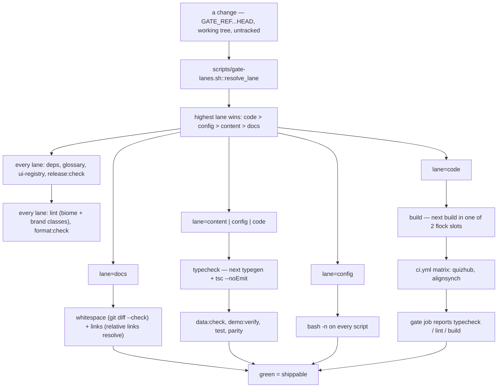

# A change's path through the gate

<!-- docs-nav:begin -->

[Docs hub](../README.md) › **Diagrams** › Gate · prev [Schemas → fixtures → tables](data.md) · next [Lifecycle](lifecycle.md)

<!-- docs-nav:end -->

One script, two callers: `bash scripts/verify.sh` runs locally (and from the pre-push hook), and
`.github/workflows/ci.yml` runs the same file and nothing else. A check that lives only in one of them
is a red the other cannot reproduce — which is why the YAML has no steps of its own beyond the matrix
and the aggregator.

The gate costs what the change costs. `scripts/gate-lanes.sh` classifies every path in the diff and
keeps the **highest** lane present, and a lane may only drop steps that cannot see a file that
changed.

## What each lane pays for

| Step                                      | docs | content | config | code |
| ----------------------------------------- | ---- | ------- | ------ | ---- |
| `deps` (`pnpm install --frozen-lockfile`) | ✓    | ✓       | ✓      | ✓    |
| `glossary` (`pnpm glossary:check`)        | ✓    | ✓       | ✓      | ✓    |
| `ui-registry` (`pnpm ui:registry:check`)  | ✓    | ✓       | ✓      | ✓    |
| `release:check`                           | ✓    | ✓       | ✓      | ✓    |
| `bash -n` on every script                 |      |         | ✓      |      |
| `whitespace` (`git diff --check`)         | ✓    |         |        |      |
| `links` (relative links resolve)          | ✓    |         |        |      |
| `typecheck`                               |      | ✓       | ✓      | ✓    |
| `lint` (biome + brand classes)            | ✓    | ✓       | ✓      | ✓    |
| `format:check`                            | ✓    | ✓       | ✓      | ✓    |
| `data:check`                              |      | ✓       | ✓      | ✓    |
| `demo:verify --gate`                      |      | ✓       | ✓      | ✓    |
| `test` (vitest)                           |      | ✓       | ✓      | ✓    |
| `parity` (both brands)                    |      | ✓       | ✓      | ✓    |
| `build` (`next build`)                    |      |         |        | ✓    |

Four steps run before the lane branch — `glossary`, `ui-registry` and `release:check` are generated
documents whose inputs classify into three different lanes, so a lane that skipped them would hand a
green local gate to a red CI run. Biome reads the whole tree in every lane because it formats Markdown
too: a hand-wrapped doc fails `lint` and `format:check` before CI ever sees it.

`demo:verify --gate` is the one step that can print a skip: it needs a `DATABASE_URL`, an auth base URL
and something listening at `BASE_URL`, which CI does not have. The skip prints its reason as a `○`
line, so a green gate never claims to have verified something it did not run.

## How the lane is picked

- unknown paths resolve to **code** — a new top-level directory cannot buy a shortcut;
- `AGENTS.md` is prose but it is **config**: it changes what every future card runs;
- an empty diff, or no `GATE_REF` to diff against, resolves to **code**: "I could not tell what
  changed" is never evidence that a change is cheap;
- `GATE_LANE=full bash scripts/verify.sh` forces the code lane — after a dependency bump, a `tsconfig`
  change, or any diff you do not trust the classifier with. Any other `GATE_LANE` value is an error,
  not a silent `auto`.

Read the first line of the output before believing a run: it prints `lane=<name>` and the paths that
decided it. A run that built nothing and a run that built everything are both green.

## One CI job, four depths

CI runs the gate as one job per brand — `typecheck / lint / build (quizhub)` and
`typecheck / lint / build (alignsynch)` — because GitHub suffixes a matrix leg's check-run name.
Neither leg reports the required context, so a third job named exactly **`typecheck / lint / build`**
collects them (`needs: [verify]`, `if: always()`) and runs no checks of its own. Renaming it or giving
it a step breaks branch protection or duplicates the gate; neither is a rename.

## The build semaphore

`next build` is most of the code lane's wall time, and eight workers compiling at once once took this
box's load average to 39.5. It now runs inside one of `QUIZHUB_BUILD_SLOTS` (default **2**) `flock`
slots under `~/.cache/quizhub/`, and the step prints whether it waited. The lock is a **CPU budget,
not a `.next/` mutex**: two gates in one worktree still corrupt `.next/`, so a single shell must not
run two gates at once.

## Where to read the rest

- [`scripts/verify.sh`](../../scripts/verify.sh) — the steps, in order, with the reasons above them.
- [`scripts/gate-lanes.sh`](../../scripts/gate-lanes.sh) — the classifier, pure over a path.
- [`docs/operations/repo-layers.md`](../operations/repo-layers.md) — the layer table and the measurements behind it.
- [`docs/operations/gate.md`](../operations/gate.md) — the current baseline, yield and the required-check ruleset.

<!-- docs-nav:begin -->

[Docs hub](../README.md) › **Diagrams** › Gate · prev [Schemas → fixtures → tables](data.md) · next [Lifecycle](lifecycle.md)

<!-- docs-nav:end -->
