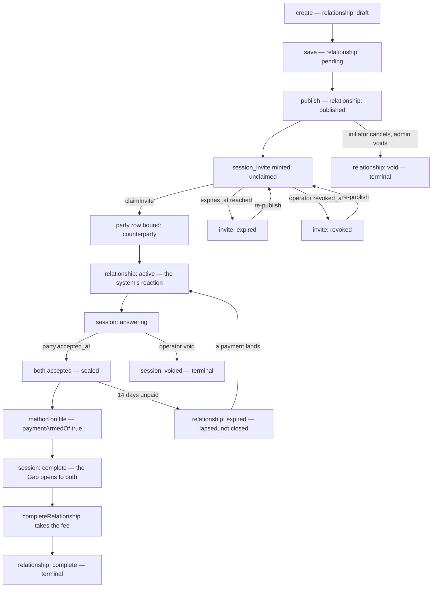

# The assessment lifecycle

<!-- docs-nav:begin -->

[Docs hub](../README.md) › **Diagrams** › Lifecycle · prev [Gate](gate.md) · next [Payment](payment.md)

<!-- docs-nav:end -->

One relationship, two sheets, one Gap — drawn from the three state machines that decide it. Every
node below is a real word or file: the relationship's status column (`lib/relationship/status.ts`,
`0030_relationship_lifecycle.sql`), the session's derived status (`lib/flow/state.ts`), and the
invitation's derived state (`lib/flow/invite-state.ts`).

## The three machines

| What         | The words                                                          | Derived from                                                      | Authority                    |
| ------------ | ------------------------------------------------------------------ | ----------------------------------------------------------------- | ---------------------------- |
| Relationship | `draft` `pending` `published` `active` `complete` `void` `expired` | a **stored** column, closed by a CHECK — the one exception        | `lib/relationship/status.ts` |
| Session      | `awaiting_counterparty` `answering` `complete` `voided`            | `party` and `opinion` counts, `accepted_at`, `voided_at`, payment | `lib/flow/state.ts`          |
| Invitation   | `unclaimed` `claimed` `expired` `revoked`                          | `claimed_at`, `expires_at`, `revoked_at` against one instant      | `lib/flow/invite-state.ts`   |

Only the relationship's status is stored. The other two are functions of rows the screen has already
read, for the reason `lib/flow/state.ts` states: a stored copy could disagree with the rows and
nothing could compare the two.

## Sealed is not complete

`instanceStatusOf()` needs three things, not two: both parties answered every Aspect, **both
accepted**, and `paymentArmedOf()` is not `false` (`lib/flow/state.ts`,
`lib/flow/payment.ts`). So the second acceptance seals the sheets, and the Gap opens when a method
is on file — the delay on the money is seven days, the delay on the _report_ is zero
([payment](payment.md)).

`undefined` from `paymentArmedOf()` is "not measured", not "unpaid": a relationship created before
\#619 has no `relationship_payment` row and must not be flipped back into a payment state.

## The branches that exist

| Branch                   | When                                                                            | Terminal?                                   |
| ------------------------ | ------------------------------------------------------------------------------- | ------------------------------------------- |
| `expired` — invitation   | `expires_at <= now` at the instant the row is read                              | No — re-publish mints a new link            |
| `revoked` — invitation   | an operator wrote `revoked_at` (`#503`)                                         | No — re-publish is offered                  |
| `voided` — session       | an operator ended the session (`#503`)                                          | Yes — `maySubmit()` is false for both seats |
| `void` — relationship    | the initiator cancelled from `draft`/`pending`/`published`, or an admin         | Yes — `CLOSED_RELATIONSHIP_STATUSES`        |
| `expired` — relationship | the membership lapsed: `trial-ended`, `payment-failed`, `subscription-canceled` | No — a payment revives it (`#533` phase 3)  |

**There is no `declined`.** The card that asked for these diagrams named one, and the tree does not
have it: `transitionsBy("counterparty")` is empty (`lib/relationship/status.ts`), `session_invite`
carries no decline column, and the claim path's refusals are `unknown`, `claimed`, `expired`,
`revoked` (`lib/flow/claim.ts`). An invited person who does not want the seat lets the link expire,
or asks an operator to revoke it. Drawing a `declined` node would be a state the product cannot
reach — a dead surface, which is the defect these diagrams exist to prevent.

## Where to read the rest

- [`docs/specs/two-party-flow.md`](../specs/two-party-flow.md) — the same lifecycle in prose, screen by screen.
- [`lib/flow/store.ts`](../../lib/flow/store.ts) — the reads and writes behind each edge.
- [`docs/specs/pay-to-complete/SPEC.md`](../specs/pay-to-complete/SPEC.md) — what completion costs.

<!-- docs-nav:begin -->

[Docs hub](../README.md) › **Diagrams** › Lifecycle · prev [Gate](gate.md) · next [Payment](payment.md)

<!-- docs-nav:end -->
