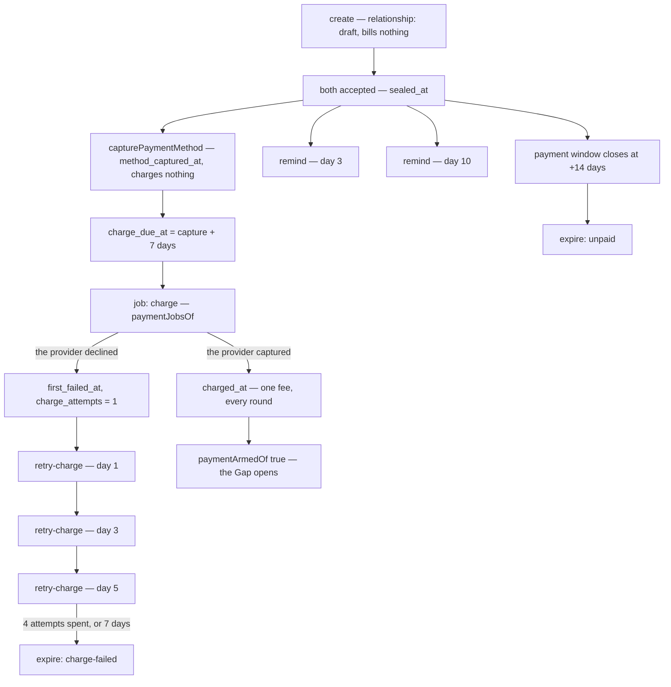

# The money ladder

<!-- docs-nav:begin -->

[Docs hub](../README.md) › **Diagrams** › Payment · prev [Lifecycle](lifecycle.md) · next [Brand boundary](brand-boundary.md)

<!-- docs-nav:end -->

A relationship is free to create. The fee is owed at **completion**, taken against a method that is
captured up front, delayed seven days, retried three times if declined, nagged twice and expired on
day fourteen. Every window below is arithmetic over a stored instant in
`relationship_payment` — no column holds a deadline (`lib/flow/payment.ts`).

## Stored facts and derived windows

| Fact                            | Where it lives                            |
| ------------------------------- | ----------------------------------------- |
| a method came on file           | `relationship_payment.method_captured_at` |
| the fee was taken               | `relationship_payment.charged_at`         |
| attempts, and the first failure | `charge_attempts`, `first_failed_at`      |
| the terminal outcome            | `expired_at`, `expire_reason`             |
| the 7-day delay on the charge   | `method_captured_at + 7 days`             |
| the 14-day payment window       | the **second** `party.accepted_at` + 14 d |
| the day-3 and day-10 nags       | that same sealed instant + 3 and +10 days |

The constants are `METHOD_TRIAL_DAYS = 7`, `PAYMENT_REMINDER_DAYS = [3, 10]`,
`CHARGE_RETRY_OFFSET_DAYS = [1, 3, 5]`, `CHARGE_ATTEMPT_LIMIT = 4`,
`CHARGE_RETRY_WINDOW_DAYS = 7` and `PAYMENT_WINDOW_DAYS = 14` in `lib/flow/payment.ts`. The two
expiry reasons are `unpaid` and `charge-failed`, mirroring the `0036` CHECK.

**Two trials, two numbers, deliberately not the same clock.** The membership trial is 14 days from
publish (`lib/relationship/trial.ts`, `TRIAL_DAYS`) and is the subscription's `trialing` period; the
seven-day figure here is how long the **money** waits after a card is captured. Confusing them is how
a person is charged on a relationship nobody sealed.

## One billing trigger, not two (ADR-1, drawn honestly)

The card asked for "the two billing triggers still alive (ADR-1)": publish-at-creation starting a
trial or a checkout, and completion creating an obligation. **Only the second one exists.** ADR-1
removed the first _in the same change_ that added the second, and the tree still says so:

- `lib/member/publish-basis.ts` — "The publish basis question used to live here and no longer does
  (#619) … Publishing now bills nothing (the invite is never blocked on a card), the fee belongs to
  completion, and the function was removed rather than left beside the new trigger: two live billing
  triggers on one relationship would charge a payer twice for one product."
- `lib/member/payment.ts::completeRelationship()` is the one writer that takes the fee, guarded by
  `completionRefusalOf()` and a `charged_at IS NULL` re-read under the row lock.
- `startCheckout` has exactly one caller — `app/api/billing/checkout/route.ts`, a membership-plan
  purchase — and nothing under `app/(mainlayout)/dashboard/relationships/` reaches it. Publishing a
  relationship sends the invitation and no invoice.

Drawn with both triggers side by side, this diagram would show a charge path that cannot fire. The
ladder above is the whole money story; the removed left-hand branch is recorded here so the next
reader does not re-invent it.

## The job, in the order it runs

`paymentJobsOf()` (`lib/flow/payment-jobs.ts`) answers per obligation, in this order:

1. **`expire`** — returned **alone**, because nothing else is owed on an ended obligation.
2. **`charge`** — returned alone, because a taken fee ends the obligation's work and a nag computed
   against "still unpaid" would be stale the instant it landed.
3. **`remind`** then **`retry-charge`** — the day-10 nag does not wait for a missed day-3 one, and a
   job that was down for a week finds every period already due and does them now.

Every window is arithmetic over stored instants, so nothing reads a clock here; `now` is the
caller's. Every write is idempotent (`charged_at IS NULL`, `expired_at IS NULL`), which is what makes
two runs in one minute one charge.

## When a completion is refused

`completionRefusalOf()` returns one word a screen maps to its own sentence: `not-the-payer`,
`not-ready` (both sheets are not sealed), `method-required`, `already-charged`, `expired`,
`charge-declined`. The payer is always the relationship's original initiator — a counterparty who
clicks "pay" is refused by name, not hidden behind a disabled button.

## Where to read the rest

- [`lib/flow/payment.ts`](../../lib/flow/payment.ts) — the phases, the windows, the refusals.
- [`lib/flow/payment-jobs.ts`](../../lib/flow/payment-jobs.ts) — what the cron owes at one instant.
- [`docs/billing.md`](../billing.md) — the billing port and its adapters.
- [`docs/pay-to-complete/ADR.md`](../pay-to-complete/ADR.md) — the decisions this ladder implements.

<!-- docs-nav:begin -->

[Docs hub](../README.md) › **Diagrams** › Payment · prev [Lifecycle](lifecycle.md) · next [Brand boundary](brand-boundary.md)

<!-- docs-nav:end -->
