# QA atlas — v1.17.0

<!-- docs-nav:begin -->

[Docs hub](../../README.md) › **Records & QA** › QA atlas — v1.17.0 · prev [QA atlas](../README.md) · next [QA atlas — the 1.17.1 tree (never released)](../v1.17.1/index.md)

<!-- docs-nav:end -->

Every route `data/pages/budget.ts` registers, captured in a real browser at 390 / 768 / 1440 CSS pixels and asserted four ways: status against the brand boundary, a clean console (no React `#418`, and no error on any surface the product ships), a heading string from the route's own copy fixture present in the DOM, and a `main` subtree with real content. A route the boundary closes renders the app's own not-found instead, and its console output is recorded as a finding rather than counted as a failure of that route.

## Coverage

```
75 registry surfaces · 72 routes · 67 captured and passing · 2 failing · 3 skipped
3 non-route surfaces (not-found, shell, tour) — covered by the pages that mount them, listed below.
```

Brand `alignsynch` · generated 2026-11-13T19:06:04.713Z · node `v24.22.0` · `/usr/bin/google-chrome` · the machine-readable form is [`manifest.json`](manifest.json).

## Changed this release

The first atlas: there is no earlier version to diff against, so every route below is new. The diff path exists — the next release's atlas compares its `manifest.json` against this one, route by route, and lists what changed.

## Findings

A finding is a fact the derivation could not settle, reported rather than smoothed over:

| route                         | finding                                                                                                                                                                                                                                        |
| ----------------------------- | ---------------------------------------------------------------------------------------------------------------------------------------------------------------------------------------------------------------------------------------------- |
| `/quiz-discussions`           | tests/parity/boundary.ts lists this route; data/pages/budget.ts carries no row for it                                                                                                                                                          |
| `/quiz/[id]`                  | tests/parity/boundary.ts lists this route; data/pages/budget.ts carries no row for it                                                                                                                                                          |
| `/quiz/[id]/play`             | tests/parity/boundary.ts lists this route; data/pages/budget.ts carries no row for it                                                                                                                                                          |
| `/quiz/[id]/discussion`       | tests/parity/boundary.ts lists this route; data/pages/budget.ts carries no row for it                                                                                                                                                          |
| `/create/editor`              | tests/parity/boundary.ts lists this route; data/pages/budget.ts carries no row for it                                                                                                                                                          |
| `/create/generator`           | tests/parity/boundary.ts lists this route; data/pages/budget.ts carries no row for it                                                                                                                                                          |
| `/my-quizzes`                 | tests/parity/boundary.ts lists this route; data/pages/budget.ts carries no row for it                                                                                                                                                          |
| `/my-quizzes/[id]`            | tests/parity/boundary.ts lists this route; data/pages/budget.ts carries no row for it                                                                                                                                                          |
| `/my-quizzes/[id]/statistics` | tests/parity/boundary.ts lists this route; data/pages/budget.ts carries no row for it                                                                                                                                                          |
| `/chat`                       | tests/parity/boundary.ts lists this route; data/pages/budget.ts carries no row for it                                                                                                                                                          |
| `/admin/console`              | tests/parity/boundary.ts lists this route; data/pages/budget.ts carries no row for it                                                                                                                                                          |
| `12 boundary-closed routes`   | the app's not-found logs 2 distinct console line(s) in dev mode (36 capture(s) carry "Failed to load resource: the server responded with a status of 404 (Not Found)"); recorded, not failed — the console assertion measures product surfaces |

## Failures

One row per assertion, with the widths it failed at — a page can render beautifully and still be wrong, which is why each assertion is named rather than the route alone.

| route                                     | widths           | assertion                | measured                                                                                                                                                        |
| ----------------------------------------- | ---------------- | ------------------------ | --------------------------------------------------------------------------------------------------------------------------------------------------------------- |
| `/assessment/instances/[instanceId]/sent` | 390 · 768 · 1440 | status 500, expected 200 | status 500, expected 200                                                                                                                                        |
| `/assessment/instances/[instanceId]/sent` | 390 · 768 · 1440 | console error            | console error: Failed to load resource: the server responded with a status of 500 (Internal Server Error)                                                       |
| `/assessment/instances/[instanceId]/sent` | 390 · 768 · 1440 | headline absent          | headline absent: "Invitation sent"                                                                                                                              |
| `/admin/instances/[id]`                   | 390 · 768 · 1440 | console error            | console error: %s contains an input of type %s with both value and defaultValue props. Input elements must be either controlled or uncontrolled (specify either |

## Skipped

| route                       | reason                                                                                                                                                                          |
| --------------------------- | ------------------------------------------------------------------------------------------------------------------------------------------------------------------------------- |
| `/reset/[token]`            | a reset token is minted per request by the password-reset endpoint and is stored nowhere the atlas can read, so this surface is captured only by a run that holds one           |
| `/dashboard/templates/[id]` | the seeded demo dataset owns no member template (`record.owner_user_id` is null on every row), and this screen opens a template the member authored — so there is no id to open |
| `/invite/[token]`           | the demo branch holds no claimable invite token — `session_invite` stores `token_hash`, and the seeded dataset carries no pending invite                                        |

## Marketing

The public pages — the brand's front door, pricing, legal and the help centre.

| route                        | status    | widths           | thumbnail                                                          | verdict |
| ---------------------------- | --------- | ---------------- | ------------------------------------------------------------------ | ------- |
| `/`                          | 200 / 200 | 390 · 768 · 1440 | 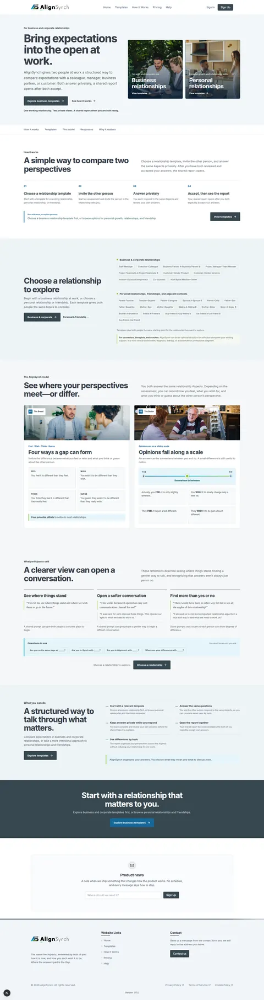                                             | ✓       |
| `/help`                      | 200 / 200 | 390 · 768 · 1440 | 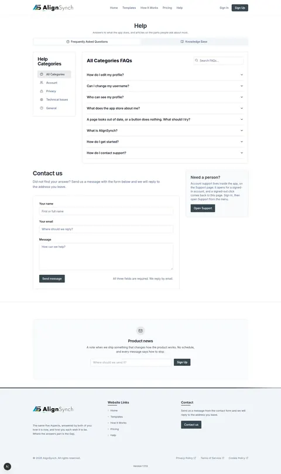                                         | ✓       |
| `/pricing`                   | 200 / 200 | 390 · 768 · 1440 | 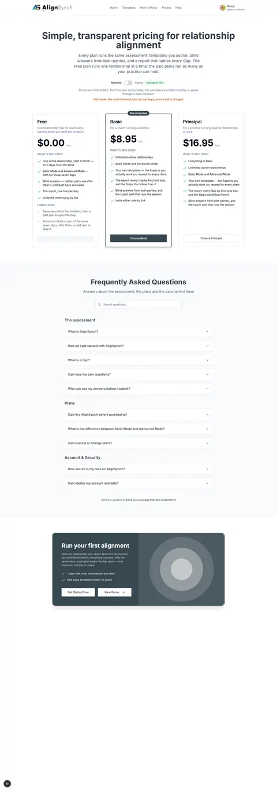                                   | ✓       |
| `/privacy`                   | 200 / 200 | 390 · 768 · 1440 | 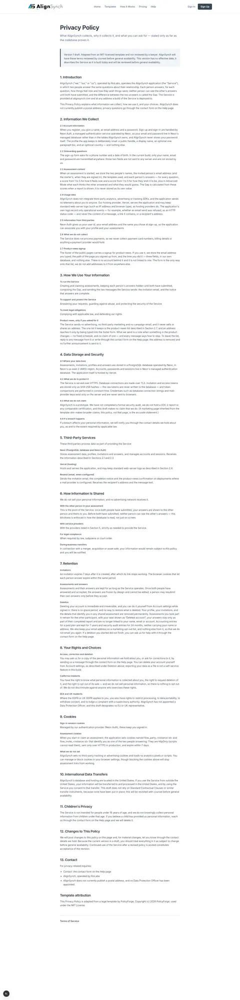                                   | ✓       |
| `/relationship-templates`    | 200 / 200 | 390 · 768 · 1440 | 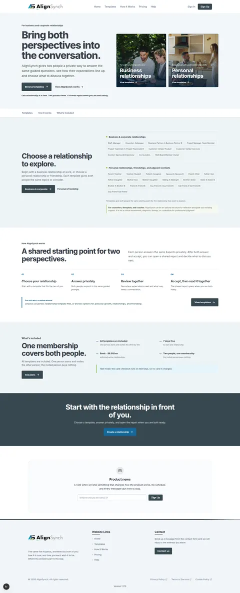     | ✓       |
| `/relationship-types`        | 200 / 200 | 390 · 768 · 1440 | 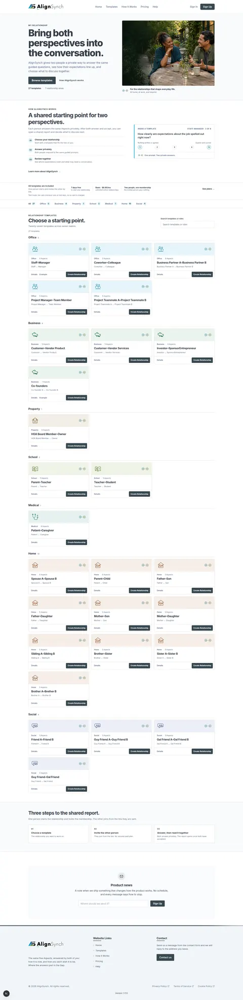             | ✓       |
| `/relationship-types/[slug]` | 200 / 200 | 390 · 768 · 1440 | ![/relationship-types/[slug]](thumbs/relationship-types-slug.webp) | ✓       |
| `/support/articles/[slug]`   | 200 / 200 | 390 · 768 · 1440 | ![/support/articles/[slug]](thumbs/support-articles-slug.webp)     | ✓       |
| `/terms`                     | 200 / 200 | 390 · 768 · 1440 | 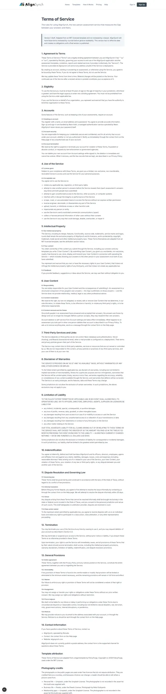                                       | ✓       |
| `/welcome`                   | 200 / 200 | 390 · 768 · 1440 | 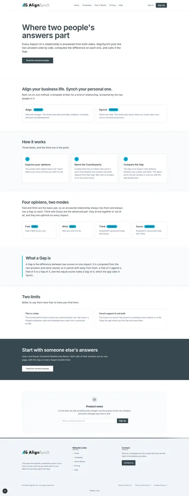                                   | ✓       |

## Auth

The account surfaces: sign in, register, the three password screens.

| route              | status    | widths           | thumbnail                                        | verdict                                                                                                                                                                         |
| ------------------ | --------- | ---------------- | ------------------------------------------------ | ------------------------------------------------------------------------------------------------------------------------------------------------------------------------------- |
| `/forgot-password` | 200 / 200 | 390 · 768 · 1440 | 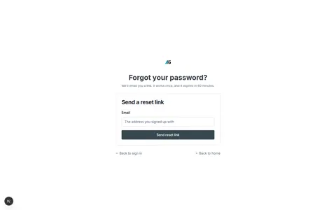 | ✓                                                                                                                                                                               |
| `/login`           | 200 / 200 | 390 · 768 · 1440 | 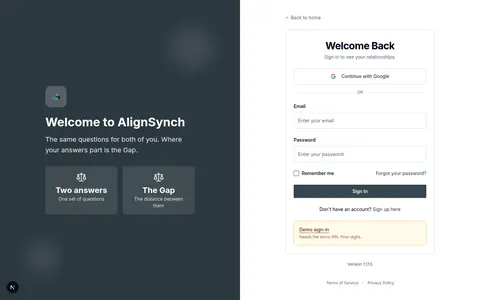                     | ✓                                                                                                                                                                               |
| `/register`        | 200 / 200 | 390 · 768 · 1440 | 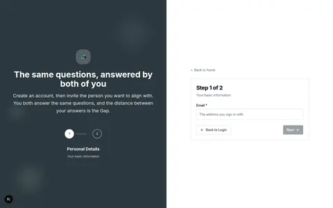               | ✓                                                                                                                                                                               |
| `/reset/[token]`   | — (200)   |                  | —                                                | skipped — a reset token is minted per request by the password-reset endpoint and is stored nowhere the atlas can read, so this surface is captured only by a run that holds one |
| `/reset/complete`  | 200 / 200 | 390 · 768 · 1440 | 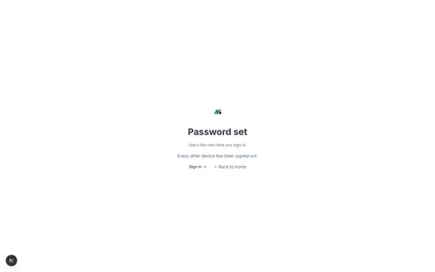   | ✓                                                                                                                                                                               |

## Dashboard

The member's own console: the overview, their records, settings, support.

| route                           | status    | widths           | thumbnail                                                                | verdict                                                                                                                                                                                   |
| ------------------------------- | --------- | ---------------- | ------------------------------------------------------------------------ | ----------------------------------------------------------------------------------------------------------------------------------------------------------------------------------------- |
| `/dashboard`                    | 200 / 200 | 390 · 768 · 1440 | 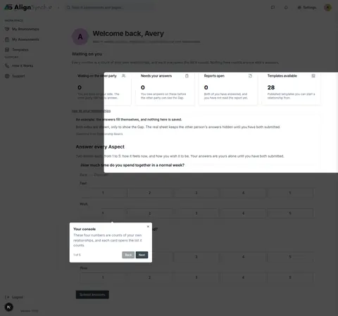                                     | ✓                                                                                                                                                                                         |
| `/dashboard/relationships`      | 200 / 200 | 390 · 768 · 1440 | 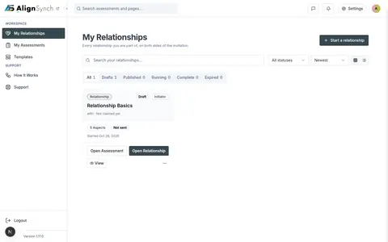         | ✓                                                                                                                                                                                         |
| `/dashboard/relationships/[id]` | 200 / 200 | 390 · 768 · 1440 | ![/dashboard/relationships/[id]](thumbs/dashboard-relationships-id.webp) | ✓                                                                                                                                                                                         |
| `/dashboard/support`            | 200 / 200 | 390 · 768 · 1440 | 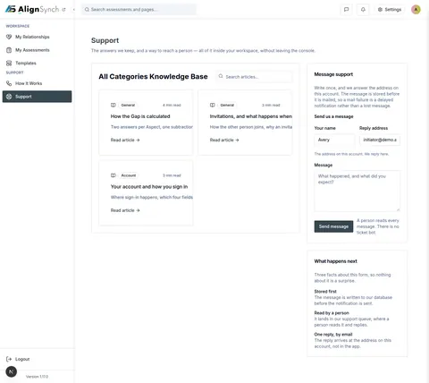                     | ✓                                                                                                                                                                                         |
| `/dashboard/templates`          | 200 / 200 | 390 · 768 · 1440 | 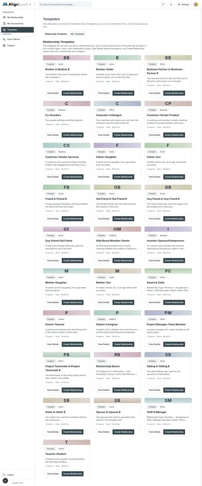                 | ✓                                                                                                                                                                                         |
| `/dashboard/templates/[id]`     | — (200)   |                  | —                                                                        | skipped — the seeded demo dataset owns no member template (`record.owner_user_id` is null on every row), and this screen opens a template the member authored — so there is no id to open |
| `/how-it-works`                 | 200 / 200 | 390 · 768 · 1440 | 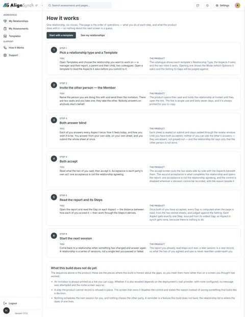                               | ✓                                                                                                                                                                                         |
| `/news`                         | 200 / 200 | 390 · 768 · 1440 | 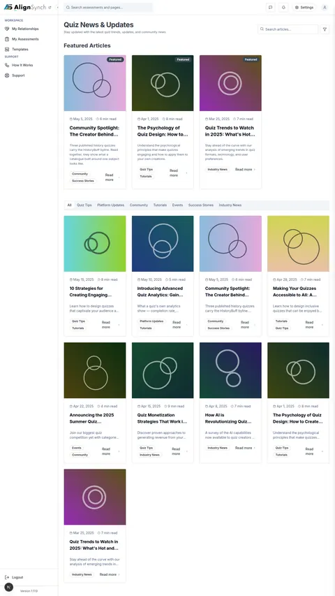                                               | ✓                                                                                                                                                                                         |
| `/news/[slug]`                  | 200 / 200 | 390 · 768 · 1440 | ![/news/[slug]](thumbs/news-slug.webp)                                   | ✓                                                                                                                                                                                         |
| `/profile/[username]`           | 200 / 200 | 390 · 768 · 1440 | ![/profile/[username]](thumbs/profile-username.webp)                     | ✓                                                                                                                                                                                         |
| `/search`                       | 200 / 200 | 390 · 768 · 1440 | 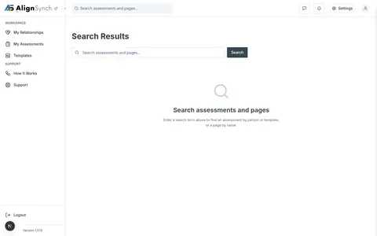                                           | ✓                                                                                                                                                                                         |
| `/settings`                     | 200 / 200 | 390 · 768 · 1440 | 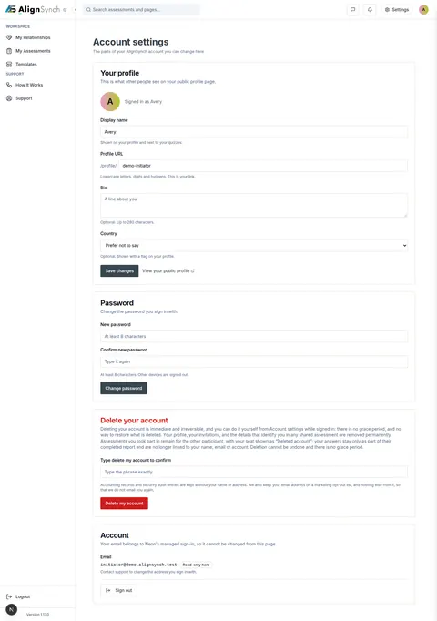                                       | ✓                                                                                                                                                                                         |
| `/support`                      | 200 / 200 | 390 · 768 · 1440 | 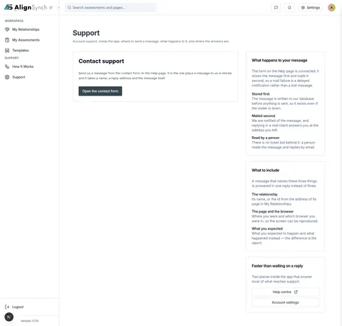                                         | ✓                                                                                                                                                                                         |

## Assessments

The two-party flow — the template catalogue, the five stages, the sessions.

| route                                           | status    | widths           | thumbnail                                                                                                | verdict                                                                                                                                            |
| ----------------------------------------------- | --------- | ---------------- | -------------------------------------------------------------------------------------------------------- | -------------------------------------------------------------------------------------------------------------------------------------------------- |
| `/assessment`                                   | 200 / 200 | 390 · 768 · 1440 | 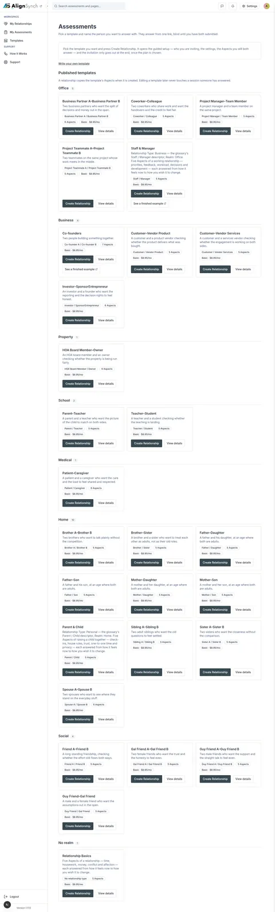                                                                   | ✓                                                                                                                                                  |
| `/assessment/instances/[instanceId]`            | 200 / 200 | 390 · 768 · 1440 | ![/assessment/instances/[instanceId]](thumbs/assessment-instances-instanceid.webp)                       | ✓                                                                                                                                                  |
| `/assessment/instances/[instanceId]/accept`     | 200 / 200 | 390 · 768 · 1440 | ![/assessment/instances/[instanceId]/accept](thumbs/assessment-instances-instanceid-accept.webp)         | ✓                                                                                                                                                  |
| `/assessment/instances/[instanceId]/answer`     | 200 / 200 | 390 · 768 · 1440 | ![/assessment/instances/[instanceId]/answer](thumbs/assessment-instances-instanceid-answer.webp)         | ✓                                                                                                                                                  |
| `/assessment/instances/[instanceId]/report`     | 200 / 200 | 390 · 768 · 1440 | ![/assessment/instances/[instanceId]/report](thumbs/assessment-instances-instanceid-report.webp)         | ✓                                                                                                                                                  |
| `/assessment/instances/[instanceId]/sent`       | 500 / 200 | 390 · 768 · 1440 | ![/assessment/instances/[instanceId]/sent](thumbs/assessment-instances-instanceid-sent.webp)             | ✗ 12 assertion(s)                                                                                                                                  |
| `/assessments`                                  | 200 / 200 | 390 · 768 · 1440 | 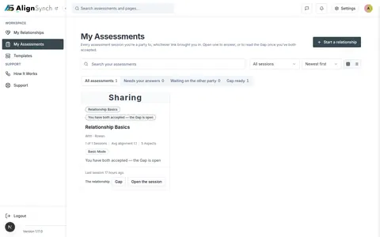                                                                 | ✓                                                                                                                                                  |
| `/invite/[token]`                               | — (200)   |                  | —                                                                                                        | skipped — the demo branch holds no claimable invite token — `session_invite` stores `token_hash`, and the seeded dataset carries no pending invite |
| `/templates/relationship`                       | 200 / 200 | 390 · 768 · 1440 | 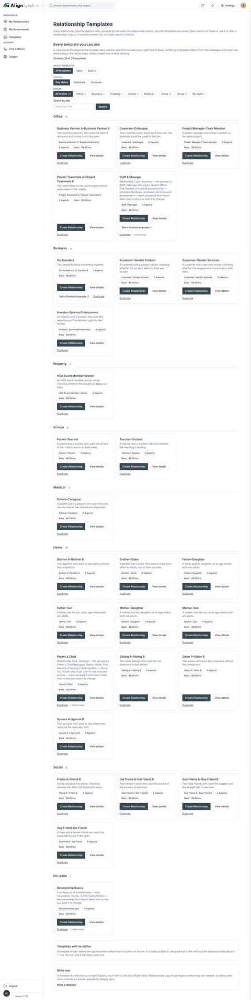                                           | ✓                                                                                                                                                  |
| `/templates/relationship/[slug]`                | 200 / 200 | 390 · 768 · 1440 | ![/templates/relationship/[slug]](thumbs/templates-relationship-slug.webp)                               | ✓                                                                                                                                                  |
| `/templates/relationship/[slug]/create`         | 200 / 200 | 390 · 768 · 1440 | ![/templates/relationship/[slug]/create](thumbs/templates-relationship-slug-create.webp)                 | ✓                                                                                                                                                  |
| `/templates/relationship/[slug]/create/aspects` | 200 / 200 | 390 · 768 · 1440 | ![/templates/relationship/[slug]/create/aspects](thumbs/templates-relationship-slug-create-aspects.webp) | ✓ → `/templates/relationship/relationship-basics/create`                                                                                           |
| `/templates/relationship/[slug]/create/commit`  | 200 / 200 | 390 · 768 · 1440 | ![/templates/relationship/[slug]/create/commit](thumbs/templates-relationship-slug-create-commit.webp)   | ✓ → `/templates/relationship/relationship-basics/create`                                                                                           |
| `/templates/relationship/[slug]/create/invite`  | 200 / 200 | 390 · 768 · 1440 | ![/templates/relationship/[slug]/create/invite](thumbs/templates-relationship-slug-create-invite.webp)   | ✓ → `/templates/relationship/relationship-basics/create`                                                                                           |
| `/templates/relationship/[slug]/create/mode`    | 200 / 200 | 390 · 768 · 1440 | ![/templates/relationship/[slug]/create/mode](thumbs/templates-relationship-slug-create-mode.webp)       | ✓ → `/templates/relationship/relationship-basics/create`                                                                                           |
| `/templates/relationship/new`                   | 200 / 200 | 390 · 768 · 1440 | 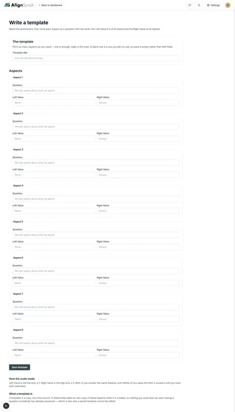                                   | ✓                                                                                                                                                  |

## Admin

The operator console.

| route                          | status    | widths           | thumbnail                                                              | verdict          |
| ------------------------------ | --------- | ---------------- | ---------------------------------------------------------------------- | ---------------- |
| `/admin/audit`                 | 200 / 200 | 390 · 768 · 1440 | 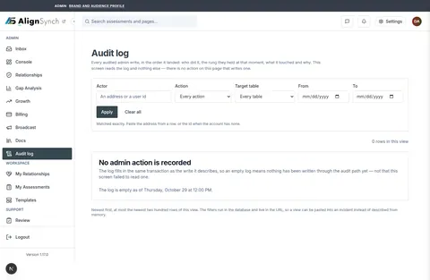                               | ✓                |
| `/admin/billing`               | 200 / 200 | 390 · 768 · 1440 | 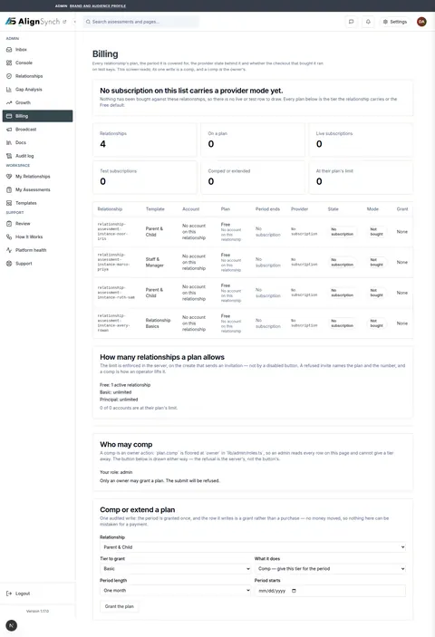                           | ✓                |
| `/admin/brand`                 | 200 / 200 | 390 · 768 · 1440 | 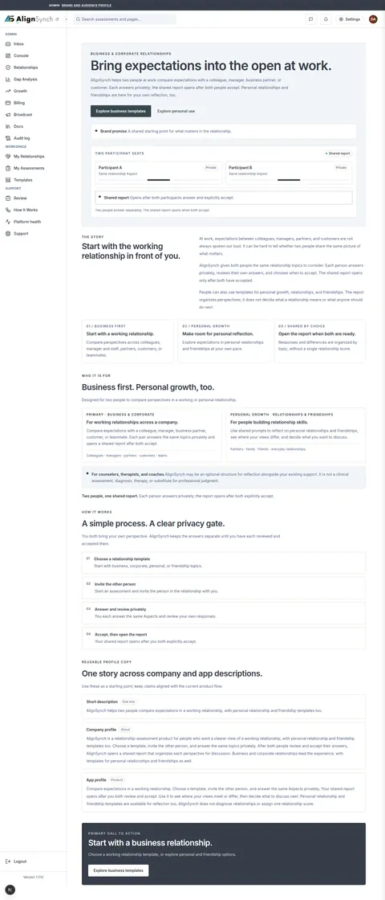                               | ✓                |
| `/admin/broadcast`             | 200 / 200 | 390 · 768 · 1440 | 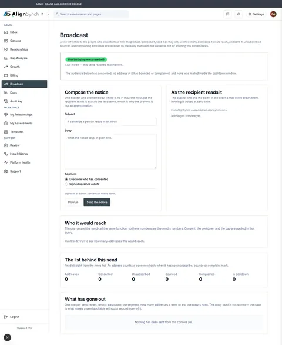                       | ✓                |
| `/admin/docs`                  | 200 / 200 | 390 · 768 · 1440 | 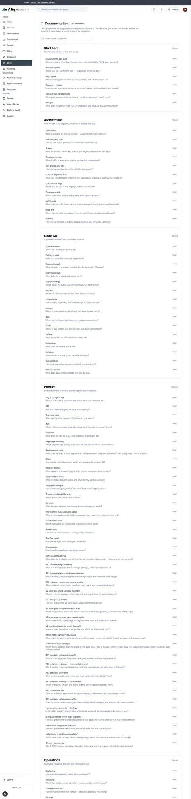                                 | ✓                |
| `/admin/docs/[...slug]`        | 200 / 200 | 390 · 768 · 1440 | ![/admin/docs/[...slug]](thumbs/admin-docs-slug.webp)                  | ✓                |
| `/admin/gaps`                  | 200 / 200 | 390 · 768 · 1440 | 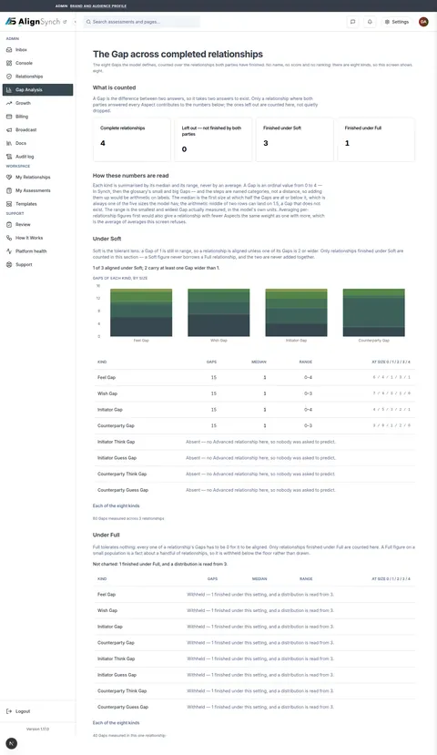                                 | ✓                |
| `/admin/growth`                | 200 / 200 | 390 · 768 · 1440 | 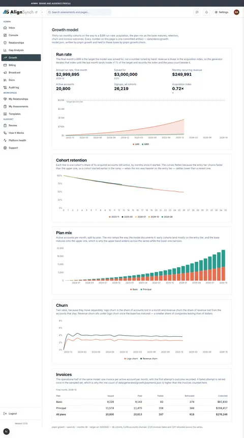                             | ✓                |
| `/admin/health`                | 200 / 200 | 390 · 768 · 1440 | 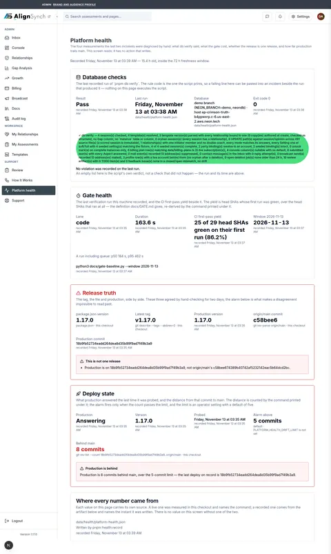                             | ✓                |
| `/admin/inbox`                 | 200 / 200 | 390 · 768 · 1440 | 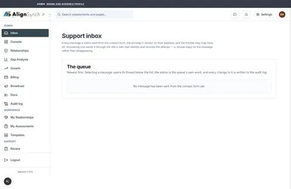                               | ✓                |
| `/admin/instances`             | 200 / 200 | 390 · 768 · 1440 | 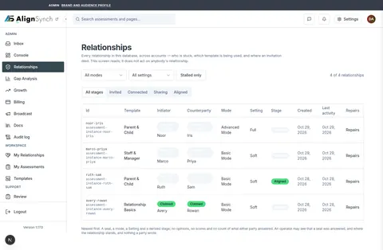                       | ✓                |
| `/admin/instances/[id]`        | 200 / 200 | 390 · 768 · 1440 | ![/admin/instances/[id]](thumbs/admin-instances-id.webp)               | ✗ 3 assertion(s) |
| `/admin/instances/[id]/report` | 200 / 200 | 390 · 768 · 1440 | ![/admin/instances/[id]/report](thumbs/admin-instances-id-report.webp) | ✓                |
| `/admin/review`                | 200 / 200 | 390 · 768 · 1440 | 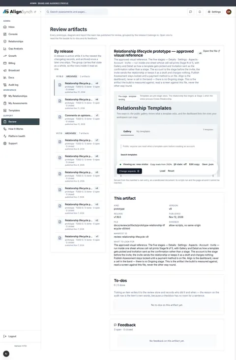                             | ✓                |
| `/admin/templates`             | 200 / 200 | 390 · 768 · 1440 | 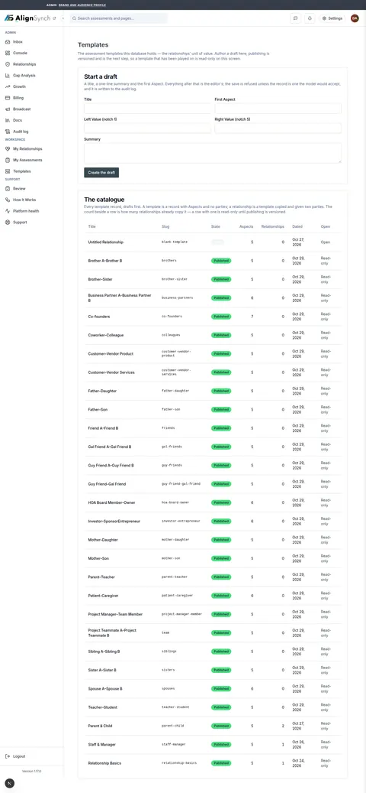                       | ✓                |
| `/admin/templates/[id]`        | 200 / 200 | 390 · 768 · 1440 | ![/admin/templates/[id]](thumbs/admin-templates-id.webp)               | ✓                |

## Quiz

The quiz product's routes. On this build they are behind `product.quiz-surfaces`.

| route                  | status    | widths           | thumbnail                                              | verdict |
| ---------------------- | --------- | ---------------- | ------------------------------------------------------ | ------- |
| `/affiliate`           | 404 / 404 | 390 · 768 · 1440 |                    | ✓       |
| `/battle`              | 404 / 404 | 390 · 768 · 1440 | 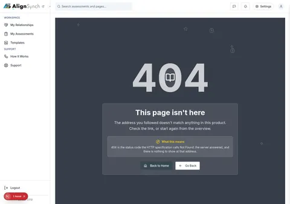                         | ✓       |
| `/categories`          | 404 / 404 | 390 · 768 · 1440 |                  | ✓       |
| `/categories/[slug]`   | 404 / 404 | 390 · 768 · 1440 | ![/categories/[slug]](thumbs/categories-slug.webp)     | ✓       |
| `/creator-tips`        | 404 / 404 | 390 · 768 · 1440 |              | ✓       |
| `/creator-tips/[slug]` | 404 / 404 | 390 · 768 · 1440 | ![/creator-tips/[slug]](thumbs/creator-tips-slug.webp) | ✓       |
| `/daily-challenge`     | 404 / 404 | 390 · 768 · 1440 |        | ✓       |
| `/dashboard/user`      | 404 / 404 | 390 · 768 · 1440 | 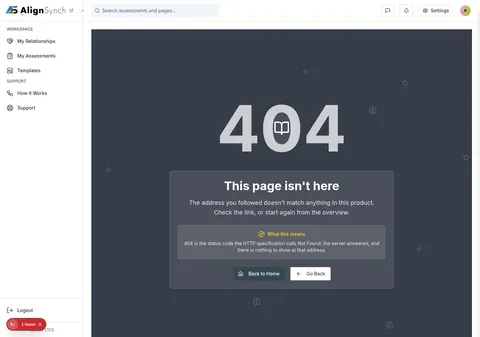         | ✓       |
| `/explore`             | 404 / 404 | 390 · 768 · 1440 |                        | ✓       |
| `/explore/featured`    | 404 / 404 | 390 · 768 · 1440 |      | ✓       |
| `/tournaments`         | 404 / 404 | 390 · 768 · 1440 |                | ✓       |
| `/tournaments/[id]`    | 404 / 404 | 390 · 768 · 1440 | ![/tournaments/[id]](thumbs/tournaments-id.webp)       | ✓       |

## Surface

The three declared non-route copy surfaces: the shell, the tour and the 404.

| route       | status | widths | thumbnail | verdict                               |
| ----------- | ------ | ------ | --------- | ------------------------------------- |
| `not-found` | —      | —      | —         | covered — mounted by every page above |
| `shell`     | —      | —      | —         | covered — mounted by every page above |
| `tour`      | —      | —      | —         | covered — mounted by every page above |

## How this was produced

`pnpm qa:atlas` (`scripts/qa-atlas.mjs`) drove headless Chrome over the DevTools protocol — the same client `pnpm demo:flow` uses (`scripts/cdp.mjs`), no Playwright and no Puppeteer — against `http://127.0.0.1:3411` on the seeded demo branch. Routes come from `data/pages/budget.ts`; the boundary and the expected status come from `tests/parity/boundary.ts` and each page's own gate call; the headline comes from the route's copy fixture; the deep-route ids come from the branch's own rows. Nothing in this document is authored by hand, and `pnpm qa:atlas:check` fails the gate if the registry and `manifest.json` disagree.

Full-size PNGs (207 files, 54039728 bytes before compression) are not committed and are not attached to this version's GitHub Release, whose assets are immutable: `qa-atlas-v1.17.0-full-size.zip` is the archive the capture wrote, sha256 `d425894fb4c4baeedf5627b2737a6210eb2b59dd648094a8b1b676768d228664`. `pnpm qa:atlas` regenerates it byte for byte from the same fixtures at the commit the release was cut from.

<!-- docs-nav:begin -->

[Docs hub](../../README.md) › **Records & QA** › QA atlas — v1.17.0 · prev [QA atlas](../README.md) · next [QA atlas — the 1.17.1 tree (never released)](../v1.17.1/index.md)

<!-- docs-nav:end -->
