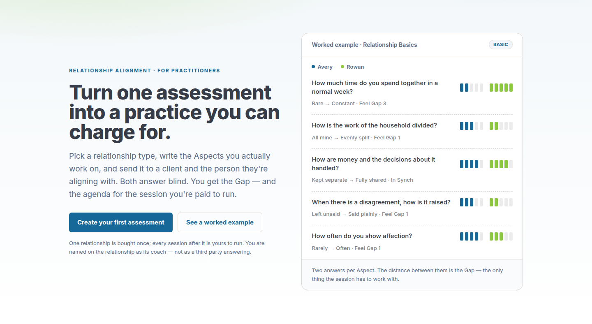
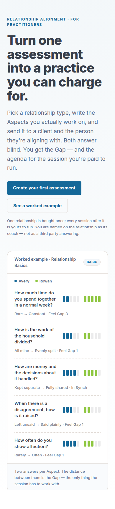
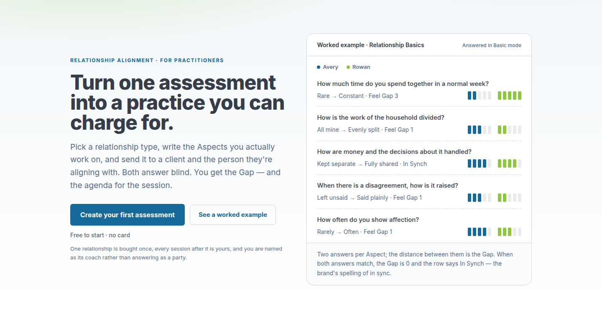
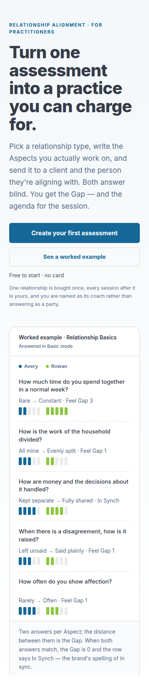

# Home hero polish — the six defects, before and after

<!-- docs-nav:begin -->

[Docs hub](../README.md) › **Records & QA** › Home hero polish · prev [Help two-column](../qa-help-two-column/README.md) · next [IA v2 — four operator groups](../qa-ia/README.md)

<!-- docs-nav:end -->

The AlignSynch `/` hero was reviewed from its own acceptance screenshot (home v2, #463). The review
called it "a solid, credible B2B hero … good and specific, but not yet fully hero-polished" and named
six defects. This folder is the evidence for the six, not a redesign: both columns below are the same
two sections of the page.

| 1440                                  | 390                                 |
| ------------------------------------- | ----------------------------------- |
|  |  |
| **after**                             | **after**                           |
|    |    |

Captured from a production build (`BRAND=alignsynch pnpm build && pnpm start`), headless Chrome over
CDP, at `1440×N` and `390×N`, clipped to `section.home-hero-ground`. The "before" pair is the tree at
`dced6044` (the branch point); the "after" pair is this branch.

## The six

1. **`In Synch`.** Kept — it is the brand's spelling (`AlignSynch`) and the glossary's word — and
   _defined on the card_: the closing line now reads "…the row says In Synch — the brand's spelling of
   in sync." The definition is fixture copy, and `tests/alignment-home.test.ts` fails if it goes.
2. **The `BASIC` pill is gone.** The card header carries "Answered in Basic mode" as a caption, which
   says what it qualifies. Same record field (`instance.mode`), no badge to mistake for a plan tier.
3. **Row microcopy, measured.** Chrome reports the note's computed colour and its composited ground,
   and the ratio is WCAG 2.1:

   |        | font size | ink                                      | ground    | ratio                 |
   | ------ | --------- | ---------------------------------------- | --------- | --------------------- |
   | before | 13px      | `rgba(54,61,73,0.65)`                    | `#ffffff` | **3.92:1** (fails AA) |
   | after  | 14px      | `rgb(89,108,136)` (`--muted-foreground`) | `#ffffff` | **5.35:1**            |

   Also measured on the after build: the risk-reducer under the CTA is 5.97:1 at 14px, and the
   footnote 5.35:1 at 13px.
4. **The footnote is one sentence**, pasted from the served HTML at 1440:

   > One relationship is bought once, every session after it is yours, and you are named as its coach
   > rather than answering as a party.

   The subtitle lost "paid to run" in the same pass, so the heading's business word ("charge for")
   appears once on the page instead of three times.
5. **Row rhythm, measured.** Each row is now the question on its own line and the note on the line
   under it, so the question gets the card's full width:

   |        | 1440 row heights         | 390 row heights             |
   | ------ | ------------------------ | --------------------------- |
   | before | 103 / 83 / 103 / 83 / 82 | 124 / 124 / 124 / 124 / 102 |
   | after  | 82 / 82 / 82 / 82 / 81   | 130 / 130 / 130 / 130 / 129 |

   (The last row is 1px shorter because `last:border-b-0` removes its rule.) All five prompts fit on
   one line at 1440; below `sm` the question carries a `2lh` floor, because the card is 342px wide
   there and four of the five prompts wrap.
6. **The CTA.** The `action` token at 16px / `px-6 py-3.5`, a resting shadow and a visible focus ring;
   full width below `sm`; and "Free to start · no card" under the pair — the promise `/pricing`'s FAQ
   already makes ("no card and no subscription"), not a new one.

## What was not done

The optional item — three rows plus an emphasised Gap callout — was **not** attempted. Trimming five
fixture Aspects to three needs a rule for which three, and an emphasis block is a new pattern rather
than a spacing change, which is the line the card draws.

## Related

- [UI-MAPPING.md](../UI-MAPPING.md) — the surface map the hero is a variation of.
- [ui-registry.md](../ui-registry.md) — the home surface and its status.

<!-- docs-nav:begin -->

[Docs hub](../README.md) › **Records & QA** › Home hero polish · prev [Help two-column](../qa-help-two-column/README.md) · next [IA v2 — four operator groups](../qa-ia/README.md)

<!-- docs-nav:end -->
