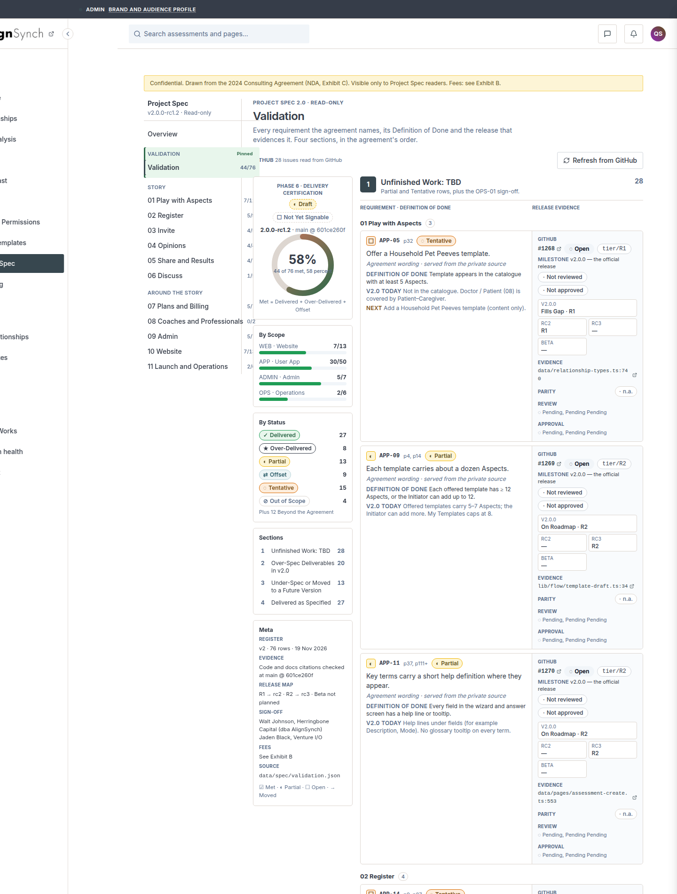
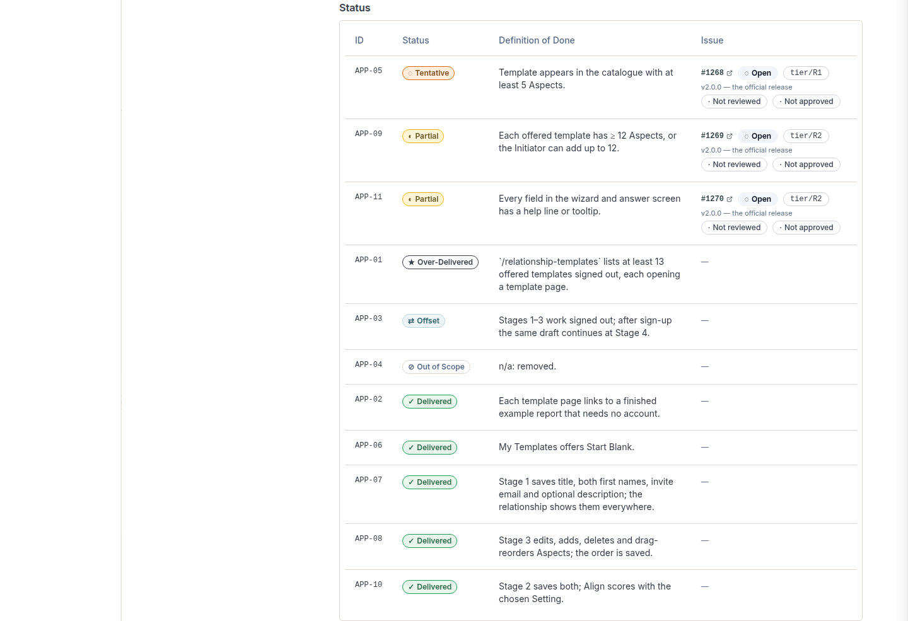
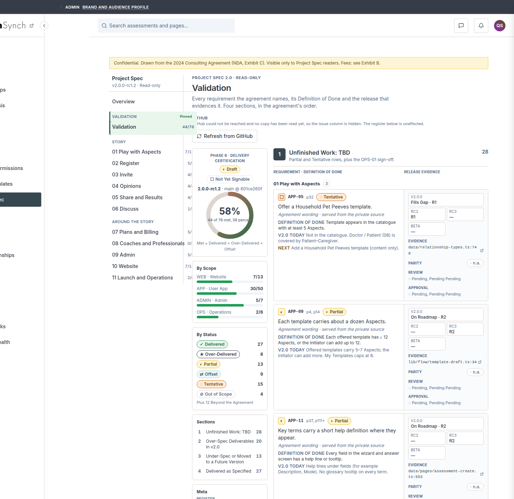

# The spec register's GitHub column, as it renders

<!-- docs-nav:begin -->

[Docs hub](../../README.md) › **Records & QA** › The spec register's GitHub column · prev [Stage 5, both states](../stage5/README.md) · next [swiper 12](../swiper-12/README.md)

<!-- docs-nav:end -->

Two stills of `/admin/spec/validation` and one of `/admin/spec/01-play-with-aspects`, taken at 1440 px
from the branch that adds the GitHub pull (#1296), plus the run with a deliberately broken token that
proves the register still renders when GitHub does not answer.

The question this page answers: **does a reader see the issue for a filed row — number, state,
milestone, tier and both reviewer pills — and an em dash for a row nobody filed, on the pages that
carry the register?**

## What was captured

| Still                          | Screen                                 | What it shows                                                                                                                     |
| ------------------------------ | -------------------------------------- | --------------------------------------------------------------------------------------------------------------------------------- |
| `validation-filed-1440.png`    | `/admin/spec/validation`               | The bar's count (`28 issues read from GitHub`), the **Refresh from GitHub** control, and section 1's rows with their issue blocks |
| `story-status-1440.png`        | `/admin/spec/01-play-with-aspects`     | The Status band with its Issue column: three filed rows and eight em dashes for the rows nobody filed                             |
| `validation-degraded-1440.png` | `/admin/spec/validation`, broken token | The honest degradation: no issue column, the notice, and the register drawn exactly as before                                     |

### Filed rows, in the matrix



### Filed and unfiled rows, on a story page



### GitHub unreachable, with a broken token



## The asserts, read before each shutter

Every still was taken after asserting these in the live DOM. A blank frame and a wrong page are both
excluded by them; the numbers are the measurements, not a claim.

| Assert                  | Filed run                                                          | Degraded run                                                   |
| ----------------------- | ------------------------------------------------------------------ | -------------------------------------------------------------- |
| `h1`                    | `Validation` / `Play with Aspects`                                 | `Validation`                                                   |
| `innerWidth`            | 1440                                                               | 1440                                                           |
| `scrollWidth`           | 1440 — no horizontal overflow                                      | 1440                                                           |
| register rows           | 88                                                                 | 88                                                             |
| issue blocks            | 28 filed, 60 em dashes                                             | 0                                                              |
| reviewer pills          | 56 (two per filed row)                                             | 0                                                              |
| bar count               | `28 issues read from GitHub`                                       | absent — no claim about GitHub                                 |
| degradation notice      | absent                                                             | `GitHub could not be reached and no copy has been read yet, …` |
| refresh control         | `/api/admin/spec-issues/refresh?next=%2Fadmin%2Fspec%2Fvalidation` | the same address                                               |
| env leak in `innerText` | none (`DATABASE_URL`, `postgres://`, `npg_`, `sk_test`, `ghp_`)    | none                                                           |

## How the stills were taken

Port `4317`, loopback, from the branch's worktree, env sourced from the main checkout:

```bash
withenv.sh <main-checkout> bash -c \
  'cd <worktree> && export ADMIN_EMAILS="qa-spec-issues@alignsynch.test" && \
   exec node24.sh pnpm dev --port 4317 --hostname 127.0.0.1'
```

The browser's own sign-in is refused by the branch's trusted-domain list, so the session was created
in Node (`POST /api/auth/sign-up/email`, then `POST /api/auth/sign-in/email` — the allowlisted address
is promoted by the sign-up) and the `__Secure-neon-auth.session_token` cookie was handed to headless
Chrome over the DevTools protocol. The account is a throwaway on the demo branch and was removed after
the capture.

**The degraded run needs an empty cache.** `unstable_cache` serves a stale entry while it revalidates,
so a restarted server with a warm `.next/cache` keeps answering the last good copy for one request —
which is the behaviour the card asks for, and it hides the degradation the run is meant to show. The
still was taken with `.next/cache` moved aside, so the first read was a miss that failed.

`capture-report.json` carries the raw measurements each frame was taken under.

<!-- docs-nav:begin -->

[Docs hub](../../README.md) › **Records & QA** › The spec register's GitHub column · prev [Stage 5, both states](../stage5/README.md) · next [swiper 12](../swiper-12/README.md)

<!-- docs-nav:end -->
