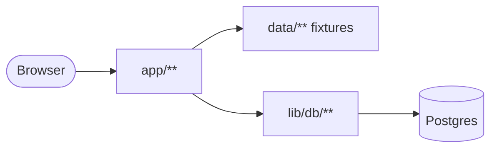

# quizhub — the code wiki

A Next.js 16 App Router application that ships **two products from one tree**: QuizHub and
AlignSynch. `BRAND` picks which one a build serves; the code, the fixtures and the database schema
are shared.

The app is **content-first**. Every product route is a projection of the TypeScript fixtures in
[`data/`](../../data), validated against the zod schemas in [`content/`](../../content). One route —
`/assessment/[slug]` — reads six Postgres tables instead, and that is deliberate: the fixtures are
the authored source, the database is their mirror, and the gate never needs a connection string.

This directory is reference documentation (what the code is and how a request becomes a page). The
rules a change must obey are in [`AGENTS.md`](../../AGENTS.md); the gate's numbers are in
[`docs/GATE.md`](../GATE.md).

## Key concepts

- **Record** — the one root content type. A quiz and an assessment are both records
  ([`content/record.ts`](../../content/record.ts)); `quiz.ts` and `assessment.ts` import it and never
  each other.
- **Template vs instance** — a template holds items and has no parties; an instance is a copy that
  names `templateId`, `mode`, `setting` and two parties. `strict()` makes the difference structural,
  not a rule to remember.
- **The Gap** — a pure function of two scores ([`content/record.ts::gapOf`](../../content/record.ts)),
  never a column, table or stored verdict.
- **Relationship** — the member-side object that owns a session, its parties, an invitation and a
  payment obligation ([`lib/member/relationships.ts`](../../lib/member/relationships.ts)).
- **Brand boundary** — the quiz surfaces answer `404` on a build that does not sell them
  ([`lib/brand-boundary.ts`](../../lib/brand-boundary.ts)).
- **The gate** — `bash scripts/verify.sh`, one script, two callers (local and CI).

## Entry points

- [`app/layout.tsx`](../../app/layout.tsx) — the root layout.
- `app/(mainlayout)/layout.tsx` — the product shell.
- `app/(marketing)/layout.tsx` — the public chrome.
- `app/api/auth/[...path]/route.ts` — the Managed Auth proxy (one catch-all handler, not a page).
- [`lib/db/client.ts`](../../lib/db/client.ts) — the only `pg` pool.
- [`scripts/data-check.ts`](../../scripts/data-check.ts) — the fixture validator.

## High-level architecture

The browser hits an App Router group, the group's layout mounts chrome, the page resolves a session
and then reads **either** a fixture module **or** `lib/db/**`. Writes do not happen in a page: they
go through a server action or a route handler into `lib/member`, `lib/flow`, `lib/admin` or
`lib/billing`. Full diagram and the data-flow rules: [architecture.md](architecture.md).

## Module map

| Module                                          | Purpose                                                                                           |
| ----------------------------------------------- | ------------------------------------------------------------------------------------------------- |
| [`app/(mainlayout)`](modules/app-mainlayout.md) | The product shell and every signed-in surface, from the dashboard to the operator console.        |
| [`app/(marketing)`](modules/app-marketing.md)   | The public surfaces behind a header and footer, never the shell.                                  |
| [`app/api`](modules/app-api.md)                 | The thirteen route handlers that are not pages: auth proxy, billing, webhooks, the cron endpoint. |
| [`components`](modules/components.md)           | One directory per feature; `ui/` is the shadcn primitives.                                        |
| [`content`](modules/content.md)                 | The zod content model — pure, no React, no `next`.                                                |
| [`data`](modules/data.md)                       | The fixtures that must satisfy `content/`, checked on every gate run.                             |
| [`lib/db`](modules/lib-db.md)                   | The `pg` pool, row→model mappers and the reads `/assessment/[slug]` makes.                        |
| [`lib/flow`](modules/lib-flow.md)               | The two-party session: create, claim, submit, accept, screen.                                     |
| [`lib/member`](modules/lib-member.md)           | The initiator's side: relationships, aspects, publish, payment, notices.                          |
| [`lib/admin`](modules/lib-admin.md)             | The operator's side: `act()`, the role ladder, the audit log, repair and broadcast.               |

## Diagrams

- [Class diagram](diagrams/class-diagram.md) — `record`, `assessment`, `quiz` and the row mappers.
- [Sequence diagrams](diagrams/sequences.md) — create and invite; submit and seal; the payment job
  ladder on its cron.

The flow charts — one picture per cross-cutting rule, so a doc can point at a shape instead of
describing one — live in [`docs/diagrams/`](../diagrams):

- [lifecycle](../diagrams/lifecycle.md) — relationship, session and invitation states, and the
  branches that end each.
- [payment](../diagrams/payment.md) — the money ladder, and the one billing trigger left after
  ADR-1.
- [brand-boundary](../diagrams/brand-boundary.md) — which routes one build sells, and where
  `requireQuizProduct()` / `requireAdminProduct()` sit.
- [data](../diagrams/data.md) — `content/` → `data/` → the six Postgres tables.
- [gate](../diagrams/gate.md) — the four lanes of `scripts/verify.sh`.

## Getting started

Node 24, `pnpm install --frozen-lockfile`, `pnpm dev`. See [getting-started.md](getting-started.md).

## What this wiki deliberately leaves out

- No per-component inventory: 295 `.tsx` files under [`components/`](../../components) are grouped by
  feature and described as groups, not listed.
- No coverage of `lib/quizhub/` — a vendored static template drop that is gitignored, absent from a
  fresh clone, and imported by nothing.
- No database migration history: [`db/migrations/`](../../db/migrations) is 39 numbered SQL files and
  [`docs/DATA-MODEL.md`](../DATA-MODEL.md) already narrates them.
