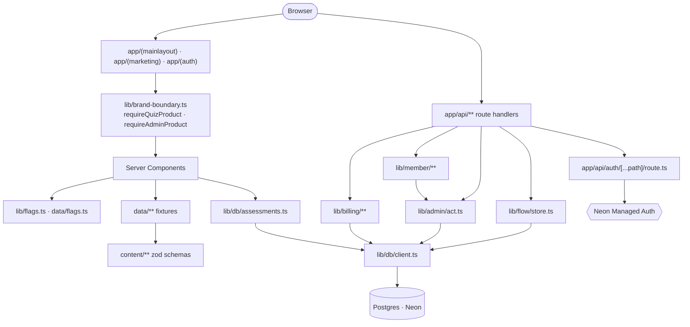
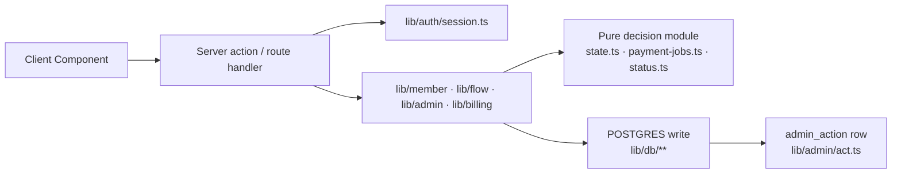

# Architecture

<!-- docs-nav:begin -->

[Docs hub](../README.md) › **Code wiki** › Request lifecycle · prev [Getting started](getting-started.md) · next [app/(mainlayout)](modules/app-mainlayout.md)

<!-- docs-nav:end -->

A request enters through the App Router, lands in one of three route groups or in `app/api`, and is
answered by a **Server Component** that reads its content from one of two places:

- the **fixtures** in [`data/`](../../data), validated against the schemas in [`content/`](../../content),
  which is what every product route does; or
- the **tables** in Postgres through [`lib/db/**`](../../lib/db), which is what exactly one route does
  (`/assessment/[slug]`).

Nothing in between: there is no ORM, no API layer of our own, and no build-time database read. The
gate runs with `DATABASE_URL` unset, so a page that needed a connection to render would fail `pnpm
build` — which is why the split is enforced by the build rather than by a convention.

Writes never happen in a page render. They go through a **server action** (member and console
surfaces) or a **route handler** (`app/api`, and the flow's HTML-form endpoints) into `lib/member`,
`lib/flow`, `lib/admin` or `lib/billing`. The auth surface is not ours at all: Neon Managed Auth is
proxied through one catch-all handler, so the browser never holds a second origin.

## System diagram

## Components

- **The route groups are the chrome boundary.** A page is either in
  [`app/(mainlayout)`](modules/app-mainlayout.md) and inherits the product shell, or in
  [`app/(marketing)`](modules/app-marketing.md) and gets a wordmark. There is no session check that
  swaps the chrome, and the sidebar is `position: fixed` on the app side. See
  `app/(mainlayout)/layout.tsx` and
  `app/(marketing)/layout.tsx`.
- **The brand boundary is a gate, not a deletion.** [`lib/brand-boundary.ts`](../../lib/brand-boundary.ts)
  exports `requireQuizProduct()` and `requireAdminProduct()`, each of which calls `notFound()` as the
  first statement of the page — ahead of `await params` and ahead of every read. The flag is
  `product.quiz-surfaces` on `quizhub` and off on `alignsynch`; `FLAG_PRODUCT_QUIZ_SURFACES=1` is the
  override. [`tests/parity/boundary.ts`](../../tests/parity/boundary.ts) lists the twenty-two routes
  that answer `404` on the alignment build.
- **The auth proxy is one file.** `app/api/auth/[...path]/route.ts` forwards every Managed Auth path
  through [`lib/auth/server.ts::authRoutes()`](../../lib/auth/server.ts), resolved per request so
  `next build` never needs `NEON_AUTH_COOKIE_SECRET`. It throttles credential paths only
  (`lib/forms/guard.ts`); session reads and sign-out are never throttled.
- **Flags are resolved on the server.** [`lib/flags.ts`](../../lib/flags.ts) reads `FLAG_<NAME>`, then
  the flag's `templates` list, then its `default` — and refuses to run in a browser, because a flag
  that hides a button is not enforcement.
- **`lib/db` is server-only by construction**: it reads `DATABASE_URL`, which is in no
  `next.config.mjs` `env` block, and `data:check` **E34** fails a `"use client"` module whose runtime
  imports reach it.

## Data flow

1. **Request** — the App Router matches a page; a gated page calls `requireQuizProduct()` before
   anything else ([`lib/brand-boundary.ts`](../../lib/brand-boundary.ts)).
2. **Session** — pages that need a person call `currentUser()` or `currentUserIfConfigured()`
   ([`lib/auth/session.ts`](../../lib/auth/session.ts)). The reader avoids the render-time cookie
   write Next 16 refuses.
3. **Read** — a server component projects a fixture module into a view model (e.g.
   [`data/quizzes.ts`](../../data/quizzes.ts) through `selectQuizCard`), or calls `lib/db/**`.
4. **Write** — a server action or route handler resolves the actor server-side and calls a library
   function; `lib/admin/act.ts` wraps the transaction for anything an operator does.
5. **Render** — the client component receives plain props. Zod objects never cross to the client, and
   `import type` is the only legal value-free crossing.

## Key design decisions

- **The fixtures are the source, the database is a mirror.** `pnpm db:seed` reads
  [`data/assessments.ts`](../../data/assessments.ts); `pnpm db:verify` proves the rows still say what
  the fixture says. Nothing derives from the database back into the fixtures.
- **Two brands, one build.** `BRAND` selects `data/brand.ts`; CI runs the matrix over both legs, and
  `pnpm parity` hashes seven routes under each.
- **Pure decisions, transactional writes.** `lib/flow/state.ts` decides a status, `lib/flow/store.ts`
  writes it; `lib/flow/payment-jobs.ts` decides what is due, `lib/member/payment-job-run.ts` carries
  it out. Every decision module is testable with literals and no database.
- **A clock is never read in a render path.** `content/core.ts` owns `DEMO_NOW_ISO`; `data/` carries
  instants only ([`content/core.ts`](../../content/core.ts)).

<!-- docs-nav:begin -->

[Docs hub](../README.md) › **Code wiki** › Request lifecycle · prev [Getting started](getting-started.md) · next [app/(mainlayout)](modules/app-mainlayout.md)

<!-- docs-nav:end -->
