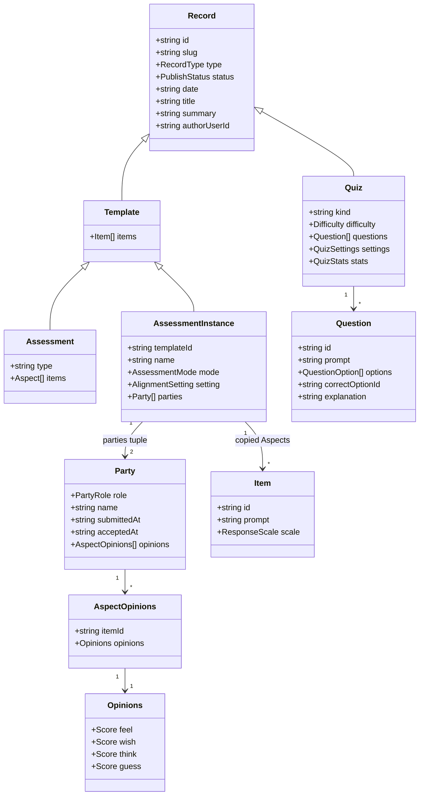
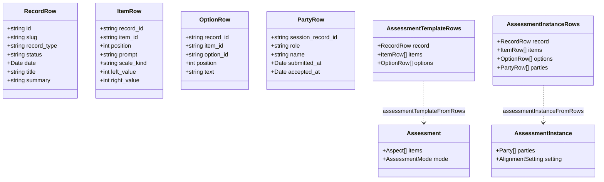

# Class diagram — the content model

<!-- docs-nav:begin -->

[Docs hub](../../README.md) › **Code wiki** › Class diagram · prev [Request lifecycle](../architecture.md) · next [Sequence walks](sequences.md)

<!-- docs-nav:end -->

Two families share one root. A **quiz** and an **assessment template** are both `Record`s; only the
assessment family has instances and parties. Everything below is a zod object in
[`content/`](../../../content), which means every class here is a runtime validator as well as a type.

## The model

`Item` carries no `position`: ordering is a **row** fact (`item.position`, read through
`orderedItems()` in [`lib/db/rows.ts`](../../../lib/db/rows.ts)), not part of the model. That is
deliberate — the fixture array's order is the author's, and the schema should not be able to disagree
with it.

## The two scales

A response is an option id **or** a score in `1..5`, and `isResponseOn(scale, response)` is the single
place the pair is compared. Assessments always use the score band (`SCORE_MIN`..`SCORE_MAX`, literals —
an assessment cannot be widened to 1..7); quiz questions carry named options instead.

## Row mappers

The database mirrors this model; the mappers are what prove the mirror still matches.

Both mappers end in `parseOrThrow(zAssessment | zAssessmentInstance, candidate, context)`. A row that
no longer satisfies the model is a thrown error naming the record's slug, not a half-rendered page —
which is what makes `pnpm db:verify` able to report drift as a _named_ failure.

| Mapper                          | Input                              | Output                              |
| ------------------------------- | ---------------------------------- | ----------------------------------- |
| `templateCandidateOf`           | `AssessmentTemplateRows`           | the plain object, before refinement |
| `assessmentTemplateFromRows`    | `AssessmentTemplateRows`           | `zAssessment`                       |
| `assessmentTemplateFromPayload` | a `template_version` JSONB payload | `zAssessment`                       |
| `assessmentInstanceFromRows`    | `AssessmentInstanceRows`           | `zAssessmentInstance`               |
| `itemCandidates`                | `ItemRow[]` + `OptionRow[]`        | `Item[]` in `position` order        |
| `orderedItems`                  | any `{ position }[]`               | the same rows, ordered              |

## Notes the diagram cannot express

- **Template vs instance is structural.** `zTemplate` has no `parties` key and `.strict()` rejects one,
  so "a template has no parties" is not a rule anyone has to remember.
- **`submittedAt` and `acceptedAt` are instants, never statuses.** Whether a seat answered is derived
  from its opinion rows; whether it accepted is derived from `acceptedAt`. Both mappers drop a `NULL`
  rather than writing `null`, so a parsed row is deep-equal to a fixture that never mentions the key.
- **The Gap is not a class.** `gapOf(left, right) → 0..4` is a function over two scores
  ([`content/record.ts`](../../../content/record.ts)); a stored Gap column is a defect the migration
  guard rejects.
- **The quiz family does not appear in the database.** Only assessment records and instances are
  seeded, which is why `lib/db/rows.ts` has no quiz mapper.

<!-- docs-nav:begin -->

[Docs hub](../../README.md) › **Code wiki** › Class diagram · prev [Request lifecycle](../architecture.md) · next [Sequence walks](sequences.md)

<!-- docs-nav:end -->
