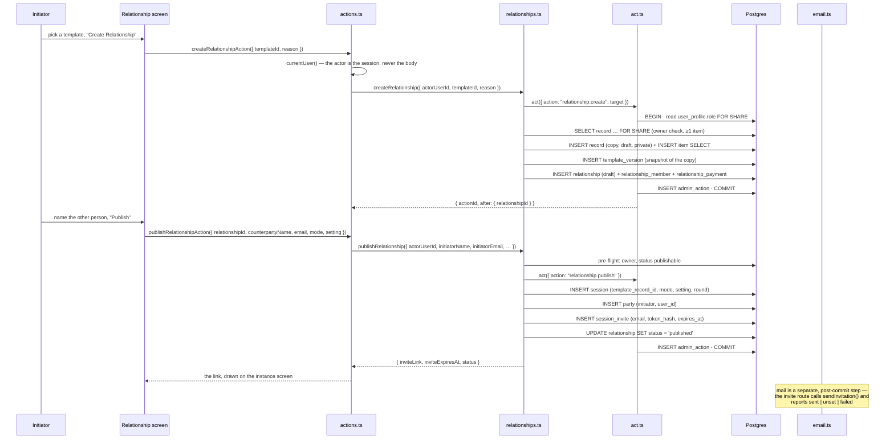
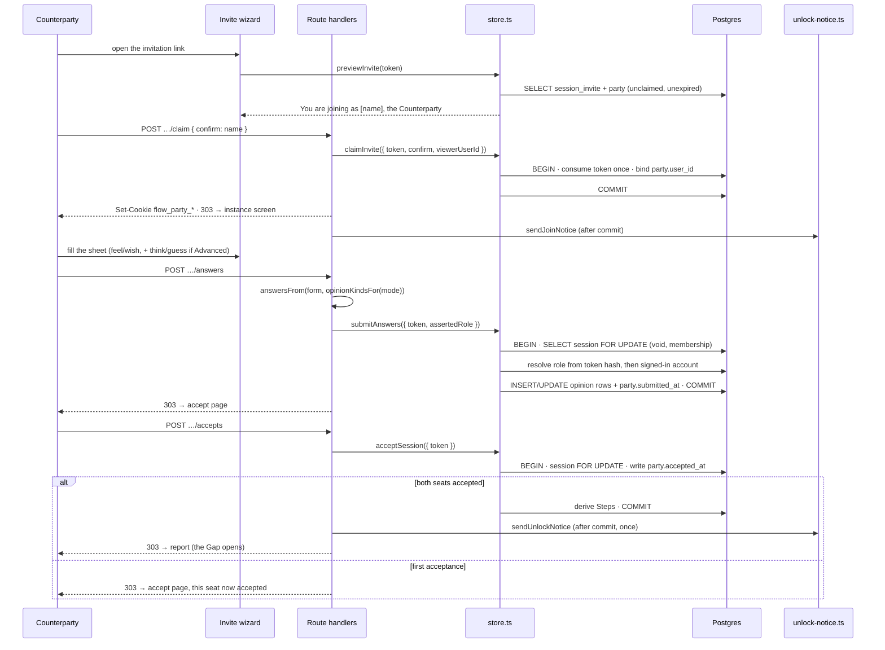
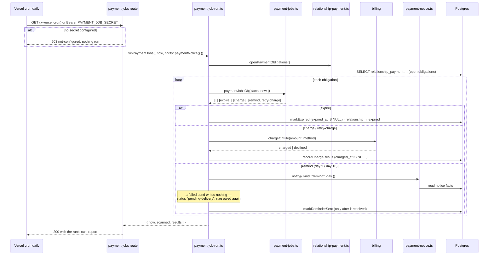

# Sequence diagrams

<!-- docs-nav:begin -->

[Docs hub](../../README.md) › **Code wiki** › Sequence walks · prev [Class diagram](class-diagram.md)

<!-- docs-nav:end -->

Three walks through the tree. Each one is traced from a real entry point, and every participant is a
file that exists. Where a path contains `[` `]` it is written as code rather than a link, because the
brackets end a markdown link.

---

## 1. Create a relationship and invite the other person

The initiator's path: pick a template you own, copy its Aspects into a relationship, publish it, and
mint exactly one invitation. The member side runs it as two server actions; the older HTML-form door
(`/assessment/new`) does the same work in one handler through `lib/flow/store.ts`.

### Walkthrough

1. **The form posts to a server action** —
   `app/(mainlayout)/dashboard/relationships/actions.ts`.
   It resolves `currentUser()` first; a signed-out call is `{ ok: false, code: "signed-out" }`.
2. **`createRelationship` copies the template** —
   [`lib/member/relationships.ts`](../../../lib/member/relationships.ts). Inside one transaction: the
   source `record` is read `FOR SHARE` with an owner check and a "has at least one Aspect" check, the
   copy is inserted as a `draft` private record with its items copied by `INSERT … SELECT`, and
   `snapshotVersion()` pins the copy as `template_version` row 1.
3. **`act()` writes the audit row** — [`lib/admin/act.ts`](../../../lib/admin/act.ts) is what enforces
   the order: role read inside the transaction, mutation, `admin_action`, commit. A member write is an
   admin action floored at `member`.
4. **Publishing mints the invitation** — `publishRelationship` writes `session`, the initiator's
   `party` row, one `session_invite` row, and moves the relationship to `published`. It **bills
   nothing**: the fee belongs to completion (`lib/member/payment.ts`).
5. **Mail is never inside the transaction** — `sendInvitation()`
   ([`lib/flow/email.ts`](../../../lib/flow/email.ts)) reports `sent | unset | failed` after the commit,
   and the screen shows the link whenever the mail did not carry it.
6. **The other door.** `POST /assessment/new` (`app/(mainlayout)/assessment/new/route.ts`) reaches the
   same shape through `createInstanceFromTemplate()`
   ([`lib/flow/store.ts`](../../../lib/flow/store.ts)) and sends the invitation inline.

---

## 2. The counterparty submits, and the sheet seals

A party's answers are frozen by **their own** acceptance, not by both parties answering. Until they
accept, their sheet is editable even though the other party has already submitted.

### Walkthrough

1. **The invitation page claims nothing on `GET`** — `app/(mainlayout)/invite/[token]/page.tsx` reads
   `previewInvite()` and renders three steps. A mail client's link preview therefore cannot spend the
   token.
2. **Claim is once, and it binds a browser** — `app/(mainlayout)/invite/[token]/claim/route.ts` →
   `claimInvite()` in [`lib/flow/store.ts`](../../../lib/flow/store.ts). The route reads the token from
   the path, the party cookies, the session and the name-confirmation; a browser that already answers
   as a party cannot claim (that was the defect where one person filled both columns).
3. **The sheet is judged against the row's mode** — `submitAnswers()` locks the `session` row first,
   then checks `voided_at`, then the membership (a lapsed membership freezes both sheets exactly as a
   void does), then parses the sheet with `parseSubmission()`
   ([`lib/flow/state.ts`](../../../lib/flow/state.ts)). A field the mode does not ask is a 409.
4. **The seal is `party.accepted_at`** — `acceptSession()` writes it under the same session lock. Once
   it is written, another submit from that party answers **409**: their sheet is the record they agreed
   to.
5. **The second acceptance completes the session** — the store derives the relationship's Steps in the
   same transaction and reports `completed: true` exactly once; the route then sends the unlock notice
   after the commit and redirects to the report.
6. **A refusal is a redirect, never a banner** — `?accept=<code>` / `?problem=<code>` carry a code, and
   the page owns the sentence from its fixture.

---

## 3. The payment job ladder, on its cron

Reminders, retries and expiry are **scheduled facts**: a session must expire whether or not anyone
opens its page. `vercel.json` runs the job daily at 09:00 UTC.

### Walkthrough

1. **The scheduler is dumb, the decision module is pure** — `paymentJobsOf()`
   ([`lib/flow/payment-jobs.ts`](../../../lib/flow/payment-jobs.ts)) takes facts and an instant and
   returns the jobs in the order they must run. `expire` is returned alone; `charge` is returned alone,
   because a taken fee ends the obligation's work.
2. **Every window is arithmetic over stored instants** — `METHOD_TRIAL_DAYS = 7`,
   `PAYMENT_REMINDER_DAYS = [3, 10]`, `CHARGE_RETRY_OFFSET_DAYS = [1, 3, 5]`, `PAYMENT_WINDOW_DAYS = 14`
   ([`lib/flow/payment.ts`](../../../lib/flow/payment.ts)). A job that was down for a week finds every
   nag and retry already due and does them now.
3. **Every write is idempotent** — `markExpired` is `expired_at IS NULL`-guarded, `recordChargeResult`
   is `charged_at IS NULL`-guarded. Two runs in one minute do the work once.
4. **Sent, then stamped** — `lib/member/payment-job-run.ts` calls the notifier first and writes
   `reminder_day3_at` / `reminder_day10_at` only because that call resolved. A mailer that refuses
   leaves the nag owed (`pending-delivery` in the response) rather than recorded as sent.
5. **The response is the trace.** The route returns `{ now, scanned, results }` — not a bare 200 — so
   the scheduler's log says what each relationship's job did.
6. **The route fails closed.** No `PAYMENT_JOB_SECRET` (or `CRON_SECRET`) means 503 and no mutation; an
   unauthenticated endpoint that expires relationships is a public button.

<!-- docs-nav:begin -->

[Docs hub](../../README.md) › **Code wiki** › Sequence walks · prev [Class diagram](class-diagram.md)

<!-- docs-nav:end -->
